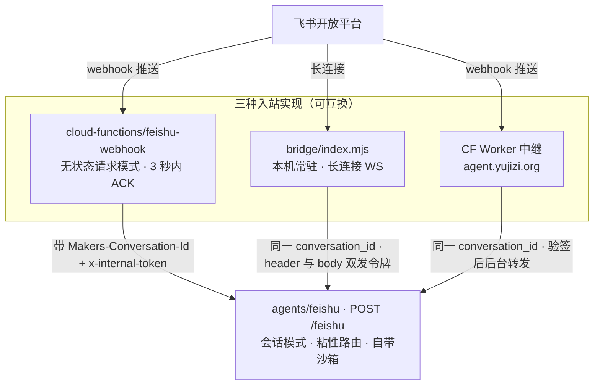

# 会话路由与三种入站实现

飞书的一个「会话」（单聊或群）在 EdgeOne 侧被表示成 `Makers-Conversation-Id` 请求头里的
一个字符串。这个字符串不是一个普通的调用参数 —— 平台拿它做三件互相绑定的事：

1. **粘性路由** —— 同一个 conversation_id 的请求路由到同一个 agent 实例；
2. **store 归属** —— `context.store.state` 是按 conversation_id 隔离的 JSON KV
   （物理键形如 `state/<conversation_id>/<key>`）；
3. **沙箱归属** —— 一个对话一个沙箱实例。

因此「同一个飞书会话永远映射到同一个 conversation_id」是整条链路的不变量，而不是
一个可以随手改的命名约定。本页讲这个 id 怎么算、为什么必须用哈希、平台怎么用它，
以及三种可以互换的入站实现如何都必须遵守同一份契约。

> 单条消息从进入 webhook 到回复飞书的完整控制流见
> [入站请求生命周期](request-lifecycle.md)；会话状态与存储分层见
> [存储模型](../concepts/storage-model.md)；外部 CF Worker 中继见
> [外部入站中继](../integrations/external-ingress-relay.md)。

## 为什么必须有一个中间层

EdgeOne 官方文档的硬约束：`agents/*` 的**所有**调用都必须带 `Makers-Conversation-Id`
请求头，缺失或不合法时 Agent 路由直接返回 `400`。

而飞书的事件推送是**飞书服务器发起的**，我们无法给它加自定义请求头。所以
`agents/feishu/index.ts` 这条路由**不可能**直接当飞书回调地址 —— 必须有一个能做转发的
中间层，而这个中间层自己也不能是 `agents/` 路由（否则它同样需要那个头，且同样收不到）。

这就是链路被拆成两段的全部原因：一段「证明请求可信 → 解析 → 转发」，一段「跑模型」。
转发不是绕远路：`agents/` 是会话模式（单次可跑很久），`cloud-functions/` 是无状态请求模式
（最长 120 秒），而模型跑一个回合动辄二三十秒还要连着调工具，只有 `agents/` 撑得住。

## conversation_id 的形状与那个会静默 400 的坑

原版（Cloudflare）用 `fs-${chatId}` 当实例名。照抄到 EdgeOne 会**全线失败**：

| | 值 | 长度 |
|---|---|---|
| 飞书 chat_id 实际形状 | `oc_` + 32 位十六进制 | **35** |
| 原版拼法 | `fs-` + 上面那串 | **38** |
| EdgeOne `Makers-Conversation-Id` 上限 | 6 ~ 36 字符，仅允许 `0-9 a-z A-Z - _ .` | **36** |

超限。这个坑阴险的地方在于**本地测试用短 chat_id 时一切正常，线上真实会话全部 400**；
而 400 是 agent 路由返回的，转发层只会看到「转发失败」，看不出是长度问题。

所以 `conversationIdFor()` 改成了哈希：

```ts
fs- + SHA-256(chatId) 的前 32 位十六进制   // 恒为 35 字符
```

这个哈希必须**确定性**：同一个 chat 永远映射到同一个 conversation_id，否则粘性路由
直接失效 —— 换个 id 就是换个实例、换个 store 命名空间、换个沙箱，「记忆和沙箱全串」。
所以不能换成随机 id 或时间戳。

同一条不变量在仓库里有若干**独立副本**（都按同一算法实现）：

| 位置 | 用途 |
|---|---|
| `cloud-functions/feishu-webhook/index.ts` 的 `conversationIdFor` | 生产转发层 |
| `bridge/index.mjs` 的 `conversationIdFor` | 长连接桥接（备选链路） |
| 外部 CF Worker `src/feishu/edgeone-relay.ts`（cf-agent-lab 仓库） | 当前生效的转发层 |
| `tools/ask-bot.mjs`、`tools/verify-memory.mjs`、`test/smoke.ts` | 验证脚本与冒烟测试 |

> ⚠️ **这是契约上的一个真实风险点**：算法被复制在多处，任何一处改动而没有同步其余各处，
> 症状是「两个会话的记忆串了」或「同一群落到不同实例」这类最难查的现象。
> `src/feishu/oauth.ts` 的 `OAuthState.chatId` 注释明确写了这个取舍：state 里**只带 chatId**，
> 由转发层自己算 conversation_id，而**不是**把算好的值塞进 state 带走 ——
> 后者等于把同一条不变量复制成两份。

### 长度与字符集的约束落在哪一层

约束是平台在 `agents/` 路由入口强制执行的，但**校验和生成都在转发层**：

- `cloud-functions/feishu-webhook/index.ts` 有 `CHAT_ID_RE = /^oc_[A-Za-z0-9_-]{1,64}$/`，
  只放行飞书真的会发出来的 chat_id 形状。这不是洁癖：一个签名有效但**构造出来**的 payload
  能刷出无限多个会话实例（每个实例一份内存 + 一份 store 命名空间）。允许 `_` 和 `-`
  是保守起见 —— 见过的都是纯字母数字，但没必要为洁癖在某个真实 id 上栽跟头。
- agent 侧（`agents/feishu/index.ts`）只读 `context.conversation_id`，不做二次校验；
  拿不到就回 `400 {"error":"缺少 Makers-Conversation-Id 请求头"}`。

### 被这个约束波及的第二个入口：OAuth 回调

云文档授权回调是**浏览器跳转**触发的，同样带不了自定义请求头。飞书把浏览器重定向到中转
（cf-agent-lab），由中转补上 `Makers-Conversation-Id` 再转发到 `agents/feishu`。
`agents/feishu/index.ts` 因此有两种入站形态，处理顺序上有个刻意的分叉：

- 回调体带 `op: "oauth"` 时走 `handleOAuthCallback()`，**同步返回**（中转那边的浏览器
  在等这个响应渲染结果页），且**不走去重/限流** —— 那两个是给用户消息用的，
  套在回调上会在用户重试时把第二次回调当成「重复」丢掉；
- 其余走正常消息路径（去重 → 限流 → 调度）。

回调的可信身份**全部来自签名过的 state**（`chatId` / `openId`），不信 body 里的同名字段：
body 是转发方拼的，state 是发起 `/login` 时我们自己签的。签名密钥直接用 `INTERNAL_TOKEN`
（中转侧是同一个值 `EO_INTERNAL_TOKEN`），所以两边都能验，不必再分发一个密钥。

## 三种入站实现与那份共享契约

仓库里存在三种「收飞书事件 → 转发给 agent」的实现。它们是**可互换的**，
但必须产出**同一个 conversation_id** 和**同一组事件字段**，否则切换链路时会出现
「同一个群换了实现之后就失忆了」。



三路入站收敛到同一条 agent 路由；差异只在「谁在收事件」和「靠什么平台保证常驻」，
不在会话身份或转发契约上。

### 共同契约

| 维度 | 三路必须一致的内容 |
|---|---|
| 会话身份 | `fs-` + `sha256(chatId)` 前 32 位十六进制，确定性、恒 35 字符 |
| 请求头 | `Makers-Conversation-Id`（平台用它做粘性路由 + store 归属 + 沙箱归属） |
| 鉴权 | `x-internal-token`，值等于 agent 侧 env 的 `INTERNAL_TOKEN` |
| body 事件字段 | `messageId` / `chatId` / `chatType`（`"group"` 或 `"p2p"`）/ `openId` / `text` |
| 自环防护 | `sender_type === "app"` 的事件必须丢弃 —— 否则 bot 会跟自己的回执聊起来 |
| 文本提取 | 只处理 `message_type === "text"`；`content` 是**一个 JSON 字符串**，要再解析 |

`agents/feishu/index.ts` 的 `normalizeEvent()` 是这份契约的接收端收口：缺 `messageId`
或 `chatId` 就返回 `null`，调用方回 400；`chatType` 不是 `"group"` 就一律归成 `"p2p"`。

### 三路的差异

| | `cloud-functions/feishu-webhook` | `bridge/index.mjs` | CF Worker 中继 |
|---|---|---|---|
| 收事件方式 | 飞书 webhook 推送 | 飞书**长连接**（WS） | 飞书 webhook 推送 |
| 需要公网回调地址 | 是 | **否** | 是 |
| 常驻性 | 平台托管 | 依赖本机/服务器开机 | CF Worker 免费常驻 |
| 验签/解密 | 自己全做（`src/feishu/crypto.ts` + `src/feishu/event.ts`） | 由飞书 SDK 的 `EventDispatcher` 做 | 自己做（在 cf-agent-lab 仓库） |
| 转发时机 | 验签通过后**同步** fetch 转发 | **立刻 ACK**，转发放后台 | 立刻 ACK，`ctx.waitUntil` 后台转发（带重试） |
| 事件字段来源 | `parseMessageEvent()` 标准化后的字段 | 手动从 SDK 数据里挑同名五字段 | 同 webhook 契约 |
| 状态 | 当主链路时可用（本机 `fetch` 同项目 `agents/` 会被平台拒） | **已弃用，留作备选** | **当前生效（v3）** |

链路换过两次，都记在 `docs/02-飞书配置.md`：v1（飞书 → EdgeOne cloud-functions 转发）
因平台不支持自环（实测 `404 domain endpoints match fail`，自定义域名和预设域名都一样）而失败；
v2（本机 bridge 长连接）能用但依赖本机开机，已弃用；v3 是 CF Worker 转发。

## 两处真实的契约漂移（改动前必读）

### 1. 令牌传递形态：header 与 body 的双写

实测发现：`agents/` runtime 里的 `context.request.headers` **不是标准 `Headers` 实例**
（`typeof headers.get === "undefined"`，`forEach` 也没有），而是普通对象。原来的
`request.headers.get("x-internal-token")` 恒等于 `""`，于是**所有转发一律 401**，
而报错文案只说「不匹配」，看不出是根本取不到。

现在的处理是双向兜底：

- agent 侧 `readInternalToken()` 三种形态都试：标准 `Headers` 实例、普通对象
  （含大小写变体）、以及 **body 里的 `token` 字段**；
- `bridge/index.mjs` 因此 **header 和 body 都发** `INTERNAL_TOKEN`，哪条路通都能过。

⚠️ **这里已经出现漂移**：`cloud-functions/feishu-webhook/index.ts` 只发 header，
**不发 body 的 `token` 字段**；`bridge/index.mjs` 两个都发。如果将来平台把自定义头
在网关侧剥掉（`?probe=env` 的 `requestShape.headersIsHeaders` 就是为了看这件事），
**webhook 这条主链路会 401，而 bridge 那条不会** —— 诊断时容易把这个不对称误判成
「bridge 更可靠」。契约上应把「header + body 双发」视为正确形态。

### 2. 外部 CF Worker 中继的行为无法在本仓库内验证

当前生效的转发层代码不在本仓库（在 cf-agent-lab 的 `src/feishu/edgeone-relay.ts`）。
本仓库只能看到它的接口契约（`docs/02-飞书配置.md`）：验签/解密 → 立即 ACK →
`ctx.waitUntil` 后台转发（带重试），密钥走 `EO_BOT_VERIFICATION_TOKEN` /
`EO_BOT_ENCRYPT_KEY` / `EO_INTERNAL_TOKEN`，目标地址在 wrangler vars 的 `EO_AGENT_URL`。

- 它的 conversation_id 算法**只有注释保证与 webhook 一致**（`src/feishu/oauth.ts` 的
  注释说「中转里已经有一份并且每一条转发都在用」），本仓库没有可执行的断言钉住它。
  改哈希算法时，这一处是最容易漏的副本。
- 它改写 token 的密钥叫 `EO_INTERNAL_TOKEN`，而 agent 侧读的是 `INTERNAL_TOKEN` ——
  **两边必须同值**，这是跨仓库的手工同步点。

### 3. bridge 目录的部署与公开风险

`bridge/` 是 v2 遗迹，**不参与 EdgeOne 部署**（部署只认 `agents/` 与 `cloud-functions/`），
但它的源码目前在公网可读（`https://<域名>/bridge/index.mjs` → 200）。原因是 EdgeOne
没有部署忽略清单，会把整个项目目录当公网静态资源上传（`edgeone.json` 的 schema 里
没有 exclude / ignore 字段）。其依赖与 `.env` 已移到 `~/.config/edgeone-bridge/`；
`https://<域名>/bridge/.env` 曾返回 200，飞书 APP_SECRET / ENCRYPT_KEY / INTERNAL_TOKEN
明文挂在网上两天。**含密钥的文件一律不能待在项目目录里** —— `.gitignore` 只挡 git，
挡不住部署。

## 平台怎么用 conversation_id

平台侧按 conversation_id 提供三样东西，缺一不可：

1. **粘性路由** —— 同一 id 的请求落到同一实例。这是 `FeishuStore` 那套
   「进程内权威副本 + 写穿 KV」去重方案能成立的前提（它**不是**分布式锁）。
2. **`context.store.state`** —— 按 id 隔离的 JSON KV。飞书这条路上「一个会话 =
   一个 conversation_id = 一个 agent 实例」，所以按会话隔离正好等价于原版
   「一个 DO 实例一个 SQLite 库」。`agents/feishu/index.ts` 的 `makeStateKv()`
   抹平了两处形状差异：`agents/` 下是 `context.store.state`，
   `cloud-functions/` 下是 `context.agent.store.state`。
3. **沙箱归属** —— 一个对话一个沙箱，平台自动管保温，不需要像原版那样自己存句柄。

`agents/feishu/index.ts` 的文件头注释里对 conversation_id 的描述
（"conversation_id 就是 `fs-<chat_id>`"）是**移植前的旧写法残留**，与实际的哈希实现不符 ——
以 `cloud-functions/feishu-webhook/index.ts` 和 `bridge/index.mjs` 的实现为准。

### 没有粘性保证时会怎样

`src/feishu/store.ts` 明确记录了这个边界：去重只在「同一时刻只有一个实例在处理这个会话」
时正确。若同一个 conversation_id 被路由到两个实例，去重会失效，表现为**同一条消息被
回答两次**（`docs/02-飞书配置.md` 的排错表把这条列为「同一条消息被回答两次」的首查项）。
要恢复强保证，做法是把 `StateKv` 换成外部 MySQL/PG 加 `unique(message_id)` 索引 ——
接口只有三个方法，改动是局部的。

## 诊断探针与 conversation_id

所有诊断探针都必须带 `Makers-Conversation-Id`，否则平台先回 400。几处与路由强相关的用法：

| 探针 | 为什么和 conversation_id 有关 |
|---|---|
| `?probe=start` / `?probe=check` | 标记写在**会话 state** 里，**两次请求必须带同一个 id**，否则 `phase` 永远是 `started`，看着像「后台不可用」，其实是查错了地方 |
| `?probe=last` | 内存环形缓冲按**实例**隔离，所以必须读会话 KV（按 conversation_id 归属，跨实例可读）才能看到真实回合的诊断 |
| `?probe=store` | `op=write` 在会话 A 写、`op=read` **换一个 conversation_id** 读，`blob.foreignCount > 0` 才证明裸 Blob 跨会话可见 |
| `?probe=env` | `requestShape.headersIsHeaders` 直接回答「自定义头有没有真的穿过平台网关」 |
| `?probe=model` / `?probe=search` | 与路由无关，但与「模型/出网哪一层坏了」的分层定位有关；四个探针都要 `token=INTERNAL_TOKEN` |

⚠️ **探针是 GET，边缘会缓存** ——「改完代码 → 打探针复验」时必须加 cache-buster
（`&_=$(date +%s)`）；带 `Cache-Control: no-cache` 请求头没用。已有把缓存误诊成
「构建没生效 / 部署没上去」的实测记录。

## 测试与验证如何钉住这份契约

`test/smoke.ts` 的 E 节（飞书 webhook 端到端）用**裸 Node** 跑、`fetch` 全被 stub，
把最容易错的东西从平台里剥出来单独测。与路由直接相关的四条断言：

- `⭐ conversation_id 落在 6~36 字符且字符集合法（原版写法会超限）` ——
  用真实形状的 `oc_` + 32 位十六进制（35 字符），断言 `fs-${chatId}` 是 **38 字符且超限**，
  把那个坑本身钉成断言；
- `同一个 chat 永远映射到同一个 conversation_id（粘性路由的前提）`；
- `不同 chat 映射到不同的 conversation_id`；
- `转发时带上内部令牌`，以及 `自环防护：sender_type=app 不转发（必须先于去重）`。

⚠️ **这些断言只覆盖 webhook 这一路**。`bridge/index.mjs` 的 `conversationIdFor` 与
外部 CF 中继没有对应的自动化测试 —— 它是同一不变量的未受保护副本，改动时靠人工核对。

端到端的真实验收依赖「换一个 conversation_id」而不是「换一个 chat_id」：
`tools/verify-memory.mjs` 的四个会话 A/B/C/D 都是同一个真实 chat_id 但不同的
`Makers-Conversation-Id`，并显式断言四者互不相同 —— 这正好证明了**会话身份是请求头、
不是 chat_id**（这是 2026-09-25 实测修正过的结论，此前的文档写反了）。
`tools/ask-bot.mjs` 与 `verify-autocompact.mjs` 也走同一条直调路径：用假 chat_id +
独立 conversation id 打 `?mode=sync`，从 HTTP 响应里读回复，因此整个验证
**一条消息都不会发到真人聊天里**。

## 相关的 URI 与路由映射

| 路由 | 文件 | 运行时模式 |
|---|---|---|
| `POST /feishu-webhook` | `cloud-functions/feishu-webhook/index.ts` | 无状态请求模式，3 秒内必须 ACK |
| `POST /feishu` | `agents/feishu/index.ts` | 会话模式，强制要求 `Makers-Conversation-Id` |
| `/` | 项目根目录静态托管（`index.html`） | 状态页 + 后台执行自测 |

`/feishu` 直接打开会返回 405（只接受 POST），这是正常的；`/feishu-webhook` 的地址
由状态页按当前 origin 推出来，省得手抄。
