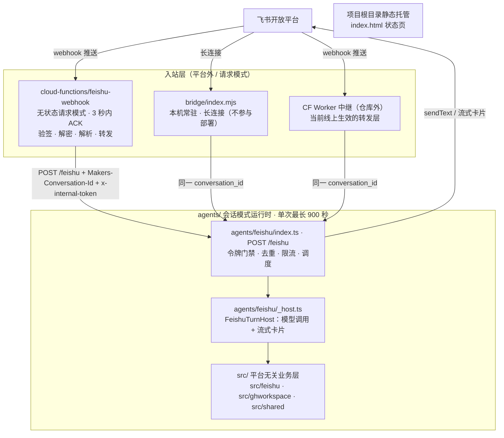

# 架构总览：两个运行时与可移植的 src/ 层

`edgeone-agent-lab` 是 `cf-agent-lab`（Cloudflare Workers + Durable Objects）到 **EdgeOne Makers** 的移植版：用 OpenAI Agents SDK 重写 Agent 核心，**飞书是唯一入口**（没有网页聊天界面）。代码量约 5800 行，其中真正的业务逻辑几乎全部落在 `src/`，平台相关的胶水只有 `agents/`、`cloud-functions/` 两个目录。

本页只讲**结构**：有哪些组件、谁跑在哪个运行时里、哪些代码与平台无关、部署工具怎么把它们绑在一起。单条消息从进入 webhook 到回复飞书的完整控制流见[入站请求生命周期](request-lifecycle.md)；会话身份如何计算见[会话路由与三种入站实现](conversation-routing-and-ingress.md)。

## 一句话贯通的拓扑



图中展示两个运行时与三种可互换入站实现的分工；只有 `cloud-functions/` 与 `agents/` 参与 EdgeOne 部署，中继与 bridge 跑在平台之外。

## 两个运行时，一条平台强制的接口

EdgeOne Makers 把「有状态」和「无状态」拆成两套运行时，本项目各用了一个：

| | `agents/feishu` | `cloud-functions/feishu-webhook` |
|---|---|---|
| 运行时模式 | **会话模式**：同一 `conversation_id` 粘性路由到同一实例，实例复用内存状态 | **无状态请求模式**：每个请求一个独立执行，最长 120 秒 |
| 单次执行上限 | 900 秒（`edgeone.json` 的 `agents.timeout`） | 120 秒 |
| 入口 | `POST /feishu`（`agents/feishu/index.ts`） | `POST /feishu-webhook`（`cloud-functions/feishu-webhook/index.ts`） |
| 平台归属 | `context.store.state` 按 conversation_id 隔离、一对话一沙箱 | 拿到的 `context` 只有 `request / env / agent.store` |
| 职责 | 跑模型、调工具、流式回卡片 | 证明请求可信 → 解析 → 转发 |
| 状态 | 去重 / 限流 / token 缓存 / 诊断落盘（全部走会话 KV） | 无 |

**为什么必须拆成两段**：平台的硬约束是**所有** `agents/*` 调用都必须带 `Makers-Conversation-Id` 请求头，缺失或不合法直接返回 `400`；而飞书的事件推送是飞书服务器发起的，我们加不了自定义头。所以 `agents/` 路由不可能直接当飞书回调地址，必须有一个能做转发的中间层，而这个中间层自己也不能是 `agents/` 路由。

反过来，转发层也**不能**跑模型：模型跑一个回合动辄二三十秒还会连着调工具，而 `cloud-functions/` 必须让飞书在 3 秒内收到 ACK。

还有一个能力上的硬缺口逼出「转发只能走 HTTP」：`cloud-functions/` 拿到的 `context` 只有 `request / env / agent.store` —— `context.agent.store` 是共享数据，**不是调用入口**；平台没有「按名字取实例、主动调它的方法」这种 RPC（原版 DO 的 `getAgentByName()`）。所以转发层只能自己 `fetch` 同项目下的 agent 路由。

> ⚠️ conversation_id 的形状有一个会**静默 400** 的坑：飞书 chat_id 是 `oc_` + 32 位十六进制（35 字符），原版照抄的 `fs-${chatId}` 是 38 字符，超过平台 6~36 字符的上限。所以改成 `fs-` + `SHA-256(chatId)` 前 32 位十六进制，恒为 35 字符。详见[会话路由与三种入站实现](conversation-routing-and-ingress.md)。

### 两个运行时各自的调度模式

会话模式下的「先 ACK 再跑模型」是这套移植最大的未知数 —— 官方文档没有明文承诺「返回 Response 之后未 await 的异步代码还能不能跑完」。因此 `agents/feishu/index.ts` 提供了一个 `FEISHU_DISPATCH_MODE` 开关：

- `async`（默认）：立刻回 `202`，整个回合在后台跑完（实测成立：`phase: finished`、`elapsedMs: 15046`）；
- `sync`：跑完才回，**不依赖后台执行能力**；代价是 webhook 要等，飞书会判超时并重推（重推被 agent 侧的去重挡住）。

⚠️ 只有 `sync` 模式才把 `request.signal` 传下去 —— 异步模式下这个 signal 会在响应发出时触发，传进 `run()` 等于自己掐掉后台任务。

## 运行时的组件责任

`agents/` 目录很小，但每一层职责分明：

| 文件 | 责任 |
|---|---|
| `agents/feishu/index.ts` | 路由处理：令牌门禁（fail closed）、`normalizeEvent()`、去重、限流、调度模式、OAuth 回调分支、全部诊断探针（`?probe=start/check/env/model/last/search/store`） |
| `agents/feishu/_host.ts` | `FeishuTurnHost` 的平台实现：建模型客户端与 `Agent`、装配工具、把 Agents SDK 的流事件映射成卡片、`runCompact()` 与回合结束的自动压缩、`memoryText()` 快照 |
| `agents/feishu/_instructions.ts` | 系统提示词主体，以及按配置条件拼接的 `WORKSPACE_PROMPT` / `ISSUE_PROMPT` |
| `agents/feishu/_tools.ts` | 平台沙箱工具装配（`EXCLUDED` 名单）+ 工具结果压成一行给卡片 |
| `agents/feishu/_search.ts` | 自建 `web_search`（serper），挂上时把平台同名工具摘掉 |
| `agents/feishu/_diag.ts` | 出站请求 / 入站响应环形缓冲、重试判定、诊断计数器 |

回合流程本身住在 **`src/feishu/turn.ts`**，不在这里：`runFeishuTurn()` 解析命令、驱动 `FeishuTurnHost` 的 `ask / compact / clear / memoryText / forgetMemory / loginUrl / logout`、用 `safeReply()` 兜底、最后 `await store.markDone()`。移植时**这个文件几乎一行不用改**，因为它的宿主能力一开始就被抽成了接口 —— 当初只是为了脱离 Durable Object 单测，结果正好让换平台几乎零成本。唯一改的是 `markDone` 从同步变 `await`（存储从 DO SQLite 换成异步 KV）。

> ⚠️ 本地 `edgeone makers dev` 起不来 `POST /feishu`：`agent-node` 不绑定端口，只有 `node-function`(9005) 和 `observability`(9101) 会监听。agent 路由只能部署后测，或在 Node 里直接 `import .edgeone/agent-node/server.mjs` 调运行时。

## `src/` 是平台无关层（多数改动应该落在这里）

`src/` 的定位是**可移植的业务逻辑**：不 import 任何 EdgeOne / Cloudflare 专有 API，只依赖 `fetch`、WebCrypto、`setInterval` 这类两边都有的东西。平台能力一律通过**注入**进来 —— `TokenCache` 接口由调用方实现，`StateKv` 只有 `get / set / delete` 三个方法，`MemoryBackend` 只有 `put / read / remove / list` 四个方法。这几条刻意留窄的缝，就是「换掉存储后端」时的改动面。

```
src/
├── shared/        base64.ts（容忍 GitHub 每 60 字符折行）、util.ts（guarded 兜底、UA）
├── feishu/        crypto / event / api / card / streamer / commands / compact /
│                  docs / global-memory / oauth / user-token / session-sanitize /
│                  store / turn / types
└── ghworkspace/   client.ts（GitHub Contents + Git Data API）、tools.ts（ws_*）、
                   issues.ts / issue-tools.ts（gh_issue_*）
```

按「与平台的耦合程度」分三类：

| 类别 | 代表文件 | 与平台的关系 |
|---|---|---|
| **零平台依赖，原样保留** | `crypto.ts`、`event.ts`、`api.ts`、`card.ts`、`streamer.ts`、`shared/*` | 只用 WebCrypto / `fetch` / `setInterval`，两边运行时都有 |
| **微改** | `turn.ts`（`markDone` 改 `await`、加命令分发）、`commands.ts`（加 `/compact` `/clear` `/memory` `/forget` `/login` `/logout`） | 逻辑不变，只顺着新存储的异步语义和新增命令调整 |
| **重写或新增** | `store.ts`（DO SQLite 两张表 → 按会话隔离的 JSON KV）、`docs.ts`、`global-memory.ts`、`oauth.ts`、`user-token.ts`、`session-sanitize.ts`、`ghworkspace/*` | 原版没有或建在平台专有能力之上 |

平台耦合只出现在两个地方，且都被收在窄接口后面：

```ts
// 会话 KV：线上直通 context.store.state，本地测试用 MemoryKv
export interface StateKv {
  get<T = unknown>(key: string): Promise<T | null>;
  set(key: string, value: unknown): Promise<void>;
  delete(key: string): Promise<void>;
}
```

`agents/feishu/index.ts` 的 `makeStateKv()` 负责抹平两处形状差异（`agents/` 下是 `context.store.state`，本地测试与降级路径用 `src/feishu/store.ts` 里的 `MemoryKv`），业务代码不需要分叉。

**这套分层也是可测试性的来源**：`test/smoke.ts` 用**裸 Node**（`--experimental-strip-types`）+ 全局 stub 的 `fetch` 跑完 13 节（A~M，`npm test` 报「全部通过：190 项」），不启 EdgeOne、不连飞书、不发网络请求。之所以能这样，正是因为「验签顺序、去重判据、摘要写回形状、那个 36 字符的 conversation_id」这些最容易错的东西**全都不依赖平台**。

> ⚠️ 一条会反咬一口的约束：冒烟测试跑在 strip-only 模式的 Node 下，只剥类型、不做代码生成，所以 `src/` 里**不能**用 TypeScript 的构造函数参数属性（`constructor(private kv: StateKv)`），否则直接 `ERR_UNSUPPORTED_TYPESCRIPT_SYNTAX`。`store.ts` 因此手写字段 + 赋值。

## 平台外的组件：状态页、bridge 与 tools/

### `index.html`：唯一的网页界面

仓库根目录的 `index.html` 是**唯一**保留的网页资产 —— 原版的 React 前端和 `/api/workspace/*` 导入协议已随仓库语料层一起删除。它是个纯静态页，做三件事：按当前 origin 推出并显示飞书回调地址、说明 agent 路由的调用约束、跑「后台执行能力自测」（按钮发两次 `POST /feishu?probe=start|check`，中间隔 16 秒，用的是页面自己生成的合法 conversation_id）。

⚠️ **状态页里绝不能出现 `INTERNAL_TOKEN`** —— 它是公开静态资源，所以两个探针对状态页开了免令牌例外（它们只读写自己那个会话的 `probe.bg` 键，泄漏面为零）；其余探针一律要 `?token=INTERNAL_TOKEN`。门禁按「这个端点会不会泄漏东西」开，不按「谁在用」开。

### `bridge/`：本机常驻的备选入站链路

`bridge/index.mjs` 是另一种收飞书事件的办法：本机常驻进程用飞书**长连接**（WS）收事件，立刻 ACK 后转发放后台，因此**不需要公网回调地址**。它属于 v2 链路，**已弃用、留作备选**，且**不参与 EdgeOne 部署**（部署只认 `agents/` 与 `cloud-functions/`）。

⚠️ 但它仍在公网可读：EdgeOne 没有部署忽略清单，会把整个项目目录当公网静态资源上传，而 `edgeone.json` 的 schema 里也没有 exclude / ignore 字段。曾经因此把 `.env` 明文挂在网上两天。**含密钥的文件一律不能待在项目目录里** —— `.gitignore` 只挡 git，挡不住部署。

### `tools/`：对部署产物跑的验证脚本

`tools/ask-bot.mjs`、`tools/verify-memory.mjs`、`tools/verify-autocompact.mjs` 从开发机打**已部署**的 agent（用假 chat_id + 独立 conversation_id + `?mode=sync`，从 HTTP 响应里读回复），所以整个验证一条消息都不会发到真人聊天里。它们依赖 `?mode=sync` 会回显这一轮的回复 —— 流式卡片的正文通过 `im/v1/messages` 读不到，异步那条路的 `202` 不承载业务内容。

## 部署工具怎么把这一切绑起来

`edgeone.json` 是唯一的部署描述，它把「哪个目录是哪种运行时」这件事声明出来：

```json
{
  "agents": {
    "framework": "openai-agents-sdk",
    "dir": "agents",
    "timeout": 900,
    "sandbox": { "timeout": 900 }
  },
  "cloudFunctions": { "includeFiles": [] }
}
```

- `framework: openai-agents-sdk` 决定平台用哪套适配来包 `agents/` 路由：`context.store.openaiSession()`、`context.tools.*`、`context.conversation_id` 都由这层适配提供；
- `timeout: 900` 是这条链路能跑长回合的前提（对照：cloud-functions 只有 120 秒）；
- 项目根目录的静态文件（`index.html`）自动托管，不需要额外配置；
- **没有** exclude / ignore 字段 —— 这就是 `bridge/` 的源码会被当静态资源上传的原因。

上线路径是「push main → GitHub Actions → `edgeone makers deploy`」，`typecheck` 与 `npm test` 是部署前的硬门禁（挂了就不上线）。部署与发布细节见[部署与发布](../operations/deployment-and-release.md)。

## 存储分层（结构视角）

三个**互相隔离**的键空间，不要混用：

| 键空间 | 归属 | 谁在读 |
|---|---|---|
| `context.store.state`（物理键 `state/<conversation_id>/<key>`） | **按会话** | 去重 / 限流（`feishu.events`）、tenant token 缓存（`feishu.token`）、用户令牌（`feishu.userToken.<openId>`）、诊断落盘；平台耦合被 `StateKv` 收口 |
| `context.store.openaiSession(cid)` | **按会话**，平台托管 | 对话历史（SDK 原生 `Session`：`getItems` / `addItems` / `clearSession`），**不暴露表名也不暴露压缩钩子** |
| Blob 命名空间 `agent-memory-<projectId>` | **跨会话** | 长期事实（`prefs/*`、`user/<openId>/*`），走运行时暴露的裸 `getStore({ name })` |

前两行是**按会话**的，第三行是**跨会话**的 —— 「换个群就得重说一遍」的界线就在这里。落点、上限与弱保证见[存储模型](../concepts/storage-model.md)与[跨会话长期记忆](../concepts/cross-session-memory.md)。

> ⚠️ 去重的正确性压在「同一时刻只有一个实例在处理这个会话」上，而这是粘性路由给的保证，**不是分布式锁**。同一 conversation_id 被路由到两个实例时表现为「同一条消息被回答两次」。恢复强保证的办法是把 `StateKv` 换成外部 MySQL/PG 加唯一索引 —— 接口只有三个方法。见[平台约束与弱化的保证](platform-constraints.md)。

## 一个组件往哪加、放哪一层

| 你要加的东西 | 放哪 | 需要同时改什么 |
|---|---|---|
| 一个新工具族 | `src/<域>/tools.ts`（zod 定义 + 纯业务逻辑） | `agents/feishu/_host.ts` 的 `tools` 数组 + 挂载条件；`_instructions.ts` 里对应的能力段落必须用**同一个条件**拼接 —— 说了但手上没有的工具，模型会去调然后白烧一轮 |
| 一个新命令 | `src/feishu/commands.ts` 的 `kind` 联合 | `src/feishu/turn.ts` 的 `switch`（漏了编译不过）+ `FeishuTurnHost` 的对应方法 + 测试 |
| 一个新的诊断探针 | `agents/feishu/index.ts` 的探针分支 | 是否要过 `tokenGate()`（按泄漏面判断）+ 更新文档 |
| 换存储后端 | 只动 `StateKv`（3 个方法）或 `MemoryBackend`（4 个方法）的实现 | 业务逻辑不动 —— 这是刻意留的缝 |

## 已知的未核实项

架构层面还有两处**按文档写、没实测**的地方，不必当成缺口：

- **平台沙箱工具的实际名字**（`commands` / `code_interpreter` / `files_*` …）来自官方文档的表；名字是模型选工具的唯一依据，写错等于工具不存在。部署后对着 `/agent-metrics` 面板核一遍。
- **流事件的真实名字**（`run_item_stream_event` 的 `tool_output`、思考增量）是推的。猜错的后果只是「卡片上少一行」，最终答案优先取 `result.finalOutput`，不依赖增量。

`context.tools.all()` 在 `openai-agents-sdk` 框架下返回的对象形状也有同样的性质：`_tools.ts` 按 `unknown[]` 收，不做形状假设。
