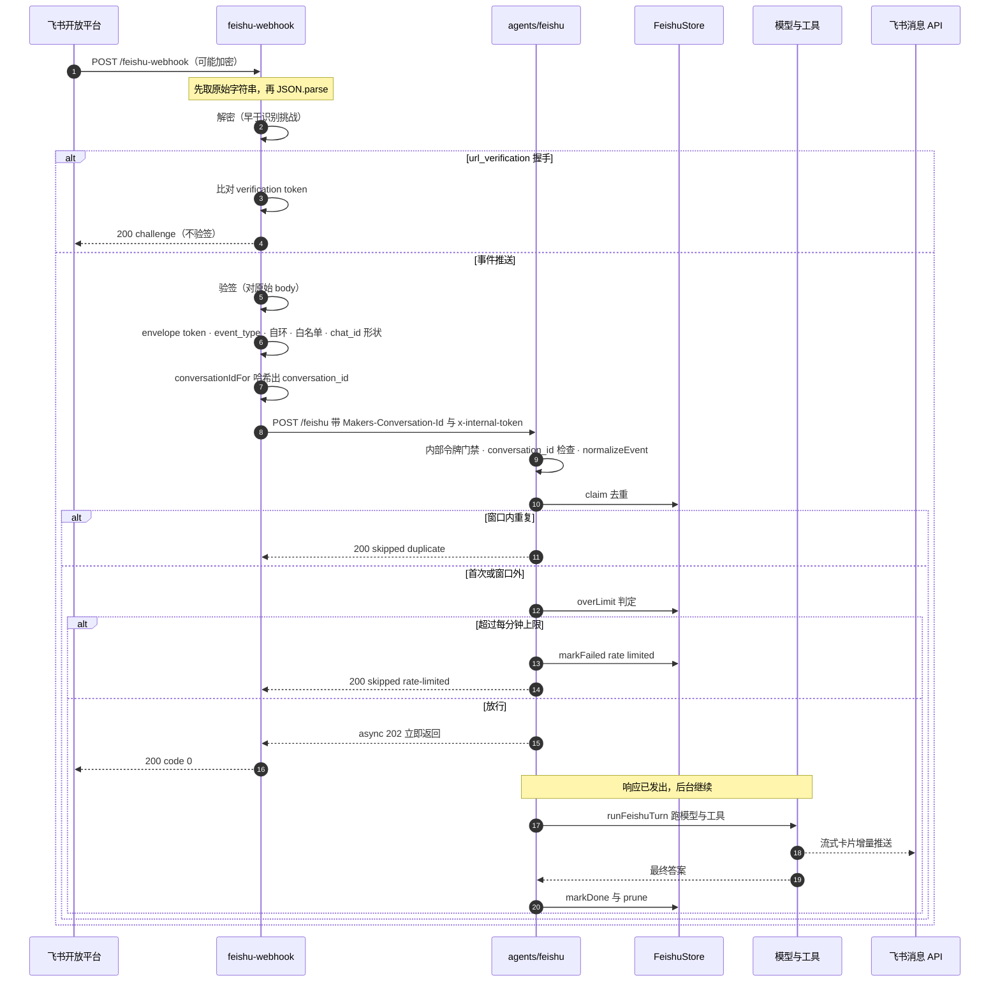

# 入站请求生命周期：从 webhook 到回复

一条飞书消息要经过**两个运行时、两次请求**才变成会话里的一条回复：无状态的
`POST /feishu-webhook`（`cloud-functions/feishu-webhook/index.ts`）负责「证明请求可信 → 解析 →
转发」，会话模式的 `POST /feishu`（`agents/feishu/index.ts`）负责「去重 → 跑模型 → 回飞书」。

这条链路里**检查步骤的顺序本身是设计的一部分**，不是排版风格。文件头的注释直接写着
「检查顺序是踩出来的，不要重排」。本页按执行顺序讲每一步在做什么、顺序反了会怎么坏，
以及两种调度模式（async / sync）的取舍。

> 会话身份（`Makers-Conversation-Id` 的构造与三件平台绑定）见
> [会话路由与三种入站实现](conversation-routing-and-ingress.md)；外部 CF Worker 中继见
> [外部入站中继](../integrations/external-ingress-relay.md)；探针与排错入口见
> [诊断与探针](../operations/diagnostics-and-probes.md)；命令分派见
> [命令与控制流](../workflows/commands-and-control.md)；工具循环与流式渲染见
> [工具调用与流式输出](../workflows/tool-invocation-and-streaming.md)。
> 平台约束（无 alarm、无 SQL、120 秒上限）见
> [平台约束与被削弱的保证](platform-constraints.md)。

## 为什么要拆成两段

EdgeOne 的 `agents/*` 路由**强制**要求 `Makers-Conversation-Id` 请求头，缺失直接 400；
而飞书的推送是飞书服务器发起的，我们无法给它加自定义头。所以 `agents/feishu` 不可能
直接当飞书回调地址，中间必须有一层能做转发的无状态入口 —— 而这一层自己也不能是
`agents/` 路由。

除了头，还有两条硬约束决定了分工：

- `cloud-functions/` 是**无状态请求模式**，硬上限 120 秒，飞书又要求 3 秒内 ACK；
- `agents/` 是**会话模式**，同一 conversation_id 粘性路由到同一实例、复用内存状态、
  单次可跑很久，而且自带沙箱。

模型跑一个回合动辄二三十秒还要连着调工具，只有 `agents/` 撑得住。所以转发不是绕远路。

## 全景时序



图中 async 路径是先回 202/ACK 再在后台跑完；sync 路径把 202 换成等到 `runFeishuTurn`
返回后的 200（见下文「调度模式」）。

## 第一段：`cloud-functions/feishu-webhook`

入口是 `onRequest`（它把整个 `handleEvent` 包在 try/catch 里，异常统一转成 500 —— 而
**500 会让飞书重推，这正是想要的**，去重那一层在 agent 里，重推不会产生重复回答）。

### 前置门禁：fail closed

按顺序先做四件事，任何一件不满足就早退：

| 检查 | 失败响应 | 理由 |
|---|---|---|
| `request` 存在 | 500 | — |
| `method === "POST"` | 405 | 路由只接受 POST |
| `FEISHU_APP_ID` / `FEISHU_APP_SECRET` / `FEISHU_VERIFICATION_TOKEN` 齐备 | 503 | 没配应用凭证就没有任何可信度，别让门静默敞开 |
| `INTERNAL_TOKEN` 在 | 503 | 缺了它转发必被 agent 拒，报错文案会直接说该配什么 |

`INTERNAL_TOKEN` 的检查放在**转发之前**，是为了把一个必然失败的调用变成一句明确的配置错误。

### ① raw body 必须先于解析

```ts
const raw = await request.text();   // 先拿原始字符串
...
body = JSON.parse(raw);             // 再解析
```

飞书文档明写「不要在反序列化后再计算」签名。**签名是对未经解析的 body 算的**；
先 `JSON.parse` 再 `stringify` 回去，键序和空白一变签名就永远对不上。
测试 `加密事件体：解密 → 验签 → 转发（顺序不能反）` 直接对着这一点写 ——
它用 `JSON.stringify(messageEvent())` 的结果算签名，再断言 payload 被正确转发。

解析失败（非法 JSON）回 400，不是 500 —— 一个畸形的请求不该触发飞书无限重推。

### ② 解密排在识别挑战之前

配了 `FEISHU_ENCRYPT_KEY` 且 body 形如 `{ encrypt: "..." }` 时先解密。
位置有讲究：**`url_verification` 的挑战体同样是加密的**。若先判断挑战再解密，
`body.type` 是 `undefined`，挑战永远认不出来 —— 飞书后台会一直报
「Challenge code没有返回」。

解密实现（`src/feishu/crypto.ts` 的 `decryptEvent`）有两个易错点：
密钥是 `SHA-256(encrypt_key)` 的**原始 32 字节**（不是 hex 再编码），
IV 是密文 base64 解码后的**前 16 字节**；且 **WebCrypto 的 AES-CBC 已按规范做了
PKCS#7 去填充**，解出来就是明文本身，不要再去剥一遍。解密后用
`TextDecoder("utf-8", { fatal: true })` 解码 —— 不是合法 UTF-8 说明密文或密钥不对，
宁可硬失败也不把乱码塞给下游。解密后仍不是合法 JSON 则回 400。

### ③ 挑战握手排在验签之前，且不验签

```ts
const challenge = readChallenge(body);
if (challenge !== null) {
  if (token !== env.FEISHU_VERIFICATION_TOKEN) return json({ error: "verification token 不匹配" }, 401);
  return json({ challenge });
}
```

`readChallenge` 只认 `type === "url_verification"` 且 `challenge` 是非空字符串。

这一步**不做签名校验**，而且必须在签名校验之前。依据是飞书文档原文：安全校验适用于
「接收到开放平台推送的事件时（**不包括请求网址校验**）」。放错位置会让飞书永远拿不到
challenge。放宽是安全的，因为回一个 challenge 只是原样回声、没有任何副作用。
测试 `加密的挑战体也能解出来（url_verification 同样是密文）` 和
`challenge 握手原样回声（且不验签）` 钉住了这两点。token 不匹配仍回 401。

### ④ 事件推送才验签

只有走到这里（不是挑战握手）才验签，且**只在配了 `FEISHU_ENCRYPT_KEY` 时**验。
`verifySignature` 算的是 `sha256_hex(timestamp + nonce + encrypt_key + rawBody)`，
取值来自 `x-lark-request-timestamp` / `x-lark-request-nonce` / `x-lark-signature`
三个头，比较用**常数时间**的 `safeEqual`（不能用 `===`）。

签名不通过回 401。测试覆盖了「签名不对 → 401」「签名正确 → 放行」，以及
「密文不能绕过验签」（对着密文用错签名 → 401 且零转发）。

> ⚠️ **没有 Encrypt Key 就等于没有任何请求来源证明**，只剩明文比对
> Verification Token —— 谁都能伪造。生产上应该配 `FEISHU_ENCRYPT_KEY`；
> 不配时代码仍工作，但安全性明显更弱。

### ⑤ envelope、token、事件类型

验签之后才读 envelope：`readEnvelope` 兼容 `header.event_type` / `header.token`
以及顶层的 `type` / `token` 两种形态（飞书不同版本的事件体形状有差异）。

顺序是：

1. `readEnvelope` 返回 null（形状不合法）→ **静默 ACK**，不是错误；
2. `envelope.token !== FEISHU_VERIFICATION_TOKEN` → 401；
3. `eventType !== "im.message.receive_v1"` → **静默 ACK**（飞书会推很多我们不管的事件）；
4. `parseMessageEvent` 返回 null → 静默 ACK。

**「静默 ACK」是这一层的统一语义**：一律回 `200` + `{"code":0}`。飞书只关心
「收到没有」，业务上的忽略不该触发它的重推。

`parseMessageEvent` 的返回 null 全是「不是给我们处理的」而非错误：不是
`im.message.receive_v1`、`event.message` 不成对象、`message_type !== "text"`
（图片/文件/卡片一律忽略）、缺 `message_id` 或 `chat_id`。

单独要记住的是 **`content` 是一个 JSON 字符串而不是对象**
（形如 `"{\"text\":\"@_user_1 hello\"}"`），直接当对象用会静默拿到 undefined，
整条消息变成空字符串。`extractText` 会剥掉 mentions 里的 `@_user_1` 占位符，
并且只压**行内**连续空白（正则 `(?<=[^\s])[ \t]+`）—— 用全局 `/[ \t]+/g`
会把 `\n  第二行` 的行首缩进也吃掉，换行留住但代码结构没了。

### ⑥ 自环防护必须先于去重

```ts
const senderType = (body as any).event?.sender?.sender_type;
if (senderType === "app") return ACK();
```

我们自己往会话里发消息（「正在抓取…」以及回答本身），那些消息**同样会变成
`im.message.receive_v1` 事件推回来**。不过滤的话 bot 会跟自己的回执聊起来。

顺序要求是「自环在去重之前」。这一点被两处钉住：webhook 的注释明写这个要求，
测试 `自环防护：sender_type=app 不转发（必须先于去重）` 断言
`sender_type=app` 时**零次转发**。

> **推断（非注释原文）**：若把这一步挪到 agent 侧的去重之后，app 消息会先被
> `claim()` 写进 `feishu.events` 并占用该会话的每分钟限流额度
> （见 `store.ts` 的 `claim` / `recentCount`），于是 bot 自己的每条回执都在
> 消耗「这个会话还能处理几条」的预算，并污染去重表。webhook 这一层放行得最早、
> 副作用最小，所以这个过滤点选在这里。

### ⑦ 白名单与形状守卫

| 守卫 | 行为 |
|---|---|
| `msg.openId` 为空 | 静默 ACK |
| `FEISHU_ALLOWED_OPEN_IDS` 非空且不含该 openId | 静默 ACK（**故意不回**「你没权限」，那等于告诉对方这个端点存在） |
| `CHAT_ID_RE.test(msg.chatId)` 不通过 | 静默 ACK |
| `msg.text` 为空或超过 `MAX_TEXT_CHARS`（4000） | 静默 ACK |

`CHAT_ID_RE = /^oc_[A-Za-z0-9_-]{1,64}$/` 只放行飞书真的会发出来的 chat_id 形状。
理由不是洁癖：**一个签名有效但构造出来的 payload 能刷出无限多个会话实例**
（每个实例一份内存 + 一份 store 命名空间）。允许 `_` 和 `-` 是保守起见 ——
见过的都是纯字母数字，但没必要为洁癖在某个真实 id 上栽跟头。

只有 `FEISHU_ALLOWED_OPEN_IDS` 是**可选的**（空/未设 = 不限制）；不配就等于关闭这一层，
但形状守卫、长度守卫和清单里的其他项始终生效。

### ⑧ 哈希出 conversation_id 并转发

```ts
const conversationId = await conversationIdFor(msg.chatId);   // fs- + sha256(chatId)[0:32]
```

这里**不能照抄原版的 `fs-${chatId}`**：EdgeOne 的 `Makers-Conversation-Id` 要求
6~36 字符且只允许 `0-9 a-z A-Z - _ .`，而飞书 chat_id 是 `oc_` + 32 位十六进制
（35 字符），加 `fs-` 就是 38 字符，**超限**。哈希后恒为 35 字符，且同一个 chat_id
永远映射到同一个 conversation_id（粘性路由的前提）。算法细节、三份独立副本与那个
会静默 400 的坑见 [会话路由与三种入站实现](conversation-routing-and-ingress.md)。

转发请求：

```ts
res = await fetch(agentUrl, {
  method: "POST",
  headers: {
    "content-type": "application/json; charset=utf-8",
    "Makers-Conversation-Id": conversationId,   // 平台按它做粘性路由 + store 归属 + 沙箱归属
    "x-internal-token": env.INTERNAL_TOKEN,
  },
  body: JSON.stringify({ messageId, chatId, chatType, openId, text }),
  signal: AbortSignal.timeout(110_000),          // cloud-functions 硬上限 120 秒，留 10 秒余量
});
```

转发目标是 `env.AGENT_URL`，未设时回落到 `${new URL(request.url).origin}/feishu`。
110 秒的上限在 async 模式下用不到（agent 200 毫秒就回 202），在 sync 模式下它决定
「最多等多久」。

转发失败（fetch 抛错）或 agent 返回非 2xx → **回 500**，让飞书重推 —— 这是**期望的**
行为，重推会被 agent 侧去重挡住。错误响应里会带 `detail.slice(0, 300)`，这是排查
「到底是哪一步 400」的唯一线索。

## 第二段：`agents/feishu`

### 探针分流先于一切

`onRequest` 一进来先看 `url.searchParams`：`probe=start|check|env|model|last|search|store`
分别走各自的诊断端点。`probe=start` / `probe=check` 是**故意公开**的（状态页要在浏览器里
直接点，把 `INTERNAL_TOKEN` 塞进静态页等于公开它），其余探针统一过 `tokenGate()`
（`?token=INTERNAL_TOKEN`）。门禁按「这个端点会不会泄漏东西」开，不按「谁在用」开 ——
收口在一处是因为逐个调用点手抄会导致新增探针就忘一次。详见
[诊断与探针](../operations/diagnostics-and-probes.md)。

### 空请求体的 POST 路径

非 POST → 405。然后按顺序：

1. **`INTERNAL_TOKEN` 未配置 → 503**（fail closed，报错文案直接说明该怎么配）；
2. **先读 body 再读令牌** —— 因为令牌可以放在 body 里（顺序不能反）；
   `readJson` 同时接受 `context.request.body`（平台文档说它是已解析对象）、
   `.text()` 和 `.json()` 三种形态；
3. **令牌校验** `readInternalToken(request, body) !== token` → 401。

`readInternalToken` 写得绕是有实测原因的：这个 runtime 里的 `context.request.headers`
**不是标准 `Headers` 实例**，`request.headers.get(...)` 恒等于 `""`，于是所有转发一律 401，
而报错只说「不匹配」，看不出是根本取不到。所以三种形态都试：标准 `Headers`、
普通对象（含大小写变体）、以及 **body 里的 `token` 字段**。这是与
[外部入站中继](../integrations/external-ingress-relay.md) 之间需要保持一致的契约点。

4. **`conversation_id` 缺失 → 400**（`{"error":"缺少 Makers-Conversation-Id 请求头"}`）。
   agent 侧只读 `context.conversation_id`，不做二次校验 —— 校验和生成都在转发层。

### OAuth 回调的分叉

```ts
if (String(body?.op ?? "") === "oauth") return handleOAuthCallback(env, context, body);
```

这一步**在去重和限流之前**，而且是**同步返回**：

- 云文档授权回调是浏览器跳转触发的，中转那边的浏览器在等这个响应渲染结果页；
- 不走去重/限流 —— 那两个是给用户消息用的，套在回调上只会在用户重试时
  把第二次回调当成「重复」丢掉。

回调的可信身份**全部来自签名过的 `state`**（`chatId` / `openId`），不信 body 里的同名字段：
body 是转发方拼的，`state` 是发起 `/login` 时我们自己签的，签名密钥同为 `INTERNAL_TOKEN`。
换令牌失败会回飞书一条说明并回 502；用户在授权页点「拒绝」时飞书带 `error` 不带 `code`，
这不是故障，回 `{ok: true, denied: true}`。

### 事件收窄

`normalizeEvent` 把 body 收窄成 `FeishuQueueEvent`：缺 `messageId` 或 `chatId` 返回 null
（调用方回 400）；`chatType` 不是 `"group"` 就一律归成 `"p2p"`。
转发层保证的五个字段（`messageId` / `chatId` / `chatType` / `openId` / `text`）在这里收口 ——
这是三路入站实现共享的契约，见 [会话路由与三种入站实现](conversation-routing-and-ingress.md)。

### 去重：claim

```ts
const claimed = await store.claim(evt.messageId, evt.chatId, evt.openId);
if (!claimed) return json({ ok: true, skipped: "duplicate" }, 200);
```

飞书在 webhook 超时后会重推同一条。判据是**时间窗口**（`DEDUPE_WINDOW_MS = 10 分钟`），
不是状态：窗口内出现同一条 `message_id` 就是同一件事，**不管它处于什么状态**
（pending / done / failed 都算重复）。窗口外同 id 再出现，视为用户又发了一遍，
重置成 pending 并放行。

实现是「**进程内权威副本 + 写穿 KV**」：内存里持一份完整副本，所有判定在内存里做
（同步语义，天然原子），每次改动后整体写回 KV。`ensureSchema()` 首次访问时从 KV 惰性加载。

> ⚠️ **这不是分布式锁**。它只在「同一时刻只有一个实例在处理这个会话」时正确 ——
> EdgeOne 的会话粘性路由给了这个保证。哪天同一个 conversation_id 被路由到两个实例，
> 去重就会失效，表现为**同一条消息被回答两次**。要恢复强保证，把 `StateKv` 换成外部
> 数据库加唯一索引（接口只有三个方法，改动是局部的）。

### 限流

```ts
if (await store.overLimit(evt.chatId)) {
  await store.markFailed(evt.messageId, "rate limited");
  return json({ ok: true, skipped: "rate-limited" }, 200);
}
```

`overLimit` = 该会话最近一分钟处理的条数 `>= RATE_LIMIT_PER_MIN`（10）。注意它的判据是
**以 `chatId` 聚合**的事件条数，而不是 message_id。

被限流时**不是静默丢弃**：先 `markFailed` 记一笔（错误文本截到 500 字符），再回 200
告诉转发层「收到了但不管」。这与「静默 ACK」不同 —— 它确实留下了诊断痕迹。

### 建宿主

`createHost({ env, context, cache, kv, openId, chatId })` 产出一个 `FeishuTurnHost`
（实现在 `agents/feishu/_host.ts`）。宿主能力被抽成接口不是过度抽象 —— 当初只是为了
「让整个回合流程可以脱离 DO 单独测」，结果正好让这次平台移植时 `src/feishu/turn.ts`
几乎一行不用改。

这一步还顺手做了几件事：`openId` 决定长期记忆的可见性视图和用户令牌槽位，
`chatId` 决定回消息发到哪个会话、以及授权链接里 state 带的是谁。

### 调度模式：async 202 vs sync

```ts
const dispatch = String(mode ?? env.FEISHU_DISPATCH_MODE ?? "async").toLowerCase();
```

模式可由**请求的 `?mode=` 查询参数**覆盖，否则读 env `FEISHU_DISPATCH_MODE`，默认 `async`。

**async（默认）**：先返回 `202 {ok: true, mode: "async"}`，`work()` 用 `void` 起在后台，
但**故意挂一个 `.catch()`** —— 不挂的话未处理的 rejection 会在某些运行时里变成未捕获异常，
把整个实例带掉。

**sync**：`await work(request?.signal)`，跑完才返回 `200 {ok: true, mode: "sync", replies}`。

```ts
if (dispatch === "sync") {
  // ⚠️ 只有同步模式才把 request.signal 传下去。
  const replies = await work(request?.signal);
  return json({ ok: true, mode: "sync", replies }, 200);
}
void work().catch(...);   // async：不传 signal
return json({ ok: true, mode: "async" }, 202);
```

**为什么 async 模式下绝不能传 `request.signal`**：这个 signal 会在响应发出时触发
（`AbortSignal.timeout` 也绑在请求上）。把 signal 传给 `work()` 等于**自己掐掉后台任务** ——
202 一发出，signal 就 abort，`runFeishuTurn` 里的模型调用立刻被取消。

`replies` 回显是**自动化核对「机器人答了什么」的唯一途径**：流式卡片的正文通过
`im/v1/messages` 读不到（那条接口对 card_id 型卡片只回一句「请升级至最新版本客户端」的
占位），async 那条路返回的 202 不承载业务内容，所以只在 sync 给。
`tools/` 下的验证脚本正是靠打 `?mode=sync` 从 HTTP 响应里读回复，
从而做到「一条消息都不发到真人聊天里」。

### 后台执行能力：一个必须实测的前提

async 模式依赖「**返回 Response 之后，未 await 的异步代码还能不能跑完**」，
而**官方文档没有明文承诺**。理论依据是 `agents/` 是会话模式、实例在会话空闲期内保活，
但「该」不等于「会」—— 有些运行时在响应发出后冻结事件循环。

**探针证据**：`?probe=start` 起一个后台任务睡 **15 秒**再往会话 state 里写标记，
隔 16 秒后用**同一个 `Makers-Conversation-Id`** 打 `?probe=check` 读回。
为什么是 15 秒而不是 1 秒：太短的话任务可能在响应发出**之前**就跑完了，
那样测出来的是「同步能跑」，是**假的通过**。

`probeCheck` 的 `verdict` 直接给出两种结论：`phase === "finished"` 时判定
「✅ 后台执行可用 —— 用默认的 `FEISHU_DISPATCH_MODE=async`」，否则判定
「❌ 后台任务没跑完（响应发出后进程被回收了）—— 把 `FEISHU_DISPATCH_MODE` 改成 `sync`」。

**已记录的实测结果（2026-09-25，见 `docs/01-架构与移植映射.md` 与 `docs/03-验证清单.md`）**：

```json
{"ok":true,"phase":"finished","elapsedMs":15046,
 "verdict":"✅ 后台执行可用 —— 用默认的 FEISHU_DISPATCH_MODE=async"}
```

`elapsedMs` 15046 ≈ 15 秒，说明那 15 秒的 sleep 确实是在**响应发出之后**才跑完的。
`docs/03` 还要求**部署后重跑第 2 步** —— 线上实例回收策略可能和本地不一样，
本地通过不代表线上通过。

> ⚠️ **这是「文档记录的证据」，不是自动化测试**：`test/smoke.ts` 里没有任何断言覆盖
> `probe=start` / `probe=check`，也没有断言覆盖 async 后台是否跑完、或 sync 是否把
> `request.signal` 传下去。它是**按文档写、靠一次线上人工实测确认**的前提；
> 换域名 / 改运行时后必须重跑，且回归时没有任何测试会先叫。

**万一实测是 ❌**：把 `FEISHU_DISPATCH_MODE` 改成 `sync`。那时 agent 跑完才返回，
webhook 跟着等 —— 飞书会在 3 秒后判超时并重推，重推被 agent 的去重挡住，
而回答本来就走 `sendText`/卡片发出去、不依赖 webhook 的响应体。用户体验仍然成立，
只是飞书后台的推送日志里会多出超时重试记录（`docs/01` 记录的超时数字是 3 秒，
这条**只在文档里出现，代码里没有对应的计时器**）。

### `work()` 与失败记账

```ts
const work = async (signal?: AbortSignal): Promise<string[]> => {
  try {
    const replies = await runFeishuTurn(host, env, store, evt);
    await store.prune();     // 搭车式清理
    return replies;
  } catch (e) {
    await store.markFailed(evt.messageId, (e as Error).message);
    throw e;
  }
};
```

`prune()` 挂在每轮跑完之后是**有意的替代方案**：原版靠 DO alarm 定期跑，
EdgeOne 免费版的 cron 最小间隔是 1 天，所以改成「搭车」—— 每轮跑完裁一次，
成本几乎为零，效果够用。

catch 里**先 `markFailed` 再重新抛出**：能走到这一步说明 `runFeishuTurn` 内部的异常
已经冒出来了（按设计它应该自己吞掉），所以基本只剩「发消息时网络抖动」。
在 async 模式下调用方（`void work().catch(...)`）只记一条日志，用户那边已经
ACK 过；在 sync 模式下异常会冒到 `onRequest` 外层转成 500。

## 第三段：模型回合（`src/feishu/turn.ts`）

`runFeishuTurn(host, env, store, evt)` 是平台无关的回合流程，它只依赖
`FeishuTurnHost` 接口。顺序是：

1. `parseCommand(evt.text)` 判断是命令还是提问；
2. 每个分支调宿主对应的方法，用 `say()` 发出去并**记进 `sent` 数组**（`sent` 就是
   sync 模式回显的那份 `replies`）；
3. `await store.markDone(evt.messageId)` 收尾。

### 命令分支与兜底

`/help`、`/status`、`/compact`、`/clear`、`/memory`、`/forget`、`/login`、`/logout`
各有分支。除 `/help` 和 `/message` 之类的静态文本外，走宿主动作的都套一层
`safeReply()`：

```ts
async function safeReply(fn) {
  try { return await fn(); }
  catch (e) { return `处理失败：${(e as Error).message.slice(0, 200)}`; }
}
```

**不兜的后果**：异常一路冒到 `index.ts`，默认 async 模式下进程只记一条日志就结束了 ——
**用户那边一条消息都收不到**，看起来像 bot 死了。`test/smoke.ts` 为此有两条守护：
`/memory 上宿主抛错时兜住，而不是静默` 和 `/compact 抛错时仍发出一条消息（不能静默）`。

`/login` 的链接**由宿主生成、由这里原样发出**，不让模型转述 —— 模型复述 URL 会出错
（截断、加空格、把 `/` 写成全角），而授权链接错一个字符就是死路一条。

**元命令自己不留痕**：测试 `元命令自己不留痕：/compact 不调用 host.ask` 断言
`/compact`、`/clear` 走的是 `host.compact` / `host.clear`，不走模型。
`/repo` 这条已删的命令被判成「不认识的命令」并回一句提示，**不会**掉进提问分支 ——
`test/smoke.ts` 有一条专门断言这一点的端到端测试。

### 提问分支：`case "ask"`

```ts
const r = await host.ask(cmd.text, evt.messageId, evt.chatId);
reply = r.text.trim() || EMPTY_ANSWER;
if (r.streamed) { sent.push(reply); break; }   // 答案已在卡片里，不再补发
```

两个关键语义：

- **`streamed: true` 表示回答已经通过流式卡片发到会话里了**，调用方**不能再发一条
  文本**（那是同一段回答的两份）；但要**记下来** —— 卡片正文从飞书 API 读不到，
  不记就没法自动核对。测试 `提问：streamed=true 时不再补发文本（否则会重复）` 守着它。
- **模型失败必须把异常吞掉**，转成一句能看懂的回复。理由写在注释里：让异常冒出去的话，
  原版的 `schedule()` 会重试三次然后放弃 —— 用户那边**一条消息都收不到，也没有任何提示**。
  而发送失败（下面的 `sendText`）仍然会抛，仍然会被重试 —— 那才是重试真正擅长的场景
  （网络抖动）。模型失败通常是配置问题，立刻说清楚比让用户干等九十秒再收到一句含糊的
  失败有用。测试 `提问：模型失败时必须发出提示而不是静默（原版踩过的坑）` 守着它。

### 标记完成

```ts
await store.markDone(evt.messageId);
return sent;
```

**只有全部发完才标记完成**。中途抛错（比如发消息时网络抖动）会让 state 停在 pending，
飞书的重推会再进来一次 —— 那时 `host.ask` 靠确定性的消息 id 认出这一轮已经跑过、
直接返回已有答案，不会重复烧模型。

> ⚠️ `markDone` 必须 `await`：原版是同步的 DO SQLite 本地写，换成 KV 之后不 await
> 可能写回还没落地、进程就先结束了。

## 第四段：回复路径回到飞书

`src/feishu/turn.ts` 只负责决定「发什么」和「发几份」，真正出网由两条路：

### 纯文本：`sendText`

`sendText(env, cache, chatId, text)` 往 `POST /im/v1/messages?receive_id_type=chat_id`
发一条 `msg_type: "text"`。三个必须记住的点：

- **`content` 必须是序列化后的字符串**而不是对象（`JSON.stringify({ text })`），
  传对象进去会得到 `code: 10002 invalid param`；
- 超过 `MAX_TEXT_CHARS`（4000）**直接截断并附加一句「回答太长，已截断」** ——
  总比整条消息发失败、用户什么都收不到好；
- 飞书**即使出错也回 200 + 业务错误码**，所以不能只看 `res.ok`。
  业务码 `99991663` 表示 tenant_access_token 无效/过期，此时**强制刷新令牌重试一次**
  （缓存里的 token 可能被后台重置 App Secret 吊销了），重试仍失败才抛。

`tenantAccessToken` 提前 60 秒判过期（`TOKEN_SAFETY_MS`），缓存由 `TokenCache`
接口注入 —— `FeishuStore.tokenCache()` 把它落到会话 KV 的 `feishu.token` 键。
**按会话各存一份是有意的**：token 是应用级的（所有会话共用同一个），各存一份会多取几次，
但省掉了「跨会话共享状态」这件事，而共享状态正是这套按会话隔离的 KV 最不擅长的。

> ⚠️ 发的是飞书**纯文本消息**，它**不渲染 Markdown** —— 命令回执里不要用加粗和反引号，
> `**x**` 会原样显示成星号。Markdown 只在流式卡片那条路上有得渲染。

### 流式卡片：`FeishuStreamer`

`host.ask` 先试着起一张流式卡片（`FeishuStreamer.start()`），起不来（比如后台没开卡片权限）
就退回「攒完整段再发一条纯文本」—— **流式是体验，不是正确性**。

流式实现的硬约束来自 AI SDK 的文档原话：`streamText` 的 `onChunk` 回调**会暂停整个流
直到回调的 promise 完成**。所以：

- `push()` / `pushReasoning()` / `pushToolCall()` / `pushToolResult()` / `pushNote()`
  **必须是同步的、绝不 await 网络请求**，增量只进内存 `buffer`；
- 真正推给飞书的动作交给一个独立的 `setInterval` 循环（`FLUSH_MS = 250` 毫秒）去做。

**增量只进内存，出网单独排队**。搞反了会把模型输出按网络 RTT 拖慢。
卡片只能**追加**（前缀一变平台就整段重上屏，打字机效果就没了），所以思考 / 工具 / 答案
按到达顺序排成一串，靠 `reasoningOpen` / `answerOpen` 这几个标记插分隔线。
工具调用只记名字（参数和结果对读卡片的人没用），工具结果只给一行结论。

收尾 `finish(fallbackText?)` 里有一道**保险**：如果增量一个都没收到（比如 `onChunk` 没接上），
卡片会永远停在「…」，而调用方又因为 `streamed: true` 不再补发文本消息 ——
用户就什么都看不到了。所以把完整答案作为 `fallbackText` 传进去，最坏情况也是
「没有打字效果」而不是「没有回答」。关流用**下一个**序号（关流也是这张卡片上的一次操作，
共享同一个递增计数器）；关流失败不影响用户已经看到的内容，不值得让整轮回答因此失败。

### 最终答案以 SDK 为准

`host.ask` 在流结束时优先取 `result.finalOutput`，拿不到才退回自己攒的增量 ——
**两者不一致时以 SDK 为准**，因为增量事件名一旦对不上（比如换了模型厂商），
攒出来的就是空的。

> ⚠️ **流事件的实际名字是「仍未核」的未知数**：`docs/01` 只把
> `raw_model_stream_event` + `data.type === "output_text_delta"` 和
> `run_item_stream_event` 的 `tool_called` 列为「官方模板里有」，
> 其余几个（工具结果、思考增量 `response.reasoning_summary_text.delta` /
> `response.reasoning_text.delta`）明确标为「按规律推的」。`?agent-metrics` 是看真实事件名的
> 入口，但本地起不来 agent 路由（`agent-node` 不绑端口），只能部署后看。
> 猜错的后果**只是卡片上少一行**，不影响答案正确性（最终答案优先取 `finalOutput`）。

### 一处刻意的顺序：自动压缩在 `finish` 之前

一轮跑完的收尾里，`autoCompactNote()` 的位置有两处讲究：**不放在
`sessionInputCallback` 里**（那个回调是同步的，而摘要要调模型），**也不放在回合开头**
（那会让这一轮的回答白等压缩跑完）；**放在 `streamer.finish` 之前** ——
提示才能跟着答案进同一张卡片。此时答案已经流式显示完了，多等几秒只是卡片晚点收尾，
不是「卡住」。这一跳**不走「后台不 await」那条路**：那条只实测过模型回合，
压缩是又一跳异步（还要再调一次模型），能不能跑完是未验证前提，所以这里 await 掉 ——
**正确性不赌在未验证的前提上**。

## 关键不变量与失败语义一览

| 不变量 | 位置 | 坏了会怎样 |
|---|---|---|
| 签名对**未解析的原始 body** 计算 | `feishu-webhook/index.ts` 的 `raw` | 先 parse 再 stringify，签名永远对不上 |
| 解密先于识别挑战 | `handleEvent` 的解密块 | `url_verification` 认不出来，飞书报「Challenge code没有返回」 |
| 挑战握手不验签、且先于验签 | `readChallenge` 分支 | 握手被 401（飞书不为它发签名头） |
| 自环过滤先于去重 | `senderType === "app"` 早退 | bot 跟自己的回执聊起来 |
| 静默 ACK 用于「不是给我们的」 | `ACK()` | 业务性忽略触发飞书重推 |
| 500 用于「可信但转发失败」 | 转发失败分支 | 临时故障不被重试 |
| `INTERNAL_TOKEN` fail closed | webhook 与 agent 两侧 | 公网可达的路由被任意人用来烧模型额度 |
| 只有 sync 传 `request.signal` | `dispatch === "sync"` 分支 | 202 一发 signal 就 abort，自己掐掉后台任务 |
| `markDone` 必须 await | `turn.ts` 结尾 | 写回没落地进程就结束，重推会重跑 |
| `streamed: true` 不再补发文本 | `case "ask"` | 同一段回答在会话里出现两份 |

## 测试与未覆盖的部分

`test/smoke.ts` 用**裸 Node** 跑（`node --experimental-strip-types`），`fetch` 全被 stub，
把最容易错的东西从平台里剥出来单独测：

- **E 节（飞书 webhook 端到端）** 直接 `import { onRequest as webhook }`，
  覆盖：challenge 握手（回声、token 不对 401、密文体也能解）、正常消息 ACK 且转发一次、
  conversation_id 长度/字符集/确定性、内部令牌头、自环防护、chat_id 形状、超长文本、
  白名单、非法 JSON 400、非 POST 405、缺凭证 503、agent 非 2xx → 500、
  「解密 → 验签 → 转发」顺序、密文不能绕过验签。
- **F 节（回合流程）** 用宿主 stub 覆盖 `runFeishuTurn` 的各分支与全部「异常不许静默」的守护，
  并对 `FeishuStore` 单独测了去重窗口、限流、prune、条数上限。

**未覆盖的部分**（改动前需要人工确认）：

1. **`agents/feishu/index.ts` 没有任何自动化测试消费者** —— `test/smoke.ts` 只 import 了
   `cloud-functions/feishu-webhook/index.ts`，agent 的令牌门禁、`conversation_id` 检查、
   `normalizeEvent` 收窄、去重/限流接线、dispatch 分支全靠人工验收
   （`tools/ask-bot.mjs` 那类直调脚本打 `?mode=sync` 是主要手段）。
2. **后台执行能力**只有一次线上人工实测与文档记录，没有回归测试；
   换域名 / 改运行时后必须重跑 `?probe=start` / `?probe=check`。
3. **流事件的实际名字**仍未核（见上），也没有断言钉住 `answerDelta` / `reasoningDelta`。
4. **`FEISHU_ENCRYPT_KEY` 未配的路径**（只靠明文 token 比对）有测试覆盖握手，
   但「生产必须配 Encrypt Key」是一条策略要求，代码不会强制。

## 配置面

这条链路读的环境变量（**只列变量名，不出现任何值**）：

| 变量 | 谁用 | 作用 |
|---|---|---|
| `FEISHU_APP_ID` / `FEISHU_APP_SECRET` | webhook 门禁、`tenantAccessToken` | 取应用级令牌发消息；任一缺失 webhook 回 503 |
| `FEISHU_VERIFICATION_TOKEN` | webhook | 挑战握手与 envelope token 比对 |
| `FEISHU_ENCRYPT_KEY` | webhook | **配了才验签**；同时是解密密钥。生产应强制配 |
| `FEISHU_ALLOWED_OPEN_IDS` | webhook | 逗号分隔的 open_id 白名单；空/未设 = 不限制 |
| `INTERNAL_TOKEN` | webhook 转发头 + agent 门禁 | 两侧必须同值；缺任一侧 fail closed |
| `AGENT_URL` | webhook | 转发目标，默认 `${origin}/feishu` |
| `FEISHU_DISPATCH_MODE` | agent | `async`（默认）或 `sync`；可被 `?mode=` 覆盖 |
| `FEISHU_API_BASE` | `src/feishu/api.ts` | **只为本地测试**覆盖 API 根地址，生产不要设 |

`FEISHU_DISPATCH_MODE` 的两种取值与切换条件见上文「后台执行能力」；
外部 CF Worker 中继侧的对应变量名不同（`EO_INTERNAL_TOKEN` 等），
这是**跨仓库的手工同步点**，见 [外部入站中继](../integrations/external-ingress-relay.md)。
