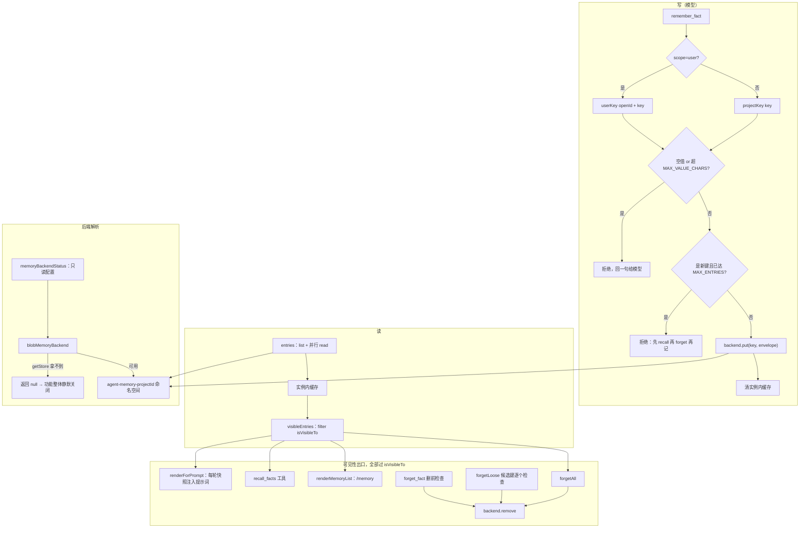

# 跨会话长期记忆：Blob 后端、命名空间隔离与可见性边界

「这个团队用 pnpm」「谷词负责 auth 模块」这类**事实**不属于任何一个会话。平台的 `context.store.state` 物理键是 `state/<conversation_id>/<key>`，按会话隔离 —— 这对对话历史是对的，但事实换个群就得重说一遍，`/clear` 之后就没了。

所以这里有**第二片存储空间**：`src/feishu/global-memory.ts` 里的一片所有会话共享的键空间，落在裸 Blob 上。它和会话 KV（[存储模型](storage-model.md)）是两个不同的东西，接口也不同：`MemoryBackend` 有 4 个方法（`put` / `read` / `remove` / `list`），比按会话隔离的 `StateKv` 多一个 `list` —— 枚举（「我记过什么」）是跨会话记忆的核心能力，而 `context.store.state` 没有 `list`。

三个模型工具（`remember_fact` / `forget_fact` / `recall_facts`）和两个人用命令（`/memory`、`/forget`）都落在这条链路上。

## 后端解析：为什么是裸 Blob，为什么必须两处找 projectId

记忆不通过 `context.store`，而是通过运行时挂出来的裸 Blob SDK：

```ts
globalThis.__EDGEONE_AGENT_RUNTIME__.getStore({ name: namespace })
```

凭证由**构建期注入**（生产替换 `{{PAGES_BLOB_DEPLOY_CREDENTIAL}}`，本地 dev 用 `DEV_BLOB_TOKEN` + `DEV_BLOB_PROJECT_ID`），代码只要 `getStore({ name })`，不必自己管凭证。物理落盘是腾讯云 COS，斜杠只是普通字符、不是真目录。

后端解析被拆成两个函数，这个拆分本身就是设计的一部分：

- `memoryBackendStatus(env)` —— **只看配置，不建连接**。返回 `{ available, namespace, projectIdFrom, reason }`。
- `blobMemoryBackend(env)` —— 先调 `memoryBackendStatus`，可用才 `getStore`，拿不到就返回 `null`。构造函数抛错、`raw.get` / `raw.set` 不是函数，都归到 `null`。

命名空间默认是 `agent-memory-<projectId>`，可用 `AGENT_MEMORY_NAMESPACE` 显式覆盖。projectId 必须**两处都找**，按固定顺序兜：

| 顺序 | 来源 |
|---|---|
| 1 | `env.PAGES_PROJECT_ID` |
| 2 | `env.ProjectId` |
| 3 | `process.env.PAGES_PROJECT_ID` |
| 4 | `process.env.ProjectId` |
| 5 | `process.env.EDGEONE_PROJECT_ID` |

实测 agents 运行时把 `PAGES_BLOB_DEPLOY_CREDENTIAL` 注入在 `process.env`，而它和 projectId 是同一批注入的 —— 只查 `context.env` 有可能整个功能静默失效。三个名字都兜是因为构建产物里 `__userEnv` 同时塞了这三个键、值一样，哪个先被平台砍掉不好说。`AGENT_MEMORY_NAMESPACE` 一旦显式设置，优先级高于一切，`projectIdFrom` 会报 `"AGENT_MEMORY_NAMESPACE"`。两处都有时 `env` 赢（控制台配的项目变量覆盖进程环境）。

`memoryBackendStatus` 存在的理由是可诊断性：「记忆不见了」只有两种完全不同的病 —— 运行时没暴露 `getStore`（本地裸 Node，或平台改了运行时 API），或者拿不到 projectId。`reason` 直接把病因说成人话，`projectIdFrom` 说明到底哪个变量生效了。它同时是 `?probe=store` 的 `memory` 字段的输出，和真实回合走**同一个**解析函数（见 [诊断与探针](../operations/diagnostics-and-probes.md)）。

### 命名空间隔离是结构性的

平台的命名空间是 `memory-<projectId>`，里面装着 `conversations/`、`state/`、`message_index/` 这些**线上用户数据**。本模块另开 `agent-memory-<projectId>`，绝不往平台的键空间里加键。

理由不是洁癖：`list` 按前缀枚举。只要共用命名空间，任何一次前缀写错都可能枚举到用户消息，或者一次清理删掉平台的键。分开之后，`global-memory.ts` 里任何一个 `list` / `read` / `delete` 都**在结构上**碰不到平台的键 —— 隔离不靠自觉。测试直接钉住这一点：`getStore` 收到的第一个 `name` 必须是 `agent-memory-makers-abc`，没有 projectId 也没有覆盖时返回 `null`（不硬编一个共享命名空间，多项目共用会串数据）。

## 键空间：一条事实一个键

```
prefs/<key>              项目级长期事实（技术栈、代码风格、团队约定）
user/<openId>/<key>      按人的偏好（「谷词负责 auth 模块」）
```

键名是**模型生成的**，所以过一道 `normalizeMemoryKey`：小写、空白转连字符、只留 `a-z0-9._-` 和 CJK（用户是中文，「技术栈」这种键比 `tech-stack` 更好读）、连续点压成一个（杜绝 `..` 这种路径穿越形状）、首尾的 `.` / `-` 去掉、最长 64 字符，返回 `null` 表示不可用。`projectKey(name)` 加 `prefs/` 前缀，`userKey(openId, name)` 加 `user/<openId>/` 前缀（openId 为空则造不出键，调用方据此改回 `project`）。

为什么**一个事实一个键**，而不是一个大 JSON：Blob 的 `set` 是**整值覆盖，没有任何可用的条件写**。SDK 类型里**有** `SetOptions.onlyIfNew` 和 `PreconditionFailedError`，注释写着「only write if the key does not already exist」—— 但实测它不生效：键已存在时带 `onlyIfNew` 写照样覆盖成功。底层 COS 确实有版本号（`x-cos-version-id`）和 etag，但 SDK 没暴露 `if-match` 这类参数，从这一层用不上。所以**设计上不依赖任何条件写**。

拆成一条一键的好处是两个会话同时记**不同**的事不会互相覆盖；代价是渲染时要 `list` + 并行 `get`。边缘节点毫秒级返回，而渲染只发生在每轮提问的开头一次，实测可以接受。

⚠️ 「一个 key 只装一件事」这条规则**必须写在 `remember_fact` 的工具描述里**（工具描述 + `key` 字段说明各写一遍）。实测它原先只存在于源文件头的注释里 —— 那是给读代码的人看的，**模型看不到** —— 于是模型把「内部代号」和「发布分支」并成了一个 key `prefs/项目代号与发布分支`，换个跑法又拆成两个，行为不稳定；而并 key 恰恰把上面「不丢更新」的保证丢掉了。教训与提示词契约里那条同源：**提示词没说的规则，模型不会遵守**（见 [提示词契约](prompt-contract.md)）。冒烟测试不验模型行为（验不了），只钉住「规则确实在模型看得见的地方」，免得重构工具描述时又把它删掉。

## 值的编码：信封

每个键里存的不是裸字符串，而是一行 JSON 信封：

```json
{ "v": "<事实内容>", "at": 1735689600000, "by": "1b7e4d" }
```

外层包一层信封是为了以后加字段（置信度、来源会话）时不用迁移旧数据。`by` 只留 openId 的**后 6 位** —— `/memory` 列表里够区分人，又不至于把完整 openId 摊在记忆值里。`decodeEnvelope` 对不上信封就当**裸文本**处理（比如手工写进 Blob 的一行），不抛。`MemoryEntry` 的 `at` / `by` 都是可选的，老数据可能没有。

`GlobalMemory` 实例的 `entries()` 做 `list` 然后并行 `read`，**带实例内缓存**：同一轮里 instructions 渲染和 `recall_facts` 会各读一次，没必要打两遍网络。任何写操作（`remember` / `forget` / `forgetAll`）都会把缓存清掉，所以同一轮内「刚记住 → 立刻查」也看得到。单条读失败**不该让整段记忆消失** —— 那一行被跳过，其余的照常渲染。

读一律显式要强一致：`{ type: "text", consistency: "strong" }`。默认的最终一致有 60 秒窗口，那段时间里「我刚让你记住的」会像没生效，用户完全没法判断是记忆坏了还是模型没听。强一致的代价只是「读取耗时略高」。

## 上限与渲染预算

| 常量 | 值 | 作用 |
|---|---|---|
| `MAX_ENTRIES` | 100 | 条目总数上限；记满后 `remember` **拒绝写入**并让模型先删 |
| `MAX_VALUE_CHARS` | 500 | 单条事实字符上限；超了说明该拆 |
| `MAX_RENDER_ENTRIES` | 30 | 注入提示词时最多显示多少条 |
| `MAX_RENDER_VALUE_CHARS` | 200 | 注入提示词时每条最多显示多少字符 |
| `MAX_RENDER_CHARS` | 3 000 | 注入提示词的整段上限，超了按条截 |

这些常量里 `MAX_ENTRIES` / `MAX_VALUE_CHARS` 是导出的（测试和工具描述都用它们），三个渲染预算是模块私有的。

**遗忘机制的设计取向：硬上限 + 让模型自己取舍。** 无上限的记忆会无限增长，最后把上下文撑爆。记满之后 `remember` **拒绝**并回一段可以直接给模型看的话：「长期记忆已经记满 100 条。先用 recall_facts 看看哪些过时了，用 forget_fact 删掉一条，再记这条。」比默默丢最老的更可控 —— 哪条还有用只有模型知道。⚠️ 上限只对**新键**生效：更新已有键必须不受影响，否则记满之后连改错都改不了。

渲染预算同样要**说明截断**：超了在结尾写「共 N 条，这里只显示了 M 条；其余让用户发 /memory 看」。不说明的话模型会以为自己看到了全部。空记忆时也不是一片空白，而是给出「可以记什么」的指引（技术栈、团队约定、谁负责哪块）并说明**不要记**一次性的东西（这次问的是哪个仓库、某个问题的答案），末尾给 `remember_fact` 的指引 —— 提示词里不提，模型不会想到去用。

### 弱保证是刻意接受的取舍

以下四条是这套方案的已知边界，**不是待修的 bug**（[平台约束](../architecture/platform-constraints.md) 里同类结论也按这个口径处理）：

1. **没有条件写。** 两个会话同时写**同一个键**，后写的赢。对「偏好」这类语义是合适的（最后说的算），但别拿它当需要精确累加的地方用；连「不存在才写」都没有。
2. **最终一致。** 读时显式要 `consistency: "strong"`，但那只是「读到已提交的值」，不是线性一致。
3. **上限是软的。** `MAX_ENTRIES` 只在 `remember` 时检查，而「先查再写」在并发下可能同时判成新键，于是能轻微突破（多出几条）。为此加锁的代价远大于收益，渲染预算兜住了后果。
4. **键不会过期。** `set` 没有 TTL 参数（`SetOptions` 只有 `onlyIfNew` / `cacheControl`），平台的 `expiresAt` 是 `createBlobBackedStore` 那层包装器加的，我们走裸 SDK 没有它。好处是「长期记忆」真的长期；代价是「记错了一条忘了删」会一直在、并且每轮都注入提示词 —— 这是 `MAX_ENTRIES` 存在的第二个理由。

## 可见性边界：`isVisibleTo` 是唯一实现

```ts
isVisibleTo(key, openId)
  → key 以 prefs/ 开头            → true（项目级人人可见）
  → 否则 openId 非空且 key 以 user/<openId>/ 开头 → true
  → 其余                          → false
```

拿不到身份时什么按人的记忆都看不到（宁可少给，不可多给）；前缀相近但不同人的（`user/ou_al` vs `ou_alice`、`ou_alice2`）不许被 `startsWith` 骗过去；非记忆键不因前缀沾光。

**这条规则只在这一个纯函数里实现，不在调用点各写一遍。** 这个收口是踩出来的：规则原先在 `renderForPrompt`、`renderMemoryList`、`forgetAll` 三处各写了一遍，也各配了一条测试 —— 三份实现 + 三条测试看着覆盖得很全，于是模型唯一持有的那个入口 `recall_facts` **没人想起来要加**，它在群聊里把所有人的个人记忆连内容一起返回了。三个实现的冗余度反而掩盖了第四个入口没人管。教训：权限边界要在收口处实现一次，不是在每个展示点各实现一遍；判断有没有漏的办法是数「有几个入口能读到/改到它」，不是数「写了几个过滤」。

### 读 / 删入口清单

每个入口都必须过 `isVisibleTo`。新增一个未过闸的入口就是**安全回归**。

| 入口 | 谁用 | 读/删路径 | 可见性闸门 |
|---|---|---|---|
| `recall_facts` | 模型 | `visibleEntries(openId)` | ✅ 工具内部；`prefix` 只做二次过滤 |
| `renderForPrompt` | 系统提示词 | `visibleEntries(openId)` | ✅ |
| `renderMemoryList`（`/memory`） | 人 | `visibleEntries(openId)`；`entries()` 只用来报总数 | ✅ 别人的按人记忆只报条数、不显示内容 |
| `forget_fact` | 模型 | 删前显式 `isVisibleTo` 检查 | ✅ |
| `forgetLoose`（`/forget <键名>`） | 人 | 候选键逐个 `isVisibleTo` | ✅ |
| `forgetAll`（`/forget all confirm`） | 人 | `visibleEntries(openId)` | ✅ |
| `statusText` 的记忆条数 | 人 | `entries()` | 只暴露**条数**，不暴露内容 —— 这是 `entries()` 唯一允许的用途 |
| `entries()` | 内部 | 全量 | ⚠️ 不是句型入口，只留给「统计总数」这类不暴露内容的用途 |

`forgetLoose` 值得单独说：**人**手打键名时不会带 `prefs/` 前缀（他会打「技术栈」而不是「prefs/技术栈」），所以依次试「原样」→「当项目级」→「当这个人的」，命中第一个就删。但这条路同样要过可见性 —— 人可以在群里照着 `/memory` 的提示猜出 `user/ou_xxx/xxx` 的形状、手打完整键名，所以候选键在删除前逐个检查。`forget_fact`（模型走的那条）不经过 `forgetLoose`：模型看到的是完整键名，而且「没找到」这条信息对它有用（可以据此改用 `recall_facts` 核对）。

`forgetAll` 清的是**这个 openId 的视野**（项目级 + 他自己的），用 `Promise.all` 逐键 `remove`，单键失败被吞掉（`.catch(() => {})`）。`/forget all` 只回用法与警告，`/forget all confirm` 才真删 —— 记忆是跨会话的，删掉之后别的群也看不到，而且没有回收站；误删一条还能重记，误清空就得重新教一遍。

`/clear` 只清会话历史（`clearSession()`），**结构上碰不到**记忆 —— 记忆在另一个 Blob 命名空间里。`_host.ts` 的 `clear()` 回执必须点名这一点，否则用户会以为 `/clear` 把记忆一起抹了。

## 写入/读取/可见性流程



图中展示一条事实从写入到渲染的三条路径，以及所有读/删出口如何汇到 `isVisibleTo` 这一个闸门。

## 每轮提示词快照 vs 实时 `recall_facts`

记忆的**具体内容**不在静态 `INSTRUCTIONS` 里 —— `_instructions.ts` 只写「有这回事」和「什么该记、什么不该记」，内容由 `_host.ts` 每轮动态拼在提示词末尾。

`Agent.instructions` 传的是**函数**而非字符串：`@openai/agents` 支持 `(runContext, agent) => string | Promise<string>`。为什么不把它塞进对话历史：塞进历史会污染 `session`，而 `/compact` 又要拿历史当历史来摘要。

⚠️ **`instructions` 传函数时，SDK 是「每次模型调用求值一次」，而不是「一轮一次」。** `@openai/agents-core/dist/run.mjs` 的 `#prepareModelCall` 里 `await executionAgent.getSystemPrompt(...)`，而 `#prepareModelCall` 在一轮的轮次循环里被反复调用（每次模型往返一次）。

于是出现过很坏的现象：一轮里模型先调 `remember_fact` 写了两条，**下一次模型调用时系统提示词变了** —— 从「（目前还是空的）」变成列出那两条。而模型可能在这之前刚调过 `recall_facts`（那时确实空，返回 0 条**合法**），于是它同时看到「提示词里有 2 条」和「工具说 0 条」，判定成「我的读取不稳定」，接着在飞书里**当众撤回一个正确的答案**，下一轮又撤回上一条撤回。用户看到的是「它反复横跳、不可信」—— 这比记不住更伤。排查时先证伪了「Blob 的 list 有写后读滞后」（连测多轮，完全一致），问题在「提示词会变」这件事上。

**修法是把渲染结果按轮快照。** `_host.ts` 里 `memorySnapshot` 闭包 memo：`memoryText()` 第一次调用渲染并缓存，本轮内后续调用直接复用。效果是本轮内提示词稳定（就是本轮开头那一刻的记忆），「现在到底有什么」由 `recall_facts` 负责 —— 职责分开，两者不会再互相打脸。

快照带来一个必然结果：**同一轮内「提示词末尾的清单」和「`recall_facts` 的返回」本来就可能不同**。这必须写进提示词让人（模型）知道，否则模型只能自己猜，而它猜的方向是「怀疑自己」。`_instructions.ts` 因此有专门的三点读数规则：

1. 提示词末尾那份清单是**本轮开始时**的快照，不随后续写入变化；`recall_facts` 是**实时**查询。
2. 两者不一致时以 `recall_facts` 为准，而且**不要**因此怀疑自己刚记的东西 —— 「写入前查是 0 条、写入后查有 2 条」是完全正常的，不是故障。无论读到什么都**不要**在回答里反复更正或撤回自己的说法；读不到就直说「我现在读不到这条」，一次说清。
3. 回答「长期记忆里记着什么」时**必须真的调用 `recall_facts` 去核实**，不要凭对话上文的印象作答，更**不要声称**「我刚查过 / 实时确认过」—— 没调工具就别说查过。

第 3 条对应另一个实测：一个会话把记忆清空后，在**之前聊过这条事实**的会话里再问，模型答得头头是道，还补一句「实时确认过 `prefs/项目代号`，没变」—— 但它压根没调 `recall_facts`，那句话是从自己的对话上文里复述的。「我查过了」这种话是用户判断可信度的依据，编不得。

快照也是为什么记忆必须渲染进**系统提示词**而不是别处：它是每轮开头一次性的、稳定的注入点。

## 工具族：为什么恰好是三个

每个工具都会出现在模型的选择空间里，多一个就多一分选错的概率，所以三个各自不可替代：

| 工具 | 职责 | 关键约束 |
|---|---|---|
| `remember_fact` | 写。模型自己判断什么值得跨会话留 | `key` / `value` / `scope`（`project` 默认、`user`）；描述里带「一个 key 只装一件事」+ `MAX_VALUE_CHARS` |
| `forget_fact` | 删。发现过时或记错时 | key 必须和 `recall_facts` / 提示词里显示的**完全一致**（含前缀）；只能删项目级 + 自己的 |
| `recall_facts` | 读全量。提示词只渲染前 N 条，剩下的靠这个取 | 必须走 `visibleEntries`；`prefix` 做二次过滤 |

**读那条不能省**：提示词有渲染预算，条数多了必然截断；截断了却没法自己查，模型就只能对用户说「我不知道」—— 那记忆就白存了。

`remember_fact` 的两个失败分支也返回**给模型看**的结构化错误：`projectKey` / `userKey` 规范化后为空时提示「换成短的字母/数字/中文标识，比如 技术栈」；`scope="user"` 但拿不到 openId 时提示「拿不到提问人身份，记不了按人的记忆。改用 scope=project」。

`/memory`（`/记忆`）的清单由 `renderMemoryList` 生成，分「项目级 · 所有会话都看得到」和「只跟你有关」两段，别人的按人记忆只写「另有 N 条是别人的个人记忆，不在这里显示」。⚠️ 这个清单走 `sendText` 发的是飞书**纯文本消息**，不渲染 Markdown —— 所以里面不能用 `**加粗**` 或反引号，会原样显示成星号（见 [命令与控制流程](../workflows/commands-and-control.md)）。

## 扩展点：换后端

`MemoryBackend` 是一个 4 方法的接口，`GlobalMemory` 只依赖它。生产走 `blobMemoryBackend`，测试和本地走 `InMemoryMemoryBackend`（`Map` + 前缀过滤 + 排序）。要换存储（外部数据库、带 CAS 的 KV）只需要实现这四个方法 —— 但注意：**没有条件写**这个假设在 `remember` 的语义里（避免丢更新靠「一条事实一个键」而非 CAS），换后端时不要无意中把「后写的赢」这条语义改变。

⚠️ 平台拿不到 Blob 时 `makeGlobalMemory` 返回 `null`，**刻意不退化成本地内存**：一个「这一轮记得、下一条消息就没了」的记忆比没有记忆更坏 —— 用户会以为它真记住了，然后被它的遗忘搞糊涂。宁可明确地没有。

## 静默降级及其代价

`makeGlobalMemory(env)` 返回 `null` 时，`createHost` 里发生的是**整体关闭**：

- 三个记忆工具**整个不挂**（`...(memory ? makeMemoryTools(memory, openId) : [])`）；
- `Agent.instructions` 退回**静态字符串** —— 不只是省一次 `await`，更重要的是提示词里不会出现「你有长期记忆」这种骗人的话（挂一个永远失败的工具只会让模型把基础设施问题当成自己的错，并反复去撞）；
- `/memory` 直说「这个环境接不上跨会话记忆（多半是本地调试，或运行时没暴露 Blob）」；
- `/status` 报「长期记忆：这个环境接不上（多半是本地调试）」。

这个设计的代价是：**出问题时没有任何报错**，表现只是「bot 完全不知道自己有记忆」。所以必须有 `memoryBackendStatus()` 和 `?probe=store` 的 `memory` 字段来指出病因 —— 这就是为什么后端解析要拆成「只看配置」和「建连接」两个函数，并且探针和真实回合共用同一个解析函数（探针要是自己另拼一份配置，测过的就不是线上真正跑的那条路了）。

## 验证

### 单元层（`npm test` 的 K 段）

`test/smoke.ts` 的 `K. 跨会话记忆` 段用 `InMemoryMemoryBackend` 覆盖：键名规范化、逻辑键构造、`isVisibleTo` 的全部边界（含前缀相近与空 openId）、`remember → entries → forget` 往返与 `by` 截尾、写入前后读数不同是合法的（把「0 → 2」这个合法序列钉住，免得以后有人看到变化去改存储层）、「一个 key 只装一件事」确实在工具描述里、`recall_facts` 前缀过滤、**`recall_facts` 不返回别人的按人记忆**、`forget_fact` / `forgetLoose` 删不掉别人的、空值与超长值不落盘、记满后拒绝新键但更新旧键仍可、渲染只显示提问人自己的按人记忆、渲染预算截断并说明、空记忆的指引、`forgetAll` 只清自己的、裸文本能读出不抛、单条读失败不影响其余、`renderMemoryList` 别人的只报条数、`memoryBackendStatus` 能区分两种病、`blobMemoryBackend` 的命名空间与覆盖优先级。

### 端到端层（`npm run verify:memory`）

⚠️ **这一层的验收必须换一个会话**。`context.store.state` 按会话隔离，「在同一个群里记得」**证明不了**跨会话记忆生效 —— 那可能只是平台自己的会话状态。会话键是 `Makers-Conversation-Id` 请求头，**不是 `chat_id`**。

`tools/verify-memory.mjs` 走真实飞书链路，7 个阶段 13 条判据（线上实测 13/13 全绿）：会话 B 基线答不出 → 会话 A 记下 → **会话 B 复问答得出**（唯一变量是共享记忆，这条才是关键）→ 全新会话 C 也答得出 → C 连问两次口径一致（不许横跳）→ 飞书 API 读 `/memory` 读到那条事实 → A 发 `/clear` 后仍记得 → `/forget all confirm` 后 `/memory` 说空、全新会话 D 不再断言该事实。

⚠️ 那个测试的探针事实必须是**猜不出来**的（用内部代号「青鸟-7」而非「用 pnpm 还是 npm」——后者模型靠先验就能答对，基线那步直接失效），且判「答出来了」不能只做 `includes`：模型会自我更正（「『青鸟-7』是我编的」里带着关键词却在否认），必须先判否认词。另见 [端到端验证](../testing/end-to-end-verification.md)。

## 相关页面

- [提示词契约](prompt-contract.md) —— 「提示词没说的规则模型不会遵守」这条硬规矩，以及每轮求值一次的 `instructions`
- [存储模型](storage-model.md) —— 按会话隔离的 `StateKv` 与共享 Blob 的分工
- [诊断与探针](../operations/diagnostics-and-probes.md) —— `?probe=store` 的 `memory` 字段
- [端到端验证](../testing/end-to-end-verification.md) —— `verify:memory` 的判据与踩坑
- [命令与控制流程](../workflows/commands-and-control.md) —— `/memory`、`/forget`、`/clear` 的用户侧行为
