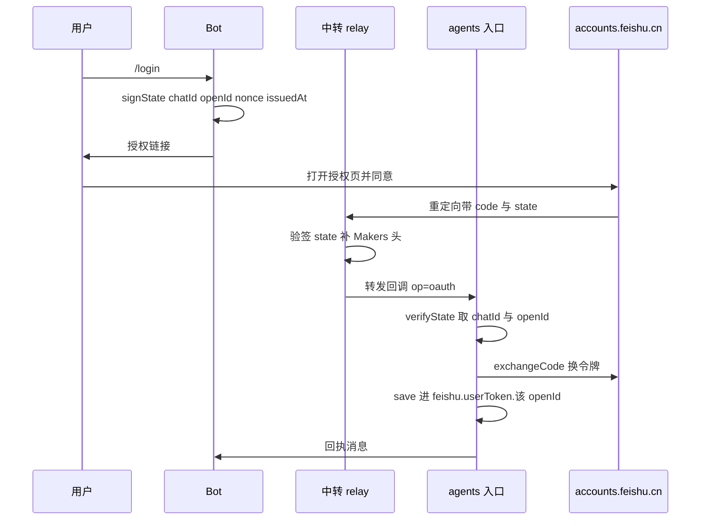
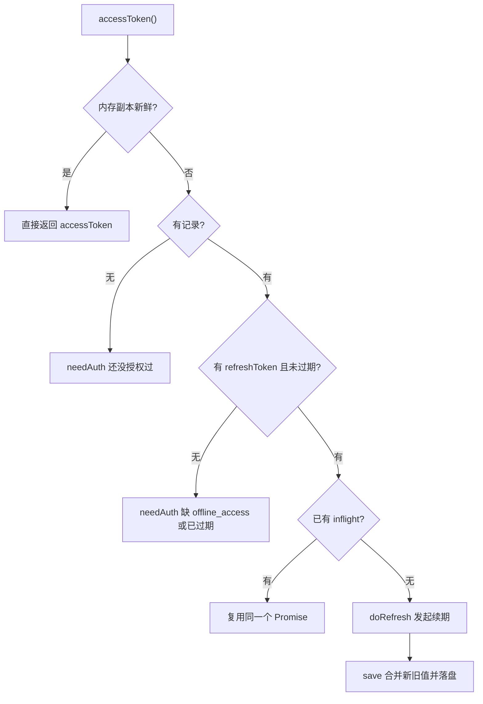
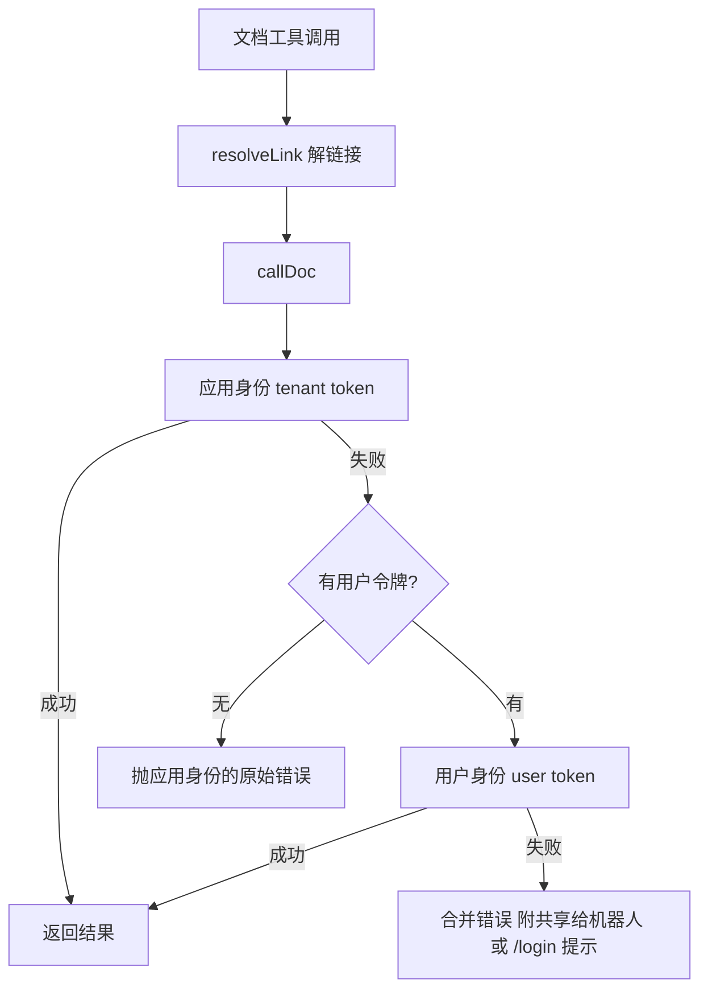

# 身份模型：应用身份与用户身份

飞书这条链路上同时存在两个身份，各自能碰到的资源范围完全不同。选错身份的后果不是「失败」，而是**看起来成功但产出归错了人** —— 所以「用哪个身份发这次请求」是这个系统里少数被刻意写进注释、画进代码结构、并被测试钉住的设计决定。

| | 应用身份（`tenant_access_token`） | 用户身份（`user_access_token`） |
|---|---|---|
| 取法 | `app_id` + `app_secret`，无需任何人参与 | 走一轮 OAuth，用户点链接授权 |
| 能读什么 | **被显式共享给这个机器人**的文档/表格 | 用户**自己**有权限读写的一切 |
| 能写什么 | 共享给机器人的资源 | 用户自己有权限的资源 |
| 落点 | `feishu.token`（按会话 KV，`TokenCache` 形状 `{token, exp}`） | `feishu.userToken.<openId>`（**按人分槽**） |
| 生命周期 | 两小时，过期静默重取 | 两小时，靠 refresh token 续期 |

发消息（`sendText`）走的是应用身份，缓存形状由 `src/feishu/api.ts` 的 `TokenCache` 接口固定成 `{ token, exp }`；云文档工具走的是「应用优先、用户兜底」，只有新建文档例外 —— 那条**只认用户身份**。

## 应用身份：零授权直读

应用身份的完整取用/缓存/失效重试都在 `src/feishu/api.ts`：

- `tenantAccessToken(env, cache, forceRefresh)` 先查缓存，命中且 `exp > now + 60s` 就直接用；否则 POST `/auth/v3/tenant_access_token/internal`，把 `expire`（秒，通常 7200）换成毫秒落盘。
- `feishuCall(env, cache, method, path, body)` 是带鉴权的通用调用：取 token → 发请求。遇到业务码 `99991663`（token 无效/过期）时**强制刷新一次再重试**。这个重试存在的理由很具体：缓存里的 token 可能被人在后台重置 App Secret 而作废，局部重试一次比让用户重发消息强。
- 飞书**即使出错也回 HTTP 200 + 业务错误码**，所以 `post` / `feishuCall` / `feishuCallAs` 都检查 `json.code !== 0` 并抛 `FeishuError`，不能只看 `res.ok`。

应用身份的好处是「零授权」：群里的任何人贴一个已共享给机器人的文档链接都能用，不需要任何人 `/login`。代价是每份文档要右键「添加文档应用」共享一次。

## 用户身份：范围更大，代价是每个人各走一轮 OAuth

用户身份由 `src/feishu/oauth.ts` 与 `src/feishu/user-token.ts` 管。它的价值是一句话：应用身份只读得到「被共享给这个机器人」的文档，用户身份读的是**用户自己有权读的一切**，也能在他的名下建文档。

### scope 清单与 `offline_access` 前提

`DOC_SCOPES` 是发起授权时要的权限全集：

```ts
export const DOC_SCOPES = [
  "docx:document:readonly",
  "wiki:wiki:readonly",
  "bitable:app:readonly",
  "sheets:spreadsheet:readonly",
  "docx:document",
  "bitable:app",
  "sheets:spreadsheet",
  "offline_access",
];
```

四个 `:readonly` 管读，三个不带 readonly 的管写（对应 `feishu_bitable_write` / `feishu_sheet_write` / `feishu_docx_write`）。`offline_access` **不是一种资源权限，而是拿到 `refresh_token` 的前提**：scope 里不带它，token 端点的响应里压根没有 `refresh_token` 字段，用户每两小时就得重新授权一次。这是这条链路最容易漏、也最难在测试环境发现的一条，冒烟测试里有一条专门断言 `DOC_SCOPES.includes("offline_access")`。

⚠️ **刷新令牌不会带来新 scope。** 三个写权限是后加进 `DOC_SCOPES` 的，已经授权过的用户不会自动拿到它们 —— 必须重新发一次 `/login` 走完整授权流程。飞书对这种情况只回一句 `99991679 Unauthorized. Please request user re-authorization.`，不解释为什么，所以 `docs.ts` 的 `callUserOnly` 在捕获 `99991679` 时补了一句人话，明说「旧的授权不会自动带上后加的权限」。

飞书 token 端点在 `accounts.feishu.cn`，和 `api.ts` 的 OpenAPI 根域名（`open.feishu.cn/open-apis`）不是一个域 —— 所以 `oauth.ts` 自己拼 URL，不复用 `base(env)`。

### state 签名：回调时唯一可信的身份来源

授权链接里的 `state` 会经过浏览器、飞书、以及中转（cf-agent-lab 的 `edgeone-relay.ts`）三层，每一层都可能被人替换。不签名的话，攻击者构造一个 state 就能把**自己的**授权码塞进别人的会话 —— 结果是受害者会话里存了攻击者的令牌，之后每次提问都在用**攻击者的文档权限**回答。

所以 state 编成 `base64url(payload).base64url(hmac)`，用 `INTERNAL_TOKEN` 做 HMAC-SHA256 签名（中转那边有同一个值 `EO_INTERNAL_TOKEN`，不必多分发一个密钥），签名比较用常数时间实现，验签失败、载荷非法、`chatId`/`openId` 缺失、或超过 `STATE_TTL_MS`（15 分钟）一律返回 `null`。

`state` 的载荷是 `{ chatId, openId, nonce, issuedAt }`。其中 `openId` 有两个用途：一是识别「换了个人用同一个会话」，二是群聊里给令牌**分槽**的依据。

回调处理（`agents/feishu/index.ts` 的 `handleOAuthCallback`）**只从验签通过的 state 里取 `chatId` / `openId`，不信 body 里的同名字段** —— body 是转发方拼的，而 state 是发起 `/login` 时我们自己签的。中转那边也验一遍同样的签名，两道关。签名正确但用户点了「拒绝」（带 `error` 不带 `code`）时返回 `{ ok: true, denied: true }`：这不是故障，不该报成故障。

OAuth 回调之所以落在 `agents/feishu/index.ts` 而不是别处：`agents/` 路由强制要求 `Makers-Conversation-Id` 头，而浏览器跳转带不了自定义头，所以必须由中转补头再转发。这条请求在去重/限流**之前**处理并**同步返回** —— 它没有 messageId，套上去重只会在用户重试时把第二次回调当成「重复」丢掉；而且中转那边的浏览器在等这个响应渲染结果页。



一次 /login 到令牌落盘的完整链路；身份全部来自签名过的 state。

`redirectUri(env)` **不做默认值**，没配 `FEISHU_OAUTH_REDIRECT_URI` 就直接抛错指出变量名 —— 回调地址必须和飞书后台「安全设置 → 重定向 URL」登记的完全一致，差一个字符用户看到的是飞书的一个报错页，完全不知道原因，猜一个默认值的错误概率极高。同理，`exchangeCode` 调用时传入的 redirect_uri 必须和发起授权时完全一致，两边都读同一个 env 才天然一致，所以代码里不留手写字面量。

### 令牌槽按人分槽：这是隐私要求，不是偏好

用户令牌落在 `feishu.userToken.<openId>`，由 `makeUserTokenStore(kv, openId)` 拼键，和 `store.ts` 的事件表（`feishu.events`，按会话）是两个不同的槽。`store.ts` 里明确注释了为什么不并进同一个 key：`feishu.token` 被 `TokenCache` 按固定形状 `{token, exp}` 读写，塞进去会两边互相静默覆盖；而且用户令牌要按人分槽，事件表按会话，生命周期不同。

**一个飞书会话 = 一个平台 conversation_id = 一份 KV，但「人」不等于会话**：群聊里一个会话背后是很多人。需求本身写的是「读**用户**有权限的文档」，所以令牌属于人，不属于会话。共用一个槽的话，群里最后授权的那个人会把自己的文档权限**出借给全群** —— 这是隐私事故，不是 bug。冒烟测试里有一条「不同 openId 用不同的槽（群聊里各授权各的）」：`ou_A` 与 `ou_B` 各写入自己的令牌，A `/logout` 后 B 的授权必须还在。

这个分槽从入口一路贯穿到工具：`createHost({ ..., openId: evt.openId, chatId: evt.chatId })` 拿到提问人身份，`_host.ts` 用 `deps.kv && deps.openId` 建一个 `UserTokenManager`，工具族闭包捕获它。没有 kv 或没有 openId 时它是 `null`：文档工具**照样挂**（应用身份不依赖它），只是这个人没有「用户身份兜底」这层，读不到未共享的文档时直接报应用身份的错误 —— 而且错误文案里**不提 `/login`**（没有用户身份可兜底，引导用户去授权是误导），这条也有测试钉住。

`/status` 的授权状态也是按人的：`statusText` 用 `deps.openId` 调 `authStateText(tokens, openId)`。换个同事来问，授权状态就不一样。

### 令牌续期：单飞 + 新旧值合并

`UserTokenManager` 管一个授权人的令牌槽。它持有一份**内存副本**（`load()` 惰性从 KV 读一次）和一组 `accessToken()` 判定，顺序刻意如此：先看内存副本够不够新（`tokenFresh`，默认提前 5 分钟判过期）→ 不够就续期 → 续不了才说要重新授权。反过来写（先判「有没有 refresh_token」）会让每次调用都白跑一次判断。



取用户令牌的判定顺序与单飞续期；并发调用会共用同一个 `inflight` Promise。

**单飞（single-flight）是必需的，不是为了省请求。** 一轮工具循环里模型可能连着调三四个文档工具，它们会同时发现令牌过期；没有 `inflight` 的话就是三四个并发 refresh，而飞书每次续期都**轮换** `refresh_token` —— 后到的那些用一个已经被作废的令牌，全部失败，用户看到的是「刚授权完就说授权失效」。

**合并新旧值是这条链路最容易自伤的地方。** 飞书续期时轮换 refresh token，但响应里**不保证每次都带新值**。照着响应整个覆盖的话，一次没带就写成空串，而那个空串是唯一的长效凭据 —— 表现是「用着用着突然要重新授权」，重新授权一次又能好一阵，极难归因。所以 `merge()` 里新值优先、旧值兜底：

```ts
private merge(v: UserToken): UserToken {
  return {
    ...v,
    refreshToken: v.refreshToken || this.current?.refreshToken || "",
    refreshExp: v.refreshExp || this.current?.refreshExp || 0,
    openId: this.openId,
  };
}
```

冒烟测试把两个方向都钉住了：响应带了新值就用新的，没带就保留旧的（测试名直呼其为「最要命的一条」）。

**续期失败时先重读一次槽再放弃，仍然失败则清掉本地坏记录。** 前者对应跨实例竞争：同一个 conversation_id 理论上粘在一台实例上，但没有硬保证，另一台可能已经续过并写回了新 refresh token，而手上这个已经作废 —— 重读发现值变了就用新的再试一次。后者对应「续不回来了」：清掉本地槽（`this.current = null` + `store.clear()`），否则下次又拿它去撞同一堵墙。清的是**这一槽的本地记录**，用户重新 `/login` 会写一份新的。

有两个刻意的不对称：

- `invalidate()`（给 `99991663` / `99991664` 用，因为令牌可能被用户在飞书侧主动撤销、`exp` 还没到，光看时间发现不了）**只标记内存副本过期，不回写 KV**。内存里标记就够了，KV 里那份仍是有效的旧值；万一续期也失败、进程又刚好被驱逐，下一个实例读到的还是那份能用的令牌，而不是一个被我们标记坏的记录。
- `peek()` 只看不刷新、`forget()` 清干净并返回「本来有没有」，两者都无副作用 —— `/status` 和 `/logout` 的回执要照着它们说实话。

续期链路本身很难在默认配置下验到：默认提前 5 分钟判过期，意味着想看到一次真实的 refresh 得等将近两小时。所以 `skewMs` 可覆盖（`FEISHU_USER_TOKEN_SKEW_MS`），把它拉到 2 小时，一次调用就能走到续期分支 —— 否则这条最容易坏的路只能靠「等两小时再看」来验。

## 云文档工具的身份解析：应用优先、用户兜底

七个文档工具的每一次调用都要先解链接（`start(url)` → `resolveLink`，wiki 链接在这里解引用成底层 `obj_token`），然后走一个身份分发函数：

- `callDoc` —— **应用身份优先，用户身份兜底**。先用 `feishuCall`（自带 tenant token 取用与失效重试）；失败且这个人有用户令牌时，换用户身份再试一次；两边都失败则给**合并错误**，把两条路各自的原始错误都带上，并附一条可执行的提示（「共享给机器人」或「发 /login」）。模型需要知道两条路都试过了，才不会自己再重试一遍。
- `callUser` —— **只用用户身份**发，遇 `99991663` / `99991664`（令牌无效）就 `invalidate()` 再取一次重试**一次**。重试放在这里而不是 `feishuCallAs` 里是有意的：只有令牌管理器知道怎么续期，而续期要落盘，把它埋在通用 helper 里调用方就看不见那次写回了 —— `api.ts` 的 `feishuCallAs` 因此刻意**不做**刷新重试，只负责发。
- `callUserOnly` —— **只用用户身份，不兜底到应用身份**。新建文档走这条。

`callDoc` **不按错误码过滤「该不该兜底」**：飞书各产品的权限错误码不统一（docx / bitable / sheets / wiki 各一套），白名单迟早漏。代价是模型自己写错参数（如 `table_id` 不存在）时多打一次注定失败的请求，这个代价可接受。

`tokens` 为 `null`（没接 KV / 本地调试）时，`callDoc` 直接抛应用身份的错误，不给用户身份的提示。



读/写已有资源的身份分发；新建文档不经过这条路径，见下节。

## 新建文档拒绝退回应用身份：一条硬要求

`feishu_docx_create` 是这条链路上唯一**故意不设应用身份兜底**的工具，理由是实测出来的：

> **应用身份建出来的文档归应用自己的云空间，用户打开只有只读** —— 菜单里是「申请编辑权限」、点「删除」回「无权限操作」、往正文打字打不进。更麻烦的是**应用没有删除 scope、用户又没有编辑权**，那种文档**两边都清不掉**。

所以「建」这件事必须用用户身份，产出才落在**用户自己名下**、可编辑可删可分享。代价是没 `/login` 的人用不了 —— 这是**有意的取舍**，退回应用身份就等于又造一篇用户既改不了也删不掉的死文档，把刚修掉的问题原样再犯一遍。代码里 `callUserOnly` 的注释、以及 `CREATE_AUTH_HINT`（与通用的 `AUTH_HINT` 分开：那条说「共享或 /login 二选一」，这条**只有 /login 一条路**）都写明了这个理由。

这条规则被**测试钉住**，而不是靠注释：

- 「建文档走**用户身份**：全程不取租户令牌，两跳都带用户令牌」—— 断言 `calls.filter(c => c.url.includes("tenant_access_token")).length === 0`，且建 + 追加两跳的 `authorization` 都是用户令牌 `Bearer at-1`。
- 「建文档没授权时：直接说不，**不退回应用身份**造文档」—— 断言报错文案里有 `/login`、**没有** `docUrl`，且一次都没去取租户令牌、一次都没打创建端点。

这两条身份测试是 2026-09-26 补的，因为在此之前那 4 条创建测试**全都是绿的却区分不出用的哪个身份**（stub 按 URL 路由，谁发的都接）—— 把身份改回应用身份，它们一条都不会红。这种「测试与实现出自同一份误解」正是更早那个字段名 bug 能一直全绿的原因。所以「创建测试的桩里故意不桩租户令牌端点」，让「偷偷退回应用身份」这种回归立刻暴露。

创建与随后的追加**必须同一个身份**（两处都传 `callUserOnly`）：新建的文档没共享给应用，用应用身份去追加是注定失败的一跳。正文追加失败时**不回滚** —— 文档已经建出来了，把链接吞掉才是更坏的结果，所以如实返回 `contentError` 并给出下一条路（链接有效，可以再用 `feishu_docx_write` 补）。

## 相关设计约束

- **用户令牌不落 `feishu.token`。** 那个槽由 `TokenCache` 按 `{token, exp}` 固定形状读写，混用会两边静默覆盖。见 [存储模型](storage-model.md)。
- **令牌按 openId 分槽**：群聊里每人一份，`/logout` 只影响本人。见 [飞书开放平台集成](../integrations/feishu-open-platform.md)。
- **`offline_access` 必须在 scope 里**，否则每个用户两小时重新授权一次。授权地址与回调地址的注册见 [OAuth 授权流程](../workflows/oauth-authorization-flow.md)。
- **读/写身份选择与工具契约**（截断标注、`{ error }` 永不抛、wiki 解引用）见 [飞书文档读写工作流](../workflows/feishu-doc-read-write.md)。
- 授权失效时的表现：`accessToken()` 返回 `{ needAuth: true, reason }`，`reason` 带具体原因（「还没授权过」「没拿到 refresh_token 已经过期了」「refresh_token 过期了」「授权已失效（原始错误）」），工具把这句转述给用户并给出 `/login`。
