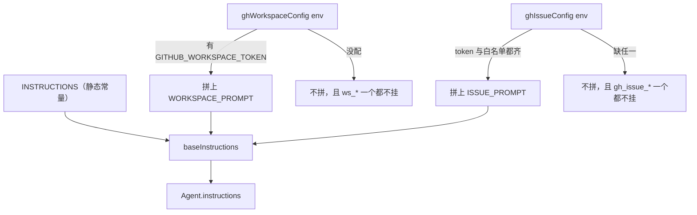

# 提示词契约与模型行为规则

模型的行为**只由它能看见的东西决定**：系统提示词、工具描述、参数与字段的 `description`、以及摘要请求的 system prompt。这些文本合起来是一份**契约** —— 模型的每一次能力判断、每一条自我约束都从它读出来。写进源码注释、写在文档里、或者只存在于作者的脑子里的规则，对模型等于不存在。

这条规矩是踩出来的，而且是同一个坑的两次：

- `decisions.md` 当初由 `init_memory` 创建、却没有任何提示词提到它 —— 实测两次真实运行，模型从没建过那个文件。
- 「一个 key 只装一件事」原先只写在 `src/feishu/global-memory.ts` 的文件头注释里（那是给读代码的人看的），于是模型把「内部代号」和「发布分支」并成了一个 key `prefs/项目代号与发布分支`，换个跑法又拆成两个。

教训统一为一句：**提示词没说的规则，模型不会遵守**（原话见 `docs/01-架构与移植映射.md`）。反过来也成立：**说了但手上没有的能力，模型会去调然后白烧一轮**。所以契约有两条对偶的约束 —— 该说的必须说全，不该说的一个字都不能多。

## 契约的五个落点

| 落点 | 住哪 | 谁写 |
|---|---|---|
| 系统提示词（静态部分） | `agents/feishu/_instructions.ts` 的 `INSTRUCTIONS` | 手写常量 |
| 系统提示词（条件段落） | 同文件的 `WORKSPACE_PROMPT` / `ISSUE_PROMPT` | 手写常量，由 `_host.ts` 按配置拼接 |
| 系统提示词（动态部分） | `GlobalMemory.renderForPrompt()` 的渲染结果 | 运行时每轮快照 |
| 工具描述与字段说明 | 各工具定义处（`_search.ts`、`docs.ts`、`global-memory.ts`、`ghworkspace/*`） | 手写字符串 |
| 摘要请求的 prompt | `src/feishu/compact.ts` 的 `SUMMARY_SYSTEM_PROMPT` | 手写常量 |

摘要 prompt 住在 `src/` 而不是 `agents/`，很容易在改助手定位时被忘掉 —— 但**它也是提示词**，一样受契约约束。2026-09-25 从「代码仓库阅读助手」改成通用助手时，它里面那条「本会话导入过哪些仓库」必须换成「引用过的来源」，否则模型会继续要求保留一个已经不存在的东西。

## 系统提示词：条件拼接，与工具挂载同开同关

`INSTRUCTIONS` 是静态常量，但**完整提示词不是**。`_host.ts` 在 `createHost` 里按运行时配置拼：

```ts
const baseInstructions =
  INSTRUCTIONS + (ghCfg ? WORKSPACE_PROMPT : "") + (ghIssueCfg ? ISSUE_PROMPT : "");
```



图中展示提示词段落与工具族的挂载条件共用同一份配置判据，两边必须同开同关。

两个条件段落的判据**就是**工具族的挂载判据：`ghCfg` 是 `ghWorkspaceConfig(env)`（要 `GITHUB_WORKSPACE_TOKEN`），`ghIssueCfg` 是 `ghIssueConfig(env)`（要 token + `GITHUB_ISSUE_REPOS` 白名单，留空则整个工具族不挂）。提示词是静态常量、工具是按配置挂的，所以只能靠 `_host.ts` 做这一层拼接 —— 写成 `INSTRUCTIONS` 里的一段就必然是「说了但手上没有」。

契约的这条对应关系在 `INSTRUCTIONS` 里逐句成立，几个典型例子：

- `web_search` / `browser_fetch` 的「先搜再答」对应 `makeSearchTools`（没配 `SERPER_API_KEY` 时返回空数组，提示词那句就变成关于一个不存在的工具的描述）；
- `code_interpreter` / `commands` / `files_*` 对应平台沙箱工具（`SANDBOX_ENABLED=0` 时整条不挂）；
- `feishu_doc_read` / `feishu_sheet_read` / `feishu_bitable_read` / 三个 `*_write` / `feishu_docx_create` 对应 `makeFeishuDocTools`（要应用凭证）；
- `remember_fact` / `forget_fact` / `recall_facts` 对应跨会话记忆（后端拿不到时整个不挂）；
- `ws_ls` / `ws_read` / `ws_write` / `ws_rm` / `ws_commit` 与 `gh_issue_create` / `gh_issue_comment` 对应两个条件段落。

**删工具时必须同步删提示词。** 2026-09-25 删仓库语料层时，`read` / `ls` / `grep` / `find` 那四个工具连同「怎么用这四个工具」的提示词段落一起删 —— 留着会同时踩两条：说了没有的能力，且和沙箱那族语义重叠、模型会在两套之间选错。

### `instructions` 传函数：一轮之内会求值多次

记忆内容不能塞进静态常量（它是运行时数据），所以 `Agent.instructions` 传的是**函数**而非字符串（`@openai/agents` 支持 `(runContext, agent) => string | Promise<string>`）。但这里有个必须知道的事实：**函数是每次模型调用求值一次，不是一轮一次**（`@openai/agents-core/dist/run.mjs` 的 `#prepareModelCall`）。传函数时记忆文本必须快照，否则提示词在同一轮内会变 —— 详见 [跨会话长期记忆](cross-session-memory.md) 与下一节的读数规则。

拿不到记忆后端时 `instructions` 退回**静态字符串**，不只是省一次 `await`：更重要的是提示词里不会出现「你有长期记忆」这种骗人的话。挂一个永远失败的工具只会让模型把基础设施问题当成自己的错，并反复去撞。

## 记忆读数规则（含一条禁编）

快照机制带来一个必然结果：**同一轮内「提示词末尾的清单」和 `recall_facts` 的返回本来就可能不同**。这必须写进提示词让模型知道，否则它只能自己猜，而它猜的方向是「怀疑自己」。`INSTRUCTIONS` 因此有专门的读数规则（原文以 ①②③ 编号，② 里还含一条禁撤回的子规则）：

1. **清单是快照，工具是实时。** 提示词末尾那份清单是**本轮开始时**的快照，不随后续写入变化；`recall_facts` 是**实时**查询。
2. **不一致以工具为准，且不要怀疑自己。** 「写入前查是 0 条、写入后查有 2 条」是完全正常的，不是故障。
3. **不要当众撤回。** 无论读到什么，都**不要**在回答里反复更正或撤回自己的说法（「我上一条说错了…撤回…再撤回」），那会让用户彻底不信你；读不到就直说「我现在读不到这条」，一次说清即可。
4. **不许凭上文印象冒充「查过了」。** 回答「长期记忆里记着什么」时**必须真的调用 `recall_facts`**，不要凭对话上文的印象作答，更**不要声称**「我刚查过 / 实时确认过」—— 没调工具就别说查过。

第 4 条对应一个独立的实测：某个会话把记忆清空之后，在一个**之前聊过这条事实**的会话里再问，模型答得头头是道，还补一句「实时确认过 `prefs/项目代号`，没变」—— 但它**压根没调 `recall_facts`**，那句话是从自己的对话上文里复述的。「我查过了」这种话是用户判断可信度的依据，编不得。规则 3 与 4 是同一类问题的两面：前者禁止**因为读数不同就推翻正确结论**，后者禁止**编造一个根本没发生的核查动作**。

记忆的**具体内容**不在 `INSTRUCTIONS` 里 —— 那里只写「有这回事」和「什么该记、什么不该记」。内容由 `_host.ts` 每轮动态拼在提示词末尾（`memoryText()` 的快照）。写入规则（「一个 key 只装一件事」等）则写在 `remember_fact` 的工具描述 + `key` 字段说明里，两条路径都不能省。

## 工具描述与字段说明也是契约

工具描述不是给人看的文档，是模型**选工具的唯一依据**。几处刻意的落点：

- `web_search` 的描述里明确「用户贴的飞书云文档要用 `feishu_*_read` 那几个工具，不要拿它当文档读取用」—— 两个数据源混用会让模型对着链接凭标题猜内容。
- `remember_fact` 的描述里带「**一个 key 只装一件事**」和单条字数上限，`key` 字段的 `describe()` 里再写一遍「别把两件不相关的事塞进一个 key（会互相覆盖）」。这条是有测试钉住的（`test/smoke.ts` 断言 `remember_fact.description` 含该字符串），免得重构时又把它删掉。
- `forget_fact` 的描述强调 key 要和 `recall_facts` / 提示词里显示的**完全一致**（含 `prefs/` 或 `user/` 前缀），因为模型看到的是完整键名。
- `recall_facts` 的描述说明它返回的是「项目级 + 提问人自己的」，别人的个人记忆不在里面「这是有意的」—— 让模型不要把可见性边界当成缺陷去绕。

工具结果的失败也走同一条契约：全仓工具族**永不抛错**，异常一律转成 `{ error }`（`src/shared/util.ts` 的 `guarded`），让模型自己看到并调整。搜到 0 条**不是错误**，返回空数组 + 一句提示，否则模型会反复重试同一个词 —— 这条也写进了 `INSTRUCTIONS`（「搜索没有结果不是错误，换个关键词或放宽范围再试」）。

## 来源分离：三个来源不许互相冒充

`INSTRUCTIONS` 花了整段把三类信息分开，因为混起来说用户没法判断该信哪一句：

- **文档里的内容**（`feishu_*_read`）、**网上查到的内容**（`web_search` / `browser_fetch`）、**你自己推的结论**（沙箱里跑的脚本）是三个来源，回答时要说清每一句是从哪来的。
- 沙箱结果尤其要点明：那是**它自己写的脚本**跑出来的，不是既有事实，引用时要说明「按上述逻辑推演」而不是当成「本来就这样」。
- 引用外部信息要给出处（链接或站点名）。
- `files_*` 操作的是**沙箱里的临时工作目录**，不是用户的磁盘、也不是长期存储；沙箱会过期。不点明的话模型会承诺「帮你存好了」。
- 搜不到就直说查不到，**不要编一个看起来合理但没查过的答案**。

这条契约也延伸到摘要 prompt：`SUMMARY_SYSTEM_PROMPT` 要求「必须保留引用过的来源（网页 URL、飞书云文档链接，**原样保留**）」和「记不清的地方就写『未确认』，**不要编**。摘要会被当成事实用」。摘要会被写回会话、当作后续轮次的背景，所以它和系统提示词受同一条「不许编」的约束。

## 摘要 prompt：跟着助手定位走

`SUMMARY_SYSTEM_PROMPT` 列了必须保留的四类信息，`test/smoke.ts` 直接断言这四个关键词（「来源」「结论」「偏好」「还没做完」）都在，并要求含「不要编」、**不含「仓库」**（防止仓库问答时代的保留项残留）：

1. 引用过的来源：网页 URL、飞书云文档链接，**原样保留**（后续要能顺着追溯）；
2. 讨论过的问题和得出的关键结论。算出来的数字要连口径一起留（单位、时间范围、数据来源）；
3. 用户表达过的偏好或决定；
4. 还没做完的事、悬而未决的问题。

「按上述逻辑推演」这条沙箱规则也在这里被追认：摘要要求「算出来的数字要连口径一起留」，否则后续轮次会把一个自己在沙箱里推演出的数字当成外部事实复述。

## 回执排版：纯文本不渲染 Markdown，卡片渲染

飞书的两条出站通道**排版规则不一样**，不能混：

| 通道 | 载体 | 渲染 Markdown？ | 谁用 |
|---|---|---|---|
| `sendText` | `msg_type: "text"` | **否** —— `**x**` 原样显示成星号 | 命令回执（`/help`、`/status`、`/memory`、`/forget`、`/login` 的链接、`/clear`、`/compact`） |
| 流式卡片 | `cardkit` 卡片的 `markdown` 组件 | **是** | 模型的回答 |

卡片的正文组件确实是 `{ tag: "markdown", element_id: ANSWER_ELEMENT_ID }`，所以 `INSTRUCTIONS` 才可以说「回答会显示在飞书的卡片里，**支持 Markdown**」，并进一步给排版细则：行内标识符用反引号；**别用宽表格**（手机上的卡片很窄，宽表格要横向滚动），需要对比时改用列表。

反过来，凡是走 `sendText` 的字符串就**不能用 Markdown**：

- `_host.ts` 的 `loginUrl()` 里那段授权链接回执，专门有一条注释警告不要用加粗和反引号 —— 它会原样把 `**x**` 显示成星号。
- `renderMemoryList()`（`/memory` 的清单）同样如此，`turn.ts` 的 `FeishuTurnHost.memoryText()` 接口注释里也复述了这条约束。
- `HELP_TEXT` 是纯文本表格式对齐，不用 Markdown 语法。

⚠️ 这条分野必须写进**契约本身**（`INSTRUCTIONS`），而不是只写在代码注释里 —— 模型是在卡片上写回答，且它写的是 Markdown；但只要它参与了任何走 `sendText` 的文案（例如把链接转述进回答），排版规则就得跟着变。所以 `INSTRUCTIONS` 里还有一条：授权链接**不要自己编、也不要转述**，链接必须由机器人原样发出，因为模型复述 URL 容易出错（截断、加空格、把 `/` 写成全角），而授权链接错一个字符就是死路一条。

## 不变量与失败模式

| 不变量 | 违反后的表现 | 为什么难查 |
|---|---|---|
| 每句能力声明对应一个真实挂着的工具 | 模型反复调一个必然失败的工具，白烧一轮 | 症状是「偶尔答得慢/答不上」，不像配置错误 |
| 条件段落与工具族同开同关 | 同上，且只在特定环境变量缺失时出现 | 本地调试环境（有 key）复现不出来 |
| 规则写在模型看得见的地方 | 规则完全不生效，且**不报任何错** | 代码看着「写得很清楚」，只有真跑才发现行为不对 |
| 记忆读数的规则写进提示词 | 模型当众撤回正确的答案，反复横跳；或自称「实时确认过」而其实没调工具 | 用户感知是「它不可信」，而不是「配置错了」 |
| 摘要 prompt 与助手定位一致 | 摘要要求保留一个已删除能力对应的信息 | 摘要看起来「很详细」，只是有一类是空的 |
| `sendText` 回执不用 Markdown | 用户看到一串星号和反引号 | 纯观感问题，不影响功能，最容易漏 |

## 扩展点：改契约时改哪里

- **加/删能力** → 同时改 `_instructions.ts`（或对应的条件段落）与工具族挂载点（`_host.ts` 的 `tools` 数组 / `platformTools` 的 `extraExcluded`）。两边是同一份判据的两个出口。
- **加行为约束**（如「先查再答」「不许冒充查过了」）→ 写进 `INSTRUCTIONS`；如果能落成工具的字段约束（`describe()`）就更可靠，因为它在模型选工具的那一刻一定被读到。
- **改助手定位** → 三处一起看：`_instructions.ts`、`SUMMARY_SYSTEM_PROMPT`（`src/feishu/compact.ts`）、以及各工具描述里提到定位的句子。
- **改命令回执**（`statusText` / `loginUrl` / `logout` / `compact` / `clear` / `memoryText` / `forgetMemory`）→ 记得这些走 `sendText`，不要用 Markdown。

## 相关页面

- [跨会话长期记忆](cross-session-memory.md) —— 每轮快照 vs 实时 `recall_facts` 的机制，以及 `renderForPrompt` 的渲染预算
- [工具契约与清单](tool-contract-and-inventory.md) —— 契约另一面：现在究竟挂了哪些工具、各自的挂载条件
- [命令与控制流程](../workflows/commands-and-control.md) —— 走 `sendText` 的那些回执
- [会话压缩](../workflows/session-compaction.md) —— `SUMMARY_SYSTEM_PROMPT` 所在的那条链路
