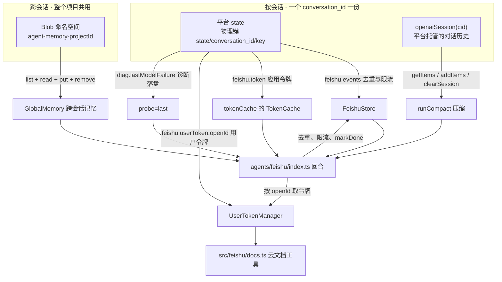
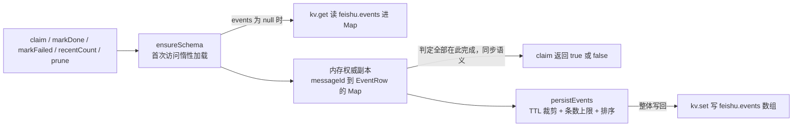

# 存储模型：三个键空间

原版 cf-agent-lab 跑在 Durable Object 上，自建了 20 多张表（去重、token 缓存、对话消息、语料快照……）。EdgeOne 既没有 DO 也没有 SQL，所以那一整套表都得换掉 —— 换成的不是「一个数据库」，而是**三片互相隔离的键空间**，各自归属维度不同、读写入口不同、被谁托管也不同。

本页讲**放置与隔离**：东西存在哪、键长什么样、哪个代码路径读写它、以及它们之间为什么不能混用。三片空间各自的保证强度（去重不是分布式锁、Blob 无 CAS/TTL、会话窗口锁死 100 条）见[平台约束与弱化的保证](../architecture/platform-constraints.md)；跨会话记忆的键语义、上限与可见性见[跨会话长期记忆](cross-session-memory.md)。

## 三片空间的对照

| 键空间 | 物理落点 | 归属维度 | 托管方 | 读写入口 |
|---|---|---|---|---|
| 平台 state | Blob 的 `state/<conversation_id>/<key>`（平台命名空间 `memory-<projectId>` 内） | **按会话** | `context.store.state` | `StateKv` 接口（3 个方法）→ `FeishuStore` |
| 对话历史 | 平台内部，不暴露表名 | **按会话** | `context.store.openaiSession(cid)` | SDK 原生 `Session`（`getItems` / `addItems` / `clearSession`） |
| 长期记忆 | Blob 命名空间 `agent-memory-<projectId>` | **跨会话共享** | 运行时裸 `getStore({ name })` | `MemoryBackend` 接口（4 个方法）→ `GlobalMemory` |



三片空间与各自的代码入口：前两片按 `conversation_id` 归属，第三片不带会话前缀。

前两片是**按会话**的：一个飞书会话 = 一个平台 `conversation_id` = 一个 agent 实例，所以「按会话隔离」正好等价于原版「一个 DO 实例一个库」。第三片是**跨会话**的：「这个团队用 pnpm」这类事实不属于任何一个会话，换个群就得重说一遍。**「换个群就得重说一遍」的那条界线，就是这三片空间的分界。**

## 一、按会话的平台 state

落点是 `context.store.state`：一个**按 `conversation_id` 隔离的 JSON 键值存储**，key 1~256 字符，value 任意可 JSON 序列化的东西，跨实例持久化。物理键形如 `state/<conversation_id>/<key>`（2026-09-25 实测：在平台命名空间里 `list` 出 255 个键，布局清晰可见）。

平台耦合被收口在一个 3 方法的接口里，业务代码不认识平台：

```ts
export interface StateKv {
  get<T = unknown>(key: string): Promise<T | null>;
  set(key: string, value: unknown): Promise<void>;
  delete(key: string): Promise<void>;
}
```

`makeStateKv(context)`（`agents/feishu/index.ts`）把平台对象适配成这个接口 —— 它同时认 `context.store.state`（`agents/` 路由下）和 `context.agent.store.state`（`cloud-functions/` 下）两种形状，因为这是同一条链路在不同运行时里的两种暴露方式。

### 键的清单与归属

| 键 | 内容 | 谁写 | 谁读 |
|---|---|---|---|
| `feishu.events` | 去重 / 限流的事件行数组 | `FeishuStore.claim` / `markDone` / `markFailed` / `persistEvents` | `claim`、`recentCount`、`prune` |
| `feishu.token` | `tenant_access_token` 缓存，形状固定为 `{ token, exp }` | `FeishuStore.tokenCache().set` | `tenantAccessToken`（经 `TokenCache` 接口） |
| `feishu.userToken.<openId>` | 该授权人的 `user_access_token` + `refresh_token` | `UserTokenManager.save` / `clear` | `UserTokenManager.load`、`doRefresh` 的并发兜底重读 |
| `diag.lastModelFailure` | 模型层最后一次失败 / 历史被裁剪的记录 | `_host.ts` 的诊断回调 | `?probe=last` |
| `probe-state/<cid8>` | 跨会话可见性的对照探针（预期**不**跨会话） | `?probe=store&op=write` | `?probe=store&op=read` |

### 用户令牌为什么按 `openId` 分槽

`feishu.userToken.<openId>` 是这片空间里**唯一不按会话归属**的键，而这是有意的：

- **人不等于会话。** 群聊里一个会话背后是很多人，而需求本身写的是「读**用户**有权限的文档」—— 令牌属于人，不属于会话。共用一个槽的话，群里最后授权的那个人会把自己的文档权限**出借给全群**，那是隐私事故而不是 bug。
- **不能塞进 `feishu.token`。** 那个槽由 `src/feishu/api.ts` 的 `TokenCache` 按固定形状 `{ token, exp }` 读写，混用会两边互相覆盖，而且失败起来很安静。
- **生命周期不同。** 事件表按会话、按分钟滚动；用户令牌对人长期有效、还会被 refresh 轮换。混在一张表里会让惰性加载（下文 `ensureSchema`）变得别扭。

所以 `makeUserTokenStore(kv, openId)` 只是「同一个 `StateKv` 后端 + 不同的 key」，却刻意独立成一个模块（`src/feishu/user-token.ts`）。令牌的续期、单飞、新旧值合并属于[身份模型](identity-and-authorization.md)，本页只管它落在哪。

### 进程内权威副本 + 写穿

`FeishuStore` 不是「每次读都打 KV」，而是**内存里持一份完整副本，改完整体写回**：



为什么是这个形状，而不是「每次先查再写」：原版的 `claim()` 是**同步**的，因为 DO 单线程 + 本地 SQLite 让「先查再写」这个复合操作天然原子，两个 webhook 并发进来也串行执行。KV 读写天生异步，原子性没了。于是判定全部挪到内存里做（同步语义、天然原子），KV 只作为可恢复的落盘。

三条实现细节值得注意：

- **`null` 与空 `Map` 是两回事。** `events === null` 表示「还没从 KV 加载过」，空 `Map` 表示「加载了但确实空」—— 用前者当加载哨兵，`ensureSchema()` 才是幂等的（第一次之后是空转）。原版这里是建表 DDL，移植后语义不变、动作换成「把历史读进内存」。
- **所有公开方法都先 `ensureSchema()`。** 漏掉任何一条入口，那条路径就会看到一份空副本并整体写回，等于**把 KV 里的历史抹掉**。
- **构造器不用 TS 参数属性。** `constructor(private kv: StateKv)` 在 Node 的 `--experimental-strip-types`（strip-only 模式，只剥类型不做代码生成）下直接 `ERR_UNSUPPORTED_TYPESCRIPT_SYNTAX`。冒烟测试要在裸 Node 下跑，所以手写字段 + 显式赋值。

⚠️ **这套方案只在「同一时刻只有一个实例在处理这个会话」时正确。** EdgeOne 的会话粘性路由（同一个 `conversation_id` 粘到同一实例，由 `fs-` + `SHA-256(chatId)` 的确定性哈希保证）给了这个保证，所以成立 —— 但它**不是分布式锁**。哪天同一个 `conversation_id` 被路由到两个实例，去重就会失效，表现为**同一条消息被回答两次**。原版的 DO 天然没有这个问题。粘性路由与前缀约束见[会话路由与三种入站实现](../architecture/conversation-routing-and-ingress.md)。

### `MAX_EVENTS` / `prune` / TTL 怎么给 KV 载荷封顶

`feishu.events` 是这片空间里唯一会持续增长的键，三个数字管住它：

| 常量 | 值 | 作用 |
|---|---|---|
| `DEDUPE_WINDOW_MS` | 10 分钟 | **判据是时间窗口，不是 `state`** —— 窗口内同一条 `message_id` 就是同一件事，不管它处于 pending / done / failed |
| `EVENT_TTL_MS` | 3 天 | 超过就 prune 掉，否则 KV 里的数组会无限长 |
| `MAX_EVENTS` | 500 | 硬上限，超了丢最老的 —— **丢老事件是安全的**：它们早就出了去重窗口，唯一的作用就是给 prune 记账 |

有 TTL 兜底还不够：一个高频群一天能刷出几万条，3 天窗口意味着数组能长到十几万项，而**每次写回都要序列化整个数组**。所以 `persistEvents()` 在每次落盘前都先按 TTL 裁一遍、再按 `createdAt` 排序、超上限就 `slice` 掉最老的 —— 于是这份载荷的实际大小由 `MAX_EVENTS` 而非时间决定。这也是平台约束页里那条「单值大小上限」未知数的实际余量：现在存的最大东西就是这 500 条去重记录，几十 KB 量级。

`prune()` 的调度也被平台逼改了形状：原版靠 DO alarm 定期跑，而 EdgeOne 免费版 cron 最小间隔是 **1 天**（等于没有定时能力）。现在改成「搭车」—— 每轮对话跑完、在 `agents/feishu/index.ts` 的 `work()` 里 `await store.prune()` 一次。成本几乎为零，但只在高频会话里才真的跑。

### 惰性加载为什么不能省（跨实例读）

`ensureSchema()` 的「惰性」不是性能优化，而是**功能性要求**：KV 是按 `conversation_id` 归属、跨实例持久化的，而内存副本是按实例的。实测踩过：模型失败时把最后一笔记录写进内存环形缓冲，结果 `?probe=last` 那次请求被路由到**另一个实例**，探针里的内存部分（`memoryCount` / `entries`）是空的 —— 明明刚失败过。所以诊断记录也改走**会话 KV**（`diag.lastModelFailure`，探针的 `persistedFailure` 字段读它），任何实例都能读到。

## 二、平台托管的对话历史

对话消息本体**不在** `context.store.state` 里。平台按 `conversation_id` 提供 OpenAI Agents SDK 的原生 `Session` 实现：

```ts
context.store.openaiSession(cid);   // Session 接口：getItems / addItems / popItem / clearSession
```

它是零配置、跨实例持久化的 —— 原版对应的是 `agents/sessions` 那套（`cf_agents_session_messages` 表 + `createCompactFunction` 压缩），而**那个压缩钩子在这里不存在**，所以压缩只能自己组合三步（`getItems()` → 调模型摘要 → `clearSession()` → `addItems([摘要])`）。压缩的判据、安全约束与自动触发见[会话压缩](../workflows/session-compaction.md)。

存储视角上只有三件事重要：

- **模型看不到 100 条以前的对话。** 平台实现里 `MAX_LIMIT = 100`，而 SDK 取历史时不传 `limit`，本项目调 `openaiSession(cid)` 也没传 `maxItems` —— 于是窗口恒被截到最近 100 条，平台在没人被告知的情况下就丢了，不报错、不留痕。所以 `getItems()` 拿到的**不是全部历史**，`/compact` 的语义也只是「把最近 100 条压成摘要」。
- **它是按会话的**，和 `context.store.state` 同一个归属维度 —— 所以 `session()` 取不到时（本地裸 Node、平台换了 API）退化成**无记忆**，而不是退化成跨会话记忆。
- **`session()` 的取用被一个 `try/catch` 包着**，拿不到就返回 `undefined`：本地没有平台 context 时不该因此跑不起来。同一段代码里也刻意不传 `maxItems`，不引入一个平台可能不认的参数。

⚠️ 会话历史与流式渲染之间还有一条**契约**：窗口一旦从「`assistant` 声明 `tool_calls` → `tool` 结果」这一对的中间切开，开头就会剩下一条孤儿 `tool` 消息，协议上非法、网关稳定 400，且之后每一轮都带着它 —— **这个会话会被永久毒死，只有 `/clear` 能救**。所以历史在交给 `run()` 之前必须过 `sanitizeAndAppend`（见 `src/feishu/session-sanitize.ts`）。这属于历史**内容**的约束，但它正是「按窗口取历史」这个存储行为的直接后果。

## 三、跨会话共享的 Blob 命名空间

第三片空间是**唯一不带会话前缀**的，也是唯一不通过 `context.store` 走的：它走运行时挂出来的裸 Blob SDK。

```ts
globalThis.__EDGEONE_AGENT_RUNTIME__.getStore({ name: "agent-memory-<projectId>" })
```

本页只讲它的**放置与隔离**；键空间（`prefs/*`、`user/<openId>/*`）、信封编码、`MAX_ENTRIES` 上限、`isVisibleTo` 可见性边界、以及后端拿不到时的静默降级，全部在[跨会话长期记忆](cross-session-memory.md)。

放置层面有两件必须知道的事：

- **命名空间是结构性的隔离，不靠自觉。** 平台自己的命名空间是 `memory-<projectId>`，里面装着 `conversations/`、`state/`、`message_index/` 这些**线上用户数据**。本系统用独立的 `agent-memory-<projectId>`，于是 `global-memory.ts` 里任何一个 `list` / `get` / `delete` 都**在结构上**不可能碰到平台的键 —— 因为 `list` 是按前缀枚举的，只要共用命名空间，任何一次前缀写错都可能枚举到用户消息、或者一次清理删掉平台的键。`?probe=store` 原来的注释以为 `context.store` 落在 `agent-store`，实测那个命名空间**根本不存在**；用错名字会在账号里凭空建一个垃圾命名空间。
- **落盘没有信封。** 平台自己的那层是 `createBlobBackedStore()` 包的，读出来是 `{"__eo_pages_store_v":…, "value":…, "expiresAt":…}`；本系统走裸 SDK，同一个凭证下读回来是**原样字符串，一个字节没变**。好处是键**不会自己过期**（「长期记忆」真的是长期的），代价是没有 TTL 兜底，增长只能靠 `MAX_ENTRIES` 管。

第三片空间和第一片的接口形状也不同：`MemoryBackend` 有 **4** 个方法（多一个 `list`）。多出来的这个正是**能力差异**而非风格差异 —— 枚举（「我记过什么」）是跨会话记忆的核心能力，而 `context.store.state` 没有 `list`。两者是**两个不同的东西**，别混。

## 隔离规则与不变量

这几条是改存储代码时最容易踩坏的地方：

1. **三片空间不共享键名、不共享后端、不共享归属维度。** 会话 KV 与 Blob 是两个后端；`feishu.token` 与 `feishu.userToken.<openId>` 是同一后端的两个槽，形状不同、不可互换。
2. **`ensureSchema()` 是所有入口的前置。** `FeishuStore` 的每个公开方法先调它；漏一个就等于拿空副本覆盖 KV。
3. **标完成必须 `await`。** `runFeishuTurn` 里 `await store.markDone(evt.messageId)`（原版是同步的 DO SQLite 本地写）。不 await 的话写回可能还没落地、进程就先结束了。同理 `turn.ts` 里所有 `store.*` 调用都已异步化。
4. **`persistEvents()` 是唯一的写回点。** 所有改动都要经过它，它同时负责 TTL 裁剪与条数上限 —— 绕过它就直接破坏了载荷封顶。
5. **去重判据是时间窗口，不是 `state`。** 这样才能挡住飞书的重试：它会在我们还没答完的时候重推同一条（webhook 那边可能已经超时了）。窗口外同 id 再出现，视为用户又发了一遍，重置成 `pending` 放行。
6. **只有服务于「用户消息」的路径才走去重 / 限流。** OAuth 回调（`op === "oauth"`）在 `claim()` **之前**分支返回，因为它是浏览器跳转、没有 `messageId`，套上去只会在用户重试时把第二次回调当成「重复」丢掉。

## 降级路径与可观测性

存储拿不到时**刻意不假装成功**：

- `makeFeishuStore(context)` 拿不到 `context.store.state` 时打印一行 `[feishu] 拿不到 context.store.state，退化成纯内存（重启即丢）`，改用 `MemoryKv`。这只该发生在本地调试。
- `MemoryKv` / `InMemoryMemoryBackend` 是给冒烟测试和降级用的纯内存实现 —— 它们是**测试缝**，不是生产兜底。跨会话记忆拿不到 Blob 后端时整个功能自动消失（不挂那三个工具、提示词里也不提记忆），**刻意不用内存实现兜底** —— 一个「这一轮记得、下一条消息就忘了」的记忆比没有记忆更坏，用户会以为记下了。
- 「记忆不见了」有两种完全不同的病（运行时没暴露 `getStore` / 拿不到 `projectId`），所以有 `memoryBackendStatus(env)`：只看配置、不建连接，把病因直接说成人话，并报 `projectIdFrom` 说明到底哪个变量生效了。它是 `?probe=store` 的 `memory` 字段输出，和真实回合走**同一个**解析函数。
- `?probe=store` 的 `op=write` / `op=read` 用**换一个 `Makers-Conversation-Id`** 的方式，在同一份代码里对照三条候选路（裸 Blob / 路由 store / 会话 state）的跨会话可见性 —— 所有写入都在 `probe-*` 前缀下，不碰 `feishu.*` 那些真键。

要恢复更强保证，只需换实现、不动业务逻辑：把 `StateKv`（3 个方法）换成外部 MySQL/PG 加 `unique(message_id)`，或把 `MemoryBackend`（4 个方法）换成外部 Redis/PG 加事务。这两条缝是刻意留窄的，清单见[平台约束与弱化的保证](../architecture/platform-constraints.md)。

## 测试钉住的地方

`test/smoke.ts` 的 **D 节**专门守这片空间（跑在裸 Node 里，用 `MemoryKv`）：

- 首次 `claim` 放行、窗口内重复拦、`markDone` 之后窗口内仍拦（钉住「判据是时间窗口不是状态」）；
- 窗口外同 id 重新放行（把 `createdAt` 往前挪 11 分钟，换一个 `FeishuStore` 实例读同一个 `kv` —— 顺带验证惰性加载）；
- `recentCount` 只数窗口内的、`overLimit` 到 10 条触发、另一个 `chatId` 不受影响；
- `prune` 清掉 4 天前的行（TTL 是 3 天）；
- **token 缓存跨实例恢复**：换一个 `FeishuStore` 用同一个 `kv`，仍读得到 `feishu.token`；
- **事件数组有条数上限**：连打 560 条，KV 里的数组必须 `≤ 500`。这条直接守 `MAX_EVENTS`，也间接守「每次写回不要序列化一个无限增长的数组」。

用户令牌分槽另有一条断言：`ou_A` 与 `ou_B` 各写各的槽，`A` 退出授权不影响 `B` —— 注释写明了理由：「共用一个槽的话，群里最后授权的人会把自己的权限出借给全群」。
