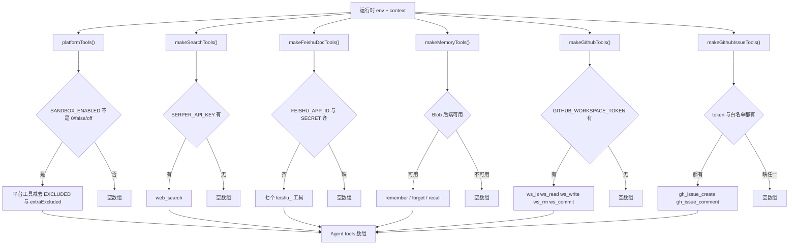
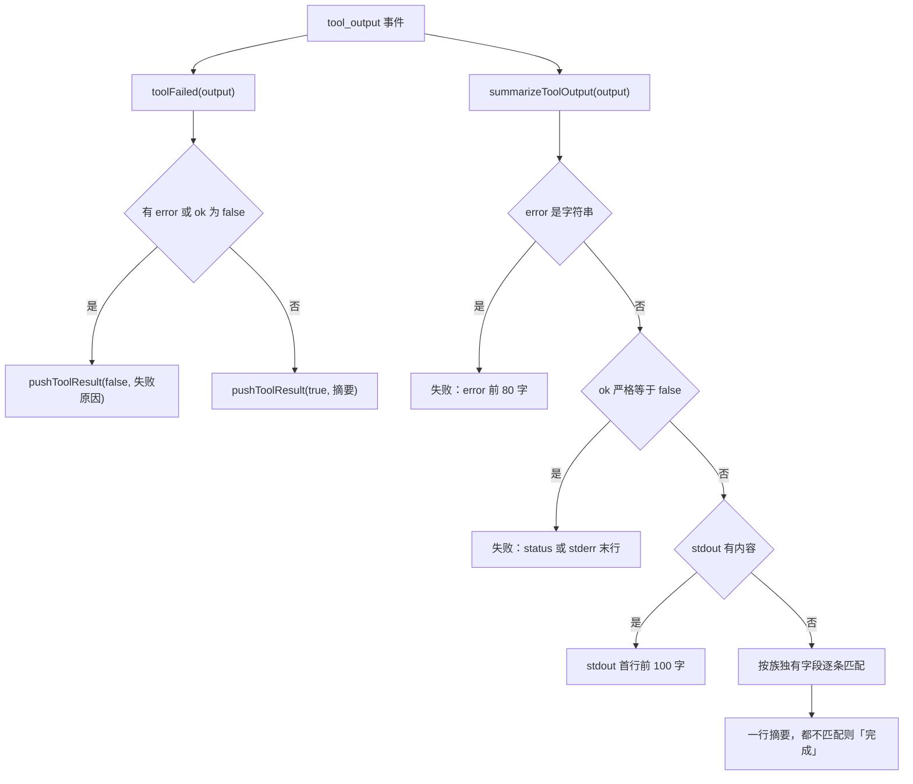

# 工具契约、工具族清单与挂载规则

模型能看见的每个工具都是它**选择空间的成员** —— 工具名是它选工具的唯一依据，工具描述是它判断「这个工具能干什么」的唯一依据。所以这份清单不是实现细节，而是行为面：挂错一个工具、漏挂一族、或者名字写错，症状全都是「模型行为变了」，且都不报错。

这张清单由两个机制共同决定：`agents/feishu/_host.ts` 的 `buildAgent()` 里那个 `tools` 数组（谁被装配进来），以及各工具族构造函数的**返回值**（配不全就返回空数组）。后者是关键：**挂载决策住在工具族的构造函数里，不在 `_host.ts` 里**。

## 工具来源：五族，逐族一个装配点

`_tools.ts` 的文件头把这个结构写得很明确，共五个来源：

| 来源 | 构造函数 | 产出的工具 | 挂载条件 |
|---|---|---|---|
| 平台内置沙箱 | `platformTools(context, env, extraExcluded)` | `commands` / `code_interpreter` / `files_read` / `files_write` / `files_list` / `files_exists` / `files_make_dir` / `browser_fetch`（`all()` 减去 `EXCLUDED` 与 `extraExcluded`） | `context.tools.all` 是函数，且 `SANDBOX_ENABLED` 不是 `0` / `false` / `off` |
| 自建搜索 | `makeSearchTools(env)` | `web_search`（serper） | 有 `SERPER_API_KEY`，否则返回 `[]` |
| 飞书云文档 | `makeFeishuDocTools(deps)` | `feishu_doc_read` / `feishu_sheet_read` / `feishu_bitable_read` / `feishu_bitable_write` / `feishu_sheet_write` / `feishu_docx_write` / `feishu_docx_create` | `FEISHU_APP_ID` 与 `FEISHU_APP_SECRET` 都在 |
| 跨会话记忆 | `makeMemoryTools(memory, openId)` | `remember_fact` / `forget_fact` / `recall_facts` | `blobMemoryBackend(env)` 拿得到 Blob（`makeGlobalMemory` 返回非 null） |
| 工作区仓库 | `makeGithubTools(cfg)` | `ws_ls` / `ws_read` / `ws_write` / `ws_rm` / `ws_commit` | `ghWorkspaceConfig(env)` 非 null，即配了 `GITHUB_WORKSPACE_TOKEN` |
| GitHub issue | `makeGithubIssueTools(cfg)` | `gh_issue_create` / `gh_issue_comment` | `ghIssueConfig(env)` 非 null，即 `GITHUB_ISSUE_TOKEN` **且** `GITHUB_ISSUE_REPOS` 白名单都有 |

（工作区与 issue 是两个独立来源 —— 分开的 token、分开的权限、分开的白名单，见下节。）

`_host.ts` 的 `tools` 数组按这个顺序展开，每一族都写成 `...(cfg ? make...(cfg) : [])` 的形式，把挂载判据显式摆在装配点上。



图中展示 `_host.ts` 的 `buildAgent()` 把六个装配点的产出依次展开成 `Agent.tools`，每个装配点各自判自己的配置是否完整。

## 挂载规则：配不全就不挂，而且必须同步提示词

这是全仓最一贯的一条规矩，三处注释用几乎相同的话说它：

> 挂一族必然失败的工具只会让模型反复去撞。

- `makeSearchTools` 没配 key 时返回 `[]`「而不是挂一个永远报错的工具」；
- `makeGithubTools(null)` 返回 `[]`，「挂出来只会让模型反复试用一个必然失败的工具」；
- `makeGithubIssueTools(null)` 返回 `[]`，理由同 `ghWorkspaceConfig` —— 「配不全就当没配」；
- `makeMemoryTools` 的调用点写成 `memory ? makeMemoryTools(...) : []`；
- `platformTools` 在 `SANDBOX_ENABLED=0` 时返回 `[]`，用于「先跑通纯搜索问答、把沙箱留到后面再开」。

规矩的另一半是**提示词段落必须用同一个条件拼接**：`_host.ts` 的

```ts
const baseInstructions =
  INSTRUCTIONS + (ghCfg ? WORKSPACE_PROMPT : "") + (ghIssueCfg ? ISSUE_PROMPT : "");
```

`WORKSPACE_PROMPT` 与 `ISSUE_PROMPT` 住在 `_instructions.ts` 里但**不在 `INSTRUCTIONS` 常量里**，正是因为它们是条件段落。`_instructions.ts` 把这条规矩写成硬规矩：「提示词没说的能力，模型不会想到用；反过来，说了但手上没有的能力，它会去调然后白烧一轮」。这层契约的细节见[提示词契约与模型行为规则](prompt-contract.md)。

⚠️ **平台工具不在提示词里点名**：`INSTRUCTIONS` 提到 `code_interpreter` / `commands` / `files_*`，但平台工具族只有 `SANDBOX_ENABLED=0` 这一个开关，没有「按配置条件拼接的沙箱段落」——关掉沙箱时那几句就变成关于不存在工具的描述。这是已知的不对称，不是设计。

## 平台沙箱工具：`all()` 全收，再减去 `EXCLUDED`

`platformTools()` 用的是 `context.tools.all()` 而不是逐个 `files()` + `get()`，理由是「我们几乎要全套（除了那几个）；用 `get()` 逐个点名的话，哪天平台加了新工具，这里不会自动跟上」。这是一条**刻意选择默认接新**的取舍：新增的平台工具会默认进入模型的选择空间。

被排除的（`EXCLUDED` 常量，五个）：

| 工具名 | 为什么不挂 |
|---|---|
| `browser_screenshot` | 点页面元素的操作类工具 |
| `browser_click` | 同上 |
| `browser_type` | 同上 |
| `browser_evaluate` | 同上 |
| `files_remove` | 破坏性操作；沙箱本来就会过期，不需要模型手动清理，留着反而多一次误删自己刚写的数据的机会 |

`browser_*` 那四个的判据是场景：「模型在飞书里答一个问题，没机会跟人来回确认点击目标，挂了只会让它乱点一通。要读网页用 `browser_fetch`。」

`extraExcluded` 是第二个参数，目前只有**一个**用处：自建 `web_search` 挂上时把平台内置的同名工具摘掉。调用点是那一行：

```ts
...(platformTools(context, env, searchTools.length ? ["web_search"] : []) as any[]),
```

### 为什么同名工具必须二选一

平台内置的 `web_search` 底层是腾讯云 WSA，本项目从没配 `WSA_API_KEY`，一调就报 `web_search requires the WSA_API_KEY environment variable.` —— **它是坏的**。所以自建了一个 serper 版（`_search.ts`），**名字故意保持 `web_search` 不变**（「模型无需知道来源变了」）。两个同名同用途的工具同时在列表里，模型选哪个全看运气，所以必须显式摘掉。官方文档接第三方搜索时也要求这么做。

⚠️ 自建版与平台版的返回值**形状不同**，这是卡片摘要分支配对的前提：自建版返回 `{ results: [...] }`（0 条时带回一句 `hint`），平台版没有这个字段。见下文。

### 未核实：平台工具的实际注册名

⚠️ **平台工具的这批名字（`commands` / `code_interpreter` / `files_*` / `browser_fetch`）来自官方文档《Using the Agent Framework》的表，尚未对着线上核过。** 仓库自己的未核实项清单（`docs/01-架构与移植映射.md` 第九节、`docs/03-验证清单.md` 第 4 步）把它列为「按文档写、没实测」的一类：

> 名字是模型用来选工具的唯一依据，写错就等于工具不存在 —— 部署后请对着本地 `/agent-metrics` 面板确认一遍实际注册的名字。

核错的表现是「模型调不到那个工具」，而 `EXCLUDED` 里那几个名字若与平台实际不同，**排除会静默失效**（`platformTools` 用 `String(t.name)` 比对，名字对不上就不匹配），坏工具会照常进列表。所以 `EXCLUDED` 的漂移与工具改名是同一类行为变更。

## 工具契约：永不抛错、JSON 字符串、截断显式

三处注释（`_search.ts`、`docs.ts`、`ghworkspace/tools.ts`）各自复述同一份契约，实现只有一份：

1. **永不抛错**：异常一律转成 `{ error }`。理由是硬的 —— **工具抛错会中断整个工具循环**，模型看不到错因，只看到这一轮断了。实现是 `src/shared/util.ts` 的 `guarded()`：

   ```ts
   export async function guarded<T>(fn: () => T | Promise<T>): Promise<T | { error: string }> {
     try {
       return await fn();
     } catch (e) {
       return { error: `工具执行失败：${(e as Error).message}` };
     }
   }
   ```

   `guarded` 原先住在 `src/workspace/tools.ts`（「读用户导入的仓库快照」那一层）。那一层在 2026-09-25 整体删除时，`guarded` 因为还被 `docs.ts` 与 `_search.ts` 用着，被先抽到 `src/shared/util.ts` 再删目录。教训写在文件头：「**删一层之前先看有没有别人在 import 它里面的通用零件。**」

2. **返回值序列化成 JSON 字符串**，全仓工具族统一。各文件里都有一行 `const json = (v: unknown) => JSON.stringify(v)`。

3. **截断必须显式标注，并给出继续的办法**，绝不能让半截内容被当成全文。具体形态是 `truncated: true` 加一个承接字段：`feishu_doc_read` 给 `nextOffset`，`ws_read` 给 `nextOffset`，`ws_ls` 给 `hint` + `truncated`。`feishu_doc_read` 的工具描述把这条写成对模型的指令：「用它再读下一段，直到 truncated 为 false。读全之前不要对整篇文档下结论。」`_instructions.ts` 里也有对应的一句 —— 不写清楚，模型会拿半截结果当完整的下结论。

4. **前置条件不满足时给「可执行」的提示**，别让模型自己猜。`feishu_doc_read` 两边身份都读不到时的 `AUTH_HINT` 会同时给出两条出路（让用户把文档共享给机器人，或发 `/login`），并明确「请不要自己编链接」；`ws_read` 读不到文件时会附一句自查（「如果 ws_ls 连根目录都列不出来，那是凭证没被授权这个仓库，不是文件不存在」）—— 因为 `getFile` 的 404 → null 把「路径不存在」和「PAT 没被授权这个仓库」合并成了同一种回报。

### 用法错与故障要分开

`usageError()` 是 `guarded` 之外的第二个包装层，出现在 `ws_*` 与 `gh_issue_*` 两族。它把 `UsageError`（白名单外、仓库名写错、把目录当文件读）翻成**不带前缀**的干净 `{ error }`，其余异常照旧丢给 `guarded`。原因是消息语义：「工具执行失败：」读起来像环境坏了，模型可能因此去重试或道歉 —— 而正确反应是换个工具、换个仓库，或告诉用户去改配置。

这条区分也决定了错误信息里该说什么：不在白名单时要**把允许的仓库列出来**（只说不允许，模型会去猜），并且这条校验在本地就挡住，一个请求都不发。

### 空结果不是错误

自建 `web_search` 搜到 0 条时返回 `{ results: [], hint: "没有搜到结果。换个关键词再试，不要重复同一个查询。" }` —— 不写清楚，模型会因为一个空结果连搜三次一模一样的查询。而且**不能报成 `error`**，否则「搜不到」会被理解成「工具坏了」。这条也写进了 `INSTRUCTIONS`（「搜索没有结果不是错误」）。`ws_ls` 遇到空目录同理，给的是 `note: "这个目录是空的"` 而不是空数组。

## 三族的边界设计（它们的存在理由就是边界）

### 云文档：读三个、写三个、建一个

七个工具里只有**三个被操作的资源**：文档类型有四种，但**知识库不是一种文档，是一种链接形态** —— 每个工具都先做一次 wiki 解引用，所以 `/wiki/xxx` 在所有工具里都能直接用。

写只有三种：多维表格记录、电子表格区域、文档正文**追加**。新版文档的块级编辑 API「又重又容易写坏版式，不值得」—— 要改已有正文，让用户自己在飞书里改。`feishu_docx_create` 是 2026-09-25 补的第七个：补之前六个工具**无一例外**都要求一个已存在的资源链接，于是「写一份报告」这类请求全做不了（这个缺口是 agent 自己在工作区仓库里报的）。

身份规则（应用优先、用户兜底）与 `feishu_docx_create` **只用用户身份**的例外，见[身份与授权](identity-and-authorization.md)与[飞书云文档读写流程](../workflows/feishu-doc-read-write.md)。

### 工作区：五个工具，写即 commit

`ws_ls` / `ws_read` / `ws_write` / `ws_rm` / `ws_commit` 读写的是 **agent 自己的** GitHub 私有仓库（默认 `guci314/cf-agent-workspace`），不是用户的任何代码。凭证是部署时配好的 fine-grained PAT（只授予那一个仓库的 Contents 读写），所以运行时用户什么都不用做。

`ws_commit` 的理由是**部署次数**：`ws_write` 一次一个文件 = 一个 commit，而 `projects/<名字>/` 下每个目录都是一个接自动部署的项目 —— 调一次往往动五六个文件，分成五次就是五个 commit、跑五次 CI、部署五次中间态。所以 `projects/` 下的改动**优先用它**，一个 commit 提交整批。

几个刻意的上限与语义（数值沿用 cf 原版，「契约一致，模型已有的使用习惯可以直接迁移」）：`ws_read` 最多 2000 行 / 50KB，**绝不返回半行**，截断给 `nextOffset`；`ws_write` 上限 256KB；`ws_rm` **不能删目录**（Contents API 一次只能删一个文件）。`ws_read` 的 offset/limit 是**取回全文后本地切片** —— GitHub Contents API 不支持分段读取，这个参数管的是「喂给模型的上下文有多大」，不是省流量。

### GitHub issue：独立凭证、独立白名单、不可关

`gh_issue_create` / `gh_issue_comment` 与 `ws_*` **分开文件、分开一份配置**。理由不是整洁，是权限：`GITHUB_WORKSPACE_TOKEN` 只授了 Contents，而 **Issues API 不属于 Contents 范围**，拿它提 issue 会 403。所以这不是「加个工具」，是**一次扩权** —— 混用一把 token 会让「改工作区凭证」这个动作意外影响 issue 能力，反之亦然。

只做「开 + 评论」，**不做关闭**：开 issue 可逆（能关），关闭别人提的 issue 是破坏性且面向他人的操作。这条和 `ws_rm` 只删文件不删目录、`EXCLUDED` 里排除 `files_remove` 是同一条约定。

白名单为空时 `ghIssueConfig` **必须**返回 null，这是全仓最明确的一条 fail-closed：没有白名单就意味着「这把 token 能开的仓库全都能开」，而 issue 是对外可见的 —— 「宁可没有工具，也不要挂出一族能往任意仓库写公开内容的工具」。白名单按大小写不敏感归一（统一存小写），因为 GitHub 的 owner/repo 大小写不敏感。

错误信息里**绝不回显 token**：它会被模型读、被卡片渲染、被用户复制出去，所以只带 GitHub 自己返回的 message。

## 工具结果如何落到卡片上：`summarizeToolOutput` + `toolFailed` 必须一起改

`_tools.ts` 的另外两个导出**不是工具**，是把工具结果渲染到飞书卡片的两个函数，它们和工具清单强耦合 —— 摘要分支的判据是**各族独有的字段名**，所以加一族工具、改一个返回字段，就可能让卡片显示错。



图中展示同一个工具结果被两个函数各读一次：`toolFailed` 决定画 ✅ 还是 ❌，`summarizeToolOutput` 决定那行写什么；两者判据必须一致。

分支顺序是**踩出来的，不是想出来的**，注释写明了每一条：

- **先看 `error`**：自己实现的那些工具（搜索 / 云文档 / 记忆 / 工作区 / issue）失败时返回的就是它。
- **再看 `ok === false`**：**平台沙箱工具**失败时返回的是 `{ok:false, status, stderr}`，**没有 `error` 字段**。只看 `error` 会把它们判成成功，卡片上出现一个骗人的 ✅。`toolFailed` 的注释只有一句：「和上面同一套判据，**两处必须一起改**」。
- **然后 stdout 首行**：`code_interpreter` / `commands` 的主要产出。

之后是按族独有字段匹配（`matchCount` / `paths` / `entries` / `totalLines` / `results` / `commit`+`path` / `totalChars` / `created`+`docUrl` / `rowCount` / `tableList` / `updatedCells` / `appended` / `added` / `updated` / `count`），最后兜底「完成」。有几条顺序约束是硬要求：

- `count` 太通用（多维表格记录数，`ws_ls` 也用），**必须排在后面**，否则会抢在更具体的字段（`totalChars` / `rowCount` / `tableList`）前面命中。
- `created` + `docUrl` 这条必须排在 `appended` 前面 —— 建文档时若带了正文，两个字段同时出现，「已建文档」比「追加 N 段」更该先说。判据用 `docUrl` 而不是 `created`，因为 `ws_write` 也返回 `created`，而那条已经被 `commit`+`path` 分支接走了。
- `commit` + `path` 这条（`ws_write` / `ws_rm`）必须说清**改了什么**：「这一族改了 GitHub 上的东西，摘要必须说清改了什么 —— 只回『完成』用户没法对账」。所以它输出 `已更新 <path>` / `已创建` / `已删除`。

摘要的消费者是 `FeishuStreamer.pushToolResult()`，它把结果写成一行 `✅ …` / `❌ …`，与 `pushToolCall()` 的 `🔧 \`name\`` 一起排进卡片正文。卡片只给**一行**是刻意的：工具完整返回值动辄几千字，全倒进去会把真正的回答淹掉，而且飞书卡片本来就不适合读长文本。

⚠️ **这条链路的实际到达情况仍未核实。** `_host.ts` 的 `applyEvent()` 处理 `run_item_stream_event` 的 `tool_called` 与 `tool_output` 两个事件名，其中 `tool_called` 出自官方模板、`tool_output` 是「按同一套规律推的」。仓库的未核实项清单把它列为未知数 1，验证面是部署后的本地 `/agent-metrics` 面板。**猜错的后果只是卡片上少一行 🔧/✅ 串，不影响答案正确性**（最终答案优先取 `result.finalOutput`）。

## 不变量与失败模式

| 不变量 | 违反后的表现 | 为什么难查 |
|---|---|---|
| 工具族配不全就整个不挂 | 模型反复撞一个必然失败的工具，白烧一轮 | 症状是「偶尔答得慢/答不上」，不像配置错误 |
| 工具挂载与提示词段落同开同关 | 同上，且只在特定环境变量缺失时出现 | 本地调试环境（key 齐全）复现不出来 |
| 同名工具只能有一个 | 模型可能选中坏的那个（平台的 `web_search` 缺 `WSA_API_KEY`） | 两个工具都「在列表里」，看不出哪个坏 |
| 工具永不抛错 | 工具循环整个中断，模型看不到错因只看到断掉 | 表现是「这一轮没答上来」，不是工具报错 |
| `summarizeToolOutput` 与 `toolFailed` 判据一致 | 卡片出现骗人的 ✅（平台工具的 `ok:false` 被当成成功） | 平台工具失败时返回的形状与自建工具不同 |
| `EXCLUDED` 的名字与平台实际注册名一致 | 被排除的工具静默回到列表里 | 名字对不上就不匹配，**不报任何错** |
| issue 白名单非空才挂 | 一族能往任意仓库写公开内容的工具 | 只在环境变量漏配时出现 |

## 配置与运维

| 环境变量 | 控制什么 | 缺了会怎样 |
|---|---|---|
| `SANDBOX_ENABLED` | 整条平台沙箱工具 | 设成 `0` / `false` / `off` 时整条不挂（先跑纯搜索问答用） |
| `SERPER_API_KEY` | 自建 `web_search` | 不挂；同时**平台内置的同名工具也不摘**（`searchTools.length` 为 0） |
| `FEISHU_APP_ID` / `FEISHU_APP_SECRET` | 七个云文档工具 | 整族不挂（挂载条件只需应用凭证齐备，**不要求提问人 `/login` 过**） |
| Blob 后端（平台注入的 projectId） | 记忆三工具 | `makeGlobalMemory` 返回 null，整族不挂，`instructions` 退回静态字符串 |
| `GITHUB_WORKSPACE_TOKEN` | `ws_*` 五个 | 整族不挂，`WORKSPACE_PROMPT` 不拼 |
| `GITHUB_WORKSPACE_REPO` | 覆盖工作区仓库名 | 有默认值 |
| `GITHUB_ISSUE_TOKEN` | issue 两工具 | 整族不挂，`ISSUE_PROMPT` 不拼 |
| `GITHUB_ISSUE_REPOS` | issue 白名单 | **留空 = 整族不挂**（哪怕是空的形态也不允许） |
| `GITHUB_API_BASE` | 只为本地测试指向 mock | 默认 `https://api.github.com` |

几个装配点上写着「为什么在 `createHost` 里算一次」：`searchTools`、`ghCfg`、`ghIssueCfg` 都只取决于 env，一个实例生命周期内不会变；而 `userTokens`（云文档令牌管理器）与 `memory` 是**每个回合建一个**（`createHost` 一次 = 一轮消息），前者为了让同一轮里多个文档工具共用同一份「内存副本 + 单飞续期」，后者因为它实例内带读缓存。

⚠️ 变量名本身也是契约的一部分：`AI_GATEWAY_*` 被平台托管、每次 deploy 被覆盖回平台值，所以自定义凭证必须放普通键（如 `GITHUB_WORKSPACE_TOKEN`）。另外 `?probe=env` 有一个**按名字过滤**的白名单正则（`/FEISHU|INTERNAL|AI_|AGENT|SANDBOX|SERPER|OPENCODE|GITHUB/`）—— 加新变量时不同步这个正则，那个变量就在探针里**隐身**（踩过两次：漏 `SERPER`、漏 `GITHUB`）。见[配置与环境变量](../operations/configuration-and-env.md)。

## 扩展点：加一族工具要动的地方

1. **工具定义**：新建 `src/<域>/tools.ts`，用 `@openai/agents` 的 `tool()` + zod（本仓所有工具的统一形状），业务逻辑单独放一个模块。
2. **配置解析**：写一个 `xxxConfig(env)`，**配不全返回 null** —— 挂载判据就是它。
3. **装配点**：`agents/feishu/_host.ts` 的 `tools` 数组加一行 `...(cfg ? makeXxxTools(cfg) : [])`；如果这族需要条件提示词，在 `_instructions.ts` 加一个段落常量，并在同一份 `cfg` 上拼接。
4. **卡片摘要**：在 `summarizeToolOutput` 里按**族独有**的字段名加一条分支，位置要避开通用的 `count`；确认该族的失败形状走 `error` 还是 `ok:false`，并同步 `toolFailed`。
5. **错误信息**：确认不含凭证；用法错走 `usageError`，不要被 `guarded` 兜成「工具执行失败：」。
6. **测试**：`test/smoke.ts` 里有钉住名字清单的断言（`ws_commit` 那族的 `Object.keys(tools()).sort()`、issue 那族、云文档七个），也有钉住「没配就整族不挂」与「本地能判的错别送到远端」的断言。这类断言的作用是防止重构时把挂载条件或工具名改掉 —— 两者都是行为变更。

## 相关页面

- [提示词契约与模型行为规则](prompt-contract.md) —— 契约的另一面：每句能力声明必须对应一个真实挂着的工具，条件段落与工具族同开同关
- [身份与授权](identity-and-authorization.md) —— 云文档工具的「应用身份优先、用户身份兜底」与 `feishu_docx_create` 只用用户身份的例外
- [配置与环境变量](../operations/configuration-and-env.md) —— 上表那些变量的取值与生效方式
- [飞书云文档读写流程](../workflows/feishu-doc-read-write.md) —— 七个文档工具的端到端流程
- [GitHub 工作区与部署](../workflows/github-workspace-and-deployment.md) —— `ws_*` 与 `ws_commit` 背后的自动部署链路
- [工具调用与流式渲染](../workflows/tool-invocation-and-streaming.md) —— 工具事件如何变成卡片上的 🔧/✅ 行
- [平台约束与弱化的保证](../architecture/platform-constraints.md) —— 未核实项清单与 `EXCLUDED` 漂移的定位
