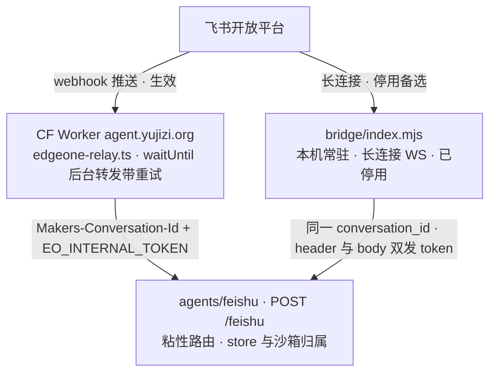
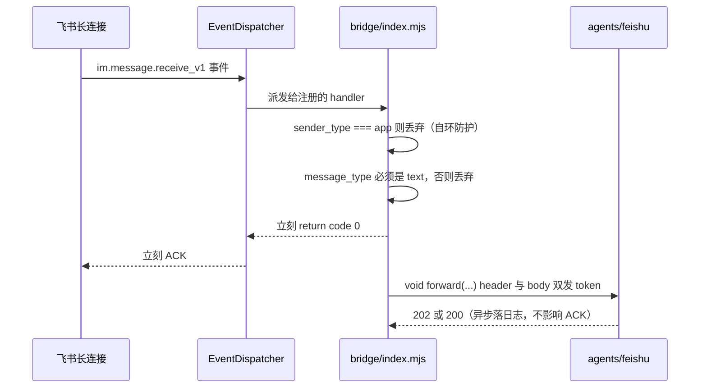

# 外部入站中继：CF Worker 与本地 bridge

EdgeOne 的 `agents/` 路由**强制要求**每个请求带 `Makers-Conversation-Id`，而飞书的事件推送是
**飞书服务器自己发起的**，我们加不了自定义头。所以「接事件 → 加头 → 转发」这一步必须落在
`agents/` 之外，而且不能落在同项目的 `cloud-functions/` 里 —— 那里 `fetch` 自己的 `agents/`
路由会被平台直接拒（实测 `404 domain endpoints match fail`，自定义域名和预设域名一样）。详细
的平台成因见[平台约束](../architecture/platform-constraints.md)。

结果是「谁在收事件」这一层被放到平台之外，历史上换过两次，现在同时存在一条生效链路和一条
保留的备选链路：



中继决定「事件怎么到达」，agent 决定「怎么回答」；两条链路的差异只在收事件的方式和常驻方式上。

## 版本沿革：v1 失败，v2 可用但依赖本机，v3 生效

链路换过两次，三次的分界记录在 `docs/02-飞书配置.md`：

| 版本 | 链路 | 结局 |
|---|---|---|
| v1 | 飞书 → 同项目 `cloud-functions/feishu-webhook` 转发 | ❌ 平台不支持自环（`404 domain endpoints match fail`） |
| v2 | 飞书 → 长连接 → 本机 `bridge/` 进程 | ✅ 能用，但**依赖本机开机**，已弃用 |
| **v3（当前）** | 飞书 → CF Worker（`agent.yujizi.org`）→ EdgeOne agent | ✅ 免费常驻，本机关机照常用 |

v1 留下的 `cloud-functions/feishu-webhook/index.ts` 仍在仓库里，是当前唯一有自动化测试的入站实现
（也是本地 dev 与冒烟测试的入口）；但它的**线上投递路径并不经过它**。看代码时不要把「仓库里有
一个 webhook 实现」误读成「线上事件走它」。

## 当前生效：CF Worker 中继

外部中继的代码**不在本仓库**，在 cf-agent-lab 仓库的 `src/feishu/edgeone-relay.ts`。本仓库只能
看到它的接口契约与配置点：

| 维度 | 内容 |
|---|---|
| 收事件 | 飞书 webhook 推送到 `https://agent.yujizi.org/api/feishu/edgeone` |
| 处理顺序 | 验签 / 解密 → **立即 ACK** → `ctx.waitUntil` 后台转发（带重试） |
| 转发目标 | wrangler vars 的 `EO_AGENT_URL` → `https://eolab.yujizi.org/feishu` |
| 密钥 | wrangler secret：`EO_BOT_VERIFICATION_TOKEN` / `EO_BOT_ENCRYPT_KEY` / `EO_INTERNAL_TOKEN` |

飞书后台的对应配置（应用 →「事件与回调」→「事件配置」）：订阅方式选
**「将事件发送至开发者服务器」**，请求地址填上面的 `/api/feishu/edgeone`，事件订阅
`im.message.receive_v1`。

`waitUntil` 是关键：它把转发挪出请求-响应周期，所以中继可以在飞书的 ACK 时限内回 200，
同时让转发**带重试**地跑完。这与本地 bridge 的处理方式同源 —— 两者都是「先 ACK，再转发」，区别
在重试能力：中继有，bridge 没有。

### 跨仓库的手工同步点

改 `EO_*` 密钥时要走完整条链：`wrangler secret put` → 重新部署 CF → 把 `EO_INTERNAL_TOKEN`
的同一个值同步到 EdgeOne 侧项目环境变量的 `INTERNAL_TOKEN`（两侧**必须同值**，否则 agent 返
401）→ 重新部署 EdgeOne。名字不同的原因是历史沿革，不是两把不同的钥匙。

这条链的另一半是**哈希复制的风险**：中继里的 `conversation_id` 算法只有注释保证与 webhook
一致，本仓库没有任何可执行断言钉住它。它是同一条不变量的未受保护副本，改算法时最容易漏。

## 备选链路：本机 bridge 长连接进程（v2，已停用）

`bridge/` 是一个**跑在自己机器上**的常驻小进程，用飞书的**长连接**（WebSocket）收事件。
状态很明确：**已被替代、留作备选，且不参与 EdgeOne 部署**。

```
飞书 ──长连接(WS)──> bridge（本机）──HTTP 公网──> https://<域名>/feishu（agents 路由）
                                                      │
                                           agent 自己调飞书 API 回复
```

它的分工很窄：**只做「收事件 → 转发」，不碰模型、不回复**。回复是 agent 侧自己调飞书 API 发的
（`agents/feishu/` 有 `FEISHU_APP_ID` / `FEISHU_APP_SECRET`）。去重、限流、命令解析都在 agent 侧，
bridge 只做最粗的两层过滤。

长连接模式还有一个副作用是**不需要公网回调地址**：飞书不再往我们的域名推送，那条曾经 500 的
回调链路被整体绕开。这是它在 v2 阶段能被选用的实际理由。

### 什么时候会重新启用它

按 `bridge/README.md` 与 `docs/02-飞书配置.md` 的说法，重新启用是**飞书后台的一个开关加本机一条
命令**：把飞书事件的订阅方式从「将事件发送至开发者服务器」改回**「长连接」**，然后在本机把这
个进程跑起来。可能触发这个切换的情况是「哪天不想经过 CF」—— 例如不想再维护一个跨仓库的中继、
或者需要一条不依赖任何公网回调地址的收事件路径。

启用前必须先补两件事：

1. **把依赖装回来**（但**不能装回项目目录**，见下节）。`bridge/package.json` 的
   `start` 脚本是 `node --env-file=.env index.mjs`，`sync-env` 是 `node tools/sync-env.mjs`。
2. **确认 conversation_id 与事件字段与当前转发层逐字节一致**。这不是可选项：切换链路时若
   conversation_id 变了，同一个群会落到另一个 agent 实例、另一个 store 命名空间、另一个沙箱上 ——
   表现是「换了链路之后这个群失忆了」。哈希算法本身的形状见
   [会话路由与三种入站实现](../architecture/conversation-routing-and-ingress.md)。

### 控制流：先 ACK，再后台转发



关键点是 `forward(...)` **没有 `await`**：handler 立即 `return { code: 0 }`，让飞书 SDK 马上 ACK；
转发在后台以 `void forward(...).then(...).catch(...)` 的形式跑。

**为什么必须这样**：实测在 handler 里同步等转发（约 4 秒）会超过飞书的 ACK 时限，飞书把同一条
消息**再推一次**，日志里表现为同一个 `messageId` 成对出现（先 `→ 202` 后 `→ 200`）。第二次靠
agent 侧的去重挡住了（返回 `duplicate`），不会重复回答，但白白多跑一次。所以「先 ACK、再转发」
是链路的结构性要求，不是性能优化。

代价是**异步转发的失败面没有重试**：长连接不重推，转发失败这条消息就丢了，agent 侧的去重也
用不上（`src/feishu/store.ts` 的去重只在事件真的到达时才有机会生效）。这是它与 CF Worker 中继
最实质的差别。

### 明确不做的事

handler 只做两层过滤，其余一律**静默 ACK**（`return { code: 0 }`），不回错误：

| 检查 | 条件 | 行为 |
|---|---|---|
| 自环防护 | `data.sender.sender_type === "app"` | 丢弃 |
| 文本提取 | `message_type !== "text"` 或 `content` 不是合法 JSON | 丢弃 |
| 字段完整性 | 缺 `chat_id` 或 `message_id` | 丢弃 |

自环防护在这里同样是**不可省**的：我们自己发的回执（「正在抓取…」、以及回答）也会变成
`im.message.receive_v1` 推回来，不过滤 bot 会跟自己的回执聊起来。它与 webhook 那条路有同一条
要求，理由与顺序关系见[入站请求生命周期](../architecture/request-lifecycle.md)。

### 转发契约

`forward()` 组装的 body 与当前转发层是同一组字段，`agents/feishu` 的 `normalizeEvent()` 是这份
契约的接收端收口：

```js
{ messageId, chatId, chatType, openId, text, token }
```

请求形态上有两点需要注意：

- `Makers-Conversation-Id` 由 `conversationIdFor(chatId)` 算出 —— `fs-` + `sha256(chatId)` 的
  前 32 位十六进制，恒 35 字符，确定性。平台按这个头做粘性路由 + store 归属 + 沙箱归属；
- `INTERNAL_TOKEN` **header 和 body 都放**（`x-internal-token` 与 body 的 `token` 字段）。
  这个 runtime 的 `request.headers` 不是标准 `Headers` 实例而是普通对象，agent 侧三种形态都读；
  双发是为了哪条路被平台改了都还能过。**契约上应把「header + body 双发」视为正确形态** ——
  `cloud-functions/feishu-webhook/index.ts` 目前只发 header，这里已经存在一处真实的漂移。
- `AbortSignal.timeout(110_000)`，且**超时不重试**（长连接不重推，重推会造成重复回答）。
  这个上限只是兜底：agent 在 async 模式下 200ms 就回 202。

### 配置与密钥卫生

环境变量从云端同步到 `~/.config/edgeone-bridge/.env`（**项目目录之外**）：

| 变量 | 来源 | 说明 |
|---|---|---|
| `FEISHU_APP_ID` / `FEISHU_APP_SECRET` | 云端 | 建立长连接用 |
| `FEISHU_VERIFICATION_TOKEN` / `FEISHU_ENCRYPT_KEY` | 云端 | 事件验签 / 解密（由 SDK 的 `EventDispatcher` 消费） |
| `INTERNAL_TOKEN` | 云端 | **必须和 agent 侧同一个值**，否则 agent 返 401 |
| `AGENT_URL` | 写死 | 默认 `https://eolab.yujizi.org/feishu` |

`npm run sync-env`（`bridge/tools/sync-env.mjs`）用 `@edgeone/makers-sdk` 的 `listEnvs` 从 EdgeOne
项目 `makers-z7cwsvvsvylf`（可用 `EDGEONE_PROJECT_ID` 覆盖）拉这五个键写成 env 文件，缺任何一个
就报错退出；`AGENT_URL` 不在云端 env 里，由脚本写死。文件以 `0o600` 创建、目录以 `0o700`，
日志里只回显每个值的前 6 位和长度。

⚠️ **文件为什么必须写在项目目录外**：EdgeOne 部署会把**整个项目目录**当静态资源上传，而静态
资源是公网可读的 —— `https://eolab.yujizi.org/bridge/.env` 曾返回 200，飞书 `APP_SECRET` /
`ENCRYPT_KEY` / `INTERNAL_TOKEN` 明文挂在网上两天。`.gitignore` 只挡 git，**挡不住部署**；
`edgeone.json` 的 schema 里根本没有 exclude / ignore 字段。结论是「含密钥的文件一律不能待在
项目目录里」。同一个原因让 `bridge/node_modules/`（47M）也曾被打包上传，把 `.edgeone/assets/`
撑到 50M 并在 batch 85 崩掉 —— 所以**要在本机跑 bridge，依赖得装到 `~/.config/edgeone-bridge/`
而不是 `bridge/` 下**。`bridge/` 的源码本身目前仍在公网可读，这是待定的目录布局决定。

密钥改动生效还有一条时序：**改云端项目环境变量不会实时生效**，agent 用的是部署时打包的快照。
所以顺序是「改云端 env → `npm run deploy` 重新部署 → 等边缘节点切换（一分钟内）→
`npm run sync-env` → 重启 bridge」。看到 401 时先用 `?probe=env` 的 `match` 字段判断「值不对」
还是「还没切完」。

### 常驻与运维

`bridge/launchd/com.guci.feishu-bridge.plist` 是 macOS 的常驻配置：`RunAtLoad` 开机自启、
`KeepAlive` 进程退出就拉起（长连接断了要能自己回来），stdout/stderr 都进
`/tmp/feishu-bridge.log`。

```bash
cp launchd/com.guci.feishu-bridge.plist ~/Library/LaunchAgents/
launchctl load -w ~/Library/LaunchAgents/com.guci.feishu-bridge.plist
launchctl list | grep feishu-bridge      # 确认在跑
tail -f /tmp/feishu-bridge.log
```

plist 里有两个**要按机器改的绝对路径**（node 二进制与 `bridge/` 目录），node 版本需 ≥18
（要支持 `--env-file`）。环境变量**刻意不写进 plist**，免得把密钥写进一个可能被同步/提交的文件。
Linux 服务器同理写 systemd unit，或 `docker run -d` / `pm2 start`；唯一的要求是**网络能出公网 +
进程别死**。

## 平台外组件的共同性质

CF Worker 中继、本机 bridge、以及它们的密钥文件**全部跑在部署运行时之外**：

- **不在部署产物里**：EdgeOne 部署只认 `agents/` 与 `cloud-functions/`，`bridge/` 与中继都不在
  这条路径上；
- **不被冒烟测试覆盖**：`test/smoke.ts` 里没有任何一处 import 或断言 `bridge/`，也不覆盖中继
  （中继代码根本不在本仓库）。它只覆盖 `cloud-functions/feishu-webhook/index.ts` 这一路；
- **不受部署回滚影响**：改 agent 代码、重新部署都不需要动它们，反之亦然 —— 但这也意味着
  「部署成功」不证明这两条链路正常。

因此仓库里那份哈希不变量的**未受保护副本**有三个（webhook、bridge、外部中继），只有 webhook
那一个有自动化断言。任何涉及 conversation_id 或事件字段形态的改动，都要在这三处人工核对一遍 ——
这也是不要把「必须一致的行为」复制到第二份实现里、除非先给它一个共享的真相来源的原因。

## 相关页面

- [会话路由与三种入站实现](../architecture/conversation-routing-and-ingress.md) —— 三路入站的共同契约与差异
- [入站请求生命周期](../architecture/request-lifecycle.md) —— 一条消息从 webhook 到回复的完整控制流
- [平台约束](../architecture/platform-constraints.md) —— 自环被拒、conversation_id 格式、没有部署忽略清单
- [配置与环境变量](../operations/configuration-and-env.md) —— 密钥清单与注入方式
- [部署与发布](../operations/deployment-and-release.md) —— 部署路径与重新部署的时序影响
