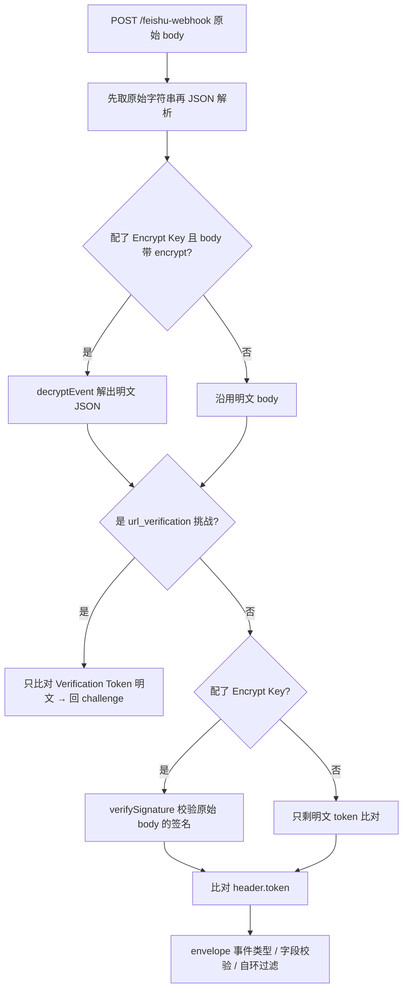

# 飞书开放平台集成面

本页只讲「飞书这一侧依赖了什么」：域名、端点、scope、错误码语义与后台配置。事件怎么被路由到 agent、会话 id 怎么算、令牌按谁分槽，属于平台与路由设计，见[会话路由与三种入站实现](../architecture/conversation-routing-and-ingress.md)、[入站请求生命周期](../architecture/request-lifecycle.md)与[身份模型](../concepts/identity-and-authorization.md)。

一句话概括这层的地基：`src/feishu/` 下的模块**不 import 任何平台（Cloudflare / EdgeOne）的东西**，token 缓存从 `TokenCache` 接口注入，所以验签、解密、事件解析、令牌取用都能在裸 Node 下测。

## 两套域名，不是一个

飞书把「业务 OpenAPI」和「OAuth 授权 / 换 token」放在**不同域**上，这是这一层最容易踩的一处：

| 用途 | 根地址 | 定义处 |
|---|---|---|
| 业务 OpenAPI（取租户令牌、发消息、cardkit、云文档） | `https://open.feishu.cn/open-apis` | `src/feishu/api.ts` 的 `DEFAULT_BASE` |
| OAuth 授权页与换 token | `https://accounts.feishu.cn` | `src/feishu/oauth.ts` 的 `ACCOUNTS_BASE` |

所以 `oauth.ts` **自己拼 URL，不复用 `api.ts` 的 `base(env)`**。`buildAuthorizeUrl()` 造的是 `${ACCOUNTS_BASE}/open-apis/authen/v1/authorize`，`requestToken()` 打的是 `${ACCOUNTS_BASE}/oauth/v3/token`。

`base(env)` 由 `FEISHU_API_BASE` 覆盖，**只为本地测试**：飞书应用还没建好之前，整条回复链路（取 token → 发消息 → 重试）没法验证，指向一个本地 mock 就能全跑通；生产不要设。国际版 Lark 的根是 `https://open.larksuite.com/open-apis`，换版只需改 `DEFAULT_BASE` 这一个常量。

## HTTP 层：200 不等于成功

这是整层的核心约定，写在 `api.ts` 三处取响应的地方：

- **飞书即使出错也回 HTTP 200 + 业务错误码**，所以不能只看 `res.ok`；
- `post()`、`feishuCall()`、`feishuCallAs()` 都解析 body 成 `FeishuResponse`，然后判 `json.code !== 0`，非 0 就抛 `FeishuError(code, msg)`；
- body 不是合法 JSON 时抛普通 `Error`，错误信息里带上 HTTP 状态码与前 200 字，便于区分「网关挂了」和「业务报错」；
- 所有出网请求都带 `AbortSignal.timeout(15_000)`。

`FeishuError` 是**导出的**，就是为了让调用方按业务码分流（见下节的 99991663 与 99991679）。

`FeishuResponse` 的 `data` 刻意是索引签名 `Record<string, any>` 而**不收窄成联合类型**：发消息给 `message_id`、建卡片给 `card_id`、文档接口给 `content` / `document` / `items` —— 每加一个接口就要改一次类型，而这几处本来就该由调用方自己判空。代价是类型安全靠调用方保证。

## 端点清单

### 令牌

| 端点 | 方法 | 用途 |
|---|---|---|
| `/auth/v3/tenant_access_token/internal` | POST | 用 `app_id` + `app_secret` 换应用身份的 tenant token |
| `${ACCOUNTS_BASE}/open-apis/authen/v1/authorize` | 浏览器跳转 | 用户身份授权页 |
| `${ACCOUNTS_BASE}/oauth/v3/token` | POST（form-urlencoded） | `authorization_code` 换 token / `refresh_token` 续期 |

`tenantAccessToken(env, cache, forceRefresh)` 的流程：先查注入的缓存，命中且 `exp > Date.now() + 60_000` 就直接返回；否则 POST 取 token —— 请求体**同时带 app_id 与 app_secret**，这一点与用户身份完全相反（用户身份只有 client_id，密钥在 token 端点用）。响应里的 `expire` 单位是**秒**（通常 7200），代码乘 1000 落盘。`TOKEN_SAFETY_MS` 提前 60 秒判过期，避免「取出来刚好在这一刻失效」。

缓存形状由 `TokenCache` 接口固定成 `{ token, exp }`，实现由调用方给：生产侧是 `feishu.token.<conversation>` 这份按会话隔离的 KV（`store.ts` 的 `tokenCache()`），冒烟测试里是一个内存闭包。**每个会话各存一份是有意的**：token 本身是应用级的，多取几次换掉了「跨会话共享状态」这件事，而后者正是这套按会话隔离的 KV 最不擅长的；取 token 是每两小时一次的调用，这点浪费可接受。

### 消息

| 端点 | 方法 | 用途 |
|---|---|---|
| `/im/v1/messages?receive_id_type=chat_id\|open_id` | POST | 发文本消息（`sendText`）、把卡片作为 `interactive` 消息发出去（`sendCard`） |

两个必须记住的约束：

- `content` 必须是**序列化后的字符串**而不是对象（飞书的约定），传对象进去会得到 `code: 10002 invalid param`；
- 文本长度上限取保守值 `MAX_TEXT_CHARS = 4000`（飞书没有公开的精确数字），超长**直接截断**并附一句「回答太长，已截断」，而不是让整条消息发失败、用户什么都收不到。

### cardkit 流式卡片

流式打字机效果走的是卡片实体，不是「编辑消息」。理由写在 `card.ts` 文件头：`PUT /im/v1/messages/:id` **一条消息最多只能编辑 20 次**，而一次问答二三十秒，20 次意味着最密 1.5 秒一更，长回答根本不够；cardkit 的流式更新是专门为 AI 打字机做的，官方原文说「在流式更新模式下…不会触发接口的频率限制」，且**平台自己算增量**（我们每次推全量文本，它负责逐字上屏）。

| 端点 | 方法 | 用途 |
|---|---|---|
| `/cardkit/v1/cards` | POST | 建一张处于 `streaming_mode` 的卡片实体，返回 `card_id` |
| `/cardkit/v1/cards/{cardId}/elements/{elementId}/content` | PUT | 推一次**累计全量**文本 |
| `/cardkit/v1/cards/{cardId}/settings` | PATCH | 关闭流式模式 |

三个端点各有一条不变量：

- 建卡片时 `data` 同样是**序列化后的字符串**；`streaming_config` **显式指定**而不用默认值 —— 默认值随客户端类型 / 版本 / 机型变化，想要一致观感就得自己定死（`print_frequency_ms: 50`、`print_step: 2`、`print_strategy: "fast"` ≈ 每秒 40 字）；
- 一个卡片实体**只能发一次**；
- `sequence` 必须**严格递增**，平台靠它丢弃乱序到达的旧版本。**推正文和关流共用同一个计数器** —— 关流时从 1 重新开始会被直接拒掉（实测 `99992402 field validation failed`）；
- 呈现效果取决于「新文本是否以旧文本为前缀」：一致就继续打字机，前缀一变就整段直接上屏。所以这里**只做追加、绝不重写前缀**，中断重试也是拿更长的全文覆盖。`ANSWER_ELEMENT_ID = "answer"` 是推内容时指到具体组件的 id。

不关流的后果：卡片一直停在「生成中」，会话列表里的预览会永远显示那个摘要，而且卡片上的交互组件也不可用。

### 云文档：四类链接、七个工具、三个资源

文档类型有四种，被操作的资源只有三个 —— 因为**知识库不是一种文档，是一种链接形态**。每个工具都先做一次 wiki 解引用，所以 `/wiki/xxx` 在所有工具里都能直接用。

| 资源 | 端点 | 方法 | 工具 |
|---|---|---|---|
| wiki 节点解引用 | `/wiki/v2/spaces/get_node?token=…&obj_type=wiki` | GET | 所有工具的前置步骤 |
| 新版文档 | `/docx/v1/documents/{id}` | GET | `feishu_doc_read`（取标题，失败不影响正文） |
| 新版文档正文 | `/docx/v1/documents/{id}/raw_content` | GET | `feishu_doc_read` |
| 新建文档 | `/docx/v1/documents` | POST | `feishu_docx_create`（**只收 title**） |
| 追加段落 | `/docx/v1/documents/{id}/blocks/{id}/children` | POST（`index: -1`） | `feishu_docx_write` / `feishu_docx_create` 的第二步 |
| 电子表格工作表列表 | `/sheets/v3/spreadsheets/{token}/sheets/query` | GET | `feishu_sheet_read`（没给 range 时先问有哪些表） |
| 电子表格读 | `/sheets/v2/spreadsheets/{token}/values/{range}` | GET | `feishu_sheet_read` |
| 电子表格写 | `/sheets/v2/spreadsheets/{token}/values` | PUT | `feishu_sheet_write`（**覆盖式**） |
| 多维表格数据表列表 | `/bitable/v1/apps/{app}/tables?page_size=100` | GET | `feishu_bitable_read` |
| 多维表格读记录 | `/bitable/v1/apps/{app}/tables/{tid}/records?page_size=N` | GET | `feishu_bitable_read` |
| 多维表格新增记录 | `/bitable/v1/apps/{app}/tables/{tid}/records/batch_create` | POST | `feishu_bitable_write`（`action=add`） |
| 多维表格更新记录 | `/bitable/v1/apps/{app}/tables/{tid}/records/batch_update` | PUT | `feishu_bitable_write`（`action=update`） |

注意端点版本号是**混着来的**：读工作表列表用 `v3`、读写值用 `v2`、docx 与 bitable 用 `v1`。写代码时不要「顺手统一」。

几个只在真实 API 上撞出来的形状约束（都写进了代码注释，并有测试钉住）：

- wiki 链接里的 token 是**节点 token，不是文档 token** —— 少了 `get_node` 这一步，所有知识库链接都会以「找不到文档」告终；`obj_type` 的名字也和 URL 里的不一样（链接是 `/base/`，节点报的是 `bitable`；链接是 `/sheets/`，节点报的是 `sheet`），所以 `resolveLink` 要做一个映射；
- docx 段落载荷的字段名是 `text`，**不是** `paragraph` —— 写成 `paragraph` 时飞书回 `1770001 invalid param`（不给是哪个字段）。`paragraph` 是旧版 `/docs/` API 的名字；
- 飞书**把整个网格回给你**，空行空列也占位（新建表默认 200 行 × 20 列）。原样吐出去有两个后果：白烧上下文，以及按「网格比窗口大」判 `truncated` 对新表**永远成立**（实测模型为一个 4 行就够的表格连调了 8 次）。所以先剪尾部全空行列再判截断；
- 链接里的 `?table=` 参数**不保证**是 OpenAPI 的 `table_id`（地址栏拷的链接、表格停在「页面」侧栏时是另一套 id），失败要退回「先列表」而不是把报错丢给模型。模型**自己**传的 `table_id` 不兜底 —— 那是它的选择，写错了就该让它看见；
- 新建文档的标题上限是 **800 字**（实测超了回 `99992402 field validation failed: the max len is 800`），本地挡掉比送到飞书换一个 `field_violations` 结构少烧一轮。

各工具的行列 / 字数上限（`DOC_DEFAULT_CHARS` 10000、`DOC_MAX_CHARS` 30000、`SHEET_MAX_ROWS` 100 × `SHEET_MAX_COLS` 20、`BITABLE_MAX_ROWS` 500、`CELL_MAX_CHARS` 200、`DOCX_WRITE_MAX_PARAS` 500 / `DOCX_WRITE_MAX_CHARS` 20000、`SHEET_WRITE_MAX_CELLS` 10000、`BITABLE_WRITE_MAX_RECORDS` 100）属于工具契约，见[飞书云文档读写工作流](../workflows/feishu-doc-read-write.md)。

## scope：一次开通，两种身份共用

同一个权限清单**同时服务两种身份**：应用身份（tenant token，读共享给机器人的文档，用户无需授权）和用户身份（`/login` OAuth）。

| 权限 | 用途 |
|---|---|
| `im:message` | 读消息（接收事件必需） |
| `im:message:send_as_bot` | 以应用身份发消息 |
| `im:message.p2p_msg:readonly` / `im:message.group_msg` | 单聊 / 群聊消息读取 |
| `docx:document:readonly` + `docx:document` | 新版文档读 + 追加正文 |
| `wiki:wiki:readonly` | 知识库链接解引用 |
| `bitable:app:readonly` + `bitable:app` | 多维表格读 + 写记录 |
| `sheets:spreadsheet:readonly` + `sheets:spreadsheet` | 电子表格读 + 写单元格 |
| `offline_access` | **不是资源权限**，是拿到 `refresh_token` 的前提 |
| `cardkit:card:write` | 创建 / 更新流式卡片（可选） |

代码里对应 `oauth.ts` 的 `DOC_SCOPES`（用户身份授权时索要的全集）与 `docs/02-飞书配置.md` 的「权限管理」清单。两条容易忽略的语义：

- `offline_access` 不在 scope 里，token 端点的响应里**压根没有 `refresh_token` 字段**，用户每两小时就得重新授权一次。冒烟测试里有一条专门断言 `DOC_SCOPES.includes("offline_access")`；
- **刷新令牌不会带来新 scope。** 三个写权限是后加进清单的，已经授权过的用户不会自动拿到 —— 必须重新发一次 `/login` 走完整流程。飞书对这种情况只回一句 `99991679 Unauthorized. Please request user re-authorization.`，不解释为什么（见下节）。

卡片权限是**可选**的：不配 `cardkit:card:write` 不影响可用性 —— `FeishuStreamer.start()` 会返回 false，自动退回「攒完整段再发一条纯文本」。**流式是体验，不是正确性。**

## 业务错误码与分流

飞书的错误码在代码里只被**按需**识别，白名单刻意保持短。已知的几类：

| 码 | 含义 | 代码里的处理 |
|---|---|---|
| `99991663` | tenant_access_token / access token 无效或过期 | `feishuCall` / `sendText`：强制刷新 tenant token 后**重试一次**；`docs.ts` 的 `callUser`：`invalidate()` 后重新取用户令牌重试一次 |
| `99991664` | 同上（另一形态） | 只在 `callUser` 里与 99991663 并列处理 |
| `99991672` | 权限不足 / forbidden | 不特判 —— 它是 `callDoc` 兜底链路的触发条件（应用身份读不到就换用户身份） |
| `99991679` | 这次操作要的 scope 不在**这个人当前授权**的范围里 | `callUserOnly` 捕获后补一句人话（见下） |
| `99992402` | field validation failed | 不作为常量识别，只在注释里记录了实际撞到的两个字段（`sequence`、`title`） |
| `10002` / `1770001` | invalid param | 记录在注释里，用于解释「为什么 content 要序列化」「为什么字段名是 text」 |

`99991663` 的重试存在的理由很具体：缓存里的 token 可能被人在后台重置 App Secret 而作废，局部重试一次比让用户重发消息强。用户令牌侧的 `99991663` 还多一层原因 —— 用户可能在飞书侧**主动撤销**了授权，那时 `exp` 还没到，光看时间是发现不了的。

`99991679` 的处理是这条链路里唯一一处「给飞书原文补人话」：飞书原文只说 "Please request user re-authorization"，有令牌的人会以为自己授权过了、是别的问题，去翻代码。真实原因几乎总是「scope 是后加的，刷新令牌不会带来新 scope」，所以报错里明说这一点，并在重新授权仍失败时指向 `docs/02` 第 2 节（应用侧没把 `docx:document` 开给「用户身份」）。这条有测试钉住。

`callDoc` **不按错误码过滤「该不该兜底」**：飞书各产品的权限错误码不统一（docx / bitable / sheets / wiki 各一套），白名单迟早漏。代价是模型自己写错参数时多打一次注定失败的请求，可接受。

## 事件侧：验签、解密、解析

事件推送与 OpenAPI 是**同一套凭证、不同的问题域**，模块也分开（`crypto.ts` 与 `event.ts` 都是零依赖纯函数，可以用 `node --experimental-strip-types` 直接跑）。

- **验签用的头**：`X-Lark-Signature`、`X-Lark-Request-Timestamp`、`X-Lark-Request-Nonce`。签名算法是 `sha256_hex(timestamp + nonce + encrypt_key + rawBody)`，比较用常数时间实现，缺任一头一律判失败。
- **`X-Lark-Signature` 只有在飞书侧配了 Encrypt Key 才有** —— 也就是说**没有 Encrypt Key 就没有任何请求来源证明**，只靠明文比对 Verification Token，谁都能伪造事件推送。所以生产上应该强制配；本地调试可以先不配，那时验签那一步整个跳过，发一条明文 JSON 就能测通链路。
- **验签必须拿未经解析的原始 body**。飞书文档明写「不要在反序列化后再计算」——先 `JSON.parse` 再 `stringify` 回去，键序和空白一变签名就永远对不上。所以调用方先 `await req.text()`，再算签名，最后才解析。
- **解密**：收到 `{"encrypt": "..."}` 时，密钥是 `SHA-256(encrypt_key)` 的**原始 32 字节**（不是 hex 字符串再编码），IV 是密文 base64 解码后的**前 16 字节**，其余才是真正的密文。WebCrypto 的 AES-CBC **已按规范做了 PKCS#7 去填充**，解出来就是明文本身，不要再剥一遍 —— 这一条在 `crypto.ts` 的文件头被写成了教训（对照飞书官方 Go/Java 示例扫首尾大括号的做法会推出错误结论；官方的测试向量 `P37w+…=` + key `test key` 解出 11 字节的 `hello world`，11 不是 16 的倍数，证明填充早就没了）。解密结果用 `TextDecoder("utf-8", { fatal: true })` 解码，不是合法 UTF-8 就硬失败，不把乱码塞给下游。

事件体的形状：`header.event_type` / `header.token` / `event.sender.sender_type` / `event.sender.sender_id.open_id` / `event.message.{message_id, chat_id, chat_type, message_type, content, mentions[]}`。

**`content` 是一个 JSON 字符串而不是对象**（`"{\"text\":\"@_user_1 hello\"}"`）—— 直接当对象用会静默拿到 `undefined`，然后整条消息变成空字符串。`parseMessageEvent()` 只处理纯文本（图片 / 文件 / 卡片一律返回 `null`，因为处理它们只会产生空问题），群聊里还要把 `@_user_1` 这种占位符剥掉 —— 剥的时候只压**行内**连续空白，**不动换行、也不动行首缩进**：用户发多行代码片段是常有的事，把换行或缩进吃掉会让整段代码糊成一行。

`readChallenge()` 对应 **`url_verification` 请求网址校验握手**：body 形如 `{challenge, token, type:"url_verification"}`，回一个 `{ challenge }` 就完成。它**不做签名校验**，理由见下节。

返回 `null` 的情形（不是消息事件、不是文本消息、缺关键字段）都要**静默忽略**而不是报错 —— 这些飞书都会推，但都不是给我们处理的。

## 后台侧配置：改权限 / 事件订阅之后必须发版

飞书后台（[open.feishu.cn](https://open.feishu.cn/app) → 创建企业自建应用）上要对齐的东西按顺序是：

| 配置项 | 值 / 做法 |
|---|---|
| 凭证 | `App ID`（`cli_` 开头）→ `FEISHU_APP_ID`；`App Secret` → `FEISHU_APP_SECRET` |
| 加密策略 → Verification Token | → `FEISHU_VERIFICATION_TOKEN` |
| 加密策略 → Encrypt Key | → `FEISHU_ENCRYPT_KEY`（**强烈建议配**） |
| 权限管理 | 上表那几个 scope |
| 事件与回调 → 事件配置 → 订阅方式 | **「将事件发送至开发者服务器」** |
| 事件与回调 → 事件配置 → 请求地址 | `https://agent.yujizi.org/api/feishu/edgeone`（当前生效链路；见[外部入站中继](external-ingress-relay.md)） |
| 事件与回调 → 已添加事件 | **接收消息 `im.message.receive_v1`** |
| 安全设置 → 重定向 URL | 必须与 `FEISHU_OAUTH_REDIRECT_URI` **完全一致**，差一个字符授权页就直接报错 |
| 版本管理与发布 | 创建版本 → 申请发布 |

⚠️ **权限和事件订阅的改动必须发一个新版本才生效**。改了权限没发版是最常见的「明明配了却收不到消息」的原因；已经 `/login` 过的用户还要重新授权一次才会拿到新加的写 scope。

⚠️ **改云端项目环境变量不会实时生效**，agent 用的是部署时打包的快照，所以配置改完要重新部署（时序细节见[配置与环境变量](../operations/configuration-and-env.md)）。

### 保存请求地址时会立刻发起 url_verification

点「保存」这一步飞书会**立刻**发起一次 `url_verification` 握手。后台报「Challenge code没有返回」八成不是代码问题，而是校验顺序错了：

握手与验签的既定顺序：解密排在识别挑战之前，挑战握手不验签且排在验签之前。

三条顺序都不能重排，理由各不相同：

1. **拿原始字符串再解析**：签名是对未解析的 body 算的；
2. **解密排在识别挑战之前**：`url_verification` 的挑战体**同样是加密的**；
3. **挑战握手不验签且排在验签之前**：飞书文档原文说安全校验「不包括请求网址校验」，这一步的凭据是 Verification Token 而不是签名。回一个 challenge 本身只是原样回声、没有副作用，所以放宽是安全的。放错位置会让飞书后台一直报「Challenge code没有返回」。

这几条顺序的完整实现与 request/response 时序见[入站请求生命周期](../architecture/request-lifecycle.md)；webhook 入口本身还有 fail-closed 的凭证检查（缺 `FEISHU_APP_ID` / `FEISHU_APP_SECRET` / `FEISHU_VERIFICATION_TOKEN` / `INTERNAL_TOKEN` 任一就返 503，宁可拒绝服务也不让门静默敞开）。

## 配置面

| 变量 | 作用 | 缺了会怎样 |
|---|---|---|
| `FEISHU_APP_ID` / `FEISHU_APP_SECRET` | 取 tenant token、发消息、建卡片、云文档 | webhook 返 503；文档工具族整个不挂 |
| `FEISHU_VERIFICATION_TOKEN` | 事件来源比对（握手与推送两处） | webhook 返 503 |
| `FEISHU_ENCRYPT_KEY` | 事件解密 + `X-Lark-Signature` 验签 | 解密与验签整个跳过，只剩明文 token 比对，安全性明显更弱 |
| `FEISHU_API_BASE` | 覆盖 OpenAPI 根地址 | **只为本地测试**，生产不要设 |
| `FEISHU_ENCRYPT_KEY` 之外的事件加密策略 | —— | —— |
| `FEISHU_OAUTH_REDIRECT_URI` | OAuth 回调地址 | `buildAuthorizeUrl()` 直接抛错，且**故意没有默认值**（猜一个的话用户看到的是飞书的一个报错页） |
| `FEISHU_ALLOWED_OPEN_IDS` | 逗号分隔的 open_id 白名单 | 空 / 未设 = 不限制 |
| `FEISHU_USER_TOKEN_SKEW_MS` | 放大「提前多久判用户令牌过期」 | **平时不要设**，专门用来手工验续期链路 |

`FEISHU_APP_ID` 同时被 OAuth 侧的 `client_id` 用（`buildAuthorizeUrl` 与 `exchangeCode` 都读它），所以它不是一个「只给发消息用」的变量。

## 与其他页面的边界

- 事件怎么到达 agent、`conversation_id` 怎么算、三条入站实现如何保持一致：见[会话路由与三种入站实现](../architecture/conversation-routing-and-ingress.md)与[外部入站中继](external-ingress-relay.md)；
- 用哪个身份发哪次请求、令牌按 openId 分槽、refresh token 的单飞续期：见[身份模型](../concepts/identity-and-authorization.md)；
- `sequence`、追加式前缀、同步 push 与 250ms 出网队列：见[工具调用与流式渲染](../workflows/tool-invocation-and-streaming.md)；
- 七个文档工具的契约、截断语义与可执行错误文案：见[飞书云文档读写工作流](../workflows/feishu-doc-read-write.md)；
- 冒烟测试里钉住本页哪些行为的断言（验签向量、`offline_access`、`paragraph`/`text` 字段名、身份不退回）：见[冒烟测试](../testing/smoke-tests.md)。
