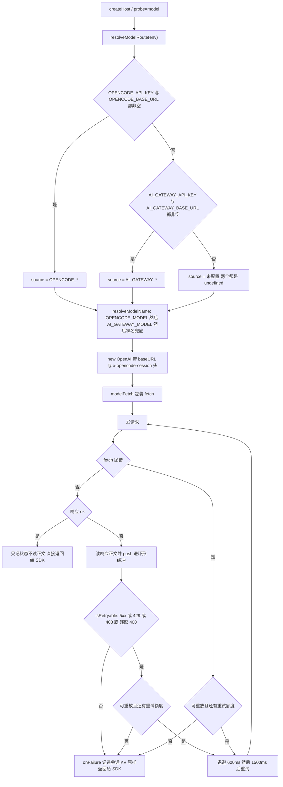

# 模型网关路由与重试诊断

模型这一层是整套移植里**唯一会把失败直接变成用户可见文案**的地方 —— bot 回一句「没答上来：400 status code (no body)」时，真正的原因既不在飞书、也不在会话存储，而在出站请求的形状或网关的选路。

本页讲三件事：请求**发给谁**（`resolveModelRoute`）、**发出去的是哪种形状的请求**（模型类与模型名规则）、以及**失败之后怎么被修好或怎么被看见**（`modelFetch` 的重试与诊断记录）。

排查入口本身见[诊断与探针](../operations/diagnostics-and-probes.md)，环境变量的整体清单见[配置与环境变量](../operations/configuration-and-env.md)，平台托管变量的约束背景见[平台约束与弱化的保证](../architecture/platform-constraints.md)。

## 一句话结论

**自定义模型配置必须放在 `OPENCODE_*` 这类普通键里，不能放在 `AI_GATEWAY_*` 里。** 后者是平台托管的：每次 `edgeone makers deploy` 时 CLI 会执行 `Bound AI Gateway credentials to project`，用平台的值把这三个键覆盖回去。实测过 `setEnvs` 写入成功、`listEnvs` 回读也一致（`baseURL` 长度 34 → 29），跑完一次部署就自己变回了旧值。

早先的结论是「`setEnvs` 改不了 `AI_GATEWAY_*`」—— 那描述对了现象、说错了原因。对照组 `OPENCODE_SESSION` 同样是自定义键，从来没被重置过；问题出在**名字**，不是写入能力。

`AI_GATEWAY_*` 因此被保留为**兜底**：本地调试、或者万一 `OPENCODE_*` 没配全时不至于完全跑不起来。但不要指望能改它。

## 选路：`resolveModelRoute` 只认「成对的来源」

`resolveModelRoute(env)` 返回 `{ apiKey, baseURL, source }`，`source` 取 `"OPENCODE_*"` / `"AI_GATEWAY_*"` / `"未配置"` 三值之一。

它按**来源**整体决定，绝不各取一半：

- `OPENCODE_API_KEY` 与 `OPENCODE_BASE_URL` 都非空 → 两个都用 OpenCode 组，`source = "OPENCODE_*"`；
- 否则 `AI_GATEWAY_API_KEY` 与 `AI_GATEWAY_BASE_URL` 都非空 → 两个都用托管组；
- 只有一半（有 key 没地址，或反过来）→ 当作**完全没配**，返回两个 `undefined`，`source = "未配置"`。

「半配算没配」是刻意的防线。踩过的坑是：key 是 OpenCode Go 的、baseURL 却指着 EdgeOne AI Gateway，于是稳定拿到 `401 API key not found` —— 看着像密钥失效，其实是**打错了门**。

如果这里放行半配，OpenAI SDK 会抛出「The OPENAI_API_KEY environment variable is missing」—— 一句和真实原因（我们自己没配对）完全无关的话，够排查半天。所以 `?probe=model` 在半配时**提前拦下**，直接回 `hasKey` / `hasBaseUrl` 和一个「key 和 baseURL 必须成对配」的提示。

模型名走的是**另一个函数**、另一套优先级：`resolveModelName(env)` 依次取 `OPENCODE_MODEL` → `AI_GATEWAY_MODEL` → 硬编码兜底 `deepseek-v4.1-flash`。注意它与选路的优先级**同向但独立**：理论上存在「地址来自 A 组、名字来自 B 组」的窗口，而两家的模型名规则又是相反的（见下），所以改端点时必须**连模型名一起改**。

### `envSource` 是排查时第一个要读的字段

`source` 会以 `envSource` 的名字出现在 `?probe=env` 和 `?probe=model` 的响应里，**这是排查模型问题时第一个要看的东西**。

只看 `baseUrl` 会被误导：`AI_GATEWAY_*` 是平台托管的，就算你在控制台里改了、回读也对了，deploy 之后它还是会变回平台值。所以真正说明「现在走的是哪一组变量」的只有 `envSource`：

| `envSource` | 含义 |
|---|---|
| `OPENCODE_*` | 正常路径：自定义模型配置生效了 |
| `AI_GATEWAY_*` | **路由退回了兜底** —— `OPENCODE_*` 没配全。这是最常见的一种 |
| `未配置` | 两组都没配全，请求必然发不出去 |

`?probe=env` 还会额外回显 `managedAiGateway`（托管那组现在是什么值），专门用来确认「它是不是又被 deploy 重置了」。

## 模型名规则：两家网关是**相反**的

这是最容易「错得很像」的一处：换端点时只改了 baseURL、忘了改模型名。

| 网关 | 规则 | 写错的症状 |
|---|---|---|
| EdgeOne AI Gateway | **必须带 provider 前缀**：免费档 `@makers/<model>`，自带 key 则 `<provider>/<model>`（`provider` ∈ `openai` / `anthropic` / `google` / `deepseek` / `minimax` / `zai` / `moonshot` / `hunyuan`） | 400 `Model ID must include provider prefix` |
| OpenCode Go | **必须写裸名**，不带任何前缀 | 404 |

踩过的具体形态：只把 baseURL 换成 `opencode.ai` 却留着 `@makers/` 前缀，报 404，看起来像「模型不存在」，实际是前缀没摘。反过来，在 OpenCode 路由上写裸名却被 `?probe=env` 的读者当成配置错误 —— 那时真正的病在 `baseUrl`。所以这两个值**必须成对读**。

`?probe=model` 把这一步变成了可判断的结论，并带 hint：

- `401 API key not found` → 打错门：key 是 A 家的，baseURL 指着 B 家；
- `400 provider prefix` → 模型名规则不对；
- `429` → 额度或限流；
- 超时 / DNS → 运行时出网问题。

### 请求头：`x-opencode-session`

OpenCode Go 要求带 `x-opencode-session` 头，缺了会被直接拒。值只是个**路由标签**，随便取，但同一个项目内保持一致（部署实例里用的是 `OPENCODE_SESSION=edgeone-agent-lab`）。

`makeModelClient` 把它映射成 OpenAI Node SDK 的 `defaultHeaders`：

```ts
defaultHeaders: env.OPENCODE_SESSION
  ? { "x-opencode-session": env.OPENCODE_SESSION }
  : undefined,
```

（原版用的是 AI SDK 的 `createOpenAICompatible({ headers })`，这里是同一个意图的 SDK 对应写法。）

## 模型类：必须显式用 Chat Completions

第二个「会错得很像」的地方在**模型类**上，不在 URL 上。

`@openai/agents` 的默认模型走 **Responses API**。而 OpenCode Go 只兼容 **Chat Completions** —— 用错模型类时得到的是 **404**，而不是「不支持这个端点」这种看得懂的错。

所以 `createHost` 里显式构造 `OpenAIChatCompletionsModel(client, MODEL_NAME)`，并且**惰性且只建一次**：

- 惰性是为了让底层 HTTP 连接池在一个实例（= 一个飞书会话）内复用，每回合重建会白白多一次 TLS 握手；
- 但 **OpenAI 客户端本身是 `createHost` 时就立刻建的**（`const client = makeModelClient(...)`，不是 getter）—— 客户端构造很便宜，而挂上诊断回调之后越早建越好：惰性会让某些失败发生在 `getClient` 之前，那段失败就拿不到诊断信息。

同一个 `client` 也被两处复用：`/compact` 的摘要请求，以及 `?probe=model`。

> 摘要（`summarize`）刻意走**裸的 `client.chat.completions.create`**，不走 `run(agent, …)`。压缩的前提是「拿全量历史再清空」，而 Agent run 会在我们读到历史和清空之间往 session 里塞东西，顺序一乱就白压。直接打 Chat Completions 不接触 session，天然干净，也不给工具。

## `modelFetch`：一层 fetch 同时做记录与重试

`makeModelClient` 把 `fetch` 换成 `modelFetch({ onFailure })`。把「记录」和「重试」放在同一层，是因为两者都要在**「拿到响应但还没交给 SDK」**这一刻做判断，拆成两层反而要 clone 两次。

它解决的是一个可观察的具体故障：OpenCode Go 会**间歇性**返回 400，响应体是个残缺对象：

```json
{"model":"deepseek-v4.1-flash"}
```

既没有 `error` 也没有 `code`，看着像上游抖了一下就把连接掐了。而 **OpenAI SDK 的内置重试只认 408/409/429/5xx —— 它不管 400**。这种 400 原样透给用户，就是那句「没答上来：400 status code (no body)」。

### 重试判据

`isRetryable(status, text)` 三条任一命中就重试：

1. `status >= 500` 或 `429` 或 `408` —— 常规可重试；
2. `400` 且正文**不是合法 JSON** —— 多半是被截断的残包；
3. `400` 且正文是合法 JSON，但**没有 `error` / `code` / `message` 字段** —— 观察到的那个残缺对象。

真·参数错误的 400 会带 `error` / `code`，不会命中，所以不会白重试。

### 重试的前提与节奏

- 退避表是 `RETRY_BACKOFF_MS = [600, 1500]`，长度即「最多重试几次」—— 所以最多两次重试（`attempt` 0/1/2）。
- **只有 `init.body` 是字符串时才能重放**（`replayable`）。OpenAI SDK 就是这么发的；body 是 `ReadableStream` 之类时无法安全重放，此时记录照做、重试不做。
- 网络层异常（`fetch` 抛错）也按同一节奏重试 —— 连不上 ≠ 请求本身有问题。
- `onFailure` **只在最终失败时回调一次**（不是每次尝试都调）。
- 成功的响应**不读正文**（`entry.res.text = "(ok，未读取正文)"`，连 clone 都不做），避免为诊断付出额外内存。

### 只记形状，不记内容

环形缓冲（`MAX_ENTRIES = 8`）里的每条 `DiagEntry` 分两半：

**出站 `req`** —— 只有形状，没有正文：

- `url`、`keys`（body 顶层字段名）、`model`、`stream`、`messageCount`、`bodyChars`；
- `toolNames`（最多 40 个）与 `toolsJsonChars` —— 工具 schema 不合法或超限是 400 的头号嫌疑；
- `msgRoles`：消息序列的压缩表示，`s`/`u`/`a`/`t` 分别代表 system/user/assistant/tool，后缀 `*` 表示这条 assistant 带 `tool_calls`（例：`s u a* t u`）。要它是因为 400 常常只在「历史里多了某种消息」之后才出现，而 `bodyChars` 这种总量指标看不出来 —— 得看**结构**变了没有；
- `tailMsgs`：最后 3 条消息各自的字段名、`contentChars`、`hasToolCalls`（用来发现多带了不该带的键）；
- `assistantKeys`：所有 assistant 消息字段名的**并集**。关键用途是 DeepSeek 系响应里带的 `reasoning_content` —— 这层若被原样回传，某些网关会直接 400，看到它就基本能定位；
- `head`：body 开头的截断片段（对象 600 字符、非对象 300 字符），只用来肉眼看格式。

**入站 `res`** —— `status` / `ok` / `ms` / `reqId`（依次尝试 `x-request-id`、`x-tt-logid`、`cf-ray`）+ `text`：非 2xx 时保留正文（截断到 1200 字符，通常很短），2xx 只留开头。

⚠️ **不记完整请求体**（可能含用户提问、贴进来的文档内容），**也不记 `Authorization` 头**。整个诊断面只有形状、截断片段和长度/指纹类字段。

### 诊断为什么要跨实例

内存环形缓冲**按实例隔离**。真实失败发生在某个实例上，而 `?probe=last` 那次请求很可能被路由到**另一个实例** —— 实测踩过：明明刚失败过，探针却回 `count=0`。

所以 `onFailure` 的 entry 会以 `DIAG_KEY = "diag.lastModelFailure"` 落进**会话 KV**（按 `conversation_id` 归属，跟探针用的是同一个 id），任何实例都能读到。`?probe=last` 同时返回两边：`persistedFailure`（跨实例可读）与 `entries`（本实例内存），外加 `counters`。

其中 `counters.sessionInputCalls` 是**「历史消毒钩子挂上了没有」的唯一直接证据** —— `sessionInputCallback` 是可选参数，名字写错不会报错、只会静默不生效，症状仅仅是「偶尔还是 400」，分不出是没挂上还是别的原因。它 > 0 就说明钩子在跑。

## 决策流程



这张图是 `resolveModelRoute` → `makeModelClient` → `modelFetch` 一条路走到底的选路与重试判定；「残缺 400」指响应体是合法 JSON 但缺 `error` / `code` / `message`。

## 失败怎么变成用户可见的那句话

重试耗尽后，响应原样返回给 OpenAI SDK，SDK 把状态码包装成错误抛出，`_host.ts` 的 `ask()` 捕获它并取前 300 字符：

- 如果流式卡片**已经建出来**：把 `没答上来：${msg}` 写在卡片上（`streamer.fail`）并**返回**，**不能抛** —— 抛出去 `turn.ts` 的 catch 会再发一条纯文本，用户同时收到「卡片说失败」和「一条文本说失败」两份；
- 如果**没有卡片**：重新抛出，交给 `turn.ts` 去发纯文本（这里不能自己发，否则同样重复）。

## 为什么「本地能跑通」不能排除问题

本地用同样的 SDK + 同样的模型复现时常常是 200 —— 因为本地没有沙箱工具、没有云文档授权。这两个差异恰恰是 400 的高发区：工具 schema 不合法、请求体超限、多带了某个网关不认的参数，全都会表现为一个光秃秃的 400。

同理，`?probe=model` 是 **200 也不能证明真实回合能过**：那个探针只发一个极简请求（`messages: [{ role: "user", content: "只回复两个字：收到" }]`，`max_tokens: 32`），不带工具、不带云文档授权。真正失败的是真实回合那个带全量工具表的请求 —— 而 SDK 把它的错误压成了一句话。

**所以排查路径是分层的：`?probe=env` 看变量读没读到、`?probe=model` 看请求发不发得出去、`?probe=last` 看真实回合那个请求长什么样。**

> ⚠️ 探针是 GET，边缘会缓存 —— 复验必须带 cache-buster（`&_=$(date +%s)`）。`-H "Cache-Control: no-cache"` 没用，必须让 URL 变。

## 一个真实的链路故障：会话被永久毒死

模型层最严重的一类故障不是「偶发 400」，而是**会话历史结构非法导致的稳定 400**。

现象：某个会话问着问着开始稳定回「没答上来：400 status code (no body)」，换任何问题都一样，`?probe=last` 显示三次尝试（`attempt` 0/1/2）全部 400、响应体还是那个残缺对象；但**同一个问题在别的会话里完全正常**，`/clear` 之后本会话也立刻恢复。

看 `req.msgRoles` 才明白，序列以 `s t t` 开头 —— **system 后面直接跟了两条 tool 消息**：

```
s t t a u a* t a u a u u a a u a u a a u a u u a a u ...
```

`role:"tool"` 在协议上**必须**紧跟在一条带 `tool_calls` 的 assistant 消息后面，靠 `tool_call_id` 对应上；孤立的 tool 消息是非法结构，网关直接 400。成因是会话历史**按窗口**取（最近 N 条），窗口一旦从「一对 `tool_calls` / tool 结果」的中间切开，开头就会剩下一条没有对应 assistant 的 tool 消息。之后每一轮都带着这个非法开头 → **永久 400**，只有 `/clear` 能救。

修法在 `sessionInputCallback` 里挂 `sanitizeAndAppend`（见 [session-sanitize.ts](../../src/feishu/session-sanitize.ts)）：维护「已被 assistant 声明但还没被消费」的 `tool_call_id` 集合，tool 消息只有在集合里才保留，否则丢弃；顺手丢掉「既没文本也没工具调用」的空 assistant。丢弃孤儿 tool 消息会**损失一点上下文**（那次工具调用确实发生过），但换来的是请求合法 —— 而原来的做法是整轮直接失败。

这条修复靠 `diagCounters.droppedOrphanTools` / `droppedEmptyAssistants` 变得可观测：丢东西说明窗口切歪了，不能静默。钩子被调用时 `sessionInputCalls++`，`> 0` 就证明它确实挂上了。

## 运维要点速查

| 事项 | 结论 |
|---|---|
| 自定义模型配置放哪 | **普通键** `OPENCODE_*`；`AI_GATEWAY_*` 每次 deploy 被平台覆盖回平台值 |
| key 与 baseURL | **必须成对配**，半配 = 未配置（防「打错门」的 401） |
| 模型名 | 两家规则相反：EdgeOne 要前缀、OpenCode 要裸名；换端点必须同时改 |
| 请求头 | OpenCode Go 需要 `x-opencode-session`；值任意但项目内保持一致 |
| 模型类 | 必须 `OpenAIChatCompletionsModel`（Responses API 会得到 404） |
| 400 重试 | SDK 不管 400；`modelFetch` 对 5xx/429/408 和「截断或字段缺失的 400」重试，最多两次（600ms / 1500ms） |
| 排查起点 | `?probe=env` 的 `envSource` → `?probe=model` 的 `upstream` / 状态码 → `?probe=last` 的 `req.msgRoles` / `assistantKeys` / `attempt` / `res.text` |
| 日志隐私 | 只记形状、截断片段、长度与 `reqId`；不记完整 body、不记 `Authorization` |

## 延伸阅读

- [诊断与探针](../operations/diagnostics-and-probes.md) —— 各个 `?probe=` 端点的门禁、字段和复验姿势；
- [配置与环境变量](../operations/configuration-and-env.md) —— `OPENCODE_*` 与平台托管键的完整清单；
- [平台约束与弱化的保证](../architecture/platform-constraints.md) —— 为什么平台托管的键改不动、以及这套移植欠下的那些强保证；
- [工具调用与流式输出](../workflows/tool-invocation-and-streaming.md) —— 工具表如何塑造出站请求形状；
- [请求生命周期](../architecture/request-lifecycle.md) —— 模型这一步在整轮里的位置。
