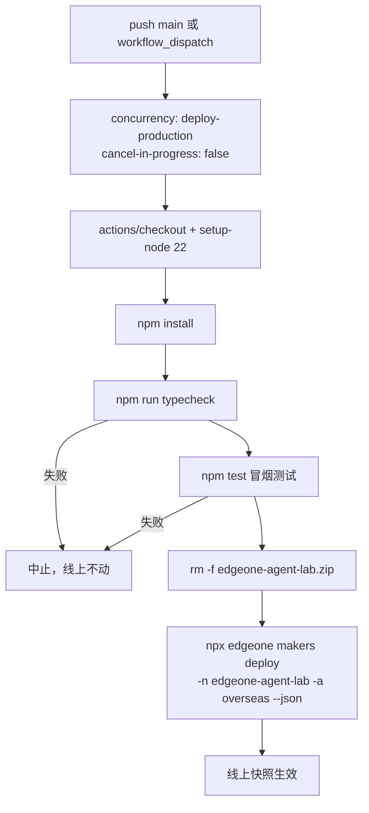

# 部署与发布

这套移植的上线路径只有一条：**push `main` → GitHub Actions → `edgeone makers deploy`**。没有预发环境、没有版本号、没有回滚命令 —— 每次上线都是把当前构建产物推到同一个线上项目上。`workflow_dispatch` 留了手动触发入口（Actions 页面 "Run workflow"），主要用于"只改了云端环境变量、需要刷新部署快照"这类不产生代码 diff 的发布。

`edgeone.json` 是唯一的部署描述（`framework: openai-agents-sdk`、`agents.timeout: 900`、`sandbox.timeout: 900`），项目根目录的静态文件（`index.html`）由平台自动托管。它**没有** exclude / ignore 字段 —— 这个缺失是本页最后一节的主题。

配置面（哪些变量、缺了各自关掉什么）见[环境变量与配置目录](configuration-and-env.md)；部署后怎么用探针确认一套改动真的生效，见[诊断与探针](diagnostics-and-probes.md)；沙箱里的 agent 自改代码为什么被明确决定不做，见[刻意不做的事](../concepts/design-non-goals.md)。

## 工作流：门禁在前，部署在后

`.github/workflows/deploy.yml` 的步骤顺序本身就是设计，不能随意调换：



门禁是 `npm run typecheck`（`tsc --noEmit`）与 `npm test`（`node --experimental-strip-types test/smoke.ts`，约 190 项），两个都挂在 `npm install` 之后、部署之前 —— **挂了就不上线**，而不是"部署了但功能不对"。这两步不依赖 EdgeOne、不连飞书、不发网络请求（`fetch` 被 stub），所以它们的失败总是代码问题，永远不会是环境抖动。

这是[刻意不做的事](../concepts/design-non-goals.md)里那条"agent 自改本仓库代码"决定的地基：因为门禁是自动的、且部署只认 `push main`，所以"改动必须经人合并才上线"这条护栏**由平台机制天然提供**，不靠提示词自觉。同一节也点出了它的软肋 —— `.github/workflows/` 本身也在仓库里，能改它就能删掉 `npm test` 那一步。因此那个门禁不能当作最终防线，只能当作日常护栏。

`concurrency: { group: deploy-production, cancel-in-progress: false }` 让同一时间只有一个部署在跑，后来的**排队**而不是互相踩。`cancel-in-progress: false` 是关键取法：取消一个跑到一半的 `edgeone makers deploy` 会留下状态不明的上传，比多等几分钟贵得多。

工作流本身**不持有任何业务密钥**，只有一条 `secrets.EDGEONE_API_TOKEN`。飞书凭证、模型 key、GitHub token 全在 Makers 控制台的项目环境变量里，由部署快照自动携带 —— 这是把"密钥注入"和"代码上线"两件事解耦的地方。

## 四条 deploy 规则

`.github/workflows/deploy.yml` 文件头的注释把实测过的规则写成了四条，`docs/03-验证清单.md` 的第 6 步是同一份内容的展开版。它们不是风格偏好，每一条都对应一次真实的失败。

### 1. 绝不带路径参数

`edgeone makers deploy` **后面不要跟路径**。

- `edgeone makers deploy .` 会**跳过本地构建**，把整个源码目录直接打包上传，平台侧再重装依赖并构建。产物很容易超过平台的「单文件 25MiB」限制（实测 30MiB 被拒）。
- 不带路径时 CLI 才**本地构建进 `.edgeone/`**，只上传构建产物。平台日志里出现 `Project only contains .edgeone directory, skipping build` 才是对的。

`package.json` 的 `deploy` 脚本写死了不带路径的形态：`npm run clean:zip && edgeone makers deploy`。本地构建约 4~6 分钟，`.edgeone/` 有 200M+ —— 这是正常的，不是卡住。

### 2. 部署前删掉陈旧的 `<项目名>.zip`（自吞循环）

CLI 部署完会在**项目根**留下一个打包 zip（`edgeone-agent-lab.zip`），而且不清理。它的静态资源收集**不认识 `.zip`**（默认只排除 `node_modules` / `.cache` / `.git` / `.DS_Store` / `*.log` / `*.tmp`），于是下一轮构建会把上一轮的 zip 当静态文件收进 `.edgeone/assets/` → 31MiB 超限 → 从此**每次部署都失败**。

所以清理必须放在部署**之前**，而且是幂等的。两处都做了：

- 工作流里单独的 `Clean stale zip` 步骤：`rm -f edgeone-agent-lab.zip`；
- `package.json` 的 `clean:zip` 脚本，被 `npm run deploy` 串在前面。

⚠️ 注意 `.gitignore` 里有 `*.zip`，所以这个 zip 不会进 git —— 但它照样进**部署产物**。这正是本页反复出现的同一条区分：**`.gitignore` 管的是 git，不是部署。**

### 3. `-a overseas`

`-a` 指定加速区域，必须和项目创建时的选择一致 —— 这个项目的加速区域是 `overseas`。原因写在文件头注释里：飞书 webhook 需要**公网回调**，且自定义域名免备案。

写错区域的表现不是一条清楚的报错，而是"部署看起来成功了但域名/回调行为不对"这一类模糊现象。

### 4. 环境变量走控制台，Actions 侧不配业务密钥

平台侧的 env 由部署快照自动携带（`-t "${{ secrets.EDGEONE_API_TOKEN }}"` 只用于 CLI 认证）。这也是"改了云端环境变量为什么要重新部署"的根因：跑着的 agent 用的是**部署时打包进去的快照**，不是实时读控制台。

实测踩过的症状：改了 `INTERNAL_TOKEN` 之后请求照样 401，光看控制台判断不出是"值不对"还是"没生效"。所以刷新快照的最小动作就是 `gh workflow run deploy.yml` 触发一次 —— 即使没有代码改动。

## `env -u NODE_OPTIONS`：safe-delete shim 造成的假卡死

本地（非 Actions）跑 `npm run deploy` 时有一个和部署逻辑完全无关的坑，值得单列，因为它的表现极易被误诊：

**症状**：日志停在

```
🔍 [Logger Plugin] Pre-build hook triggered
📂 Working directory: /Users/guci/work/edgeone-agent-lab
```

然后十几二十分钟没有新输出，`.edgeone/` 的 mtime 也不动。看起来像网络问题或构建太慢。

**根因**：开发机环境里注入了一个 safe-delete shim（通过 `NODE_OPTIONS=--require=.../node-language-shim.cjs`）。构建清理 `.edgeone/`（上万个文件）时它弹 `SAFE_DELETE_BULK_CONFIRM_REQUIRED`，非交互模式下没人确认，进程就**一直挂着** —— 不是慢，是等一个永远不会来的回答。

**正确写法**：

```bash
env -u NODE_OPTIONS npm run deploy
```

`dangerouslyDisableSandbox` 单独用**不够**，shim 还在 `NODE_OPTIONS` 里。顺带把代理变量也摘掉（`-u HTTP_PROXY -u HTTPS_PROXY -u http_proxy -u https_proxy -u ALL_PROXY -u all_proxy`），免得本机代理失效时把 CLI 的请求一起带走。

这条只影响**本机手工部署**，Actions runner 里没有这个 shim，所以工作流不需要它。

## 部署会重置 `AI_GATEWAY_*`

`edgeone.json` 的 framework 适配读 `AI_GATEWAY_API_KEY` / `AI_GATEWAY_BASE_URL` / `AI_GATEWAY_MODEL` 这三个名字，CLI 每次 `edgeone makers deploy` 都会执行 `[cli] Bound AI Gateway credentials to project`，用平台值覆盖它们。

实测证据链：`setEnvs` 写入成功、`listEnvs` 回读也一致（`baseURL` 长度 34 → 29），跑完一次部署就自己变回旧值。对照组 `OPENCODE_SESSION` 是自定义键，从来没被重置过 —— **问题出在名字，不是写入能力**。

所以上线计划里必须体现一条：**任何自定义凭证都必须放普通键**（`OPENCODE_*`、`GITHUB_WORKSPACE_TOKEN`、`GITHUB_ISSUE_TOKEN`），别塞进 `AI_GATEWAY_*`。它只作兜底。`?probe=env` 的 `managedAiGateway` 字段就是专门用来看"它是不是又被重置了"。完整路由规则见[模型网关路由与重试诊断](../integrations/model-gateway-routing.md)。

## 部署后必做：重跑后台执行探针

**任何运行时或域名改动之后，都要重跑第 2 步的后台执行探针。**

这条不是形式主义：`FEISHU_DISPATCH_MODE` 的默认值 `async` 依赖「返回 Response 之后，未 await 的异步代码还能不能跑完」这个平台行为，而**官方文档没有明文承诺**。线上的实例回收策略可能和本地不一样，**本地通过不代表线上通过**。

```bash
CID="probe-$(date +%s | tail -c 7)"
curl -s --noproxy '*' -X POST -H "Makers-Conversation-Id: $CID" \
  "https://<域名>/feishu?probe=start"
sleep 17
curl -s --noproxy '*' -X POST -H "Makers-Conversation-Id: $CID" \
  "https://<域名>/feishu?probe=check"
```

两次请求**必须带同一个 `Makers-Conversation-Id`** —— 标记写在会话 state 里，换个 id 就查不到，`phase` 会一直显示 `started`，看着像"后台不可用"，其实是查错了地方。

- `phase: finished` → `FEISHU_DISPATCH_MODE` 保持 `async`；
- `phase: started` → 改成 `sync` 并重新部署。

**为什么要等 15 秒**：任务太短的话可能在响应发出**之前**就跑完了，测出来的是"同步能跑"而不是"后台能跑" —— 假的通过。

当前线上状态是 ✅ 成立（`phase: finished`、`elapsedMs: 15046`）。但这条是**随平台版本和域名漂移的实测结论**，不是永久事实。

同一条排查渠道还覆盖了"改完代码 → 打探针复验"的另一个坑：**探针是 GET，边缘会缓存**，必须加 cache-buster（`&_=$(date +%s)`），`Cache-Control: no-cache` **请求头没用**。已有把缓存误诊成"构建没生效 / 部署没上去"的实测记录。详见[诊断与探针](diagnostics-and-probes.md)。

## 部署上传的是**整个项目目录**（公开可读）

这是本仓最贵的一条教训，也是唯一一条会直接造成安全事故的部署语义：

**EdgeOne 会把整个项目目录当公网静态资源上传，而静态资源是公网可读的。** `edgeone.json` 的 schema 里**没有** exclude / ignore 字段，平台也没有"部署忽略清单"这种配置。

⚠️ **`.gitignore` 挡不住这件事。** 它只管 git 提交，不管部署产物。一个文件可以既不被提交、又被发布到公网上。

已经付过的两次代价：

| 事故 | 表现 |
|---|---|
| 密钥文件在项目目录内 | `https://<域名>/bridge/.env` 曾返回 200 —— 飞书 `APP_SECRET` / `ENCRYPT_KEY` / `INTERNAL_TOKEN` **明文挂在网上两天** |
| 依赖也一起被打包 | `bridge/node_modules`（47M）+ `bridge/.npm-cache`（445 文件）被完整上传，`.edgeone/assets/bridge/` 膨胀到 50M、上传 105 个批次，最后在 batch 85 崩掉：`ENOENT ... open '<项目>/.edgeone/assets/bridge/.npm-cache/_cacache/...'` |

对应的两条硬规矩：

1. **含密钥的文件一律不能待在项目目录里。** bridge 的 env 已挪到 `~/.config/edgeone-bridge/.env`（目录 `0o700`、文件 `0o600`）。
2. **要本机跑的东西，依赖别装回项目目录。** bridge 的 `node_modules` / `.npm-cache` 已挪到 `~/.config/edgeone-bridge/`。移走之后 assets 从 1673 文件 / 50M 降到 **40 文件 / 600K**，部署 1 分钟跑完。

这类问题的发现方式和修复方式是同一套：**先看 `.edgeone/assets/` 里有什么**（那份清单就是即将公开的文件清单），而不是看 git 状态。

### 还没做完的一处目录布局决定

`bridge/` 的**源码**目前仍在项目目录里，因此公网可读（`https://<域名>/bridge/index.mjs` → 200）。它现在不含密钥（配置已移出），但"没有理由公开"。更彻底的做法是把整个 `bridge/` 移出项目目录 —— 这是一个**待定的目录布局决定**，记在 `docs/03-验证清单.md` 里，别当成随手可做的小重构：它会牵动 launchd plist 里的绝对路径。

### 另外两条同源但不同症状的规则

- **OpenWiki 读的是工作区，不是 git 索引，而且不读 `.gitignore`** —— 所以 `.env` 必须显式写进 `.openwikiignore`。否则密钥会被写进 `openwiki/` 下的页面，而 `openwiki/` 是要提交进 git 的，等于二次泄露。此文件同时排掉 `node_modules/`、`.edgeone/`、`.npm-cache/`、`dist/` 这些体积大头。`.env.example` 是脱敏模板，**刻意保留**。详见[环境变量与配置目录](configuration-and-env.md)。
- **`bridge/` 不在部署路径上。** EdgeOne 部署只认 `agents/` 与 `cloud-functions/`；`bridge/` 与本机中继都不在这条路径上，因此"部署成功"**不证明**这两条链路正常。见[外部入站与中继](../integrations/external-ingress-relay.md)。

## 发布时序不变量

把上面的规则收成一张改动前要想一遍的清单：

- **门禁先于部署。** 任何绕过 `typecheck` / `npm test` 的"快速上线"都是在拿线上当前状态赌；而线上状态是本仓唯一的验收环境。
- **代码改动和密钥改动是两件事。** 代码走 push main；密钥走控制台 + `gh workflow run deploy.yml` 刷快照。改完密钥不重新部署，等于没改。
- **改身份 / 会话相关内容要跨实现核对。** 同一条哈希算法在仓库里有**多份独立副本**（webhook、bridge、外部 CF 中继、验证脚本），改一处漏一处就是"两个会话记忆串了"这类最难查的现象；只有 webhook 那份有自动化断言。
- **部署成功 ≠ 链路正常。** 它只证明构建产物推上去了。功能正确性要看探针与线上验收（`npm run verify:memory` / `verify:autocompact`）。
- **上线前扫一遍"这个目录里现在有什么"。** 新增任何目录/文件之前先问：它会不会被打包上传？含不含密钥？体积多大？这一条比任何检查脚本都便宜。

## 相关页面

- [环境变量与配置目录](configuration-and-env.md) —— 环境变量如何进入部署快照、为什么要重新部署、`.openwikiignore` 与 `.gitignore` 的分工
- [诊断与探针](diagnostics-and-probes.md) —— 部署后用 `?probe=*` 分层复核，以及边缘缓存这个坑
- [刻意不做的事与破坏性能力政策](../concepts/design-non-goals.md) —— 为什么 `push main` 才部署这条机制被当成护栏复用
- [外部入站与中继](../integrations/external-ingress-relay.md) —— 跑在部署运行时之外的 CF 中继与本机 bridge
- [平台约束与弱化的保证](../architecture/platform-constraints.md) —— 没有部署忽略清单、改环境变量要重新部署这两条的平台层出处
