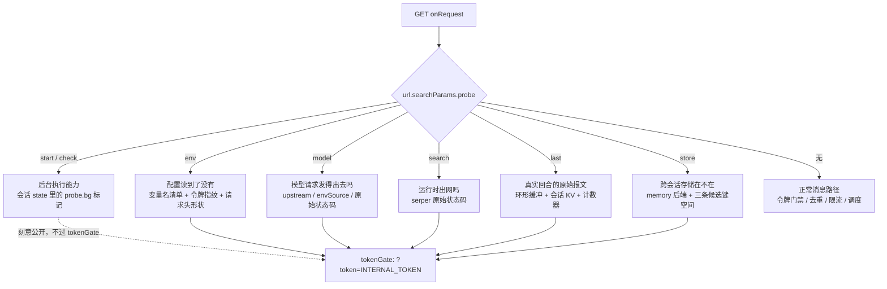

# 诊断、探针与排障

排查「bot 不回 / 答不上来」时，**不要靠往飞书里发消息试** —— 一轮十几秒，而且只能看到被 SDK 包装过的错误文案（`没答上来：400 status code (no body)`）。整套诊断面收在 `agents/feishu/index.ts` 的 `onRequest` 开头：一进来先看 `url.searchParams`，`probe=start|check|env|model|last|search|store` 各自分流到一个自测端点，然后才轮到正常消息路径。

这些端点的唯一职责是**把失败定位到某一层**。设计上每个探针只隔离一层，因为层层叠叠的失败里最常见的困惑恰恰是「到底是模型坏了、网络出不去、还是变量根本没读到」—— 发一条消息看答案根本分不出来。

> 正常消息路径本身的时序见[请求生命周期](../architecture/request-lifecycle.md)；模型两家的路由规则与 400 的判读见[模型网关路由与重试诊断](../integrations/model-gateway-routing.md)；探针回显的变量各自启用什么见[环境变量与配置目录](configuration-and-env.md)；探针读的记忆后端见[跨会话长期记忆](../concepts/cross-session-memory.md)。

## 探针面：每个端点隔离哪一层



这张图是「探针分流先于一切」的控制流：除 `start` / `check` 两道刻意的公开例外外，所有端点都收口在 `tokenGate`。

| 探针 | 隔离的是哪一层 | 第一个要看的字段 |
|---|---|---|
| `?probe=start` / `?probe=check` | **后台执行能力**：返回 Response 之后未 await 的异步代码还跑不跑得完 | `phase` 与 `verdict` |
| `?probe=env` | 环境变量**读到了没有**，以及自定义头有没有真的穿过平台网关 | `envSource`、`requestShape.headersIsHeaders` |
| `?probe=model` | 模型请求**发得出去吗**（与真实回合共用 `makeModelClient`） | `upstream`、`envSource`、`status` |
| `?probe=search` | 运行时**出网**吗（把模型那层摘掉） | serper 的 `status` 与 `titles` |
| `?probe=last` | **真实回合**那个请求长什么样 + 钩子跑过没有 | `counters.sessionInputCalls`、`req.msgRoles`、`req.assistantKeys`、`res.text` |
| `?probe=store` | **跨会话存储**在不在，三条候选键空间哪条真的跨会话 | `memory.available` / `memory.reason`、`runtime.getStoreType` |

### 门禁：按「这个端点会不会泄漏」开，不按「谁在用」开

探针的统一门禁是 `tokenGate(context, url)`，判据一行：`?token=<INTERNAL_TOKEN>` 相等才放行，否则 401。抽成一个函数本身是评审修出来的决定 —— 原先每个探针各自手抄这三行，结果 `probe=env` 那一处**漏了**，而它恰恰是泄漏最多的一个（`INTERNAL_TOKEN` 与 `SERPER_API_KEY` 的长度和首尾、serper key 的 FNV 指纹、env 变量名清单），实测线上无令牌也能拿到 200。

所以立的规矩是：**门禁按「这个端点会不会泄漏东西」开，不按「谁在用」开。** 逐个调用点手抄 = 新增一个探针就忘一次，因此收口在 `tokenGate()` 一处。

例外只有两处，是**刻意**的：

- `probe=start` / `probe=check` 不挡令牌。状态页（仓库根目录 `index.html`）要在浏览器里直接 fetch 它们，而**把 `INTERNAL_TOKEN` 塞进公开静态页等于公开它**。这两个端点只读写自己那个会话的 `probe.bg` 键，泄漏面为零。
- 状态页本身是纯静态资源，它推出来的飞书回调地址按当前 origin 算，只有该显示的和说明文字，**绝不含任何密钥**。

`op=write` 的 `?probe=store` 明确要挡令牌的理由写在该端点的注释里：它会往**共享**命名空间里写键，`op=shape` 又会回显存储相关的环境变量名 —— 正因为它「明知公网可达」还这么干，才必须过门禁。

⚠️ 所有探针都**必须带 `Makers-Conversation-Id` 头**，否则平台在到达 handler 之前就先回 400。会话身份是这个头，不是 `chat_id`。

### `env` 与 `model` 为什么要分开

这两个探针各自对应一类完全不同的病，混在一起会得出错误结论：

- `?probe=env` 只证明**变量读到了**，不证明**请求发得出去**。半配（只有 key 没有地址，或反过来）在这里就要挡掉，否则 OpenAI SDK 会抛出「The OPENAI_API_KEY environment variable is missing」—— 一句和真实原因（我们自己没配对）完全无关的话，够排查半天。
- `?probe=model` 用和真实回合**同一个工厂函数** `makeModelClient(env)` 发一次极简请求，把原始状态码和上游身份掏出来。三种结果各自指向不同的病：401 `API key not found` = **打错门**（key 是 A 家的，baseURL 指着 B 家）；400 `provider prefix` = **模型名规则不对**（EdgeOne AI Gateway 要 `@makers/` 前缀，OpenCode Go 要裸名）；429 / quota = 额度；超时 / DNS = 运行时出网问题。

它还先把结论摆出来，免得读的人自己拼：`upstream` 按 `baseURL` 的 host 判定（`*.opencode.ai` → OpenCode Go，`*.edgeone.link` → EdgeOne AI Gateway，否则未知或非法 URL）。

⚠️ `?probe=model` 是 **200 也不能证明真实回合能过** —— 它只发一个极简请求，不带工具、不带云文档授权。真正失败的是真实回合那个带全量工具表的请求。这就是为什么还需要 `?probe=last`。

### `search`：把模型那层摘掉

「工具能不能用」这件事被两层遮着：模型得先跑起来（网关鉴权 / 额度），才会去调工具。模型一挂，搜索就完全测不了 —— 于是没法回答「到底是搜索坏了，还是模型坏了」。`?probe=search` 直接对 `https://google.serper.dev/search` 发一次请求，于是「搜索失败」能一次定位到是哪一层：

- `model` 探针 200 + `search` 探针 200 → 两层都好，问题在提示词 / 工具描述；
- `model` 探针失败 → 先修模型，搜索根本轮不到。

它带回 serper 在 Google Cloud 上的直连结果，而**超时 / DNS 错 = 运行时出网被限制，不是 key 的问题**。⚠️ 会消耗一次 serper 配额，所以过门禁。

### `store`：同一份代码里对照三条候选键空间

`context.store.state` 按 `conversation_id` 隔离，换个会话就是空白 —— 所以「跨会话记忆」必须找到一片不带会话前缀的键空间。读运行时的打包产物发现三条候选路，`?probe=store` 就是用来**实测哪条真的跨会话**：

| 路 | 怎么走 | 预期 |
|---|---|---|
| A · 裸 Blob | `getStore({ name: "memory-<projectId>" })` + 自己起的键前缀 | ✅ 跨会话可见 |
| B · 路由 store | `context.store.get/set(...)` | 路由级，跨会话可见（别串数据） |
| C · 会话 state | `context.store.state.set(...)` | 预期**不**跨会话（对照组） |

用法是三步：`?probe=store`（看形状，不写任何东西）→ `?probe=store&op=write`（三条路各写一个带时间戳的探针键）→ **换一个 `Makers-Conversation-Id`** 再 `?probe=store&op=read`。三条路各自的 `verdict` 就是答案，`blob.foreignCount > 0` 说明裸 Blob 真的跨会话。所有写入都在 `probe-*` 前缀下，不碰 `feishu.*` 那些真键，也不碰平台 `memory-<projectId>` 里的任何非探针键。

⚠️ 命名空间必须用运行时真正在用的那个 —— 早先以为 `context.store` 落在 `agent-store`，实测那个命名空间**根本不存在**（路由级 store 在 agents 路由下从未被调用）。用错名字会在账号里凭空建一个垃圾命名空间。凭证类环境变量在这里只报长度 / 首尾 / 是不是没被替换的 `{{...}}` 占位符，**不打印明文**。

`?probe=store` 的 `memory` 字段走的是和真实回合**同一个**解析函数 `memoryBackendStatus(env)`，所以它说 `available` 就是真 available。这一点是有意的：探针要是自己另拼一份配置，测过的就不是线上真正跑的那条路了。`memory.reason` 把「记忆为什么不见了」直接说成人话（只有两种病：运行时没暴露 `getStore`，或拿不到 projectId），`memory.projectIdFrom` 说明到底哪个变量生效了。

## 观测钩子确实跑过：为什么需要计数器

`_diag.ts` 里有一个模块级 `diagCounters`，`?probe=last` 会原样带出来。它存在的原因是一个反复出现的失败模式：**静默失效的钩子和坏掉的钩子看起来一模一样**。

`sessionInputCallback` 是 OpenAI Agents SDK 的一个**可选**参数 —— 如果名字写错或 SDK 版本不认，它不报错、不警告，只是**静默不生效**。而唯一的症状是「偶尔还是 400」。光看聊天记录**分不出**是钩子没挂上，还是历史真的又毒了一次。

所以给钩子一个能被观察的副作用：每被调用一次 `sessionInputCalls` 就 +1。**只要 `sessionInputCalls > 0`，就证明钩子确实挂上了** —— 这是「钩子挂上没有」的唯一直接证据。

`diagCounters` 里五个计数器各自钉住一条链路：

| 计数器 | 含义 | 为 0 说明什么 |
|---|---|---|
| `sessionInputCalls` | 历史消毒钩子被调用次数 | 钩子没挂上 / 本轮没走到 `ask()` |
| `droppedOrphanTools` | 累计丢掉的孤儿 tool 消息数 | 窗口没切歪（正常），或钩子没跑 |
| `droppedEmptyAssistants` | 累计丢掉的空 assistant 消息数 | 同上 |
| `compactWanted` | 自动压缩「判定该压」的次数 | 历史没超限，或判据坏了 |
| `autoCompactions` | 自动压缩**成功**的次数（摘要非空、写回完成） | 判据没到，或压缩那一步抛错被吞掉了 |

后两个计数器是 2026-09-26 加的，同样的理由：自动压缩这条链路上有**两处会静默失效** —— 判据恒 false（历史没超限），或者压缩那一步抛错被吞掉。只看聊天记录分不清是「没到该压的时候」还是「坏了」。所以：

- `compactWanted` 与 `autoCompactions` **都涨** = 判据和压缩都工作；
- **只有前者涨** = 判据说该压但没压成（多半摘要返回空），诊断里会有一条 `auto-compact-skipped`；
- `auto-compact-failed` 则记下摘要请求抛出的原始消息。

⚠️ `diagCounters` 是**按实例**的内存计数，而实例由 conversation id 粘性路由。所以复验前必须先 `?probe=last&op=clear` 清零 —— 否则读到的是上一轮攒下的值，构成**假阳性**。`verify:autocompact` 脚本自己先清零，清零后从 0 涨起来的那个 1 才算证据。

顺带：`?probe=last&op=clear` 同时清空内存环形缓冲、重置计数器、并删掉会话 KV 里的 `DIAG_KEY`。

## `?probe=last`：真实回合的原始报文

`modelFetch`（挂在模型客户端上的 fetch 包装）把每次出站请求的**形状**和入站响应原文记进一个最多 8 条的环形缓冲。为什么需要它：bot 回 400 时 `?probe=model` 是 200（探针不带工具），而 SDK 把真实失败压成了一句话 —— 真正的原因在出站请求里（工具 schema 不合法、请求体超限、多带了网关不认的参数），本地又复现不出来（本地没有沙箱工具和云文档授权，「本地能跑通」根本不能排除问题）。**排查用的是线上真实报文，不是推测。**

记录只留**形状 + 截断片段**：不记完整 body（可能含用户提问 / 贴进来的文档内容），**也不记 Authorization 头**。

⚠️ 环形缓冲按**实例**隔离，而这次探针请求很可能被路由到另一个实例（实测踩过：刚失败完探针却回 `count=0`）。所以最终失败的那一笔还会通过 `onFailure` 落进**会话 KV** 的 `DIAG_KEY = "diag.lastModelFailure"`（按 `conversation_id` 归属，跟探针用的是同一个 id），任何实例都能读到。`?probe=last` 因此同时返回两边：`persistedFailure`（跨实例可读）与 `entries`（本实例内存），外加 `counters`。

诊断 payload 里还混着两类非报文记录，都落在同一个 `DIAG_KEY` 下、用 `kind` 区分：`history-sanitized`（窗口切歪、丢了东西）、`auto-compact-skipped` / `auto-compact-failed`。

## 复验铁律：探针是 GET，边缘会缓存

⚠️⚠️ **凡是「改完代码 → 打探针复验」的流程，都必须带 cache-buster。**

实测踩过：部署成功之后打 `?probe=store`，响应里一直缺新加的字段，第一反应是「构建没生效 / 部署没上去」，差点去翻构建日志。加上 `&_=$(date +%s)` 立刻就有了。`-H "Cache-Control: no-cache"` **没用** —— 那是请求头，边缘不认，必须让 **URL 本身变化**。

```bash
BASE=https://<域名>/feishu
TOK=<INTERNAL_TOKEN>
CID=probe-diag-0001        # 任意 6~36 位 [0-9a-zA-Z-_.]
h=(-H "Makers-Conversation-Id: $CID")
T=$(date +%s)              # ← cache-buster，别省

curl -s "${h[@]}" "$BASE?probe=env&token=$TOK&_=$T"    | python3 -m json.tool
curl -s "${h[@]}" "$BASE?probe=model&token=$TOK&_=$T"  | python3 -m json.tool
curl -s "${h[@]}" "$BASE?probe=search&token=$TOK&_=$T" | python3 -m json.tool
curl -s "${h[@]}" "$BASE?probe=store&token=$TOK&_=$T"  | python3 -m json.tool
```

先下「部署失败」这个结论之前，先排除缓存 —— 否则会把缓存误诊成部署失败。

## `?probe=start` / `?probe=check`：后台执行能力自测

这套移植最大的未知数是 EdgeOne 官方**没有明文承诺**「返回 Response 之后未 await 的异步代码还能不能跑完」。飞书要求 webhook 在 3 秒内 ACK，而模型要跑二三十秒，所以这条链路整体依赖它。

两个动作要**分两次请求**，中间隔 16 秒 —— 因为要测的正是「第一个请求已经结束了，它启动的后台任务还在不在」：

1. `?probe=start` 立刻返回（202），同时起一个后台任务，**睡 15 秒**后把带 `finishedAt` 的标记写进会话 state 的 `probe.bg` 键；
2. 等 16 秒 → `?probe=check` 用**同一个 `Makers-Conversation-Id`** 读回那个标记。

`probeCheck` 的 `verdict` 直接给出两种结论：`phase === "finished"` → 「✅ 后台执行可用 —— 用默认的 `FEISHU_DISPATCH_MODE=async`」；否则 → 「❌ 后台任务没跑完（响应发出后进程被回收了）—— 把 `FEISHU_DISPATCH_MODE` 改成 `sync`」。

**为什么要 15 秒**：太短的话任务可能在响应发出**之前**就跑完了，那样测出来的是「同步能跑」而不是「后台能跑」—— 假的通过。

⚠️ 两次请求必须是**同一个 conversation id** —— 标记写在会话 state 里，换个 id 就查不到，`phase` 会一直显示 `started`，看着像「后台不可用」，其实是查错了地方。⚠️ 换域名 / 改运行时后要重跑（线上的实例回收策略可能和本地不一样）。

## 症状 → 层：先看哪

| 现象 | 去哪看 | 病在哪 |
|---|---|---|
| 路由 404 | 文件位置：`agents/feishu/index.ts` → `/feishu` | 不是探针问题 |
| 401 内部令牌不匹配 | `?probe=env` 的 `match` / `gotInternalToken` | 两边 `INTERNAL_TOKEN` 不同，或自定义头被网关剥掉 |
| 503 没配 `INTERNAL_TOKEN` | —— | 环境变量没配，这是**故意的** fail-closed |
| 400 缺少 `Makers-Conversation-Id` | —— | 转发头没带上，或直接访问了 `/feishu` |
| bot 回「没答上来：…」 | 先 `?probe=model` | 200 才轮到查提示词 |
| 搜索不生效 | `?probe=model` 与 `?probe=search` 各打一次 | 分清是模型层还是工具层 |
| 改了变量却毫无变化 | `?probe=env` 的 `internalToken` 指纹 | 值对但没重新部署（跑着的 agent 用的是打包快照）；或 key 名字不在过滤正则里 |
| `envSource` 是 `AI_GATEWAY_*` | `?probe=env` | 路由退回了兜底：`OPENCODE_*` 没配全 |
| 某个会话稳定 400，别处正常 | `?probe=last` 的 `req.msgRoles` / `assistantKeys` / `attempt` / `res.text` | 会话被历史毒死，或钩子没挂上 |
| 自动压缩「好像没动」 | `?probe=last` 的 `counters`（先 `op=clear`） | 判据没到，还是压了没成功 |
| 换了群 / 换个人就「不记得」 | 先 `?probe=store` 的 `memory.available` | 后端拿不到时功能**整体静默关闭** |
| `/memory` 回「拿不到持久存储」 | 同上 | 设计如此，不是 bug |

⚠️ 加新环境变量时，记得同步 `probeEnv` 里的过滤正则（`/FEISHU|INTERNAL|AI_|AGENT|SANDBOX|SERPER|OPENCODE|GITHUB/`）。漏一个就会让那个变量在探针里**隐身** —— 曾经漏了 `SERPER`，误判成「环境变量没生效」，白排查半天。

## 边界与取舍

- **探针只做诊断，不做业务。** `?probe=model` 与 `?probe=search` 各会真实消耗一次额度（token 量级 / 一次 serper 配额），这正是它们要过门禁的原因。
- **诊断不能拖垮业务。** 落盘是 `void ... .catch(() => {})` 的 fire-and-forget，KV 写失败不影响这一轮回答；`autoCompactNote` 把所有异常都吞掉，只往诊断记一笔。
- **静默失效是这个系统的主要失败形态。** 记忆后端拿不到时整体静默关闭（不挂工具、提示词也不提）；历史消毒钩子写错名字不报错；自动压缩失败被吞掉。计数器、`memory.reason`、以及「探针和真实回合共用同一个解析函数」这三条都是为了让这些静默失效最终**有一个可观测的出口**。
- **诊断面不记密钥。** `?probe=env` 只回显**变量名**清单与令牌的长度 / 首尾，值对不对靠指纹（serper）验证；`?probe=store` 的凭证类值只报长度 / 首尾 / 是否还是构建期占位符。

相关页面：[请求生命周期](../architecture/request-lifecycle.md) · [模型网关路由与重试诊断](../integrations/model-gateway-routing.md) · [环境变量与配置目录](configuration-and-env.md) · [跨会话长期记忆](../concepts/cross-session-memory.md) · [存储模型](../concepts/storage-model.md) · [端到端验证](../testing/end-to-end-verification.md)
