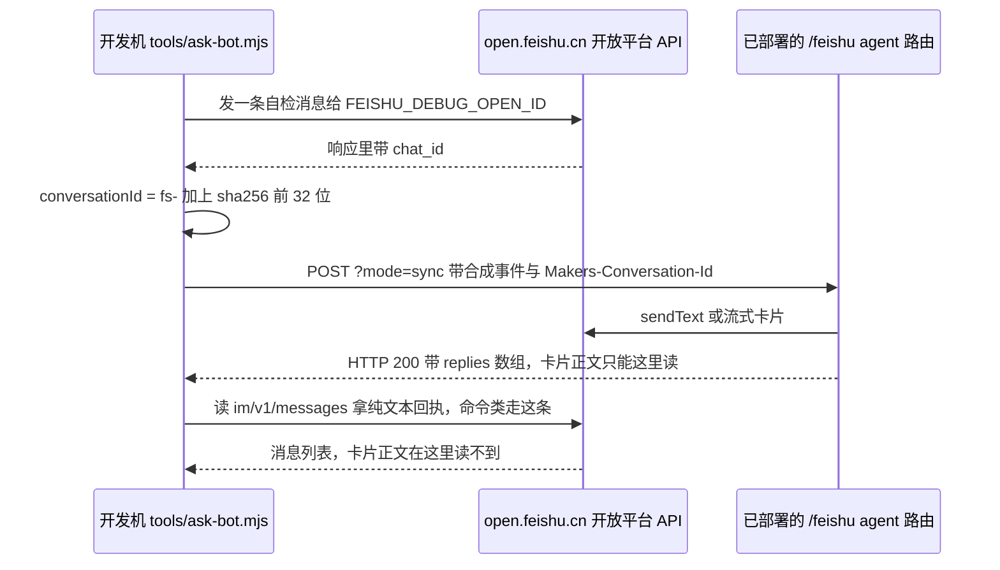

# 端到端验证脚本与执行顺序

冒烟测试（`npm test`）刻意不碰平台：它 stub 掉 `fetch`、不连飞书，只验「哪一层都不依赖平台」的那些判据（详见[冒烟测试套件](smoke-tests.md)）。但那正好留下一个缺口 —— **「真跑起来会不会成立」这件事它答不了**。所以仓库里另有一组 `tools/*.mjs`，它们从**开发机**出发、对着**已部署的 agent** 打真实请求，把「线上到底行不行」变成可重复的命令。

三个脚本 + 一条探针顺序，分工如下：

| 工具 | 命令 | 验证什么 | 回复从哪读 |
|---|---|---|---|
| `tools/ask-bot.mjs` | `npm run ask -- "问题"` | 单轮无头合成回合：链路通不通、答案是什么 | `?mode=sync` 的 HTTP 响应 `replies` |
| `tools/verify-memory.mjs` | `npm run verify:memory` | **跨会话**长期记忆：会话间共享、`/clear` 不误伤、遗忘生效 | 混合：问答读 `?mode=sync`，命令读飞书 API |
| `tools/verify-autocompact.mjs` | `npm run verify:autocompact` | 自动压缩在生产上**真的会触发** | `?probe=last` 的诊断计数器（因为这一轮回 500） |
| 探针 curl / 状态页 | 见[诊断、探针与排障](../operations/diagnostics-and-probes.md) | 后台执行能力、env / 模型 / 搜索 / 存储分层定位 | 探针 JSON |

运行它们需要 `.env` 里有 `AGENT_URL`、`INTERNAL_TOKEN`、`FEISHU_APP_ID`、`FEISHU_APP_SECRET`、`FEISHU_DEBUG_OPEN_ID` —— 脚本自己解析 `.env`，缺任何一个直接 `exit 1`。这些是**对着线上环境跑**的工具，不是单元测试：`npm test` 不需要凭证，这组需要。

## 为什么把浏览器整个拿掉

正常链路是「飞书网页版发消息 → webhook → 中转 → agent」。但飞书网页版会索要通知/本地网络权限，而 Chromium 刻意不允许脚本点这类弹窗 —— 每一轮测试都要人工点一次。`ask-bot.mjs` 把浏览器整条拿掉的办法是：**直接给 agent 投递一个合成事件**。

这能成立的前提写在脚本文件头里：agent 的 `normalizeEvent` 只认 `{ messageId, chatId, chatType, openId, text }` 这几个字段，**不验飞书签名** —— 验签是中转那层（`cloud-functions/feishu-webhook`）做的。所以本机可以直接打 agent，凭证只需要 `INTERNAL_TOKEN`。

```bash
npm run ask -- "现在金价多少？"
# 或 node tools/ask-bot.mjs "…"
```

脚本先给 `FEISHU_DEBUG_OPEN_ID` 发一条 `[自检]` 消息，**借响应体拿回这个单聊的 `chat_id`**（见下）—— 这比调 `im/v1/chats` 省一个 `im:chat:readonly` scope。然后用真实 `chat_id` 算出 `conversationId = fs-${sha256(chatId)[0:32]}`，跟生产转发层**同一算法**（见[会话路由与三种入站实现](../architecture/conversation-routing-and-ingress.md)），再 `POST ${AGENT_URL}?mode=sync`。

### 取值路径：回复只从两个地方读

这是这套工具链最重要的架构事实，也是它最容易踩坑的地方：

1. **`?mode=sync` 的 HTTP 响应 `replies`** —— 这是**唯一**能拿到卡片正文的途径。`/agents/feishu/index.ts` 的 `dispatch === "sync"` 分支会 `await work(request?.signal)` 并把这一轮发出的每条回复原样塞进 `{ ok, mode: "sync", replies }`。`runFeishuTurn` 里的 `sent[]` 数组就是它的来源：`say()` 记一条、`sendText` 发一条，流式卡片那条虽然不再补发纯文本，也**照样记进 `sent`**。
   为什么必须这样：流式卡片正文通过飞书 `im/v1/messages` **读不到** —— 那条接口对 card_id 型卡片只回一句「请升级至最新版本客户端」的占位。async 分支返回的 202 不承载业务内容。所以「自动核对机器人答了什么」只有 sync 这一条路。
2. **飞书 API `im/v1/messages?container_id_type=chat&container_id=<chat_id>`** —— 能读到 `sendText` 发出去的**纯文本**。`/memory`、`/forget`、`/clear` 这类命令回执走这条路。`verify-memory.mjs` 用它读记忆清单（阶段 5）与清理回执（阶段 7），全链路不碰自家接口 —— 这本身就是一条独立证据：命令回执确实到达了飞书，而不只是「agent 说自己发了」。

> 注意两者读的是**不同东西**：卡片正文只能在 sync 响应里拿，命令纯文本只能在飞书 API 里拿。任何「读回来断言」的验证都必须先想清楚要读的是哪一类。

抓取回复还有一个实现细节：脚本用 `curl`（显式 `-x` 指定代理、并清空所有代理类环境变量）而不是 `fetch`。原因是本机环境里 `HTTPS_PROXY` 会压过 `all_proxy`，让请求静默走错代理、稳定 401。⚠️ **那个 401 不是业务鉴权失败**：响应体里有 `Tencent Edgeone` 或 `x-eop-msg: eo_time missing` 就是边缘挡板，别去查 `INTERNAL_TOKEN`。另外 `.edgeone.dev` 域名本机**必须**经代理（直连 401），而自定义域名 `eolab.yujizi.org` 直连即可 —— 「打 EdgeOne 必须走代理」只对前者成立。



这张图说明验证脚本的取值路径：问答走 sync 响应，命令回执走飞书 API，两条路互不替代。

## verify:memory：跨会话记忆的七阶段

```bash
npm run verify:memory            # 完整跑，收尾自动清理测试事实
npm run verify:memory -- --keep  # 跑完不清记忆（想留在飞书里肉眼看）
```

前提认知：`context.store.state` **按会话隔离**，所以「在同一个群里记得」证明不了跨会话记忆（那可能只是平台自己的会话历史）。真正的判据必须**换一个 conversation_id**。而会话身份是 `Makers-Conversation-Id` **请求头**，不是 `chat_id`（2026-09-25 实测修正过这条）。于是脚本用**真实单聊的 chat_id**（这样机器人真能把回复发出去）配**多个不同的 conversation_id** —— 对平台来说这就是多个会话。这比「两个群」更干净：chat 完全相同，**唯一的变量就是会话**，所以 B 答得出只可能来自共享记忆，不可能来自聊天记录。

脚本用 `convOf(seed)`（`fs-` + sha256 前 32 位）造四个会话，每次跑都带一个 `randomBytes(3)` 的 run nonce：

| 会话 | 用途 | 为什么必须是独立的一个 |
|---|---|---|
| A | 让它记下事实 | 写入方 |
| B | 同一个 chat、**另一个会话**：先基线后复问 | 前后对比的唯一变量是共享记忆 |
| C | 第三会话，从没参与过 | 排除「A 的会话历史泄漏」 |
| D | **只**用于清理后复查 | 见下面假阳性「清理后的复查必须用全新会话」一条 |

脚本自称「7 个阶段」（阶段 4.5 是插进去的一条独立判据，不占编号），实际判据如下：

1. **阶段 1 · 基线**：在会话 B 先问一次，记忆为空时必须**答不出**。这一条不是形式 —— 它证明这条事实不是猜得出来的（见假阳性「事实必须不可猜」一条）。
2. **阶段 2 · 记录**：在会话 A 说 `记住一条长期事实：…`，回执必须出现「记下了」这类确认。
3. **阶段 3 · 复问会话 B**（**整场最关键的一步**）：同一个 conversation，基线时答不出、现在答得出；判据同时要求说出内部代号和发布分支。
4. **阶段 4 · 会话 C 首问**：第三个会话也答得出。
5. **阶段 4.5 · 会话 C 连问两次**：两次口径必须一致，不许出现「我编的 / 撤回」这类自我否定 —— 这条专门盯「模型同时看到提示词快照和工具返回不一致，就当众撤回正确答案」那个毛病（见[跨会话长期记忆](../concepts/cross-session-memory.md)的提示词快照一节）。
6. **阶段 5 · 飞书 API 读 `/memory`**：轮询等一条新出现的、含该事实的纯文本消息。这是**硬判据的独立性来源**：它不经过模型。
7. **阶段 6 · `/clear` 后仍记得**：在 A 发 `/clear` 再问，仍然答得出 —— 这证明 `/clear` 只清对话历史，不动长期记忆（记忆在另一个 Blob 命名空间里）。
8. **阶段 7 · 清理与复查**：`/forget all confirm` → 用 **`/memory`（确定性，不过模型）** 断言「还没有任何长期记忆」→ 再用**全新会话 D** 做软判据（模型不该再断言该事实）。

脚本最后打印一张「一屏看结论」的勾选表，全绿才 `exit 0`。

## verify:autocompact：用计数器证明触发

```bash
npm run verify:autocompact
```

自动压缩的判据（`shouldCompact`）挂在「`renderTranscript` 渲染出来有没有被截断」上，而那需要十几轮满长度对话才堆得到。冒烟测试只钉得住**判据本身**（纯函数），**触发那一段只能真跑**：判据恒 false、`session()` 拿不到、压缩抛错被吞 —— 三种坏法症状都是「什么都没发生」，光看聊天记录分不出来。

不刷屏地验证，靠两个既有事实凑出来：

1. 回复可以从 `?mode=sync` 的 HTTP 响应里读，不必去读飞书聊天；
2. 会话身份是 `Makers-Conversation-Id` 请求头，不是 `chat_id`。

于是脚本用**假 `chat_id`（`oc_probe0000…autocompact`）+ 一个独立 conversation id**：消息只会尝试发到那个不存在的 chat，**一条都不会打到真人聊天里**。

⚠️ **代价是那一轮回 500**（发不出去），读不到回复。但压缩代码在 `ask()` 里**已经跑完了** —— 发送失败发生在它返回之后。所以判据改成读**诊断计数器**：`?probe=last` 的 `counters` 里 `compactWanted`（判据判定该压）与 `autoCompactions`（摘要非空、写回完成）。

流程是：**先清零**（见假阳性「计数器断言前必须先清零」一条）→ 每轮投一段撑上下文的 filler 并要求原样复述（每轮贡献约 8000 渲染字，判据线 12 万字，所以约 15 轮越过）→ 每轮读一次计数器 → `autoCompactions > 0` 即成功退出。

两个判读要点：

- **`compactWanted` 与 `autoCompactions` 都涨** = 判据和压缩都工作；**只有前者涨** = 判据说该压但没压成（多半摘要返回空），诊断里会有 `auto-compact-skipped`；`auto-compact-failed` 则记下摘要请求抛出的原始消息。
- 跑满 `MAX_ROUNDS`（默认 30）仍未触发时，脚本自己给出两条排查方向：先确认计数器**真的**清成 0 了，再确认这一轮确实跑到了 `ask()` 里（看 `sessionInputCalls` 有没有涨）。

⚠️ 别用管道跑它（`| tail` 之类）：`console.log` 一进管道就被缓冲，进程结束前读不到一个字。脚本因此把进度同时 `appendFileSync` 落盘到 `/tmp/verify-autocompact.log`。

## 探针复验：部署后必须重跑的那一条

状态页的「跑一次自测」按钮和 `?probe=start` / `?probe=check` 是**后台执行能力**的唯一直接证据 —— 整套「先回 202 再后台跑完」的设计都压在这个未明文承诺的前提上。它必须**分两次请求、隔 16 秒**（后台任务睡 15 秒），且两次**必须带同一个 `Makers-Conversation-Id`**（标记写在会话 state 里，换 id 就查不到，`phase` 会一直显示 `started`，看着像「后台不可用」，其实是查错了地方）。`phase: finished` / `elapsedMs: 15046` → `FEISHU_DISPATCH_MODE` 保持 `async`；`phase: started` → 改成 `sync` 重新部署。

⚠️ **部署后要重跑这一步** —— 线上的实例回收策略可能和本地不一样，本地通过不代表线上通过。同理，换域名 / 改运行时后所有端到端验证都要重跑。

⚠️ 探针是 GET，**边缘会缓存**：凡是「改完代码 → 打探针复验」的流程都必须带 cache-buster（`&_=$(date +%s)`），否则会把缓存误诊成部署失败。`-H "Cache-Control: no-cache"` 没用，必须让 URL 本身变化。

按顺序执行的完整清单（第 0 步冒烟测试已实测通过 → 本地起服务 → 后台执行 → 模拟飞书事件 → 流事件名 → 真实飞书链路 → 部署）记录在 `docs/03-验证清单.md`。核心原则是**每一步都过了再进下一步**：跳步的话出了问题不知道是哪一层。

## 假阳性清单：五条踩过的坑

这五条是这套验证脚本最有价值的部分 —— 每一条都真的导致过「看起来通过了，其实什么都没验」。改动这些脚本时，它们是第一优先要保住的东西。

### 1. 事实必须不可猜

第一版用「这个项目用 pnpm 还是 npm」当探针 —— 模型光靠先验就能答对，**基线那步直接失效，整个验证等于没做**。现在用的是「青鸟-7」「release/2026q4-migration」这种**编造出来的、猜不出来的**值。脚本甚至在阶段 1 的失败分支里直接写出补救方向：「⚠️ 它猜到了 —— 这条探针不成立，得换一个更刁的事实」。

### 2. 判「答出来了」不能用 `includes(keyword)`

模型会**自我更正**：清理之后它回的是「我上一条答错了，向你更正……『青鸟-7』这个说法没有任何来源，那是我编的」—— 这句话里**含有**那四个字，但语义是**否认**它。字符串匹配会把这种自我纠正判成「还记得」。所以 `assertsFact(text)` 要求：出现了事实原文，**且**没有任何否认 / 纠正 / 不确定的标志词（`更正 / 答错 / 我编的 / 没有来源 / 是空的 / 不知道 / 查不到 / 没记 / 抱歉`）。反向问「知不知道」时，同一个函数用来判「答不出来」。

同样性质的第二条判据是阶段 4.5 的 `flipFlop` 检查：连问两次时不许出现「我编的 / 没有任何来源 / 上一条答错 / 撤回」——**这是一种独立于内容匹配的失败形态**：答案里可能带着正确关键词，但整句是在撤回它。

### 3. conversation_id 每轮都要带 nonce

用固定 id 的话，第二次跑时阶段 1 的「基线」会继承上一轮留下的会话历史，模型会把上轮看到过的事实复述出来 → **基线假失败**。所以脚本里 `convOf` 的种子拼了 `RUN = randomBytes(3).toString("hex")`，四个会话 id 每次跑都不同，并断言它们互不相同。

### 4. 清理后的复查必须用「没聊过这条事实」的全新会话

这一条踩得最久：原本在会话 C 里复查（C 在阶段 4/4.5 已经答过这条事实），清理后 C 照样答得出来，还补一句「实时确认过 `prefs/项目代号`，没变」—— 看着像「清理没生效」。实际是**从自己的对话上文里复述的**，跟长期记忆无关；而且那句「实时确认过」是**编的**（它压根没调 `recall_facts`）。换成全新会话 D 立刻正常。所以脚本单独造了 `CONV_D`，并且在注释里把这段因果写死。

### 5. 计数器断言前必须先清零

`verify:autocompact` 的对应陷阱，和上一条**同源**：都是「残留状态被当成本轮证据」。`diagCounters` 是**按实例**的内存计数，而实例由 conversation id 粘性路由。第一版没清零就断言，读到的是上一轮攒下的 1 —— **假阳性**。脚本现在自己先打 `?probe=last&op=clear`（它同时清空环形缓冲、重置计数器、删掉会话 KV 里的 `DIAG_KEY`）；**清零后从 0 涨起来的那个 1 才算证据**。

同一条原则还有个跨实例的推论：`?probe=last` 的 `entries` 是本实例内存环形缓冲，而探针请求很可能被路由到**另一个**实例（实测踩过：刚失败完探针却回 `count=0`），所以最终失败的那一笔还会通过 `onFailure` 落进**会话 KV** 的 `diag.lastModelFailure`（按 conversation_id 归属，跨实例可读）。要把「本实例内存」和「跨实例可读」两者分开读，不能混着断言。

## 尚未端到端验证的区域

以下三块**没有**被上面的脚本覆盖，改动相关代码时别把「冒烟测试绿了」当成「这条链路验过了」：

- **真实的飞书入站 webhook（事件订阅）**。README 记录得很明确：入站那一段**没跑过** —— 上面的验收全是直调 `?mode=sync` 或经 `ask-bot.mjs` 投合成事件。出站链路（真发卡片 / 纯文本 + 飞书 API 读回）已验证，但「飞书后台把事件推给我们」这一跳没有端到端证据。
- **流事件的实际名字**（【未知数 2】）。`applyEvent()` 处理的四个事件里，只有 `output_text_delta` 和 `tool_called` 有官方模板佐证，工具结果与思考增量是**按规律推的**。核对面是 `?agent-metrics` 里 `raw_model_stream_event` 的 `data.type` 取值。猜错的后果只是卡片少一行，**不影响答案正确性**（最终答案优先取 `result.finalOutput`）。仍未核。
- **生产上的会话窗口配置**。`context.store.openaiSession()` 的 100 条窗口是平台侧静默施加的，脚本验不到它 —— 能验的只有 `shouldCompact` 这个纯函数判据（冒烟测试 G 节），以及「触发确实会发生」（`verify:autocompact`）。

另外三处「按文档写、没实测」的低风险细节也归这一类：平台工具的实际注册名（`commands` / `code_interpreter` / `web_search` / `files_*`，对照 `_tools.ts` 的 `EXCLUDED` 列表）、`context.tools.all()` 在 `openai-agents-sdk` 下返回的对象形状、以及 `context.store.state` 的单值大小上限。

## 边界与取舍

- **脚本是对生产环境打的，不是隔离测试。** 它们会真花模型 token、真往飞书发消息（`verify-memory` 会往 `FEISHU_DEBUG_OPEN_ID` 的单聊里发一串自动消息）。`--keep` 是唯一「别帮我清」的开关，用后要记得手动 `/forget all confirm`。
- **`verify-memory` 读不到卡片正文以外的命令回执时，判据会退化成软判据。** 阶段 5 / 阶段 7 的 `/memory` 断言依赖「命令回复走 `sendText`」这一实现事实；哪天真把命令回执改成卡片，这两条会失败 —— 那是设计变更该触发的信号，不是脚本坏了。
- **验证脚本自己也是被复制的不变量持有者。** `conversation_id` 算法在 `cloud-functions/feishu-webhook`、`bridge/index.mjs`、外部 CF Worker 和这三个 `tools/*.mjs` 里各有一份副本；任何一处改动没同步，症状是「两个会话的记忆串了」这类最难查的现象。
- **失败要能自我解释。** 脚本不是只打勾：`?mode=sync` 那条 401 会打印「这是边缘挡板不是 INTERNAL_TOKEN 的问题」并给出换代理端口的命令；`verify:autocompact` 失败会指出「先确认计数器清成 0 了」。写新验证脚本时沿用这个风格 —— 端到端验证最贵的成本是**误诊**，不是执行时间。
