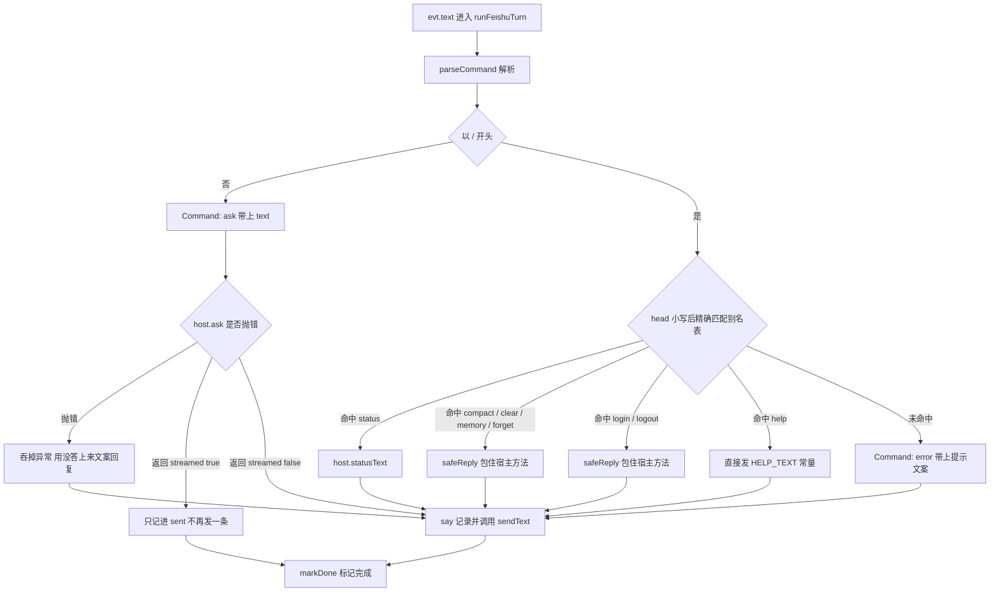

# 命令分派与控制流：从一条消息到一个动作

一条飞书文本消息进到 agent 之后，第一步不是「问模型」，而是**判它是不是命令**。这个判断在
[`parseCommand`](../../src/feishu/commands.ts) 里完成，产出一个 `Command` 联合类型的值；
随后 [`runFeishuTurn`](../../src/feishu/turn.ts) 用一个 `switch` 把它分派到两种完全不同的执行路径：
**宿主方法**（状态、压缩、清空、记忆、授权）或**模型回合**（`kind: "ask"`）。

本页讲的是这一层的结构：`Command` 联合的形状与别名表、分派 switch 的每一个分支、
两处刻意不对称的异常处理（`safeReply` 兜住 vs 模型失败被吞掉 vs 发送失败被放行）、
以及 `sent[]` 记录为什么是 `?mode=sync` 这条唯一机器可读通道的来源。

> 上游（消息怎样到达 `agents/feishu`、去重与限流、async/sync 两种调度）见
> [入站请求生命周期](../architecture/request-lifecycle.md)；模型回合内部的工具循环与
> 流式卡片渲染见宿主实现与[工具契约与清单](../concepts/tool-contract-and-inventory.md)。
> 命令背后的业务语义分别见[会话压缩](session-compaction.md)、
> [跨会话长期记忆](../concepts/cross-session-memory.md)、
> [云文档授权流程](oauth-authorization-flow.md)。
> 钉住这些行为的测试见[冒烟测试套件](../testing/smoke-tests.md)。

## 两层职责：解析是纯函数，分派才有副作用

这一层被刻意切成两半，切法决定了绝大部分性质：

| 文件 | 职责 | 依赖 |
|---|---|---|
| `src/feishu/commands.ts` | `parseCommand(raw): Command`，外加 `HELP_TEXT` | 零依赖纯函数 |
| `src/feishu/turn.ts` | `runFeishuTurn(host, env, store, evt)`，分派 + 发送 + 标记完成 | 注入 `FeishuTurnHost` 与 `FeishuStore` |

`parseCommand` **只做字符串到判别联合的映射**，不发消息、不碰存储、不建模型。所以
C 节可以一条断言一条断言地钉住别名与大小写，而不需要任何桩。

`runFeishuTurn` 拿到的是 `FeishuTurnHost` 接口（[`_host.ts` 的 `createHost`](../../agents/feishu/_host.ts)
为生产实现它），所以整个回合流程可以脱离平台单独测 —— 测试里的 `host()` 只是一个返回固定字符串的对象。
这个抽象最初只是为了「能脱离 Durable Object 单测」，结果正好让平台移植时这个文件几乎一行不用动。

## `Command` 联合：命令即数据

```ts
export type Command =
  | { kind: "ask"; text: string }
  | { kind: "status" }
  | { kind: "compact" }
  | { kind: "clear" }
  | { kind: "memory" }
  | { kind: "forget"; key: string }
  | { kind: "login" }
  | { kind: "logout" }
  | { kind: "help" }
  | { kind: "error"; message: string };
```

两点值得单独记住：

- **`ask` 携带 `text`，是唯一带业务载荷的分支**。`parseCommand` 对不带斜杠的输入
  `return { kind: "ask", text }` —— 提问不走 `switch` 的具体分支，它是「什么都没匹配上」之外的那条路。
- **`error` 也是一个成员，而不是抛异常**。「不认识的命令」是一种正常结局，
  携带一段给用户看的 `message`，由分派层当普通回复发出去。

### 别名表与大小写

解析规则只有三条（[commands.ts](../../src/feishu/commands.ts)）：

1. `raw.trim()` 之后不以 `/` 开头 → `{ kind: "ask", text }`；
2. 从第一个空白处切开：`head` 是命令名、`arg` 是参数；
3. `head` 先 `toLowerCase()` 再进 `switch` —— **命令名大小写不敏感，参数保持原样**。

| 命令名 | 英文别名 | 中文别名 | `kind` |
|---|---|---|---|
| `/status` | — | `/状态` | `status` |
| `/compact` | — | `/压缩` | `compact` |
| `/clear` | — | `/清空` | `clear` |
| `/memory` | — | `/记忆` | `memory` |
| `/forget` | — | `/忘记` | `forget`（`key: arg`） |
| `/login` | — | `/授权` | `login` |
| `/logout` | — | `/退出授权` | `logout` |
| `/help` | `/?` | `/帮助` | `help` |

两条易被忽略的行为：

- **多余参数被静默忽略**：`/compact 现在` 仍是 `compact`，`arg` 根本不会被读。
- **`/forget` 的参数故意允许为空**：`{ kind: "forget", key: "" }` 是合法结果。
  用户打一个光秃秃的 `/forget` 时想看的是**用法**，而只有宿主知道有哪些键、
  以及清空需要什么确认词 —— 在这里报「参数缺失」既没用又显得像出错。

### 匹配是精确的，不做前缀或模糊补全

`default` 分支直接产出 `error`，没有「猜测用户想打哪个命令」这回事。
C 节专门钉住了几个**近邻**输入不被误判：`/log`（不是 `/login`）、`/for`（不是 `/forget`）、
`/memories`（不是 `/memory`）都必须落 `error`。精确匹配的代价是用户多打几个字，
收益是「我打错了」和「这个命令不存在」不会被混淆成同一件事。

## 分派全图



图中 `say()` 是所有回复的唯一出口（记进 `sent[]` 再 `sendText`），唯一的例外是
`streamed: true` 那条 —— 它只记不发。`markDone` 只有在全部发完之后才执行。

## `switch` 的每一个分支

`runFeishuTurn` 的主干是一个对 `cmd.kind` 的 `switch`，分支可以分成三类：

**① 宿主方法 + `safeReply` 兜底**（`compact` / `clear` / `memory` / `forget` / `login` / `logout`）

```ts
case "compact":
  await say(await safeReply(() => host.compact()));
  break;
```

`safeReply` 只做一件事：`try { return await fn() } catch (e) { return \`处理失败：${e.message.slice(0, 200)}\` }`。
它存在的理由是**「必须有东西发回去」**——不兜的话异常会一路冒到 `index.ts`，
async 模式下进程只记一条日志就结束，用户那边**一条消息都收不到**，看起来像 bot 死了。

**② 常量或直接透传**（`help` / `error` / `status`）

`help` 发 `HELP_TEXT` 常量，`error` 发 `cmd.message` —— 这两条都是 `commands.ts` 里已经算好的文案，
不需要宿主参与。`status` 走 `host.statusText()` 但**不包 `safeReply`** —— 这是当前实现里唯一
一处宿主调用没有兜底的分支。

**③ 模型回合**（`ask`）—— 见下一节，它是唯一有自定义异常策略的分支。

## 为什么 `ask` 吞异常而发送失败要放行

这是本页最值得讲的一处**刻意不对称**。三条路径对异常的态度完全不同：

| 路径 | 异常怎么办 | 为什么 |
|---|---|---|
| 宿主命令方法（`compact` 等） | `safeReply` 兜住 → 发 `处理失败：…` | 用户要的是一个回执，失败信息本身就是回执 |
| `host.ask` 抛错 | **在 `case "ask"` 里 `catch` 并吞掉** → 发「没答上来：…」 | 见下 |
| `sendText` 失败 | **不兜，让它冒出去** | 见下 |

### 模型失败必须被吞掉

`case "ask"` 的 `catch` 不是顺手写的兜底，注释里写明了实测后果：让异常冒出去的话，
调用方（原版是 DO 的 `schedule()`）会**重试三次**，然后在服务端日志里留一句
`error executing callback after 3 attempts` 就放弃 —— 用户那边一片安静，没有任何提示。

所以策略是：**模型失败立刻说清楚，不指望重试**。模型失败通常是配置问题（凭证没配好、
网关打错门），重试三次改变的只是用户多等九十秒然后收到一句含糊的失败。
把 `e.message.slice(0, 300)` 拼进「没答上来：…」，并附一句
「如果这是刚部署的，八成是模型凭证没配好」，比任何自动重试都有用。

### 发送失败必须放行

同一段注释的另一半解释了为什么 `sendText` 不兜：**「网络抖动」才是重试真正擅长的场景**。
发消息失败是暂时性的、可重试的，而且重试的语义是正确的 —— 上游的去重窗口
（`store.claim`）会让重复推送落回同一条事件；发送还没成功时 `markDone` 也不会执行，
state 停在 `pending`，飞书的重推会再进来一次。

换句话说：**「错误发生在哪一层」决定它该被吞还是该被抛**。业务执行失败（模型、压缩）
吞掉并用人话回复；传输失败（发消息）抛出去让上层的重试机制接手。

### 还有一条流式特例

`host.ask` 返回 `{ text, streamed: true }` 时表示**答案已经通过流式卡片发到会话里了**，
调用方**不能再发一条**（那是同一段回答的两份）。但**要记下来** —— `sent.push(reply)` 之后
`break`，跳过 `say()`。这个「记但不发」的组合是下一节的主角。

## `sent[]` 与 `?mode=sync`：唯一机器可读的答复通道

`runFeishuTurn` 内部维护一个按发送顺序累积的数组：

```ts
const sent: string[] = [];
const say = async (text: string): Promise<void> => {
  sent.push(text);
  await sendText(env, cache, evt.chatId, text);
};
```

**所有**回复都经过 `say()`，包括 `streamed: true` 那条「只记不发」的例外 ——
它走的是裸 `sent.push(reply)` 而不是 `say()`，因为发已经发过了。函数返回 `sent`。

### 为什么要回显

`index.ts` 在 `dispatch === "sync"` 时把返回值塞进 HTTP 响应：
`json({ ok: true, mode: "sync", replies }, 200)`。这是**唯一**能把答案拿进 HTTP 响应的地方，
理由在 `turn.ts` 里写得很直接：

> 想自动核对「机器人到底答了什么」就只能去读飞书消息，而流式卡片的正文通过
> `im/v1/messages` 读不到 —— 那条接口对 card_id 型卡片只回一句
> 「请升级至最新版本客户端」的占位。于是自动验证退化成「开浏览器人工看」。

`tools/ask-bot.mjs`、`tools/verify-memory.mjs`、`tools/verify-autocompact.mjs`
这些验证脚本正是靠打 `?mode=sync` 从 HTTP 响应里读 `replies`（见
[端到端验证](../testing/end-to-end-verification.md)）。async 那条路的 `202` 不承载业务内容，
所以回显只在 sync 分支给。

注意这个回显的**语义边界**：它是「这一轮发出过哪些文本」，不是「这些文本都被用户看到了」——
`sendText` 抛错时数组里已经 push 了那一条，而消息其实没发出去。

## 完成标记与失败重入

`runFeishuTurn` 的最后一步是 `await store.markDone(evt.messageId)`。注释写明了顺序约束：
**只有全部发完才标记完成**。中途抛错（比如发消息时网络抖动）会让 state 停在 `pending`，
飞书的重推会再进来一次 —— 那时 `host.ask` 靠确定性的消息 id 认出这一轮已经跑过，
直接返回已有答案，不会重复烧模型。

`markDone` 必须 `await`（存储从同步 SQLite 换成了异步 KV，见
[存储模型](../concepts/storage-model.md)）：不 await 的话写回可能还没落地、进程就先结束了。

## 拆掉一条命令为什么不会静默掉进模型

这一层有一个**编译器守得住**的改动方向，和一个**编译器看不见**的方向。两者都值得知道。

### 删 `Command` 成员 → `switch` 编译不过

`case` 标签必须是联合的成员。所以移除一个 kind（历史上移除过 `repo`：agent 从
「代码仓库问答」改成通用助手时，`/repo` 连同 `OWNER_RE` / `REF_RE` / `parseRepoArg` 一起删掉）
之后，留着 `case "repo"` 会**直接编译不过**。构造器那边同理：`FeishuTurnHost` 上原来有
`ingest()`，删掉之后实现里多出一个未知属性，对象字面量检查会报错。

切掉一条命令因此是「改两处、编译器盯着」的过程。

### 改 `default` 分支 → 编译器完全看不见

反方向的风险没有这种保护：把 `parseCommand` 的 `default` 从
`{ kind: "error", message }` 改成 `{ kind: "ask", text }`，**类型完全合法**，
`turn.ts` 一行不用动就编译通过 —— 因为 `ask` 本来就是联合成员。后果是
用户发 `/repo a/b`（或任何打错的命令）会拿到一段模型即兴发挥的答复，
而不是明确的「没这个命令」。这种故障最难排查：它看起来像模型答得不对，而不像命令没被识别。

这条风险由两条**端到端测试**钉住（不是单元测试 —— 判据是「`host.ask` 有没有被调到」）：

- C 节：`parseCommand("/repo …")` 必须等于 `{ kind: "error", message: "不认识的命令 /repo。发 /help 看看有什么。" }`，
  且 `/REPO`、`/导入`、`/log`、`/for`、`/memories` 一并落 `error`。
- F 节：`runFeishuTurn(host, …, evt("/repo a/b"))` 只发一条、内容含「不认识的命令」、
  且 `host.ask` **一次都没被调到**（用一个置 `asked = true` 的桩断言）。

```ts
let asked = false;
const h = host({ ask: async () => { asked = true; return { text: "答案是 42", streamed: false }; } });
await runFeishuTurn(h as any, ENV, new FeishuStore(new MemoryKv()), evt("/repo a/b"));
eq(asked, false, "不该走到模型");
```

`asked` 那条断言是整段里**唯一**能区分「识别成 error」和「静默当提问」的判据 ——
只看「发了一条消息」是区分不出来的，两种情况都会发消息。

**可迁移的规则**：当「默认行为」和「显式错误」在类型上都是合法值时，编译器不提供任何护栏，
护栏必须是一条能观察到**副作用差异**（谁被调到）的测试，而不是一条断言返回值的测试。

## 维护这一层时要知道的

1. **加命令的代价是四处**：`Command` 加成员 → `parseCommand` 加 case → `switch` 加分支
   → `HELP_TEXT` 加一行（帮助文案没有自动化一致性检查，只能靠人；C 节只钉了
   `/login` `/logout` `/memory` `/forget` 出现在 `HELP_TEXT` 里这一小部分）。
2. **宿主方法「不该抛」是接口契约，不是防御性编程**。`FeishuTurnHost` 的注释里逐条写了
   「实现不该抛：模型失败也要返回一句能看懂的说明」—— 因为 `safeReply` 的文案是通用的
   （`处理失败：…`），不如实现自己说清楚。真抛了也有兜底，但那是次优结果。
3. **命令回执走的是纯文本消息，不渲染 Markdown**。`sendText` 发的是飞书纯文本，
   `**加粗**` 和反引号会原样显示。Markdown 只在流式卡片那条路上有得渲染
   （`loginUrl` 的实现注释专门点了这一点）。
4. **`/forget` 的参数原样透传**（含空串）。用法说明归宿主，因为只有它知道有哪些键、
   以及清空需要什么确认词；`{ kind: "forget", key: "all confirm" }` 这类二次确认格式
   也在宿主层解释。turn 这一层不该自己编文案。
5. **授权链接由宿主生成、由 turn 原样发出，绝不经过模型**。理由是模型复述 URL 会出错
   （截断、加空格、把 `/` 写成全角），而授权链接错一个字符就是死路一条 ——
   用户看到的是飞书的一个报错页，完全不知道为什么。F 节有一条端到端测试断言链接
   **原样**出现在发出的文本里。
