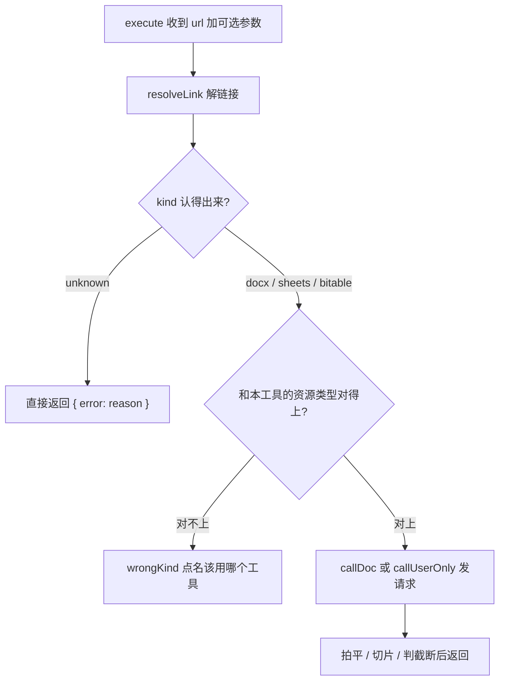
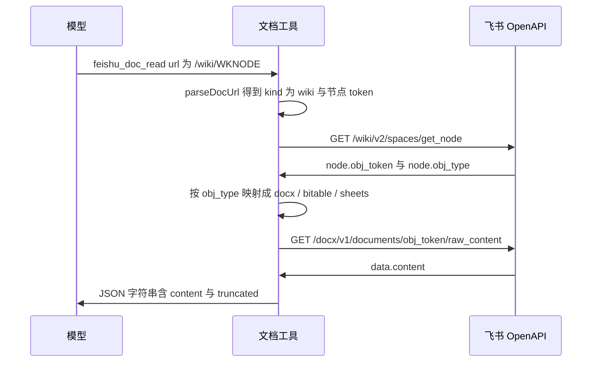
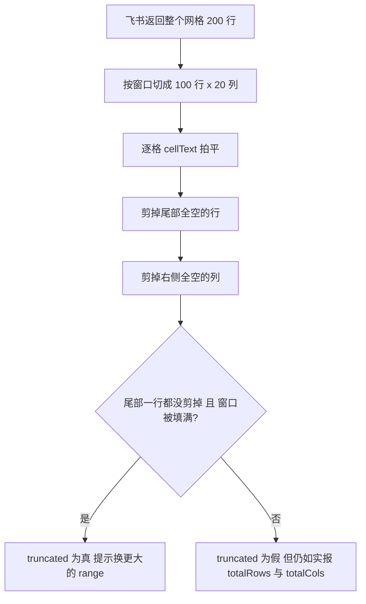

# 飞书云文档读写工具族的端到端流程

这一族由 `src/feishu/docs.ts` 的 `makeFeishuDocTools(deps)` 构造，一共七个工具，覆盖**四种文档类型、三个被操作的资源**：`feishu_doc_read` / `feishu_docx_write` / `feishu_docx_create` 面向新版文档，`feishu_sheet_read` / `feishu_sheet_write` 面向电子表格，`feishu_bitable_read` / `feishu_bitable_write` 面向多维表格。「四类类型、三个资源」的差就是知识库——**知识库不是一种文档，而是一种链接形态**，所以七个工具都共用同一条「先解链接」的前置步骤。

装配点是 `agents/feishu/_host.ts`，挂载条件只要求 `FEISHU_APP_ID` 与 `FEISHU_APP_SECRET` 齐备，**不要求提问人 `/login` 过**：应用身份的那一层不依赖任何人。整个文件导出的返回一律是 JSON 字符串，异常由 `guarded()` 转成 `{ error }`（工具抛错会中断整个工具循环），因此卡片摘要不需要为这一族写特例之外的判据。

上游与相邻的主题：身份与令牌生命周期见[身份模型：应用身份与用户身份](../concepts/identity-and-authorization.md)，工具清单与卡片摘要的耦合见[工具契约、工具族清单与挂载规则](../concepts/tool-contract-and-inventory.md)，端点、scope 与业务错误码见[飞书开放平台集成面](../integrations/feishu-open-platform.md)，`/login` 的授权往返见[云文档授权流程](oauth-authorization-flow.md)，钉住这些行为的测试见[冒烟测试套件](../testing/smoke-tests.md)。

## 一次调用的四段结构

七个工具的 `execute` 形状是同一套，读起来只有四步：



图：七个工具共用的「解链接 → 判类型 → 选身份发请求 → 组织返回值」四段结构。

- **解链接**：`start(url)` 调 `resolveLink`，认不出就直接把 `{ error: reason }` 当结果返回（不再往下走）。这一步也是唯一查授权的地方——身份的事归 `callDoc`，授权提示跟着它的错误走。
- **类型守卫**：`wrongKind(ref, toolName)` **必须点名该用哪个工具**。只说「请换对应的工具」等于让模型去猜，而它猜错的代价是再撞一次墙；`RIGHT_TOOL` 表按 `ref.kind` 加工具名后缀（`_write` 与否）查出一句「这个链接是「sheets」，`feishu_doc_read` 处理不了。请改用 `feishu_sheet_read`。」认不出的类型则明说「目前只支持文档 / 电子表格 / 多维表格」。
- **发请求**：读与写已有资源走 `callDoc`（应用优先、用户兜底）；新建文档走 `callUserOnly`（只用用户身份）。见下文「身份分发」。
- **组织返回值**：截断要显式标注并给出续读办法，这是全仓工具契约的一部分。

## 链接解析与 wiki 解引用

`parseDocUrl(raw)` 住在 `src/feishu/oauth.ts` 里，是一个**零依赖纯函数**，所以 H 节可以在裸 Node 下逐条钉它的形态。它兼容的都是实测见过的写法：

| 形态 | 解析结果 |
|---|---|
| `/docx/<id>` | `{ kind: "docx", token }` |
| `/docs/<id>` | 同上（旧版链接，飞书会重定向到 `/docx`） |
| `/wiki/<node>` | `{ kind: "wiki", token, tableId?, sheetId? }` |
| `/base/<app_token>?table=…&view=…` | `{ kind: "bitable", token, tableId? }` |
| `/sheets/<token>?sheet=…` | `{ kind: "sheets", token, sheetId? }` |

三个宽容之处都不是随手加的：**协议头可以省**（用户从地址栏拷出来的常常是 `xxx.feishu.cn/docx/abc`，没有 `https://`）；**租户前缀任意**（只在 `feishu.cn` / `larksuite.com` / `larkoffice.com` 三个域下放行，其它域给一条带域名的 `reason`）；**认不出就返回可读的 `reason` 而不是抛**。

`/wiki/` 链接要**保留 `?table=` 与 `?sheet=`**，别看着它挂着 wiki 就丢掉：飞书里**新建的多维表格和电子表格默认就落在知识库**，用户从地址栏拷下来的大多是这个形状。这两个子标识要一直留到解出节点、知道底层是什么之后才用。

### wiki 解引用：节点 token 不是文档 token

`resolveLink` 里最容易发的一处错，是所有 `/wiki/` 链接都必须先调一次

```
GET /wiki/v2/spaces/get_node?token=<节点 token>&obj_type=wiki
```

拿到的 `node.obj_token` 才是真正能读的文档 / 表格 token。**少了这一步，所有知识库链接都会以「找不到文档」告终**——节点 token 在 `/docx/`、`/sheets/` 的路径里根本不存在。

解引用后 `node.obj_type` 的**名字和 URL 里的不一样**，所以还要做一次映射：`docx` / `doc` 都归 `docx`；`bitable` 归 `bitable`；`sheet` 归 `sheets`。链接里带的 `table` / `sheet` 参数一并带过去（新建的多维表格默认落在知识库，这个 `table` 能省掉「先列表、再读记录」的一轮往返）。节点挂的是别的类型（比如挂了个文件）时给可读的 `reason`：「这个知识库节点挂的是 xxx，目前只支持文档 / 多维表格 / 电子表格。」



图：wiki 链接必须解引用两次才对——节点 token 换成 `obj_token`，再用 `obj_token` 读正文。

这条链上有一处**故意的兜底**。`feishu_bitable_read` 在链接带了 `?table=` 时会直接用它，但**链接里的 `table` 参数不保证是 OpenAPI 的 `table_id`**（实测：地址栏拷下来的链接、表格停在「页面」侧栏时那个值是另一套 id）。所以只要这个 id 是**从链接里带来的**（`fromLink` 为真），读失败就退回「先列出有哪些数据表」，而不是把一条模型看不懂的报错丢出去。模型**自己**传的 `table_id` 不兜底：那是它的选择，写错了就该让它看见。

## 身份分发：读是「应用优先、用户兜底」，新建只认用户

这一族有三个发请求的 helper，它们只差「用谁的身份」这一件事：

| helper | 身份 | 用在哪 |
|---|---|---|
| `callDoc` | **应用身份优先，用户身份兜底** | 所有读、所有对**已有**资源的写 |
| `callUser` | 只用用户身份，遇令牌无效续期重试一次 | `callUserOnly` 的内层 |
| `callUserOnly` | **只用用户身份，不兜底到应用身份** | `feishu_docx_create`（含它的追加那一步） |

`callDoc` 的分层是有具体收益的：**应用身份先行**意味着每个工具都能读/写「在飞书里被显式共享给机器人」的文档，于是群里的任何人贴一条链接都能用，无需任何人 `/login`；应用身份拿不到（没共享、权限不够）时，若这个人已授权过就**自动换用户身份再试一次**，而用户身份能读他自己有权限的一切。两条路都失败才给一条**合并错误**（见下节）。

⚠️ `callDoc` **不按错误码过滤「该不该兜底」**：飞书各产品的权限错误码不统一（docx / bitable / sheets / wiki 各一套），白名单迟早漏。代价是模型自己写错参数（比如不存在的 `table_id`）时多打一次注定失败的请求——可接受。

另一处刻意的不对称在**重试放在哪一层**：`callUser` 自己处理令牌续期（`99991663` / `99991664` 时 `invalidate()` 再取一次，重试**一次**），而 `src/feishu/api.ts` 的 `feishuCallAs` 刻意**不做**刷新重试。理由是会落盘：用户 token 的续期要用 `refresh_token` 换，而飞书每次续期都**轮换** refresh token，新值必须写回；把这件事埋在通用 helper 里，调用方就看不见那次写回了。

### 新建文档是唯一不兜底的例外，理由是一次 UI 实测

`feishu_docx_create` 走 `callUserOnly`。这条硬要求来自 2026-09-25 用真人身份逐项点过的菜单：

> 应用身份建出来的文档归**应用自己的云空间**，用户用真人身份打开是**只读**——菜单里是「**申请编辑权限**」、点「删除」回「**无权限操作**」、往正文打字**打不进**。更麻烦的是**应用没有删除 scope、用户又没有编辑权**，于是那种文档**两边都清不掉**。

所以「建」必须用用户身份，产出才落在**用户自己名下**——可编辑、可删、能分享。代价是没 `/login` 的人用不了这个工具，这是**有意的取舍**（2026-09-26 拍板），不是待补的缺口：退回应用身份就等于又造一篇用户既改不了也删不掉的死文档。这条也被测试钉死，而不是只写在注释里——两条身份测试断言「建文档全程一次都不去取 `tenant_access_token`」「未授权时不许偷偷退回应用身份」，此前那 4 条创建测试虽然全绿却区分不出用的是哪个身份。

配套的还有一条**追加必须跟创建同一个身份**：`appendDocxParagraphs` 的 `call` 由调用方注入，追加到已有文档传 `callDoc`，而新建流程里传的是 `callUserOnly`——用户刚建的文档没共享给应用，用应用身份去追加是注定失败的一跳，那一轮请求是白打的。

### 不可执行的授权提示等于没有提示

两边身份都失败时，错误里同时带上原始错误和一条**可执行**的 `AUTH_HINT`：

> 应用身份读不到（xxx）；用户身份也读不到（yyy）。如果这份文档本来就该能读：让用户在飞书里打开它，右上角「···」→「添加文档应用」把它共享给机器人（无需授权即可读）；或者用户发 `/login` 完成一次授权，之后就能以他自己的身份读写他有权限的文档。**请不要自己编链接。**

三处细节各自对应一种失败：**带上两条原始错误**，模型才知道两条路都试过了、不必自己再重试一遍；**给出两条具体出路**，用户才知道下一步做什么；**明说别自己编链接**，因为模型复述链接容易出错。

`CREATE_AUTH_HINT` 与它是分开的两条：那条说「共享或 `/login` 二选一」，这条**只有 `/login` 一条路**——建文档没有「共享给机器人」这个选项。

`tokens` 为 `null`（没接 KV / 本地调试）时行为刻意不同：`callDoc` 直接抛应用身份的原始错误，且文案里**不提 `/login`**（没有用户身份可兜底，引导用户去授权是误导）。

### 99991679 要补一句飞书不说的人话

飞书对「这次操作要的 scope 不在这个人当前授权范围里」只回一句 `99991679 Unauthorized. Please request user re-authorization.`，**不解释为什么**——于是有令牌的人会以为自己授权过了，去翻代码。真实原因几乎总是同一个：**scope 是 2026-09-25 才加进 `DOC_SCOPES` 的，而刷新令牌不会带来新 scope**，必须重新走一次 `/login`。`callUserOnly` 捕获这个码时补上这句，并给出一条兜底：重新授权后仍失败，多半是应用侧没把 `docx:document` 开给「用户身份」。

## 读：逐次翻页与显式的截断契约

全仓的共同契约是「**截断必须显式标注，并给出继续的办法，绝不能让半截内容被当成全文**」。这一族把它落成每个读工具自己的形状。

### `feishu_doc_read`：offset / limit / nextOffset

`DOC_DEFAULT_CHARS = 10_000`、`DOC_MAX_CHARS = 30_000`。默认只给 10000 字是刻意的：一份长文档整个吐进去会吃掉几万 token，而用户往往只问其中一段；给 `offset` / `nextOffset` 让模型**按需再来一次**，比一次给全更省也更快。

返回值里 `truncated` 为真时**必定同时给** `nextOffset` 与一句带全文长度的说明（「这份文档共 N 字，这次给了第 a~b 字」）；工具描述也把它写成对模型的指令：「用它再读下一段，直到 truncated 为 false。**读全之前不要对整篇文档下结论**」。系统提示词里有对应的一句——不写清楚，模型会拿半截结果当完整的下结论。

两处实现细节值得知道，因为它们解释了「翻页为什么不慢」和「标题拿不到怎么办」：

- **正文留一份缓存。** 按 offset 分页读一份长文档要连着调好几次，每次都重新拉一遍全文是纯浪费。`docCache` 按文档 token 存 `{ title, text, at }`，只留最近 `DOC_CACHE_MAX = 3` 份、TTL 十分钟（超上限先丢最老的，Map 保持插入序）。冒烟测试直接断言翻页那一次**不再发请求**——「那正是缓存存在的理由」。
- **标题单独一次请求，失败不影响正文。** 标题只是让模型多点上下文，所以那次调用的异常被吞掉、`title` 留空。

读出 0 字时不给 `truncated`，而是给一句解释：「这个文档读出来是空的（可能是空文档，或者没有阅读权限）。」

### `feishu_sheet_read`：两重上限与「剪掉尾部空行再判截断」

行列都有上限（`SHEET_MAX_ROWS = 100` × `SHEET_MAX_COLS = 20`），因为**只卡行数挡不住「某一行特别宽」**。没给 `range` 时先 `GET /sheets/v3/spreadsheets/{token}/sheets/query` 问有哪些工作表，取第一张，把 `grid_properties` 的规模如实带回，然后**只取到上限**构造目标区域——几万行的表整个拖下来会直接撑爆上下文。

真正的难点在**怎么判「有没有被裁」**，这里有两次被实测推翻的推断：

⚠️ 飞书把**整个网格**回给你，空行空列也占位（新建表默认 200 行 × 20 列）。原样吐出去撞到两件事：

1. 一份只有 4 行数据的表变成 100 行制表符，白烧掉一大截上下文；
2. 按「网格比窗口大」判 `truncated`，对新表**永远成立**（`totalRows` 200 > 读到的 100），于是每次都报「只读了一部分」，模型信了、反复重读——**实测它为一个 4 行就够的表格连调了 8 次**。

所以实现先**把尾部全空的行列剪掉**，再判断到底有没有被裁。而「服务端把窗口填满了」也是一个恒真的错误判据（飞书就是会补空行填满）。真正的信号是：

> **剪掉尾部空行之后，内容仍然顶在窗口边缘**——尾部一行空行都没剪掉（`rowCount >= rawRows`），说明内容一直延续到我们请求的边界，后面才可能还有。

合起来是 `(windowFull && contentAtEdge && gridBigger) || rawCols > SHEET_MAX_COLS`。**调用方显式给了 `range` 时不算**——他指定了要哪块，就不该再报「没读完」，所以那种情况下 `askedRows` 保持 `undefined`，让 `windowFull` 自然为假。截断时给一句可继续的提示：「读到的区域已经顶到上限，后面可能还有内容。换一个更大的 range（或直接指定要读的那几行）再读一次。」

链接里的 `?sheet=<id>` 是工作表 id，可以当 `range` 的前缀（`sid2!A1:T100` 这种形态）；读回来的 `range` 也可以直接拿去当写工具的前缀。

### `feishu_bitable_read`：先列表、再读记录，两种截断信号分开

`BITABLE_DEFAULT_ROWS = 50`、`BITABLE_MAX_ROWS = 500`（**500 是接口单页上限**）。不给 `table_id` 时先返回 `tableList`（含 `table_id` 与表名）并在 `note` 里说明「用 table_id 再调一次，才会返回记录」；给了才读。

翻页信号这里**不是** `truncated`，而是接口自己的 `has_more`：为真时返回 `hasMore: true` 与一句「还有更多记录，调大 limit 继续读」。（`summarizeToolOutput` 那一侧为这一类结果准备的分支是 `count`，它被刻意排在后面，以免抢在更具体的字段前面命中。）记录里的字段值全部经 `flattenFields` 拍平（见下节）。

## 拍平：为什么模型看到的是文本而不是 JSON

飞书字段值的形状很杂，直接把原始 JSON 倒给模型既占 token 又难读，所以有一层统一的拍平 `cellText(v)`：

- `null` / `undefined` → 空串；字符串 / 数字 / 布尔直接转文本；
- **数组**（富文本、多选、人员都是数组）逐个递归拍平再用 `" / "` 拼起来——比 `JSON.stringify` 可读得多；
- **对象**按见过的几种取键：富文本 `{text}`、人员 / 选项 `{name}`、链接 `{link}`，还有 `value`；都不认就 `JSON.stringify` 后截断。

每个单元格/字段值的最长长度是 `CELL_MAX_CHARS = 200`——表格里偶尔有整段文本，不截会淹掉其余列。`flattenFields` 再去掉空值，返回 `{字段: 文本}`。

电子表格那侧换成「制表符分隔的行文本」：先按上限切片、逐格 `cellText`，剪掉尾部空行列后用 `\t` 连接。测试里有一条同源的反断言——富文本对象必须拍平成「带链接」，结果里**不该出现** `file_token` 这类原始 JSON 字段名。

## 写：只能追加的文档、覆盖式的表格

写只有三种形态，各自对应用户实际会提的需求，而不是「能不能做到」：

### `feishu_docx_write`：append-only 是设计决定

追加走 `POST /docx/v1/documents/{id}/blocks/{id}/children`，正文里 `index: -1` 就是「追加到文档末尾」——**这也是这个工具「只能追加」的实现根基**。工具描述把边界对模型说死：「只能追加，不能修改或删除已有内容——要改就让用户自己在飞书里改。」

为什么不提供块级编辑：新版文档的块级编辑 API 又重又容易写坏版式，不值得；而且改已有正文是**面向用户的破坏性编辑**，让人自己在飞书里改更安全。这条与「不给应用开 `drive:drive`」是同一条约定（见[刻意不做的事与破坏性能力政策](../concepts/design-non-goals.md)）。

上限是 `DOCX_WRITE_MAX_PARAS = 500` / `DOCX_WRITE_MAX_CHARS = 20_000`——往文档里灌一整本书不属于这个工具的职责，超了让模型分几次追加。切段的规则是：按换行切开、去掉每行尾部空白、**丢掉空行**（正文里它只是 Markdown 的分段符，落进文档反而多出空段落）。一段都没有时报「content 里没有实际内容。」

返回 `{ appended }`（段落数），并附一句「已追加到文档末尾。这个工具改不了已有内容。」

### `feishu_docx_create`：先建、再追加，两步共用同一段实现

创建接口 `POST /docx/v1/documents` **只收 `title`**（实测：`title` 是唯一被校验的字段，没有 content / children 入口），所以「建一篇带正文的文档」必然是 create + append 两步。两处共用 `appendDocxParagraphs` 而不是各写一遍——两处各写一遍迟早漂移，比如只在一处丢掉空行。

- **标题 1~800 字**，上限来自实测：标题 2000 字时飞书回 `99992402 field validation failed: {"field":"title","description":"the max len is 800"}`（`DOCX_TITLE_MAX_CHARS = 800`）。空标题与超长都在**本地**挡掉——在本地挡掉模型一眼能看懂，送到飞书去换一个 `field_violations` 结构就得多烧一轮。
- 飞书没返回 `document_id` 时直接报错并明确「别把链接给用户」：链接是用户唯一能打开文档的途径，给一个指向不存在文档的链接比报错更坏。
- **正文追加失败不回滚。** 文档已经建出来了，删掉才是真的把用户的东西弄没了。实现如实返回 `contentError` 与一句 `note`：「⚠️ 但正文没写进去，链接是有效的，可以再用 `feishu_docx_write` 补。」测试专门钉住这条（建成功、追加失败时链接照样给出）。
- `docUrl` 由 `docxUrl(token)` 统一拼（`https://feishu.cn/docx/<token>`），**新建与读取共用**，避免两处各拼一遍。

这个工具是**第七个**补上的：补之前那六个**无一例外**都要求一个已存在的资源链接，于是「写一份报告」「建个会议纪要」这类请求全做不了——agent 只能往用户先手动建好、再共享给它的文档里贴一段。这个缺口是 agent 自己在工作区仓库里报的（`reports/bug-feishu-docx-create.md`）。

### 表格类写入：上限与参数形状

| 工具 | 端点 | 语义 | 上限 |
|---|---|---|---|
| `feishu_sheet_write` | `PUT /sheets/v2/spreadsheets/{token}/values` | **覆盖式**：区域里原有内容会被盖掉 | `SHEET_WRITE_MAX_CELLS = 10_000` 个单元格 |
| `feishu_bitable_write` | `POST .../records/batch_create`（`action=add`）<br>`PUT .../records/batch_update`（`action=update`） | 新增 / 按 `record_id` 更新 | `BITABLE_WRITE_MAX_RECORDS = 100` 条 |

几处「本地能判的错别送到飞书去」：

- `feishu_sheet_write` 的 `range` **要带工作表前缀**（`Sheet1!A1:C3`）。没带 `!` 时若链接里有 `?sheet=` 就补上前缀，否则给一条能自纠的提示：「先用 `feishu_sheet_read` 读一次，它返回的 range 可以直接拿来用。」行列数乘起来超上限也在本地挡掉并建议分几次写。返回值强调写入是覆盖式的，想先看看有什么就先读一次。
- `feishu_bitable_write` 在 `action=update` 时**每条记录都必须带 `record_id`**，缺了当场报错并指出「先用 `feishu_bitable_read` 读一次拿到；要新增记录请用 `action=add`」，不发请求。字段值一律**按文本提交**，飞书按字段类型自动转换；返回值里提醒「某个字段转换失败时整批都会被拒，拆开写能定位是哪个字段」——这正是「值都给文本」这条约定的代价说明。

## 两个踩出来的坑：字段名与「断言抄实现」

### docx v1 段落载荷的字段名是 `text`，不是 `paragraph`

`block_type: 2`（文本块）的载荷字段名是 **`text`**，代码里一开始写的是 **`paragraph`**——那是**旧版 `/docs/` API** 的名字。飞书对不认识的字段名只回一个光秃秃的 `1770001 invalid param`，**不说哪个字段**，所以照着错误码根本查不出来，`feishu_docx_write` 从写完起就是坏的，直到 2026-09-25 用真实凭证才撞出来。

更值得记住的是它**为什么能一直全绿**：冒烟测试的断言写的是 `body.children[0].paragraph.elements[0].text_run.content`——**把 bug 抄成了期望值**，测试和实现出自同一份误解。修法除了改字段名，还加了一条反向断言把它钉住：

```ts
const para = body.children[0];
eq(para.block_type, 2);
eq(para.text.elements[0].text_run.content, "第一段");
ok(!("paragraph" in para), "docx v1 的字段是 text，不是 paragraph（旧版 /docs/ API 才是）");
```

**可迁移的规则**：断言里的字段名、字符串、形状必须来自**真实响应或规格**，不能来自刚写完的实现。桩测试能挡住「发出去的形状不对」，前提是期望值本身得对。同一个判据也出现在新建文档的测试里（`!("paragraph" in cb.children[0])`）。

### 桩的形状本身也可能是错的

同一个陷阱还有一个变体，值得一并记住：`feishu_sheet_read` 的截断判据被掩盖了很久，因为测试桩 SH1 回的是**理想化的**「只回有内容的三行」，而实测不会发生。直到补了按**真实形状**构造的 SH2（整个网格 + 96 行补位空行）才暴露出来。也就是说，「剪尾部空行 + 内容顶到边缘才算截断」这条判据的价值，恰恰由「桩不再理想化」换来的。



图：电子表格截断判定——先剪尾部空行列，再看内容是否仍顶在窗口边缘。

## 不变量与失败模式

| 不变量 | 违反后的表现 | 为什么难查 |
|---|---|---|
| wiki 链接必须先解引用再读 | 所有知识库链接以「找不到文档」告终 | 报错看起来像权限问题，像文档被删了 |
| `callDoc` 的两层身份顺序（应用先、用户后） | 没共享给机器人的文档一律读不到，或反过来对所有人要求 `/login` | 两条路都能读到内容是**倒过来才发现**的；测试要断言认证头序列 |
| 新建文档不兜底到应用身份 | 用户拿到一篇既改不了也删不掉的文档 | 症状在**几天后**才出现：想改想删时才发现 |
| 创建与追加必须同一身份 | 追加那一步注定失败，白打一轮请求 | 表现为「建好了但正文没进去」，会被误当成权限问题 |
| 截断必须显式标注并给续读办法 | 模型拿半截正文当完整文档下结论 | 答案看起来完整、只是错了 |
| 截图是「内容顶到窗口边缘」而不是「网格比窗口大」 | 对新表每次都喊「没读完」，模型反复重读（实测 8 次） | 结果没错，只是慢且烧 token，不像 bug |
| 表格单元格值一律拍平成文本 | 原始 JSON 淹掉其余列、白烧上下文 | 只是「答得含糊」，不是报错 |
| 断言证据来自真实响应/规格 | 实现写错时测试仍然全绿 | 这正是 `paragraph` / `text` 那个 bug 能活下来的原因 |

## 配置与运维

| 环境变量 / 依赖 | 控制什么 | 缺了会怎样 |
|---|---|---|
| `FEISHU_APP_ID` / `FEISHU_APP_SECRET` | 整族七个工具的挂载 | 整族不挂（挂载**不要求**提问人 `/login` 过） |
| 运行时 KV（`deps.kv` + `openId`） | 「用户身份兜底」这一层 | `tokens` 为 `null`：只剩应用身份，读不到就报应用的原始错误，且**不提 `/login`** |
| `FEISHU_API_BASE` | 覆盖 OpenAPI 根（**只为本地测试**） | 默认 `https://open.feishu.cn/open-apis` |
| `FEISHU_USER_TOKEN_SKEW_MS` | 放大「提前判过期」的余量 | 默认 5 分钟，意味着想看到一次真实 refresh 得等将近两小时 |

后台侧的两件人工操作，属于这一族的「运维前置」：**共享给机器人**（文档 → 右上角「···」→「添加文档应用」；要让它能**写**就勾「可编辑」）与**开通 scope 并发版**（`docx:document` / `bitable:app` / `sheets:spreadsheet` / `wiki:wiki:readonly` 等，改完权限要发新版本才生效，已 `/login` 过的用户还要重新授权一次才会拿到新加的写 scope）。

`/status` 那侧的可见性来自 `authStateText(tokens, openId)`：没授权时说清「共享给机器人的文档无需授权可读；发 /login 后能以你的身份读写你有权限的文档」，授权后报令牌有效期与「有 / 无刷新令牌」——没有刷新令牌时直接警告「两小时后要重新授权」，那是授权时缺 `offline_access` 的症状。

## 相关页面

- [身份模型：应用身份与用户身份](../concepts/identity-and-authorization.md) —— 令牌分槽、单飞续期、scope 清单，以及新建文档拒绝退回应用身份的完整理由
- [工具契约、工具族清单与挂载规则](../concepts/tool-contract-and-inventory.md) —— 永不抛错 / JSON 字符串 / 截断显式这条共同契约，以及卡片摘要与返回字段的耦合
- [飞书开放平台集成面](../integrations/feishu-open-platform.md) —— 本族用到的每一个端点、scope 与业务错误码
- [云文档授权流程](oauth-authorization-flow.md) —— `/login` 到令牌落盘的完整往返
- [冒烟测试套件](../testing/smoke-tests.md) —— J 节如何钉住这里的翻页、截断、身份与字段名
- [刻意不做的事与破坏性能力政策](../concepts/design-non-goals.md) —— 为什么没有 `drive:drive`、为什么文档只能追加
