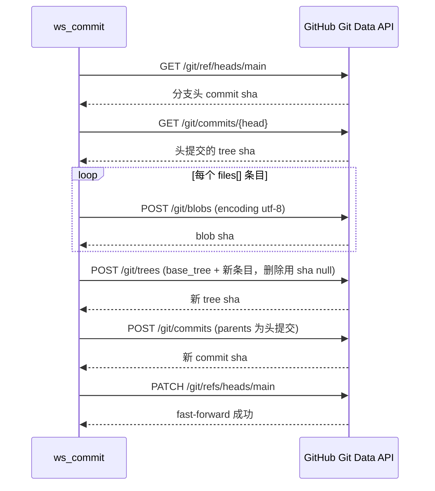
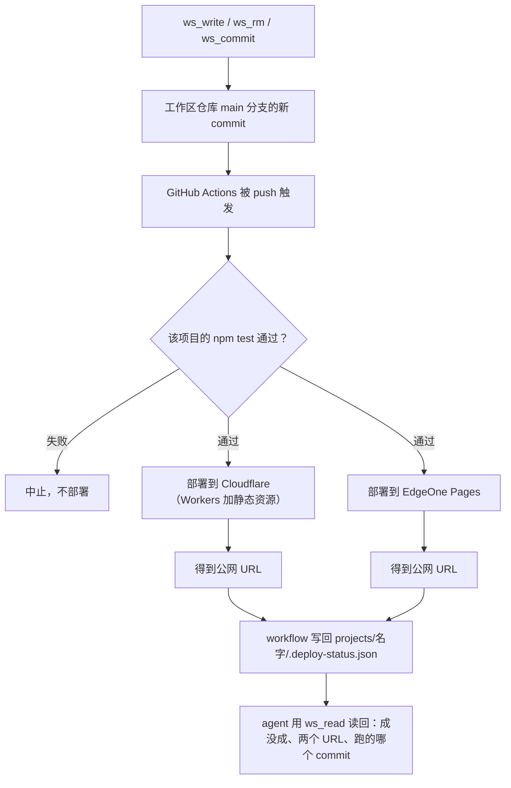

# GitHub 工作区工具与自动部署闭环

这一页讲的是 agent **面向自己那把记事本**的能力：它在 GitHub 上有一个私有仓库（默认
`guci314/cf-agent-workspace`），可以列目录、读文件、写文件、删文件、以及**一次提交多个文件**。
这一族叫 `ws_*`，实现分成两层 —— 纯 HTTP 客户端住在
[`src/ghworkspace/client.ts`](../../src/ghworkspace/client.ts)，工具定义（zod + 描述文案）住在
[`src/ghworkspace/tools.ts`](../../src/ghworkspace/tools.ts)。

它和仓库里另外那族 `gh_issue_*` 长得像但**是两回事**：那是往公开仓库开 issue，用的是**另一把
token、另一套权限、另一份白名单**。

最重要的是第三件事：工作区仓库接了一条**自动部署链路**。`projects/<名字>/` 下面每个目录
都是一个**能上线的项目** —— 写进去的代码 commit 到 main 之后会自动跑测试、部署到两个平台、
并把结果写回一个文件。所以 `ws_*` 不是「记笔记」那么简单，它是**这条仓库从「代码」到
「线上服务」的唯一通路**。

> 工具族的完整清单与挂载规则见[工具契约与清单](../concepts/tool-contract-and-inventory.md)；
> 每个环境变量缺了什么见[环境变量与配置目录](../operations/configuration-and-env.md)；
> 本仓库自己的部署工作流见[部署与发布](../operations/deployment-and-release.md)；
> 「不给 agent 改自己代码的能力」这条决定见[刻意不做的事](../concepts/design-non-goals.md)。
> 提示词只被按配置挂载时才提这些能力，见[提示词契约](../concepts/prompt-contract.md)。

## 五个工具，两套 API

| 工具 | 干什么 | 打的端点 | 副作用 |
|---|---|---|---|
| `ws_ls` | 列一个目录（根目录是空串），目录在前、同级按名升序 | `GET /contents/<path>` | 无 |
| `ws_read` | 读一个文件的文本，带行号，可分段 | `GET /contents/<path>` | 无 |
| `ws_write` | 新建或覆盖**一个**文件 | `GET` 探 sha + `PUT /contents/<path>` | **一次真实 commit** |
| `ws_rm` | 删**一个**文件 | `GET` 探 sha + `DELETE /contents/<path>` | **一次真实 commit** |
| `ws_commit` | 一次提交**多个**文件（含删除） | `GET /git/ref` → `GET /git/commits` → `POST /git/blobs` → `POST /git/trees` → `POST /git/commits` → `PATCH /git/refs` | **一个 commit**，而不是 N 个 |

前四个走 **Contents API**，`ws_commit` 走 **Git Data API**（`/git/*`）。两者在 fine-grained PAT
上都算 **Contents** 权限，所以加 `ws_commit` 时**那把 token 不用换、不用扩权** —— 这是旁路选择
Git Data API 而不是另开一套凭证的直接理由。

五个工具全部在 `makeGithubTools(cfg)` 里一次造出来；**`cfg` 为 null（没配
`GITHUB_WORKSPACE_TOKEN`）时返回空数组**，一个工具都不挂。挂一族必然失败的工具只会让模型
每轮先去撞一次墙。[`_host.ts`](../../agents/feishu/_host.ts#L576) 的装配点是
`...(ghCfg ? makeGithubTools(ghCfg) : [])`，条件段落在同一份 `ghCfg` 上拼接。

## 客户端：sha 自动解析、base64 折行、404 的三重含义

`client.ts` 只做四段纯逻辑，但每一段都对应一个踩过的坑：

**路径处理。** `encodePath()` **逐段**编码而不是整串 `encodeURIComponent` —— 后者会把 `a/b`
变成 `a%2Fb`，于是每个带子目录的路径都 404。`checkPath()` 另外归一化（去掉前导 `./` 与两侧 `/`）
并拒掉空段、`.`、`..`、控制字符与反斜杠。这条校验是全仓统一的越界防线，`ws_commit` 的每个
`files[].path` 和 `remove[]` 也都过它，测试里专门有一条 `../escape.js` 被拒。

**sha 自动解析。** `putFile` / `deleteFile` 不传 `sha` 时先 `getFile` 读当前 sha
（`getFile` 对 404 返回 `null` 而不是抛错，正是为了让「不存在 = 创建」这条判断成立）。
这是有意的便利取舍：让模型自己管 sha 的话它几乎必然会在某轮忘记传，然后拿着 422 反复重试。
读到写之间被第三方改动时 GitHub 回 409/422，`putFile` **只重读 sha 再试一次** —— 这类竞争在
单人工作区里很少见，但模型看懂 sha 冲突的报错几乎不可能，它会反复重试烧掉步数预算。
需要「防覆盖」的调用方仍可显式传 `sha`。

**base64 的折行。** Contents API 返回的 `content` **每 60 字符夹一个 `\n`**。仓库自己写了
[`src/shared/base64.ts`](../../src/shared/base64.ts)（`fromBase64` 跳过空白、遇到 `=` 即停），
没用 `atob` —— 因为 `atob` 走 Latin-1，二进制要先转码一轮，且运行时可移植性没保证。
文件内容含 **NUL 字节**时判为二进制，`text` 给空串并由工具层明确报「读不出文本」；
`TextDecoder` 会把非法字节变成 U+FFFD，把一屏 `�` 交给模型比直说「这是二进制」糟得多。

**>1MB 的文件不是「空文件」。** 超过 Contents API 单文件上限时 GitHub 回
`encoding: "none"` 加空 `content`。把它当空文件返回是**静默的谎**，模型会据此下错误结论，
所以 `getFile` 直接抛错并说明「让它去 GitHub 上看，或换个小文件」。

**404 必须列出三种可能。** GitHub 对「路径不存在」「仓库名写错」「这把 PAT 没被授权访问这个
仓库」**故意**都回 404（避免泄漏私有仓库是否存在），从错误上分不出来。所以错误文案三条并列，
否则模型会照着「文件不存在」的结论去找文件，而真正的问题是凭证没授权。`ws_read` 读不到文件时
还额外附一句自查：「如果 `ws_ls` 连根目录都列不出来，那是凭证没被授权这个仓库，不是文件不存在」。

**超时给得比"正常该多快"宽得多，是有意的。** 读 25 秒、写 30 秒。原始值是 10s / 15s，按
「GitHub 正常几百毫秒就回」定的，实测太紧：写一个文件不是一次请求（先 GET 拿 sha 再 PUT），
任何一次慢都让整个写操作失败，而模型拿到超时后往往重试，于是一轮对话里反复卡同一个慢请求。
代价是极端情况下单次工具调用最长等这么久，但「等得久」远好过「明明能成却报错」——
后者会让模型基于假信息改道。

### 用法错与故障必须分开

`guarded`（[`src/shared/util.ts`](../../src/shared/util.ts#L26)）把任何异常包成
`工具执行失败：…`，并把工具从「抛错中断整个循环」里救出来。但「你该用 `ws_ls`」这种错被包成
那句话就纯属误导。所以多了一层 `usageError()`：它把 `UsageError`（拿错工具、文件太大、路径
非法、白名单外）翻成**不带前缀**的干净 `{ error }`，其余异常照旧丢给 `guarded`。404 被归到
`UsageError`，因为它几乎总是模型自己能纠正的事。

### 写操作的上限都挡在本地

`ws_write` 上限 256KB（Contents API 本身能收 100MB，卡这里是别让一次工具调用把内存和模型
上下文都撑爆）；`ws_read` 一次最多 2000 行 / 50KB，**绝不返回半行**，截断时给 `nextOffset`。
⚠️ 这里的 `offset`/`limit` 是在**取回全文之后本地切片** —— Contents API 不支持分段读取，
这两个参数管的是「喂给模型的上下文有多大」，不是省流量。`ws_ls` 默认 500 条、上限 1000。

## 为什么必须有 `ws_commit`

`ws_write` / `ws_rm` 一次一个文件 = **一个 commit**。而工作区仓库里 `projects/<名字>/` 下面
每个目录都是**一个接自动部署的项目**：一次调整往往动五六个文件，那就是五六个 commit、
触发五次 CI、部署五次中间态。中间态不只是浪费 —— 它**可能部署失败**（比如新代码引用的文件
还没提交），于是用户在 Actions 上看到一串红的。

所以 `ws_commit` 把这批文件合成**一个 commit**。它按 Git Data API 的标准六步走：

图中展示 `commitFiles()` 的六步：取 ref → 取 tree → 建 blob → 建新树 → 建 commit → 挪指针。

**`base_tree` 是这个工具能用的前提。** 带上它，GitHub 只在那棵树上打补丁，**没提到的文件原样
保留** —— 所以调用者只送「本次改动的文件」，不用送整个项目快照。少了它，新树会**替换整棵树**，
未提到的文件全被删掉。测试里有一条专门钉住 `body.base_tree === "t1"`。删除也用树条目表达
（`sha: null`），不另调 DELETE 端点。

**指针更新必须 fast-forward**（`force=false` 是默认），免得把别人这期间的提交冲掉。

一次提交的上限**挡在本地**，超了直接说清楚，别送到 GitHub 换一个看不懂的 413/422 ——
那种错模型只会重试或者道歉：

| 上限 | 值 | 超了怎么办 |
|---|---|---|
| 文件数 | `COMMIT_MAX_FILES = 60` | 提示分两批提交 |
| 合计内容 | `COMMIT_MAX_BYTES = 512 KB` | 提示拆成几次提交 |
| `message` | 非空，截断到 200 字 | 空说明直接拒 —— 「提交说明是以后查历史的唯一线索」 |
| `files` 与 `remove` | 不能同时为空 | 拒 |
| 每个路径 | 过 `checkPath` | 拒，且**一个请求都不发** |

`ws_commit` 的返回值里带一句固定的 `note`：已提交到 main，Actions 会自动跑测试并部署，
但**结果它看不到**，要如实告诉用户去 Actions 页面看。这句是有意的 —— 见下一节。

## 闭环：`projects/<名字>/` 是可部署单元

工作区仓库接了一条自动部署链路，机制写在
[`WORKSPACE_PROMPT`](../../agents/feishu/_instructions.ts#L146-L170) 里（这段提示词同样**按
`ghCfg` 条件拼接**，与工具族同开同关）。链路是：

图中展示写入 → 一个 commit → CI 门禁 → 双平台部署 → 状态文件回读的完整闭环。

**新增一个项目就是新建一个 `projects/<名字>/` 目录**，两个平台都会自动建项目 —— 不需要在
任何控制台点一遍。这正是「让 agent 能写代码上线」这个目标的全部意义：用户说「做个网页 /
写个小工具 / 上线一个接口」时，agent 是**能做出来并上线**的，不是只能给代码片段。

**门禁先于部署。** `test/` 挂了就不会部署，所以提示词里明确要求：要往 `projects/` 里写能跑的
代码时**先写测试再写实现**，或者至少保证 test 能跑过。这条门禁的形状与仓库自己的
[`deploy.yml`](../../.github/workflows/deploy.yml) 一致 —— 那边的门禁是 `npm run typecheck`
与 `npm test`，挂在 deploy 步骤之前。

**部署结果不在 agent 的上下文里。** 它的上下文里只有「我提交了」这一件事，而 CI 要跑几分钟。
所以 workflow 把结果写成 `projects/<名字>/.deploy-status.json`，agent 用 `ws_read` 读那个文件
就知道上一次部署成没成、两个 URL 是什么、跑的是哪个 commit。

⚠️ **刚提交完那一刻它还是上一次的结果**（新的还没跑完）。要核对就比一下里面的 sha 和你刚拿到
的 commit。读不到最新结果时如实说「已提交，结果还没出来」，**别声称已经上线** —— 提示词把这
条写成硬规矩，`ws_commit` 返回的 `note` 也重复了一遍。这是本仓库一贯的「不许编」原则在部署
链路里的落点：模型知道「我提交了」不等于「上线了」。

> 这两条（`.deploy-status.json` 由 workflow 写回、读不到就说还没出来）写在工作区**提示词段落**
> 里、而不是代码注释里，是因为**提示词没说的能力，模型不会想到用**。不写这条，模型只会把工作区
> 当记事本，有能力也不会用。

## 配置：一把 Contents PAT，配不全就当没配

| 变量 | 说明 | 缺了会怎样 |
|---|---|---|
| `GITHUB_WORKSPACE_TOKEN` | fine-grained PAT，**只授默认仓库的 Contents: Read and write**；必须是**普通环境变量**，别放进 `AI_GATEWAY_*`（那三个键每次 deploy 会被平台覆盖回平台值） | `ghWorkspaceConfig` 返回 null，**五个工具一个都不挂**，提示词段落也不拼 |
| `GITHUB_WORKSPACE_REPO` | 覆盖仓库名。默认 `guci314/cf-agent-workspace`（仓库名不是密钥，硬编码为默认值） | 有默认值 |
| `GITHUB_API_BASE` | **只为本地测试指向 mock，生产不要设** | 默认 `https://api.github.com` |

`ghWorkspaceConfig()` 还有一条比「缺 token」更细的规矩：**仓库名认不出 `owner/name` 形状也当作
没配**。宁可没有工具，也不要拿一个拼错的仓库名去 404 —— 那种错看起来像「仓库不存在」，
实际是配置问题，模型会一路在错误方向上耗。

凭证只在请求头里，**绝不进任何错误信息**。这不是洁癖：错误信息会被模型读、被飞书卡片渲染、
被用户复制出去。所以 `fail()` 只提取响应体里的 `message`，永不回显请求头。

`fail()` 的每种状态码都指向一个**不同的动作** —— 否则模型只能瞎试：

| 状态 | 判定 | 给出的动作 |
|---|---|---|
| 401 | — | PAT 无效/过期/被撤销，**这需要人去重新生成并更新** |
| 403 | `x-ratelimit-remaining: 0` | GitHub 限流（每小时 5000 次），过一会儿再试 |
| 403 | 其余 | PAT 权限不足：这个仓库需要 `Contents: Read and write` |
| 404 | — | 三种可能并列（路径、仓库名、PAT 未授权） |
| 409 / 422 | — | 多半是文件在你读之后被改动过，重新读一次再写 |

## `gh_issue_*`：必须是另一把 token

`gh_issue_create` / `gh_issue_comment` 住在
[`src/ghworkspace/issues.ts`](../../src/ghworkspace/issues.ts) 与
[`issue-tools.ts`](../../src/ghworkspace/issue-tools.ts)，**分开文件、分开一份配置**。

**为什么不能复用工作区那把 token。** `GITHUB_WORKSPACE_TOKEN` 只授了 Contents 读写，
而 **GitHub 的 Issues API 不属于 Contents 权限范围** —— 拿现有 token 提 issue 会 403。
所以这不是「加个工具」，是**一次扩权**。混用一把 token 会让「改工作区凭证」这个动作**意外
影响 issue 能力**，反过来也一样：换工作区仓库时顺手改的那把 PAT 会静默削掉 issue 能力，
而症状是 403，看起来像权限配错了。

| 变量 | 说明 | 缺了会怎样 |
|---|---|---|
| `GITHUB_ISSUE_TOKEN` | **另一把** PAT，GitHub 侧权限只要 `Issues: Read and write`；仓库访问范围只勾白名单里那几个 | 整族不挂 |
| `GITHUB_ISSUE_REPOS` | 逗号分隔的 `owner/name` 白名单 | **留空 = 整族不挂** |

**白名单为空必须返回 null，这是全仓最明确的一条 fail-closed。** 没有白名单就意味着「这把
token 能开的仓库全都能开」，而 issue 是**对外可见**的副作用 —— 「宁可没有工具，也不要挂出
一族能往任意仓库写公开内容的工具」。注意这条比「配不全就当没配」更严：白名单的**空形态也是
不允许的**，只有 token 没有白名单同样 `null`。测试里直接钉住了
`ghIssueConfig({ GITHUB_ISSUE_TOKEN: "t" }) === null`，白名单里全是非法格式也等于没有白名单。

两个实现细节：

- **白名单比对大小写不敏感**（统一存小写）。GitHub 的 `owner/repo` 本就不分大小写，配置写
  `Owner/One` 而模型传 `owner/one` 是常态，不该被判成白名单外。
- **不在白名单时要把允许的仓库列出来**。只说「不允许」模型会去猜或者道歉；而且这条校验在
  **本地就挡住，一个请求都不发**（测试断言 `calls.length === 0`）。

**只做「开 + 评论」，不做关闭。** 开 issue 可逆（能关）；关闭别人提的 issue 是**破坏性且面向
他人**的操作，agent 误操作一次就影响协作者。这条和 `ws_rm` 只删文件不删目录、平台的
`files_remove` 被 `EXCLUDED` 排掉是同一条约定，完整理由见
[刻意不做的事](../concepts/design-non-goals.md)。

### 可见性：这一族和写工作区最大的区别

写工作区写错了删掉就好；**issue 发出去别人已经看到了、通知也发出去了，撤回不了**。
所以这段的重点不是用法，是边界：

- 工具描述里的 `ISSUE_FRAMING` 直说「会真的发到互联网上的仓库里，**别人看得到**，不是草稿箱」；
- 提示词段落（`ISSUE_PROMPT`）要求「开之前先把标题和要点念给用户确认」，并点名「你**关不掉**
  issue，要关得让用户去 GitHub 上操作」；
- 返回值里的 `note` 再重复一次「它对外可见，撤回不了」，并强调把链接给用户。

长度也在本地先挡：标题上限 250 字（GitHub 上限 256，留余量）、正文/评论上限 60000 字。
送上去换一个 422，模型看不出是哪个字段的问题。

## 密钥绝不出现在错误信息或工作区里

这条有两个面，两边都必须守：

1. **出站错误信息里没有 token。** 两族的 `fail()` 都只带 GitHub 自己返回的 `message`，
   绝不回显请求头。测试有一条专门钉这个：故意让 GitHub 的 message 里不含 token，
   断言 `error` 里**不出现** `TOKEN` 值 —— 因为错误信息会被模型读、被飞书卡片渲染、被用户
   复制出去。同一条测试还要求 403 文案说清缺的是 `Issues: Read and write`、401 文案说清
   「需要人去换凭证」而不是让模型重试。
2. **模型自己不许把密钥写进工作区。** `WORKSPACE_PROMPT` 里有一条硬规矩：
   「**绝对不要把密钥、token、密码、cookie、`.env` 的内容写进工作区仓库** —— 它是 GitHub 上的
   仓库，即使私有，一旦提交就**永久留在 git 历史里，删不干净**」。要写配置就用占位符
   （如 `${OPENCODE_API_KEY}`）并在正文里说明那是占位符。

第 2 条的分量来自这条仓库的一次真实事故：EdgeOne 没有部署忽略清单，整个项目目录会被当公网
静态资源上传，曾经因此把 `.env` 明文挂在网上两天。**`.gitignore` 只挡 git，挡不住部署**；
而 `ws_rm` 能删掉工作区里的文件，**删不掉 git 历史** —— 「GitHub 上的历史还在，能从提交记录里
找回」这句话在工具描述里是对删文件说的，不是对密钥说的。

## 不变量与失败模式

| 不变量 | 违反后的表现 | 为什么难查 |
|---|---|---|
| 没配 token 就一个工具都不挂 | 模型反复撞一个必然失败的工具，白烧一轮 | 症状是「偶尔答得慢」，不像配置错误 |
| 工具挂载与 `WORKSPACE_PROMPT` 同开同关 | 同上，且只在 token 缺失时出现 | 本地调试环境（配了 token）复现不出来 |
| `ws_commit` 只产生**一个** commit | 退化成 N 次 `ws_write` 的包装，`projects/` 下每次改动触发多次部署、多个中间态 | 功能看着都对，只是部署次数悄悄翻倍 |
| `base_tree` 必须带 | 新树替换整棵树，**未提到的文件全被删掉** | 删文件不会报错，下一个人要等到发现文件没了 |
| 白名单为空则整族 issue 工具不挂 | 一族能往任意仓库写公开内容的工具 | 只在环境变量漏配时出现 |
| 两把 token 必须分开 | 「改工作区凭证」意外削掉 issue 能力（或反之），症状是 403 | 两处配置看起来各自都对 |
| token 绝不进错误信息 | 密钥经模型、卡片、用户复制三个渠道外泄 | 正常路径下完全看不出来，只有造 403 才暴露 |
| 部署结果只能从 `.deploy-status.json` 读，且可能是上一轮的 | agent 声称「已经上线」而其实 CI 还在跑或已经挂了 | 用户按这个说法去点链接，发现 404 |

## 钉住这些行为的测试

`test/smoke.ts` 的 **L 节**（`L. 工作区仓库（ws_*）`）和 **M 节**（`M. GitHub issue 工具族`）
用全局 stub 的 `fetch` 打假 GitHub，不连任何真实服务。几条关键的：

- **五个工具的名字清单**：`Object.keys(tools()).sort()` 等于
  `["ws_commit","ws_ls","ws_read","ws_rm","ws_write"]` —— 防的是重构时把工具名改掉（工具名是
  模型选工具的唯一依据）；
- **`ws_commit` 只发一次 `POST /git/commits`**。注释写明了这条断言的地位：
  「少了这条，它退化成 N 次 `ws_write` 的包装，等于没做」，同时断言 blob 数与分支指针确实被挪;
- **`base_tree` 与 `sha: null`**：断言新树的 `body.base_tree` 是头提交的 tree sha，且删除条目
  是 `sha: null` + `type: "blob"` + `mode: "100644"`；
- **本地能判的错一个请求都不发**：61 个文件、空白 message、全空、`../escape.js` 四种，桩函数
  被写成「一被调用就抛」，最后断言 `calls.length === 0`；
- **404 三因提示**：断言错误里同时含「路径不存在」「仓库名」「PAT」三个词；
- **`ws_write` 覆盖要带读到的 sha、创建不带 sha**；
- **M 节**：没配就整族不挂、白名单大小写不敏感、白名单外拒绝且不发请求、issue 号必须正整数、
  token 绝不进错误信息、401 与 403 各自指向不同动作。

`docs/03-验证清单.md` 把这些复述成检查表（L / M 两行），说明这一步值得保留 —— 它曾经真的
抓到过 bug。

## 相关页面

- [工具契约、工具族清单与挂载规则](../concepts/tool-contract-and-inventory.md) —— 六个装配点、`usageError` 与 `guarded` 的分工、`ws_*` 摘要如何落到卡片
- [环境变量与配置目录](../operations/configuration-and-env.md) —— 工作区与 issue 两把 token 的完整配置面与失败语义
- [部署与发布](../operations/deployment-and-release.md) —— 本仓库自己的 `deploy.yml` 与四条 `edgeone makers deploy` 规则
- [刻意不做的事与破坏性能力政策](../concepts/design-non-goals.md) —— 为什么不给关闭 issue 的能力、为什么不给 agent 改自己代码的权限
- [提示词契约与模型行为规则](../concepts/prompt-contract.md) —— 条件段落与工具族同开同关那条规矩
- [冒烟测试套件](../testing/smoke-tests.md) —— 190 项的分布与那些钉住挂载条件、名字清单的断言
