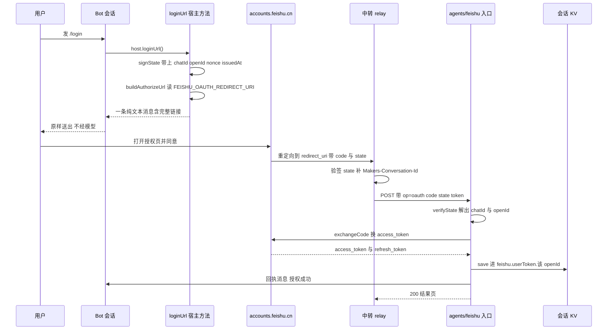
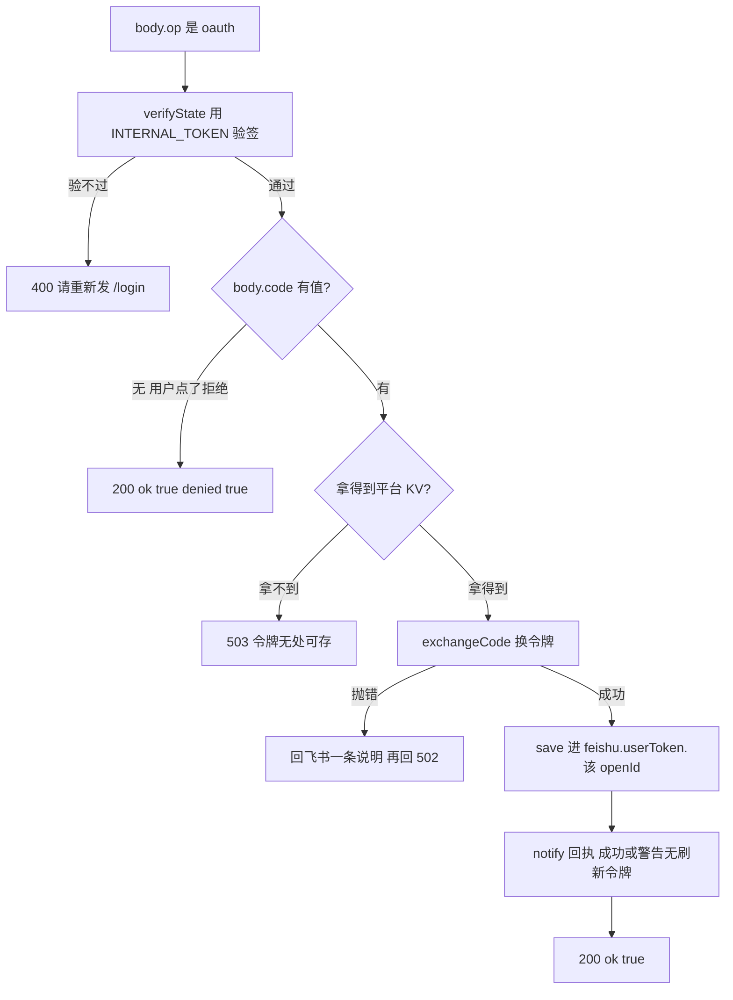

# 云文档 OAuth 授权流程：从 /login 到令牌落盘

这一页讲的是**一次授权往返的全部形状**：用户发 `/login` 之后拿到链接、点同意、浏览器被重定向回来、授权码换成长效令牌、令牌按人落盘、会话里收到一条回执；以及 `/logout` 与 `/status` 在这条链路上的位置。

它与其他几页的分工很明确：**为什么**要有用户身份、令牌按 openId 分槽的隐私理由、单飞续期与新旧值合并，都在[身份模型：应用身份与用户身份](../concepts/identity-and-authorization.md)；端点、scope 与业务错误码的清单在[飞书开放平台集成面](../integrations/feishu-open-platform.md)；令牌最终落在哪片存储空间里在[存储模型](../concepts/storage-model.md)；`/login` 这个命令怎么被解析、怎么被分派在[命令分派与控制流](commands-and-control.md)；回调为什么必须落到 agent 路由上，在[会话路由与三种入站实现](../architecture/conversation-routing-and-ingress.md)与[入站请求生命周期](../architecture/request-lifecycle.md)里有更完整的路由视角。本页聚焦**这条往返本身**：每一步做什么、状态放在哪、顺序为什么不能变、坏了会是什么样。

## 参与方与三条边界

| 参与方 | 角色 | 它持有什么 |
|---|---|---|
| `agents/feishu/_host.ts` 的 `loginUrl()` | 造链接：签 state + 拼授权 URL | `INTERNAL_TOKEN`、`chatId`、`openId`、`FEISHU_OAUTH_REDIRECT_URI`、`FEISHU_APP_ID` |
| `src/feishu/oauth.ts` | 纯函数层：`signState` / `verifyState` / `buildAuthorizeUrl` / `redirectUri` | 只吃参数，不碰存储 |
| 浏览器 + 中转（cf-agent-lab 的 `edgeone-relay.ts`） | 把飞书的 302 变成一条带头的 agent 请求 | 同一个 `INTERNAL_TOKEN`（`EO_INTERNAL_TOKEN`） |
| `agents/feishu/index.ts` 的 `handleOAuthCallback()` | 验 state、换码、落盘、回执 | `context.store.state`（令牌槽）、`FEISHU_APP_SECRET` |
| `src/feishu/user-token.ts` | 令牌的持有与续期（本页只涉及它在回调里的 `save()`） | 按 `openId` 分槽的 KV |

三条贯穿始终的边界，后面所有细节都是它们的推论：

1. **浏览器带不了自定义请求头。** `agents/` 路由强制要求 `Makers-Conversation-Id`，缺失或不合法直接 400。所以回调**不可能**直接落在 agent 路由上，必须由中转补头 —— 这也正是回调最终能拿到 `context.store.state`（按 conversation_id 隔离的那份 KV）的原因。
2. **回调的身份只能来自签名过的 state。** `chatId` / `openId` 一律从验签通过的 state 里取，**不信 body 里的同名字段**：body 是转发方拼的，state 是发起 `/login` 时自己签的。中转那边也验一遍同样的签名，两道关。
3. **授权链接必须由宿主原样发出，绝不经过模型。** 模型复述 URL 会出错（截断、加空格、把 `/` 写成全角），而授权链接错一个字符就是死路一条 —— 用户看到的是飞书的一个报错页，完全不知道为什么。`FeishuTurnHost.loginUrl()` 是命令分派层唯一的链接来源，`turn.ts` 拿到它就 `say()` 出去。

## 一个往返的全貌



图：`/login` 到令牌落盘的完整往返。身份从签名 state 里取，令牌按 `openId` 落槽，回执直接发到会话。

## 发起：授权链接怎么拼出来

`/login`（中文别名 `/授权`）被 `parseCommand` 判成 `{ kind: "login" }`，`turn.ts` 套一层 `safeReply()` 调 `host.loginUrl()`。宿主侧做两件事：

**① 签一份 state。** 载荷是 `{ chatId, openId, nonce, issuedAt }`，密钥直接用 `INTERNAL_TOKEN`（中转侧有同一个值，不必再分发一个密钥）；`nonce` 是 `crypto.randomUUID()`，`issuedAt` 是当下毫秒时间戳。

state 的载荷里**只带 `chatId`，不带算好的 conversation_id**，这是个刻意的取舍：`fs-` + `sha256(chat_id)` 前 32 位这条算法在中转里已经有一份、并且每一条普通消息转发都在用；state 里再存一份算好的值等于把同一条不变量复制成两份，哪天要改就得两边同时改，漏一边的表现是「两个会话的记忆串了」这类最难查的现象。所以由转发层自己算。

编码形式是 `base64url(payload).base64url(hmac)`，签名算法是 HMAC-SHA256，签名比较用常数时间实现。**签名是必须的**，不是锦上添花：state 会经过浏览器、飞书、中转三层，中间每一层都可能被人替换；不签名的话，任何人构造一个 state 就能把**自己的**授权码塞进别人的会话 —— 结果是受害者会话里存了攻击者的令牌，之后每次提问都在用攻击者的文档权限回答。

**② 拼授权 URL。** `buildAuthorizeUrl` 打在 `https://accounts.feishu.cn/open-apis/authen/v1/authorize` 上（注意不是 `open.feishu.cn` —— 授权页与 token 端点跟其他 OpenAPI 不在同一个域，所以 `oauth.ts` 自己拼 URL、不复用 `api.ts` 的 `base(env)`），参数是 `client_id` / `response_type=code` / `redirect_uri` / `scope` / `state`。

两个细节值得单独记住：

- **scope 里的空格必须编码成 `%20` 而不是 `+`。** `URLSearchParams` 默认把空格序列化成 `+`，而 OAuth 的 scope 是空格分隔的列表，有些服务端把 `+` 当字面量 —— 那样整个 scope 会变成一个不存在的长名字，授权页要么报错、要么授不到任何权限。两种解码其实都合规，但这个参数不值得赌，所以 `buildAuthorizeUrl` 最后显式 `.replace(/\+/g, "%20")`。
- **`FEISHU_OAUTH_REDIRECT_URI` 没有默认值。** `redirectUri()` 在没配时直接抛错并点名这个变量；宿主刻意不兜成一个猜的值。理由是回调地址必须和飞书后台「安全设置 → 重定向 URL」登记的完全一致，差一个字符授权页就直接报错 —— 猜一个的话用户看到的是飞书的一个报错页，完全不知道原因；宁可现在就说清楚是配置缺了。

抛错也是有兜底的：`turn.ts` 的 `safeReply()` 会把异常转成一条「处理失败：…」的文本发出去，而不是让异常冒到 `index.ts` 之后**一条消息都收不到**（看起来像 bot 死了）。冒烟测试 F 节有一条专门断言这一点（`host.loginUrl` 抛「没有配置 FEISHU_OAUTH_REDIRECT_URI」时仍发得出一条消息）。

链接由 `sendText` 发出，也就是说它是飞书**纯文本消息**，不渲染 Markdown —— 所以 `loginUrl()` 的返回文本里刻意不用加粗和反引号（`**x**` 会原样显示成星号）。Markdown 只在流式卡片那条路上有得渲染，两条路的排版规则不能混。

## 回调：为什么它落在 agent 路由上

飞书把浏览器重定向到 `FEISHU_OAUTH_REDIRECT_URI` 指向的地址（配置里是 `https://agent.yujizi.org/api/feishu/oauth`，即中转的地址），中转补上 `Makers-Conversation-Id` 与内部令牌后，以 `op: "oauth"` 的形状转发到 `POST /feishu`。

**这一步不是绕远路，而是唯一可行的路**：浏览器跳转带不了自定义请求头，而 agent 路由缺 `Makers-Conversation-Id` 就直接 400。中转补上了这个头，回调因此拿到 `context.store.state` —— 那是按 conversation_id 隔离的 KV，用户令牌槽就在里面。

入口里的分支只有一行，位置和返回方式都是刻意的：

```ts
if (String(body?.op ?? "") === "oauth") {
  return handleOAuthCallback(env, context, body);
}
```

- **排在去重（`store.claim`）与限流之前。** 两者都是给用户消息用的：回调没有 `messageId`，套上去重只会在用户重试时把第二次回调当成「重复」丢掉。
- **同步返回。** 中转那边的浏览器在等这个响应渲染结果页。

### 身份只从签名 state 里取

`handleOAuthCallback` 的第一步是 `verifyState(body.state, env.INTERNAL_TOKEN)`，`null` 就回 400 并附一句人话（「授权状态无效或已过期。请回飞书重新发 /login 拿一条新链接。」）。

`verifyState` 有四道闸，任何一道不过都返回 `null`，调用方一律当成「无效回调」：签名不匹配（常数时间比较）、payload 不是合法 base64url+JSON、`chatId` / `openId` 缺失、`issuedAt` 不是有限数或已超过 `STATE_TTL_MS`（15 分钟 —— 授权码本身 5 分钟失效，state 给宽一点覆盖整个来回；留太久等于给重放敞着门）。

**然后身份只从 state 里取**：

```ts
const mgr = new UserTokenManager({
  store: makeUserTokenStore(kv, state.openId),
  env,
  openId: state.openId,
});
```

body 里的 `chatId` / `openId` 同名字段**一律不看**。理由在前一节说过：body 是转发方拼的，而 state 是发起 `/login` 时我们自己签的 —— 只有后者能证明「这次授权确实是这个会话里的这个人发起的」。中转侧也验一遍同名签名，两道关。

### 授权码换令牌

拿到 `verifyState` 的结果之后，第二个分支处理「用户点了拒绝」：飞书会带着 `error` 回来、**不带 `code`**。这不是故障，别报成故障 —— 直接 `{ ok: true, denied: true }` 回 200。

真正换令牌的那一步是 `exchangeCode(env, code, redirectUri(env))`：

- **`redirect_uri` 必须和发起授权时完全一致**，差一个字符就换不到令牌。两边都读同一个 env（`redirectUri(env)`），所以天然一致 —— 代码里刻意不留手写字面量。
- 打的是 `https://accounts.feishu.cn/oauth/v3/token`，form-urlencoded，带 `grant_type=authorization_code` / `client_id` / `client_secret` / `code` / `redirect_uri`，超时 15 秒。
- **授权码 5 分钟失效且只能用一次。** 所以回调必须立刻换，失败要重新授权而不是排队重试。
- 响应里没有 `access_token` 就抛错，错误原因按 OAuth 标准字段优先（`error_description` / `error`），老接口的 `code` / `msg` 也认；响应体不是 JSON 时抛出的错误里带上 HTTP 状态码与前 200 字。

`refresh_token` 有没有，完全取决于授权时 scope 里带没带 `offline_access` —— 不带就没有这个字段，用户每两小时要重新授权一次。`DOC_SCOPES` 里含它，这是 handler 之外的前提。

### 落盘与回执

换到令牌之后，回调做两件事，**顺序固定**：

1. `mgr.save(tok)` —— 写进 `feishu.userToken.<openId>`。`save()` 会走 `merge()` 把 `openId` 强制设成管理器自己的那个，所以槽里的记录一定属于这个人。
2. `notify(...)` 回飞书一条消息到 `state.chatId`。

落盘失败会走另一条路：`kv` 拿不到时回 503「拿不到平台 state 存储，令牌无处可存」；`exchangeCode` 抛错时**回飞书一条说明**（`云文档授权没成功：<原因>\n可以再发一次 /login 重试。`）再回 502。也就是说用户在会话里始终能知道这件事成没成，不会只看到一个飞书报错页。

回执文本把两种结局说清楚了：

```text
✅ 云文档授权成功。

现在可以直接把飞书文档 / 知识库 / 多维表格 / 电子表格的链接发过来提问了。
（拿到了刷新令牌，之后不用反复授权。）
```

没拿到 `refresh_token` 时最后一句换成警告：`⚠️ 没拿到刷新令牌 —— 飞书后台的 offline_access 权限可能没开，两小时后要重新授权。` —— 这正是把「scope 配错了」这种最难在测试环境发现的配置问题，直接暴露在用户和运维都能看见的地方。

`notify()` 自己**吞掉发送异常**，只记一行日志：令牌已经存好了，不该因为一句回执没发出去就报错。



图：`handleOAuthCallback` 的全部分支。身份来自 state，令牌落在授权人自己的槽里。

## `/logout` 与 `/status`

这两个命令不产生网络往返，但它们是同一条状态机的另外两个面。

**`/logout`** 调 `host.logout()` → `UserTokenManager.forget()`：把内存副本置空、`loaded` 置真、`store.clear()` 删掉这个人的槽，并返回「本来有没有」—— 回执照着它说实话（「已撤销云文档授权。再读文档需要重新发 /login。」或「本来就没有授权，没什么可撤销的。」）。因为槽是按 `openId` 的，`/logout` **只影响本人**：群里 A 撤销不影响 B 的授权。

**`/status`** 调 `host.statusText()`，其中与授权有关的那一行来自 `authStateText(tokens, openId)`。它用 `peek()` —— 只看不刷新、无副作用，这正是 `peek()` 存在的理由。两种输出：

| 情况 | 文案 |
|---|---|
| 这个 `openId` 没有令牌 | `云文档：未授权（共享给机器人的文档无需授权可读；发 /login 后能以你的身份读写你有权限的文档）` |
| 有令牌 | `云文档：已授权（<openId 前 12 位>…，访问令牌有效到 <YYYY-MM-DD HH:mm> UTC，有刷新令牌 / ⚠️ 无刷新令牌（两小时后要重新授权））` |

「无刷新令牌」那一句就是上面那条授权时缺 `offline_access` 的症状在状态页上的样子。授权是**按人**的：换个同事来问同一个会话，`/status` 显示的授权状态不一样。

## 不变量与失败模式

| 不变量 | 违反后的表现 | 为什么难查 |
|---|---|---|
| state 必须签名，且身份只从 state 取 | 攻击者把自己的令牌塞进别人的会话，之后所有回答都用攻击者的文档权限 | 受害者的会话里**确实**有令牌、功能看起来正常 |
| 身份字段不信 body | 同上；且因为中转也在转发普通消息，看起来「和消息路径一致、应该没问题」 | body 里的字段是对的（正常转发时），只有被构造时才不对 |
| 回调分支排在去重之前 | 用户重试授权时第二次回调被当成「重复」丢掉 | 表现是「第一次失败后再点一次就没反应」 |
| 回调同步返回 | 中转的浏览器停在等待上，用户看不到结果页 | 授权其实已经成功，只是页面没出来 |
| `redirect_uri` 两边同源取值 | 换令牌报错，用户拿不到令牌 | 报错来自飞书，措辞与「链接无效」很像 |
| `offline_access` 在 scope 里 | 每两小时重新授权一次，回执里那句警告会一直出现 | 两小时才发作，测试环境极难复现 |
| 授权链接不经模型 | 链接被截断/加空格/全角斜杠，用户看到飞书的报错页 | 看起来像「飞书配置错了」，不像模型转述错了 |
| 令牌按 `openId` 分槽 | 群里最后授权的人把自己的文档权限出借给全群 | 这是**隐私事故**，不是功能 bug；没有报错 |

**配置与运维上的三个手工同步点**（都在本仓库之外或跨仓库）：

- `FEISHU_OAUTH_REDIRECT_URI` 的值必须与飞书后台「安全设置 → 重定向 URL」登记的**完全一致**，且与中转的路由一致；
- state 的签名密钥与中转侧的 `EO_INTERNAL_TOKEN` 必须**同值**（两边都从自己的 env 读）；
- 改了飞书后台的权限要**发一个新版本**才生效，而且**已经授权过的用户不会自动拿到新加的 scope** —— `refresh_token` 不会带来新 scope，必须重新发一次 `/login` 走完整流程。飞书对这种情况只回一句 `99991679`，不解释为什么，所以文档里的写权限是后加时，用户侧的表现是「我明明授权过了却说没权限」。

排错时的读法正好相反：`/status` 说已授权但工具报 `99991679` → 重新 `/login`；`/status` 说未授权但用户坚持点过链接 → 看回执消息有没有出现（回执发失败只记日志）、以及 `verifyState` 有没有因为超 15 分钟而作废。

## 测试钉住了什么

`test/smoke.ts` 的 **H 节**守这一层的纯函数部分（`parseDocUrl` 也在这一节，它住在同一个文件里）：

- `signState` / `verifyState`：签名能过；篡改签名、换密钥、格式不对、`issuedAt` 过期 20 分钟**全部返回 `null`**；
- **跨仓库守门测试**：`signState` 对固定 payload + 固定密钥必须签出固定的串，且 base64url 不带 `=` 填充 —— 本仓库用 WebCrypto、中转用 `node:crypto`，只要有一边 base64url 填充或 HMAC 参数不同，整条授权链路就会静默断在「链接无效」上，而那个报错完全指不出是这里；
- `DOC_SCOPES` 必须包含 `offline_access` 与四个 `:readonly`；
- 授权链接的域名（`accounts.feishu.cn`，**不是** `open.feishu.cn`）、路径 `/open-apis/authen/v1/authorize`、`client_id` / `response_type` / `redirect_uri` / `state` 逐个断言，且 `%20` 必须出现（scope 的分隔符不能是 `+`）；
- 没配 `FEISHU_OAUTH_REDIRECT_URI` 时 `redirectUri()` **明确抛错**，错误信息里含变量名。

**F 节**守命令分派层的两条：

- `/login` 发出的链接**原样**包含 `https://accounts.feishu.cn/open-apis/authen/v1/authorize`（宿主给的链接不当场被改写）；
- `host.loginUrl` 抛错时用户仍收得到一条消息（不能静默）。

**I 节**守令牌与槽位：`peek` 无副作用、`forget` 幂等且返回「本来有没有」、**不同 `openId` 用不同的槽**（A 退出授权不影响 B —— 断言注释直说「共用一个槽的话，群里最后授权的人会把自己的权限出借给全群」）。

没有被自动化覆盖的那部分要说清楚：`handleOAuthCallback` 本身（验 state → 换码 → 落盘 → 回执）**没有冒烟测试**，它依赖平台 `context.store.state` 与真实的 `accounts.feishu.cn` 往返；`/login` 的端到端往返也不在 `tools/` 那几个验证脚本里 —— 它们的取值路径是 `?mode=sync` 的 `replies` 与飞书消息 API，覆盖的是问答、记忆与压缩。这一段的回归目前靠人工按[飞书开放平台集成面](../integrations/feishu-open-platform.md)的后台配置表核一遍，以及与中转侧的固定签名串对照。

## 相关页面

- [身份模型：应用身份与用户身份](../concepts/identity-and-authorization.md) —— 为什么需要用户身份、令牌分槽的隐私理由、单飞续期与新旧值合并
- [飞书开放平台集成面](../integrations/feishu-open-platform.md) —— 授权页与 token 端点、scope 清单、后台「重定向 URL」与发版要求
- [会话路由与三种入站实现](../architecture/conversation-routing-and-ingress.md) —— `Makers-Conversation-Id` 为什么是硬约束、`chatId` 为什么进 state 而不是 conversation_id
- [入站请求生命周期](../architecture/request-lifecycle.md) —— `op=oauth` 分支在入口里的确切位置与同步返回
- [命令分派与控制流](commands-and-control.md) —— `/login` `/logout` 怎么被解析、`safeReply` 与纯文本回执的约束
- [存储模型](../concepts/storage-model.md) —— `feishu.userToken.<openId>` 与会话 KV、Blob 记忆三片空间的关系
- [配置与环境变量](../operations/configuration-and-env.md) —— `FEISHU_OAUTH_REDIRECT_URI`、`INTERNAL_TOKEN`（兼 state 签名密钥）、`FEISHU_USER_TOKEN_SKEW_MS`
- [冒烟测试套件](../testing/smoke-tests.md) —— H / F / I 三节各自的判据与跨仓库守门测试
- [飞书文档读写工作流](feishu-doc-read-write.md) —— 授权之后这些令牌被谁用、什么身份优先
