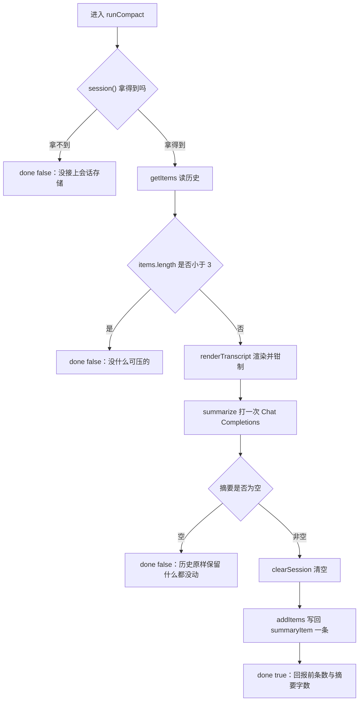
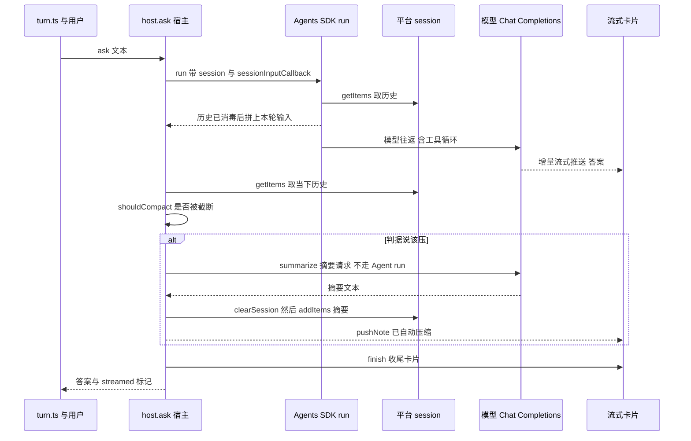

# 会话压缩：手动 `/compact` 与自动压缩

对话历史是这个 agent 里**唯一会自己长胖**的状态：每一轮问答、每一次工具调用和结果都被追加进
平台托管的 session，而模型的上下文不是无限的。会话压缩就是这条链路上的减压阀 ——
它把一段历史渲染成人能读的文本、交给模型摘要、再把那段历史换成一条摘要项。

这一层有两个入口，但**只有一份实现**：

- **手动**：用户在飞书里发 `/compact`（中文别名 `/压缩`），`runFeishuTurn` 把它分派到
  `FeishuTurnHost.compact()`（分派层的结构见[命令分派与控制流](commands-and-control.md)）；
- **自动**：每个模型回合跑完之后，宿主自己判断「历史是不是太长了」，是就压一次。

两者的差别只在**谁触发**和**失败怎么告知**，压缩动作本身共用
[`_host.ts` 里的 `runCompact()`](../../agents/feishu/_host.ts)。

> 上游：历史存在哪、为什么窗口锁死 100 条、哪些保证被弱化了 —— 见
> [存储模型](../concepts/storage-model.md) 与 [平台约束与弱化的保证](../architecture/platform-constraints.md)。
> 下游：手动入口的命令解析与异常兜底见[命令分派与控制流](commands-and-control.md)；
> 自动压缩在回合收尾中的位置见[入站请求生命周期](../architecture/request-lifecycle.md)。
> 摘要请求的提示词契约见[提示词契约](../concepts/prompt-contract.md)。
> 钉住纯函数判据的测试见[冒烟测试套件](../testing/smoke-tests.md)，
> 生产上证明触发真的会发生的脚本见[端到端验证](../testing/end-to-end-verification.md)。

## 为什么压缩要自己拼三步

平台的 `context.store.openaiSession(cid)` 给的是 OpenAI Agents SDK 的原生 `Session`
（`getItems` / `addItems` / `popItem` / `clearSession`），**不暴露任何压缩钩子**。
原版的 `compactAfter(200_000)` + `onCompaction` 是 Cloudflare 那侧的私有扩展，移植不过来。

所以压缩只剩一条路：自己按顺序调用那三个方法。

```ts
const items = await s.getItems();          // 1. 读到（全量）历史
const summary = await summarize(...);      // 2. 生成摘要
await s.clearSession();                    // 3. 清空
await s.addItems([summaryItem(summary)]);  // 4. 只写回摘要这一条
```

而这个 session 有一个**没人被告知的口头约定**：平台实现里 `MAX_LIMIT = 100`，而 SDK 取历史时
不传 `limit`、本项目调 `openaiSession(cid)` 也不传 `maxItems`，于是 `getItems()` 拿到的
**恒是最近 100 条**，更早的内容平台已经静默丢了、不报错、不留痕。这直接决定了本页后面两条设计：
`/compact` 的语义是「把最近 100 条压成摘要」而不是「把整段对话压成摘要」，
以及 `shouldCompact` **刻意不拿条数当判据**（窗口本身就卡在 100，条数多 ≠ 该压）。

### 纯函数和胶水被切开

[`src/feishu/compact.ts`](../../src/feishu/compact.ts) 是**零依赖**的：历史项怎么变成人话、
写回的项长什么形状、什么时候该拒绝压缩，全是纯函数，不碰模型也不碰平台。
`test/smoke.ts` 的 G 节因此能在裸 Node 里直接测它们。

- 渲染：`renderTranscript(items)` / `renderItem()` / `renderContent()`
- 写回形状：`summaryItem(summary)`、`SummaryItem`、`SUMMARY_PREFIX`
- 门槛：`MIN_ITEMS_TO_COMPACT`、`compactReply(before, chars)`
- 判据：`shouldCompact(items)`、`CLAMP_MARKER`
- 提示词：`SUMMARY_SYSTEM_PROMPT`、`buildSummaryUserPrompt(transcript)`

调模型和读写 session 的那点胶水留在宿主里（`createHost` 内部的 `summarize` 与 `runCompact`）。
这和当初把宿主能力抽成 `FeishuTurnHost` 接口是同一个动机：**把「会错的东西」和「接不上的东西」分开**。

## 渲染：历史项怎么变成人话

`renderTranscript` 逐项调 `renderItem`，认得出的项渲染成一行、认不出的直接丢掉，
最后用 `\n\n` 拼起来。四种项各有自己的处理：

| 项类型 | 渲染成 | 上限 |
|---|---|---|
| `message`（`type` 缺省即按它处理） | `用户：…` / `助手：…` / `系统：…`（`roleLabel`） | `MAX_MESSAGE_CHARS` = 4000 字 |
| `function_call` | `[调用工具 名字] 参数` | `MAX_TOOL_CHARS` = 600 字 |
| `function_call_result` | `[工具 名字 返回] 输出` | 同上 |
| `reasoning` | **丢掉**（返回空串） | — |

几条刻意的取舍：

- **`type` 缺省当 `message`**：平台换实现时可能只给 `role` / `content`，这样仍然渲染得出来。
- **思考项丢掉**。它是模型的中间草稿，又长又吵；丢它的代价只是摘要少一层推理细节 ——
  结论和来源都在正文里。
- **内容块数组也收**。`renderContent` 认 `input_text` / `output_text` / `text`，
  并把图片、文件、语音、拒绝渲染成 `[图片]` / `[文件 名字]` / `[语音]` / `[拒绝] …`
  这样的占位 —— 摘要看不到图，但至少知道**这里有张图**。
- **工具输出压成一行**（`oneLine`）：把连续空白揉成一个空格，超限就截断并加 `…（截断）`。
  工具输出动辄上万字，摘要不需要细节。
- **超长字符串保留头尾**（`clamp`）：只留头会丢掉「用户最后强调的约束」，只留尾会丢掉
  开头那句「用户到底要干什么」—— 而摘要恰恰最需要这两端。

### 整段超限：头尾保留 + 一个标记

`renderTranscript` 的最后一步是 `clampTranscript`。超过 `MAX_TRANSCRIPT_CHARS`（12 万字）时，
它保留头 30000 字（`HEAD_CHARS`）和尾部，中间插一句省略提示：

```
……（中间省略约 12345 字，多为重复的问答往返）……
```

头尾各留一段的理由和 `clamp()` 一样，但这里多一层：会话**开头**通常是用户第一次把
「要干什么、有什么约束」讲清楚的那一轮，后面几十轮都是围着它往返。只保留尾部的话，
摘要会丢掉那个出发点 —— 后面的追问全建立在它之上，丢了就变成一堆没有主语的结论。

那句提示里最独特的一小段被提成常量 `CLAMP_MARKER = "中间省略约"`。它不只是文案，
**它还是自动压缩的判据**（见下节）—— `clampTranscript` 与 `shouldCompact` 必须共用这一个常量。

## `shouldCompact`：判据挂在截断标记上

自动压缩的判据只有一条：**渲染出来会不会被截断**。

```ts
export function shouldCompact(items: readonly unknown[]): boolean {
  return renderTranscript(items).includes(CLAMP_MARKER);
}
```

出现标记就说明「要送去摘要的原文已经超限」—— 正是该压的信号。这也是 `runCompact` 实际喂给
模型的那份文本：**判据和动作看的是同一个东西**。

### 为什么不写成 `renderTranscript(items).length > MAX_TRANSCRIPT_CHARS`

它**碰巧也能用**，但正确性建立在那句省略提示约 31 个字的长度上：

- 截断后的长度是 `120_000 + 提示那约 31 字`，刚好越线；
- 谁把提示文案改短或删掉，`length > 120_000` 就**静默失效** —— 自动压缩永不触发，且不报任何错。

2026-09-26 实测：28 条 → 112,138 字（`false`）；30 条 → 120,031 字（`true`）。
改用「有没有出现标记」，语义直白、不赌长度。冒烟测试与生产脚本都把这件事当钉子：

- `test/smoke.ts` 断言 `renderTranscript(items).includes("中间省略约")` 必须为真 ——
  谁改那句文案会在这里被拦住，而不是让自动压缩从此一声不吭；
- 同一节还断言超限后的长度「刚好擦线」（`> 120_000 && < 120_200`），
  让后来者看见用长度判超限有多勉强。

> **拆开这个常量是静默失效风险。** `CLAMP_MARKER` 一旦被复制成两份（一边改文案、
> 另一边仍是旧字面量），判据会永远为 false：判据不报错、压缩不执行、
> 计数器不动，症状是「什么都没发生」。所以改省略文案和改判据**必须同时看这两处**。

### 为什么不拿条数当判据

平台的会话窗口本来就锁死在最近 100 条，而 100 条**短**消息远到不了 12 万字。
拿条数触发只会白压一次 —— 而历史太短时摘要比原文还长，压了是**负收益**。
`test/smoke.ts` 有一条测试专门钉这一点：100 条 `"好的"`，`shouldCompact` 必须是 `false`。

真正会撞的是「100 条里有大块工具输出」这种**单条很大**的情况，这正是字符判据能覆盖、
条数判据覆盖不到的形态。

## `runCompact`：唯一的实现与两条安全约束

`runCompact()` 是压缩的**唯一**实现，手动和自动都走它。两处各写一遍迟早漂移 ——
尤其是下面那两条安全约束，少写一条就是「把整段对话记忆抹掉」级别的事故。



这张图是 `runCompact()` 的完整控制流，四个提前返回各自对应一条「宁可这次失败重来」的判据。

### 约束一：摘要为空就什么都不动

`summarize()` 返回空串时**必须在清空之前退出**。此前清了 session 却没东西写回，
等于把整个对话记忆抹掉 —— 而用户只是想让它变短。所以这里直接返回
`done: false` 与一句「历史原样保留，稍后再试一次」。

### 约束二：先取完历史，才轮到清空

顺序是 `getItems()` → 摘要 → `clearSession()` → `addItems([摘要])`。
**摘要必须在清空之前生成**，因为清空之后历史就没得读了。同理，写回的**只有这一条摘要** ——
触发压缩的那条指令本身不留痕，否则下次压缩又会把那条指令当历史项压一遍。

### 门槛：少于 3 项不值得压

`MIN_ITEMS_TO_COMPACT = 3`。一两项时摘要不会比原文短，压完反而更难读，
而且用户会以为「历史被动了」—— 直接告诉他没什么可压的更好。

这个门槛还顺带让 `/compact` **幂等**：压完只剩一条摘要项，再发一次会被挡在这里。

### 摘要请求刻意不走 `run(agent, …)`

`summarize()` 直接用 `client.chat.completions.create(...)` 打一次模型，**不经过 Agent run**：

- 走 Agent run 的话这一回合本身会被写进 session。压缩的前提是「拿全量历史 → 清空 → 只写回摘要」，
  而 `run()` 会在「读到历史」和「清空」之间往 session 里塞东西，顺序一乱就白压；
- 直接打 Chat Completions **不接触 session**，天然干净；
- 也**不给工具**：摘要是纯文本任务，带上工具只会让它多绕几圈。

它复用的是 `createHost` 里那个**已经建好的** `client`（同一个模型客户端、同一层诊断 fetch）。

`SUMMARY_SYSTEM_PROMPT` 要求：中文、结构化、不复述逐句内容，必须保留四类信息
（**引用过的来源**（URL / 云文档链接原样保留）、**问题与关键结论**（数字要连口径一起留）、
**用户表达的偏好或决定**、**还没做完的事**），记不清就写「未确认」而**不要编**，控制在 800 字以内。
对应地，摘要请求的输出上限设为 `COMPACT_MAX_TOKENS` = 2048 —— 不设的话默认上限很低、摘要会被砍断；
给太大则容易被写成一整篇复述。

### 写回的形状：`user` role + 固定前缀

```ts
export interface SummaryItem { role: "user"; content: string; }

export function summaryItem(summary: string): SummaryItem {
  return { role: "user", content: `${SUMMARY_PREFIX}\n\n${summary.trim()}` };
}
```

用 `user` 而不是 `assistant`：它描述的是「用户这一侧带进来的上下文」，
也避免模型把它当成自己刚才说过的话而继续往下顺。`content` 直接给字符串 ——
SDK 的 `UserMessageContent` 两种（字符串 / 内容块数组）都收。
前缀 `SUMMARY_PREFIX = "以下是此前对话的压缩摘要："` 让后续轮次认得出「这是历史，不是新指令」。

### 手动与自动的差别

| | 手动 `/compact` | 自动压缩 |
|---|---|---|
| 谁触发 | 用户发命令 → `host.compact()` | 回合结束后宿主自己判断 |
| 判据 | 只过 `MIN_ITEMS_TO_COMPACT` | 先过 `shouldCompact()`，再过门槛 |
| 失败告知 | `reason` 文案**原样发给用户** | `reason` 丢掉，只记诊断，不打扰用户 |
| 成功告知 | `compactReply(before, chars)` | 一句提示，随答案进同一张卡片 |

`runCompact()` 返回的判别联合正是为这两种告知方式设计的：
`{ done: true, before, chars }` 或 `{ done: false, reason }`，其中 `reason` 是
**可以直接给用户看**的一句话。

## 自动压缩：位置、判据与失败策略

自动压缩挂在 `host.ask()` 的**回合末尾**，由一个 `autoCompactNote()` 闭包承担。
它的位置有三处讲究：



这张图说明自动压缩在回合内的位置：它在模型回合全部结束、答案已经流式显示完之后执行，且早于卡片收尾。

- **不放在 `sessionInputCallback` 里** —— 那个回调是**同步**的，而摘要要调模型（异步）。
- **不放在回合开头** —— 那会让这一轮的回答白等压缩跑完。
- **放在 `streamer.finish` 之前** —— 提示才能跟着答案进同一张卡片。此时答案已经流式显示完了，
  多等几秒只是卡片晚点收尾，不是「卡住」。

还有一条**判据取哪份历史**的细节：用**当下**的历史判（`await s.getItems()`），
不用 `sessionInputCallback` 里那份 —— 那是本回合**开始前**的快照，而这轮问答本身可能又加了不少东西。

### 失败绝不能影响这一轮的回答

`autoCompactNote()` 把所有异常都吞掉，只往诊断里记一笔。答案是用户要的东西，压缩只是维护。
三种结局：

| 结局 | 计数器副作用 | 诊断落盘 | 用户看到 |
|---|---|---|---|
| 判据不成立 | 无 | 无 | 无（正常情况） |
| 判据成立但压不成 | `compactWanted` +1 | `auto-compact-skipped` + `reason` | 无 |
| 判据成立且压成 | `compactWanted`、`autoCompactions` 各 +1 | 无 | 一句「历史过长，已自动压缩成摘要」 |
| 抛异常 | 取决于抛在哪一步 | `auto-compact-failed` + 原始消息 | 无 |

这一跳**刻意不走「后台不 await」那条路**：那条只实测过模型回合，压缩是又一跳异步
（还要再调一次模型），能不能跑完是未验证前提，所以这里 `await` 掉 ——
**正确性不赌在未验证的前提上**。

## 会话历史消毒：让会话不被永久毒死

压缩是**主动**的历史管理，消毒是**每轮都做**的历史保命措施。两者都动「喂给模型的历史」，
但解决的是不同的问题，放在一起才看得出这一层的完整形状。

现象（2026-09-25 实测）：某个会话问着问着开始**稳定**回「没答上来：400 status code (no body)」，
换任何问题都一样，重试三次全 400；而**同一个问题在别的会话里完全正常**，`/clear` 之后本会话也立刻恢复。

看请求里的角色序列才明白：

```
s t t a u a t a u a u u a a u u a u a a u a u u a a u ...
```

以 `s t t` 开头 —— **system 后面直接跟了两条 tool 消息**。而 `role: "tool"` 的消息在协议上
**必须**紧跟在一条带 `tool_calls` 的 assistant 消息后面，用 `tool_call_id` 对应上。
孤立的 tool 消息是非法结构，网关直接 400。

为什么会变成这样：会话历史是**按窗口**取的。窗口一旦从「一对 `tool_calls` / tool 结果」的中间切开，
开头就会剩下一条没有对应 assistant 的 tool 消息；之后每一轮都带着这个非法开头，
于是**永久 400** —— 这就是「一个会话被毒死、再也救不回来」的机制。

### 修法：`sanitizeHistory` 只删不重排

[`src/feishu/session-sanitize.ts`](../../src/feishu/session-sanitize.ts) 的 `sanitizeHistory()`
维护一个「已被 assistant 声明、但还没被消费」的 `tool_call_id` 集合，规则三条：

- `assistant` 到达时先把它的 `tool_calls[].id` 全部登记进 `pending`；
- `tool` 消息只有在 `pending` 里才保留（消费掉那个 id），否则计为孤儿**丢弃**；
- 顺手丢掉「既没文本也没 `tool_calls`」的**空 assistant** 消息（没有信息量，部分网关还会挑刺）。

`system` / `user` / 其它项原样保留。整个函数**保持原有顺序，只做删除** —— 不重排、不改写内容，
免得引入更难查的问题。

丢弃孤儿 tool 消息会**损失一点上下文**（那次工具调用确实发生过），但换来的是请求合法 ——
而原来的做法是整轮直接失败。

`sanitizeAndAppend(history, newItems, onDrop?)` 是给 `run()` 的 `sessionInputCallback` 用的：
语义和 SDK 默认行为一致（历史在前、本轮在后），只是中间插了一道过滤。
**丢了东西时才回调** `onDrop`（避免正常回合也写 KV），回调里把计数累加进 `diagCounters`
并把一笔 `history-sanitized` 记进会话 KV。

这条修补被"复制"在了会话与压缩**同一条**路径上：`runFeishuTurn` → `host.ask` → `run(agent, …)`
的 `sessionInputCallback`。压缩之后再让历史变短，窗口仍然会从别处切开，所以两者都需要。

> 关于「孤儿工具消息」的病根与这个函数的关系，冒烟测试里有一整段（无字母编号）专门钉住各种切歪的形状：
> 开头 / 中间的孤儿 tool、同一个 `callId` 被消费两次、空 assistant 丢弃、
> **有 `tool_calls` 但没文本的 assistant 必须留**、丢弃时回调而没丢时不回调。

## 让静默失效可观测

压缩这条链路的坏法有一个共同特征：**症状是「什么都没发生」**。
判据恒 false（历史没超限，或者常量被拆开）、`session()` 拿不到、压缩那一步抛错被吞掉 ——
只看聊天记录分不出是「没到该压的时候」还是「坏了」。所以 [`_diag.ts`](../../agents/feishu/_diag.ts)
给这条链路配了两个模块级计数器，`?probe=last` 会原样带出来：

| 计数器 | 含义 | 为 0 说明什么 |
|---|---|---|
| `compactWanted` | 自动压缩「判定该压」的次数 | 历史没超限，或判据坏了 |
| `autoCompactions` | 自动压缩**成功**的次数（摘要非空、写回完成）；失败不计 | 判据没到，或压缩那一步抛错被吞掉了 |

判读方式：

- **两个都涨** = 判据和压缩都工作；
- **只有前者涨** = 判据说该压但没压成（多半摘要返回空），诊断里会有一条 `auto-compact-skipped`；
- `auto-compact-failed` 则记下摘要请求抛出的原始消息。

⚠️ `diagCounters` 是**按实例**的内存计数，而实例由 conversation id 粘性路由。所以复验前
必须先打 `?probe=last&op=clear` 清零（它同时清空环形缓冲、重置计数器、删掉会话 KV 里的 `DIAG_KEY`）——
否则读到的是上一轮攒下的值，构成**假阳性**。`tools/verify-autocompact.mjs` 自己先清零，
**清零后从 0 涨起来的那个 1 才算证据**。

同样的理由也适用于历史消毒钩子：`sessionInputCallback` 是 SDK 的一个**可选**参数，
名字写错或版本不认时会**静默不生效**，而症状只是「偶尔还是 400」。
所以它每被调用一次 `sessionInputCalls` 就 +1 —— 只要它 > 0，就证明钩子确实挂上了。
这也是计数器这套东西存在的根本理由：**静默失效的钩子和坏掉的钩子看起来一模一样**，
必须给它一个能被观察的副作用。

计数器本身也是 2026-09-26 才补上的 —— 自动压缩先在功能上完成，随后补上「它在不在工作」的证据
（见[平台约束与弱化的保证](../architecture/platform-constraints.md)里那份"恢复强保证的缝"清单）。

## 测试：纯函数钉判据，生产脚本钉触发

这一层被刻意切成「能单测的」和「只能真跑的」，测试也相应地分成两半。

### 冒烟测试（`npm test`）钉住纯函数

`test/smoke.ts` 的 **G 节「会话压缩的纯函数」**覆盖：

- `MIN_ITEMS_TO_COMPACT = 3` 且这个门槛让 `/compact` 幂等；
- `renderTranscript` 的角色标签、内容块数组、工具调用行、丢弃思考项、头尾保留的中段省略；
- `shouldCompact` 的三个正当性断言：没超限不压 / 超限才压、看的是「有没有被截断」
  而**不是**比长度（并钉住 `CLAMP_MARKER` 真的出现在截断输出里）、
  **不**拿条数当判据（100 条短消息仍为 `false`）；
- 摘要写回形状（`user` role + 固定前缀、两端空白被 trim）；
- 回执文案 `compactReply(12, 345)`；
- `SUMMARY_SYSTEM_PROMPT` 点名四类必须保留的信息、明确「不要编」，且不留仓库问答时代的残留项。

另有 **F 节**从回合这一层钉住命令路径：`/compact` 与 `/压缩` 都解析成 `kind: "compact"`、
带多余参数照常识别、`/compact` 走的是 `host.compact` 而**不调用 `host.ask`**、
宿主抛错时仍发出一条消息（不静默）。

会话历史消毒在同一个文件里有一段无字母编号的分组，覆盖前面列出的各种切歪形状。

### 生产验证：`npm run verify:autocompact`

判据本身能被纯函数钉死，但**触发那一段只能真跑** —— 它要十几轮满长度对话才堆得到。
[`tools/verify-autocompact.mjs`](../../tools/verify-autocompact.mjs) 用两个既有事实凑出
不刷屏的验法：回复可以从 `?mode=sync` 的 HTTP 响应里读，会话身份是
`Makers-Conversation-Id` **请求头**而不是 `chat_id`。于是它用**假 `chat_id`
（`oc_probe0000…autocompact`）+ 一个独立 conversation id**：消息只会尝试发到那个不存在的 chat，
**一条都不会打到真人聊天里**。

代价是那一轮回 500、读不到回复 —— 但压缩代码在 `ask()` 里**已经跑完了**（发送失败发生在它返回之后）。
所以判据改成读诊断计数器：每轮投一段撑上下文的 filler 并要求原样复述
（每轮贡献约 8000 渲染字，判据线 12 万字，约 15 轮越过），每轮读一次 `?probe=last` 的
`counters`，`autoCompactions > 0` 即成功退出。

脚本失败时会自己给出两条排查方向：先确认计数器**真的**清成 0 了，再确认这一轮确实跑到了
`ask()` 里（看 `sessionInputCalls` 有没有涨）。完整工具链与假阳性清单见
[端到端验证](../testing/end-to-end-verification.md)。

⚠️ 有一条**验不到**的：生产上那个 100 条的会话窗口是平台侧静默施加的，
脚本碰不到它 —— 能验的只有 `shouldCompact` 这个纯函数判据和「触发确实会发生」。

## 维护这一层时要知道的

1. **改 `CLAMP_MARKER` 的文案 = 同时改判据**。它同时被 `clampTranscript`（组文案）和
   `shouldCompact`（判是否被截断）使用。拆成两份字面量是**静默失效**风险：
   自动压缩永不触发、不报错。冒烟测试里那条 `includes("中间省略约")` 就是拦住这类改动的钉子。
2. **别把判据写成长度比较**。`length > MAX_TRANSCRIPT_CHARS` 碰巧能工作，但正确性压在那约
   31 个字的提示长度上 —— 换文案就坏，且坏得很安静。
3. **别把判据改成条数**。平台窗口锁死 100 条，条数触发只会白压一次，
   而历史太短时摘要比原文还长，压了是负收益。
4. **两条安全约束不许各写一遍**。「摘要空着别动」和「先取完再清空」只在 `runCompact` 里存在一份。
   想加第三条安全约束、或者想给自动压缩换一套流程时，**改这里**，不要在旁边复制一份。
5. **摘要请求不许走 `run(agent, …)`**。它必须不接触 session，否则「读历史 → 清空」之间被塞东西，
   顺序就乱了。
6. **`/compact` 只压得到最近 100 条**。更早的内容已经不在 session 里了，压不回来。
   改文案或改 `/help` 时不要暗示它能压整段对话。
7. **`/clear` 和 `/compact` 不碰长期记忆**。记忆在另一个 Blob 命名空间里，要删只有 `/forget`
   一条路 —— `/clear` 的回执必须点名这一点（见[跨会话长期记忆](../concepts/cross-session-memory.md)）。
8. **加了新的自动动作就顺手想一句「它坏了会怎样被看见」**。这一层最有价值的经验不是压缩算法，
   而是「静默失效的钩子和坏掉的钩子长得一样」这条 —— 计数器、诊断落盘、失败文案都是它的产物。
