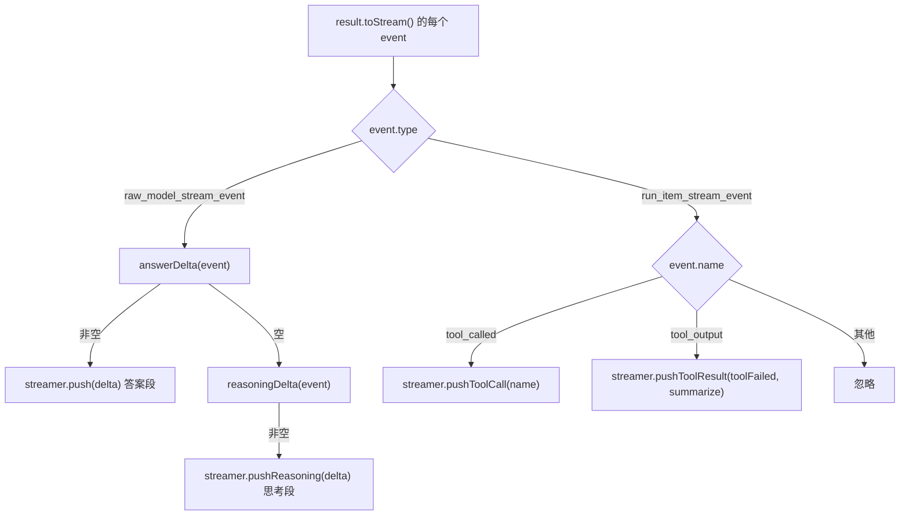

# 模型流式输出、工具事件与卡片渲染

这一页讲**一轮模型回合怎么变成用户在飞书里看到的那段回答**：宿主 `agents/feishu/_host.ts` 的 `ask()` 怎么建 Agent、怎么消费 OpenAI Agents SDK 的事件流、`agents/feishu/_host.ts` 的 `applyEvent()` 怎么把 SDK 事件翻译成卡片动作，以及 `src/feishu/streamer.ts` 的 `FeishuStreamer` 怎么在**同步 push / 异步出网**这条硬约束下组织卡片正文。

上游「一条飞书消息怎么被解析、路由、收尾」见[请求生命周期](../architecture/request-lifecycle.md)；工具的挂载条件、名字与摘要契约见[工具契约与清单](../concepts/tool-contract-and-inventory.md)；卡片的平台约束与未核实项见[平台约束与弱化的保证](../architecture/platform-constraints.md)。本页只讲**从「模型开始吐字」到「卡片上写着答案」**这一段。

## 建 Agent：一轮一个

`createHost()` 每个实例（= 每个飞书会话）建一次，返回的 `ask()` 里每轮消息**现建一个 `Agent`**（`buildAgent()`）。这个对象决定模型怎么被调用：

| 字段 | 值 / 来源 | 为什么 |
|---|---|---|
| `model` | `OpenAIChatCompletionsModel(client, MODEL_NAME)` | OpenCode Go **只兼容 Chat Completions**。用默认的 Responses API 会得到 404，而不是「不支持这个端点」这种看得懂的错 |
| `name` | `"general-assistant"` | 只是标识（日志 / trace 里出现），不参与行为 |
| `modelSettings.maxTokens` | `MAX_OUTPUT_TOKENS = 8_192` | 不显式设的话默认只给 256 token，长回答会在半截被砍断 |
| `instructions` | 静态字符串 **或** 异步函数 | 见下 |
| `tools` | 按配置条件拼出来的数组 | 见[工具契约与清单](../concepts/tool-contract-and-inventory.md) |

`instructions` 有**两种形态**，取决于跨会话记忆能不能接上：

- 拿得到记忆（`memory` 非 null）时传的是**异步函数** `async () => baseInstructions + await memoryText()`。SDK 的 `Agent.instructions` 支持 `(runContext, agent) => string | Promise<string>`，所以长期记忆能在每轮开头动态拼进去。
- 拿不到记忆时**退回静态字符串**。这不只是省一次 `await`：提示词里不该出现「你有长期记忆」这种骗人的话，不然模型会去调一个根本没挂上的工具。

⚠️ 函数形态的 `instructions` 会被 SDK **每次模型调用**都重新求值一次（`@openai/agents-core` 的 `#prepareModelCall` 在一轮的轮次循环里反复调用 `getSystemPrompt`）。所以记忆文本是**一轮一次的快照**（`memorySnapshot`），不是每次都重读 —— 否则同一轮里模型先 `remember_fact` 再 `recall_facts`，会同时看到「提示词里已有 2 条」和「工具说 0 条」，判定成自己的读取不稳定，当众撤回一个正确的答案。

工具循环的轮数上限是 `maxTurns: MAX_TURNS`（24）。撞顶不可怕 —— Agents SDK 这侧靠 `result.finalOutput` 兜底：即使被 `maxTurns` 截断，最后一轮的文本仍然拿得到。

## 一轮的调用链

```ts
const streamer = new FeishuStreamer(env, cache, chatId);
const streaming = await streamer.start();          // 起不来就是 false

const agent = buildAgent();
const result = await run(agent, text, {
  stream: true,                                     // StreamedRunResult
  session: session(),
  maxTurns: MAX_TURNS,
  sessionInputCallback: (history, newItems) =>       // 历史消毒，防会话被毒死
    sanitizeAndAppend(history, newItems, onDrop),
});

for await (const event of result.toStream()) {      // 异步事件流
  if (!streaming) { const d = answerDelta(event); if (d) answer += d; continue; }
  applyEvent(streamer, event);
}
const final = pickFinalText((result as any).finalOutput);
if (final) answer = final;                           // finalOutput 优先
```

`session: session()` 把平台按 `conversation_id` 提供的 OpenAI Agents SDK 原生 `Session` 交给 SDK；`sessionInputCallback` 在每一轮把历史过一遍 `sanitizeAndAppend`，丢掉「切窗口切歪了」留下的孤儿 tool 消息 —— 少了它，一旦窗口从「assistant 声明 tool_calls → tool 结果」这一对的中间切开，之后这个会话每轮都带非法开头，网关稳定 400，只有 `/clear` 能救。这个钩子是**可选**参数，名字写错会静默不生效，所以它每被调用一次就让 `diagCounters.sessionInputCalls` +1，好让「钩子到底挂上没有」可观测。

## `FeishuStreamer`：同步 push，异步出网

`FeishuStreamer` 的存在理由是一条硬约束（`src/feishu/streamer.ts` 文件头）：

> `streamText` 的 `onChunk` 回调**会暂停整个流直到回调的 promise 完成**（AI SDK 文档原话）。

所以设计是「**增量只进内存，出网单独排队**」：

- `push()` / `pushReasoning()` / `pushToolCall()` / `pushToolResult()` / `pushNote()` **全部是同步的 void 方法，绝不 `await` 网络请求**。它们只往内存里的 `buffer` 追加字符串，然后立刻返回。搞反了会把模型输出按网络 RTT 拖慢。
- 真正推给飞书的动作交给 `start()` 里起的 `setInterval(() => void this.flush(), FLUSH_MS)`。`FLUSH_MS = 250`：飞书自己按 50ms/2 字符渲染，我们 250ms 喂一次绰绰有余。
- `flush()` 里做 `pushCardText(..., this.buffer, ++this.sequence)`，成功后把 `sent` 记成这一拍的全文。单次失败不致命：`buffer` 里始终是**最新全文**，下一拍会连上次没推的一起重推；前缀没变，打字机效果不会因此断掉。`busy` 标志防止两拍请求重叠。

### 卡片只能追加，绝不重写前缀

`src/feishu/card.ts` 文件头写明了这条呈现规则：**效果取决于「新文本是否以旧文本为前缀」**。一致就继续打字机；前缀一变，平台**整段直接上屏**（没有打字效果）。所以 streamer 只做追加，中断重试也是拿更长的全文覆盖而不是改写。

由此推出分段标记的做法：思考 / 工具 / 答案只能**按到达顺序排成一串**，靠几个布尔标记在合适的位置插分隔线，而不是各自去重写自己那一段：

- `push(delta)`：先 `reasoningOpen = false`；`answerOpen` 还是 false 时，如果 `buffer` 已经非空（说明前面有思考或工具），插一条 `\n\n---\n\n` 分隔线，然后置 `answerOpen = true`。一上来就答的那种不插。
- `pushReasoning(delta)`：`reasoningOpen` 为 false 时起新段。**多步循环里模型会想好几轮**（想 → 调工具 → 再想 → 再调），每轮都必须重新起段，否则第二轮的思考会直接粘在上一段末尾 —— 实测会得到 `✅ median 4.0Report results, …` 这种连成一坨的排版。所以用 `sawReasoning` 区分首次（`🤔 **思考中…**\n\n`）与后续（`\n\n🤔 `）。
- `pushToolCall(name)`：只记**名字**，写成 `\n\n🔧 \`name\``。参数和结果对读卡片的人没用，还会把正文挤没。
- `pushToolResult(ok, summary)`：写一行 `\n✅ summary` / `\n❌ summary`。完整结果往往几千字，倒进卡片会把真正的回答淹掉。`ok` 与 `summary` 都由 `_tools.ts` 的 `toolFailed()` / `summarizeToolOutput()` 产出，契约见[工具契约与清单](../concepts/tool-contract-and-inventory.md)。
- `pushNote(text)`：追加一句**不是工具结果**的说明。目前只有「历史已自动压缩」用它。刻意**不复用** `pushToolResult`：那条会画成「✅ 一行」，而这个提示跟工具没有任何关系，借用它会让用户以为刚才调了什么工具，凭空多出一次「机器人干了什么」的误读。

### sequence 计数器

`pushCardText` 和 `closeStreaming` 都带一个 `sequence`，**必须是同一个严格递增的计数器**。平台靠它丢弃乱序到达的旧版本，否则网络重排会让卡片内容来回跳。关流用的是**下一个**序号（`++this.sequence`），不能从头开始 —— 关闭流式模式也是这张卡片上的一次操作，从 1 重新开始会被直接拒掉（实测 `99992402 field validation failed`）。

### `start()`：起不来就返回 false

`start()` 建卡片实体 → 作为消息发出去 → 起 `setInterval` → 返回 true。任何一步抛错（比如后台没开 `cardkit:card:write` 权限）都走 `catch`：清掉 timer、返回 **false**。调用方据此**退回「攒完整段再发一条纯文本」的老路**——**流式是体验，不是正确性**。

### 收尾：`finish(fallbackText?)`

```ts
async finish(fallbackText?: string): Promise<void> {
  if (this.timer) { clearInterval(this.timer); this.timer = null; }
  if (!this.cardId) return;
  if (!this.buffer && fallbackText) this.buffer = fallbackText;   // 增量一个都没收到时的保险
  // 等到最后一次推送落地（可能有一次正在飞的请求）
  for (let i = 0; i < 6 && this.sent !== this.buffer; i++) {
    if (this.busy) { await sleep(120); continue; }
    await this.flush();
  }
  await closeStreaming(this.env, this.cache, this.cardId, ++this.sequence); // 失败被吞掉
}
```

两道讲究：

- **`fallbackText` 是一道保险**。如果增量一个都没收到（比如 `onChunk` / 事件名没接上），卡片会永远停在 `…`，而调用方又因为 `streamed: true` 不再补发文本消息 —— 用户就什么都看不到了。把完整答案传进来兜底，最坏情况也是「没有打字效果」而不是「没有回答」。
- **关流失败被吞掉**：它不影响用户已经看到的内容，只是卡片会停在「生成中」。不值得让整轮回答因此失败。但**必须关** —— 不关的话卡片一直停在「生成中」，会话列表预览会永远显示那个摘要，卡片上的交互组件也不可用。

## 事件映射：`applyEvent()`

SDK 的流是两层事件，`applyEvent()` 把它们翻译成上面的卡片动作：


图的含义：SDK 事件按 `type` 分两层，`raw_model_stream_event` 再按 `data.type` 分出答案与思考增量，`run_item_stream_event` 按 `name` 分出工具调用与工具结果。

四个分支各自的确认程度不同：

| 想要的效果 | 判据 | 确认程度 |
|---|---|---|
| 答案增量 | `raw_model_stream_event` + `data.type === "output_text_delta"` | ✅ 官方模板里有 |
| 工具调用 | `run_item_stream_event` + `name === "tool_called"` | ✅ 官方模板里有 |
| 工具结果 | `run_item_stream_event` + `name === "tool_output"` | ⚠️ 按同一套规律推的 |
| 思考增量 | `raw_model_stream_event` + `data.type ∈ {response.reasoning_summary_text.delta, response.reasoning_text.delta, reasoning_content_delta}` | ⚠️ 按规律推的 |

`pickFinalText()` 从 `finalOutput` 里取纯文本：静态类型是 `string | undefined`，但实际取决于最后一个 output item 的类型，所以字符串直接用，对象则试 `o.text`，取不到返回空串让调用方退回增量。

### ⚠️ 这组事件名是仓库里「仍未核实」的未知数

原版用 AI SDK 的 `onChunk({ chunk })`，`chunk.type` 只有四个很直白的值；移植到 Agents SDK 换成两层事件后，只有上面标 ✅ 的两个有官方模板佐证，另外两个是**按同一套规律推的**。仓库把它列为「未知数 2 / 未知数 1」（不同文档编号不同），状态是**仍未核**。

**失败模式被限制在「卡片上少几行」**：事件名对不上时，卡片上只有答案、没有 `🤔` / `🔧` / `✅` 那一串，**不影响答案正确性**。原因是最终答案优先取 `result.finalOutput`，不依赖增量事件。

**验证面是本地 `/agent-metrics` 面板**：要看的是 `raw_model_stream_event` 的 `data.type` 都有哪些值。对不上就改 `answerDelta()` / `reasoningDelta()` —— 这是唯一该动的两处。但本地起不来 agent 路由（`agent-node` 不绑端口），所以只能部署后从 metrics 看。顺带这个面板也能核对平台工具实际注册的名字，见[工具契约与清单](../concepts/tool-contract-and-inventory.md)。

## 失败路径：双重上报是这里最容易犯的错

`ask()` 的 `catch` 分支有一处**刻意的对称**，两半都为了不让同一件事被报两遍：

```ts
if (streaming) {
  // 卡片已经建出来了 → 原因写在卡片上就够
  await streamer.fail(`没答上来：${msg}`);
  return { text: `没答上来：${msg}`, streamed: true };
}
// 没有卡片 → 交给 turn.ts 去发纯文本，这里不能自己发
throw e;
```

- **有卡片时**：调 `streamer.fail(message)`（它把 `\n\n⚠️ message` 推进 `buffer` 再 `finish()`），然后**返回 `streamed: true`** 而不是抛。抛出去的话 `turn.ts` 的 `catch` 会再发一条纯文本，用户会同时收到「卡片上写着失败」和「一条文本说失败」两份。返回 `streamed: true` 让 `turn.ts` 只**记下**这段文本（供 `?mode=sync` 回显）而不发。
- **没有卡片时**：**必须抛**，交给 `turn.ts` 的 `catch` 去发唯一的纯文本。这里绝不能自己发 —— `turn.ts` 的 `catch` 本来就会发一条，两处都发就是重复。

同一个模式在文件头也有一条注释：`_host.ts` **有意不 import `sendText`** —— 往飞书发消息是 `turn.ts` 的职责，宿主只负责「问模型」。踩过的坑是「一开始在宿主里也发了一份错误提示，结果和 `turn.ts` 的那份重复，用户同时收到两条」。

另一半对称在 `turn.ts`：`if (r.streamed) { sent.push(reply); break; }` —— 流式的话答案已在卡片里，**不能再发一条**（那是同一段回答的两份），但要**记下来**，因为流式卡片的正文通过 `im/v1/messages` 读不到（那条接口对 `card_id` 型卡片只回一句「请升级至最新版本客户端」的占位），不记就没法自动核对。

## 收尾顺序：自动压缩在 `finish` 之前

一轮跑完的收尾里，`autoCompactNote()` 的位置有两处讲究，且**必须在 `streamer.finish(answer)` 之前**：

```ts
const compactNote = await autoCompactNote();
if (streaming) {
  if (compactNote) streamer.pushNote(compactNote);
  await streamer.finish(answer);
  return { text: answer, streamed: true };
}
return { text: compactNote ? `${answer}\n\n（${compactNote}）` : answer, streamed: false };
```

- **不放 `sessionInputCallback` 里**：那个回调是**同步**的，而摘要要调模型（异步）。
- **不放回合开头**：那会让这一轮的回答白等压缩跑完。
- **在 `finish` 之前**：提示才能跟着答案进同一张卡片。此时答案已经流式显示完了，多等几秒只是卡片晚点收尾，不是「卡住」。
- 这一跳**不走「后台不 await」那条路**：那条只实测过模型回合，压缩是又一跳异步（还要再调一次模型），能不能跑完是未验证前提 —— 这里 `await` 掉，正确性不赌在未验证的前提上。

压缩本身的机制（唯一实现、三条安全约束、手动与自动共用）见[会话压缩](session-compaction.md)。

## 配置与运维

| 项 | 位置 | 作用 |
|---|---|---|
| `FLUSH_MS = 250` | `streamer.ts` | 出网节奏。飞书自己 50ms/2 字符渲染，我们 250ms 喂一次够用 |
| `MAX_TURNS = 24` | `_host.ts` | `run()` 的 `maxTurns`，工具循环轮数上限 |
| `MAX_OUTPUT_TOKENS = 8_192` | `_host.ts` | `modelSettings.maxTokens`，输出上限 |
| `cardkit:card:write` | 飞书后台权限 | **可选**：没配时 `start()` 返回 false，自动退回纯文本 |
| `streaming_config` | `card.ts` 的 `createStreamingCard` | 显式指定 `print_frequency_ms: 50` / `print_step: 2` / `print_strategy: "fast"`，不信默认值（默认值随客户端类型/版本/机型变化） |
| `ANSWER_ELEMENT_ID = "answer"` | `card.ts` | 推内容时要按这个 id 指到具体文本组件 |
| `/agent-metrics` | 部署后的本地面板 | 核对流事件真实名字与平台工具实际注册名的唯一入口 |

## 测试与未覆盖的部分

`test/smoke.ts` 用**裸 Node** 跑，`fetch` 全被 stub。和这条链路直接相关的断言只有 `turn.ts` 那一层：

- `提问：streamed=true 时不再补发文本（否则会重复）` —— 守着「流式答案不进纯文本」这条不变量，也就是双重上报那一半。
- `提问：模型失败时**必须**发出提示而不是静默` —— 守着「不许静默」。

**`FeishuStreamer` 本身没有被单测覆盖。** 它的正确性至今依赖人工观察卡片，以及上面那条「事件名对不上只影响卡片行数」的隔离设计 —— 这条设计正是为了让未核实的事件名不构成正确性风险。复验步骤见[端到端验证](../testing/end-to-end-verification.md)，诊断探针见[诊断与探针](../operations/diagnostics-and-probes.md)。
